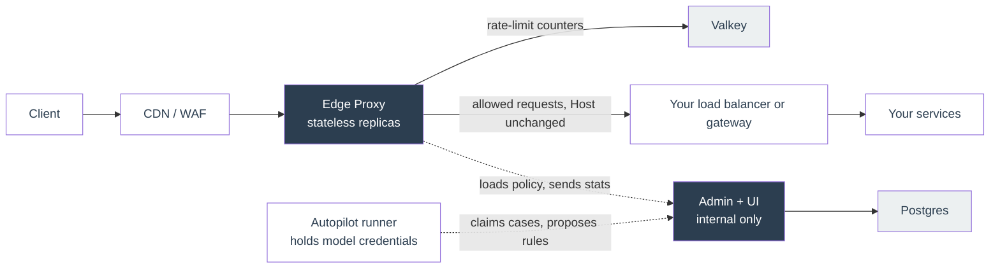
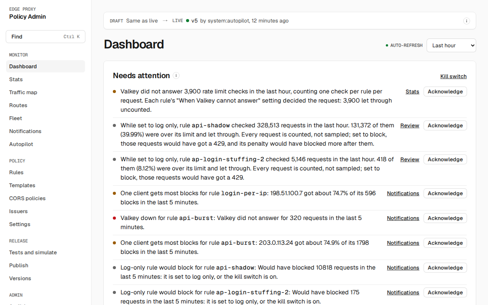
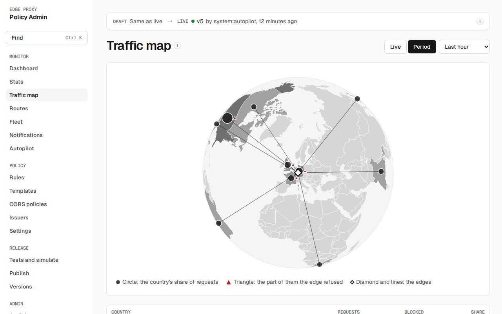
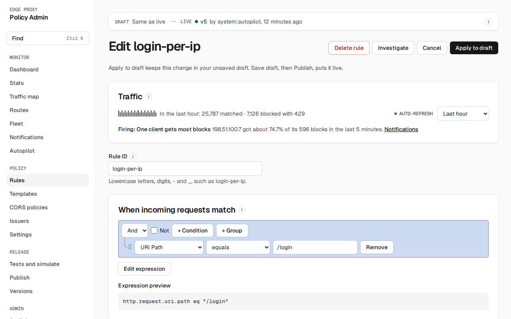
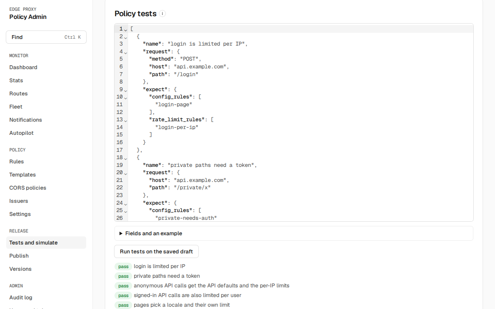
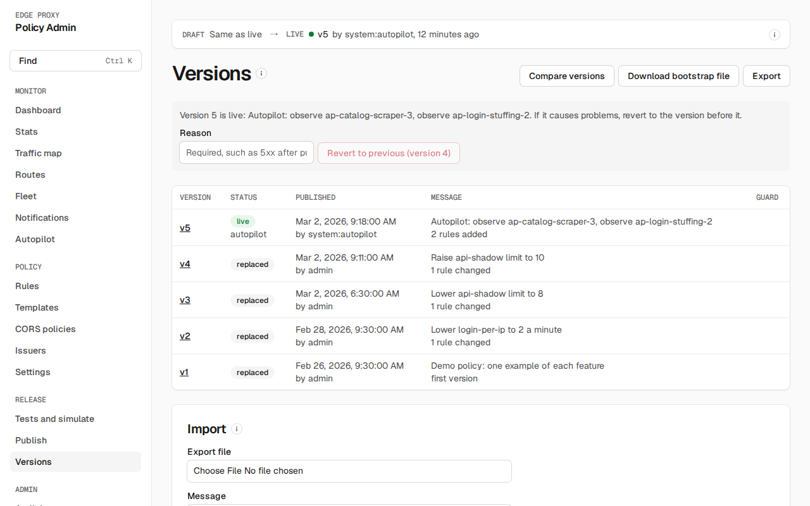
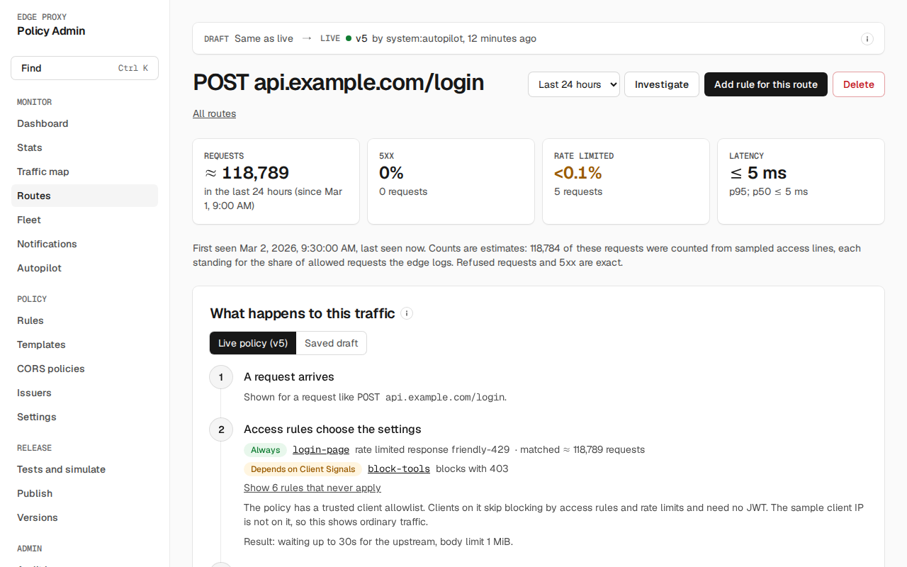
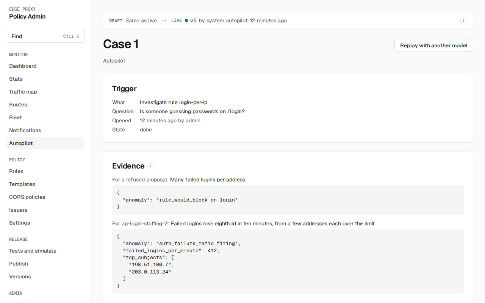
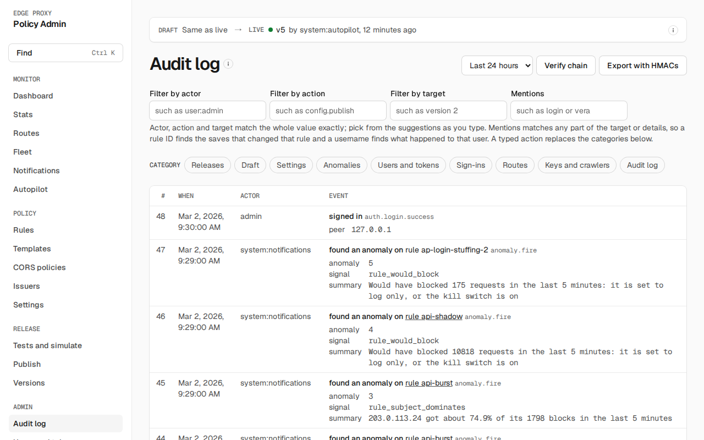
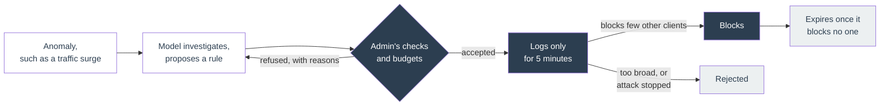

# Edge Proxy

One policy layer in front of all your services. Edge Proxy is a Go reverse proxy that sits behind your content delivery network (CDN) or web application firewall (WAF) and enforces rate limits, JSON Web Token (JWT) validation, cross-origin resource sharing (CORS) and header rules for every route, so each service doesn't build its own. You manage the policy in an admin UI, where every change is tested, versioned, optionally canaried and audited. During an attack, autopilot can add short-lived rate limits for you, within checks and budgets you set.



The edge never routes: it forwards every request it allows to one upstream, your load balancer or gateway. If admin, Postgres or the identity provider goes down, the edge keeps serving with the policy it already has. If Valkey goes down, each rate-limit rule lets traffic through, returns `503` or counts on each replica alone, as you choose.



The [Traffic map](docs/use/dashboard.md#traffic-map) shows where requests come from by the viewer's country, live or over a time range, with the share the edge refused and lines to where your edges are.



## What it does

| Capability | For example |
|---|---|
| Exact rate limits shared by every replica | "2 logins per minute per IP, then blocked for 1 minute", counted in one Valkey key |
| Limits keyed on who the user is | Per user or tenant ID, taken from a verified JWT claim |
| Rate limits added during an attack | A traffic surge opens an [autopilot](docs/use/autopilot.md) case; a model proposes a limit per IP on the route; admin checks it, runs it log-only for 5 minutes, then lets it block; it is renewed only while it still blocks someone |
| JWT validation | `/private/*` returns `401` without a valid token from your identity provider |
| CORS, header rules, locale detection | Add or strip headers per route; services reached only through the edge get edge headers clients can't forge |
| Templated responses | A branded HTML `429` page instead of a bare status |
| Safe changes | Validated on save; policy tests must pass to publish; canary to a share of traffic; automatic rollback when the new version raises 5xx rates or a changed rule blocks far more than expected |
| Audit | Every change is written to a tamper-evident log |

A rule is an expression plus an action. The `login-per-ip` rule from the demo, in short:

```text
match:  http.request.uri.path eq "/login"
limit:  2 per 1m, keyed on ip, sliding window, 1m penalty
```

## In the admin UI

<table>
<tr>
<td width="50%" valign="top"><a href="docs/use/dashboard.md#rules"></a><br><b>Rules</b>: build a match from conditions, see the expression it makes and how much traffic the rule matched and blocked.</td>
<td width="50%" valign="top"><a href="docs/use/dashboard.md#tests-and-simulate"></a><br><b>Tests and simulate</b>: policy tests run on the draft, and a publish needs them to pass.</td>
</tr>
<tr>
<td width="50%" valign="top"><a href="docs/use/dashboard.md#versions"></a><br><b>Versions</b>: every publish is a version with its author and changes; compare any two, or revert in one step.</td>
<td width="50%" valign="top"><a href="docs/use/dashboard.md#routes"></a><br><b>Routes</b>: every route the edges served, and what the policy does to its requests, step by step.</td>
</tr>
<tr>
<td width="50%" valign="top"><a href="docs/use/autopilot.md#reading-a-case"></a><br><b>Autopilot cases</b>: what started a case, the model's evidence and admin's checks on what it proposed.</td>
<td width="50%" valign="top"><a href="docs/use/dashboard.md#audit-log"></a><br><b>Audit log</b>: every change, who made it and when, in a tamper-evident chain you can verify and export.</td>
</tr>
</table>

## Autopilot

Autopilot adds a short-lived rate limit during an attack. A language model investigates and proposes a rule; admin checks it, runs it log-only first, and lets it block only when it would block few other clients.



A proposal like "20 `POST /login` per minute per IP, for 1 hour" passes. One that names an IP address, AS number or JWT claim value, is just `true`, fails closed or is keyed only on values the client chooses is refused. Each autopilot rule expires at most 24 hours ahead and is renewed only while it is still needed, up to 7 days by default; a blocking rule only while it still blocks someone. Setting `mode` to `off` removes them all in one publish, once no canary is running.

It needs the [autopilot runner](docs/deploy/autopilot.md), a separate process that holds your model provider credentials. You watch and steer it on the admin UI's **Autopilot** page: cases with the model's evidence and every check, live rules, settings, spend and the off switch. See [Autopilot](docs/use/autopilot.md).

## Is it for you?

Use it when your CDN's rate limits are too approximate, you need limits keyed on a verified user, or you want one policy model that doesn't change when your CDN or cloud does. See [why it exists](docs/index.md#why-it-exists) and the [comparison with CDN vendors](docs/vendor-comparison.md).

Don't use it as a WAF or CDN (no managed attack rules, bot scores or distributed denial-of-service (DDoS) absorption) or as a router. If approximate per-IP limits are all you need, your CDN alone is simpler.

## Why a custom proxy

Without a shared layer, every microservice builds and maintains its own rate limiter. Edge Proxy puts one in front of all of them. Rate limits in a CDN are counted per location, NGINX counts per server, and gateways such as Envoy, APISIX, Kong and Traefik each fall short somewhere: a fixed algorithm, one Redis call per limit, or blocked traffic when Redis is down. Edge Proxy counts each limit once across all replicas, sending the site-wide limits and up to 5 other limits a request matches to Valkey in one round trip, can limit by a verified JWT claim, and picks up rule changes within seconds. It also handles header rules, CORS, locale detection and templated error responses. See [Why a custom proxy](docs/why-custom-proxy.md).

## Try it in five minutes

Needs Docker with Compose v2 and `make`.

```bash
make demo
```

The demo sets `TRUSTED_PROXIES` to `0.0.0.0/0,::/0`, so it trusts any peer and `curl` can stand in for the CDN by sending CloudFront's viewer header. In a real deployment, list only the proxies directly in front of the edge ([edge settings](docs/deploy/edge.md#trust)).

Then hit the login limit through the edge:

```bash
for i in $(seq 1 5); do curl -s -o /dev/null -w '%{http_code}\n' -H 'Host: api.example.com' -H 'CloudFront-Viewer-Address: 203.0.113.9:443' http://127.0.0.1:8080/login; done | sort | uniq -c
```

You should see two `200`s and three `429`s. The admin UI is at `http://127.0.0.1:8081` (user `admin`, password `local-dev-login`). `make demo-down` removes everything.

[Get started](docs/get-started.md) continues from here: steady traffic, a Valkey outage, and publishing and reverting a change.

## Documentation

Full docs: https://chrisleekr.github.io/edge-proxy/

| You want to | Read |
|---|---|
| Write rules | [Policy](docs/use/policy.md), [Rate limiting](docs/use/rate-limiting.md), [Bot detection](docs/use/bots.md), [Expressions](docs/reference/expressions.md) |
| Let autopilot add rate limits during an attack | [Autopilot](docs/use/autopilot.md) |
| Ship a change safely | [Publish and roll back](docs/use/publishing.md) |
| Find your way around the admin UI | [Dashboard](docs/use/dashboard.md) |
| Run it in production | [Deploy](docs/deploy/index.md), [Kubernetes with Helm](docs/deploy/kubernetes.md), [Capacity planning](docs/deploy/capacity.md) |
| Keep it running | [Monitoring](docs/operate/monitoring.md), [Runbooks](docs/operate/runbooks.md) |
| Understand the internals | [Design](docs/design.md) |

## Develop

```bash
make test   # tests against real Valkey and Postgres, plus the 100% edge coverage gate
make ci     # every gate CI runs
```

`make` lists every target. See [Development](docs/build/development.md) for CI and releases.
