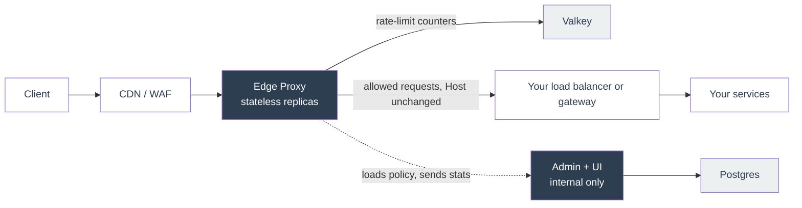
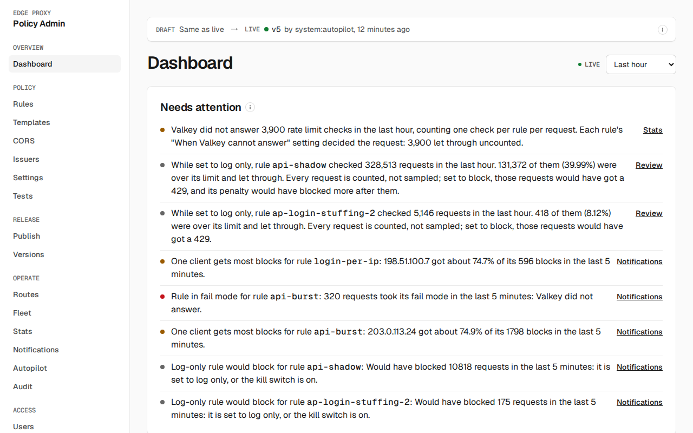

# Edge Proxy

One policy layer in front of all your services. Edge Proxy is a Go reverse proxy that sits behind your content delivery network (CDN) or web application firewall (WAF) and enforces rate limits, JSON Web Token (JWT) validation, cross-origin resource sharing (CORS) and header rules for every route, so each service doesn't build its own. You manage the policy in an admin UI, where every change is tested, versioned, optionally canaried and audited.



The edge never routes: it forwards every request it allows to one upstream, your load balancer or gateway. If admin, Postgres or the identity provider goes down, the edge keeps serving with the policy it already has. If Valkey goes down, each rate-limit rule lets traffic through, returns `503` or counts on each replica alone, as you choose.



## What it does

| Capability | For example |
|---|---|
| Exact rate limits shared by every replica | "2 logins per minute per IP, then blocked for 1 minute", counted in one Valkey key |
| Limits keyed on who the user is | Per user or tenant ID, taken from a verified JWT claim |
| JWT validation | `/private/*` returns `401` without a valid token from your identity provider |
| CORS, header rules, locale detection | Add or strip headers per route; services reached only through the edge get edge headers clients can't forge |
| Templated responses | A branded HTML `429` page instead of a bare status |
| Safe changes | Validated on save; config tests must pass to publish; canary to a share of traffic; automatic rollback when the new version raises 5xx rates or a changed rule blocks far more than expected |
| Audit | Every change is written to a tamper-evident log |

A rule is an expression plus an action. The `login-per-ip` rule from the demo, in short:

```text
match:  http.request.uri.path eq "/login"
limit:  2 per 1m, keyed on ip, sliding window, 1m penalty
```

## Is it for you?

Use it when your CDN's rate limits are too approximate, you need limits keyed on a verified user, or you want one policy model that doesn't change when your CDN or cloud does. See [why it exists](docs/index.md#why-it-exists) and the [comparison with CDN vendors](docs/vendor-comparison.md).

Don't use it as a WAF or CDN (no managed attack rules, bot detection or distributed denial-of-service (DDoS) absorption) or as a router. If approximate per-IP limits are all you need, your CDN alone is simpler.

## Why a custom proxy

Without a shared layer, every microservice builds and maintains its own rate limiter. Edge Proxy puts one in front of all of them. Rate limits in a CDN are counted per location, NGINX counts per server, and gateways such as Envoy, APISIX, Kong and Traefik each fall short somewhere: a fixed algorithm, one Redis call per limit, or blocked traffic when Redis is down. Edge Proxy counts each limit once across all replicas, sending the site-wide limits and up to 5 other limits a request matches to Valkey in one round trip, can limit by a verified JWT claim, and picks up rule changes within seconds. It also handles header rules, CORS, locale detection and templated error responses. See [Why a custom proxy](docs/why-custom-proxy.md).

## Try it in five minutes

Needs Docker with Compose v2 and `make`.

```bash
make demo
```

The demo sets `TRUSTED_PROXIES` to `0.0.0.0/0,::/0`, so it trusts any peer and `curl` can stand in for the CDN by sending CloudFront's viewer header. In a real deployment, list only the proxies directly in front of the edge ([edge settings](docs/deploy/edge.md#trust)).

Then hit the login limit through the edge:

```bash
for i in $(seq 1 5); do curl -s -o /dev/null -w '%{http_code}\n' -H 'Host: api.example.com' -H 'CloudFront-Viewer-Address: 203.0.113.9:443' http://127.0.0.1:8080/login; done | sort | uniq -c
```

You should see two `200`s and three `429`s. The admin UI is at `http://127.0.0.1:8081` (user `admin`, password `local-dev-login`). `make demo-down` removes everything.

[Get started](docs/get-started.md) continues from here: steady traffic, a Valkey outage, and publishing and reverting a change.

## Documentation

Full docs: https://chrisleekr.github.io/edge-proxy/

| You want to | Read |
|---|---|
| Write rules | [Policy](docs/use/policy.md), [Rate limiting](docs/use/rate-limiting.md), [Expressions](docs/reference/expressions.md) |
| Ship a change safely | [Publish and roll back](docs/use/publishing.md) |
| Find your way around the admin UI | [Dashboard](docs/use/dashboard.md) |
| Run it in production | [Deploy](docs/deploy/index.md), [Kubernetes with Helm](docs/deploy/kubernetes.md), [Capacity planning](docs/deploy/capacity.md) |
| Keep it running | [Monitoring](docs/operate/monitoring.md), [Runbooks](docs/operate/runbooks.md) |
| Understand the internals | [Design](docs/design.md) |

## Develop

```bash
make test   # tests against real Valkey and Postgres, plus the 100% edge coverage gate
make ci     # every gate CI runs
```

`make` lists every target. See [Development](docs/build/development.md) for CI and releases.
