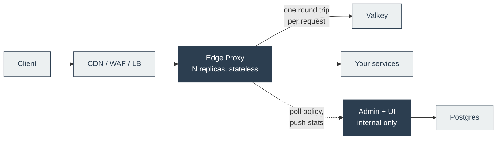

# Edge Proxy

A Go reverse proxy that sits behind your CDN, WAF or load balancer and enforces application policy for every route of every service in one layer.

**Documentation:** https://chrisleekr.github.io/edge-proxy/

## Why

Without a shared layer, every microservice builds its own rate limiter, JWT checks and CORS handling, each written, tested and fixed separately and each slightly different. Edge Proxy does it once, in front of all of them. Services receive only traffic that has already passed policy, and protecting a new route means adding a rule, not writing code.

A CDN or WAF could be that layer, but for application policy it falls short:

- **Rate limits are approximate.** Vendors count per POP, server or region. Here a limit of 5 means 5 across the whole fleet.
- **Limits on verified identity** (a user or tenant ID from a JWT) need custom edge code or an Enterprise add-on.
- **Rules are tied to one vendor.** Here the same policy runs behind any CDN or cloud.
- **Policy changes are hard to test and roll back.** Here every change is tested, versioned and can be canaried, with automatic rollback.

See [Compared with vendors](https://chrisleekr.github.io/edge-proxy/vendor-comparison/) for the details and sources.

## What it does

- **Rate limiting:** fixed window, sliding window, token bucket or leaky bucket, keyed on IP, verified JWT claims, headers, cookies and more. Counters live in Valkey, shared by every replica, with at most one Valkey round trip per request.
- **JWT validation** against several identity providers, chosen per route.
- **CORS**, including preflight answered at the edge.
- **Header rules:** set, append, remove, copy and rename. Client copies of edge-managed headers are always stripped.
- **Locale detection** from `Accept-Language`.
- **Templated JSON and HTML responses** for the errors the edge returns, per error kind and route.

Policy is written as rules (an expression plus an action) in an admin UI. Every change is validated, run against config tests, published as a version and recorded in a tamper-evident audit log. A publish can be canaried, and a guard rolls it back automatically if errors rise.

## How it fits



- **Two images:** `chrisleekr/edge-proxy` takes the traffic and scales horizontally; `chrisleekr/edge-proxy-admin` manages policy and stays on the internal network.
- **Traffic keeps flowing when a dependency fails.** Valkey, admin, Postgres and the identity provider each have a defined degraded mode, and an edge keeps serving with the last policy it loaded.
- **It is not a WAF or CDN.** No OWASP rules, bot detection, DDoS absorption or public TLS. Keep those in front.

## Try it

Needs Docker and `make`.

```bash
make demo
```

This starts one edge, admin, Postgres, Valkey, a mock upstream and a mock identity provider. Open the admin UI at http://127.0.0.1:8081 (user `loadtest`, password `load test password for local runs only`) and send traffic to the edge:

```bash
curl -i -H 'Host: api.example.com' -H 'CloudFront-Viewer-Address: 203.0.113.7:443' http://127.0.0.1:8080/hello
```

The [Get started](docs/get-started.md) guide walks through publishing a change. `make demo-down` removes everything.

## Develop

```bash
make test   # tests with real Valkey and Postgres, plus the 100% edge coverage gate
make ci     # every gate CI runs
```

See [Development](docs/build/development.md) for the full list, CI and releases, and [Design](docs/design.md) for how and why it is built this way.
