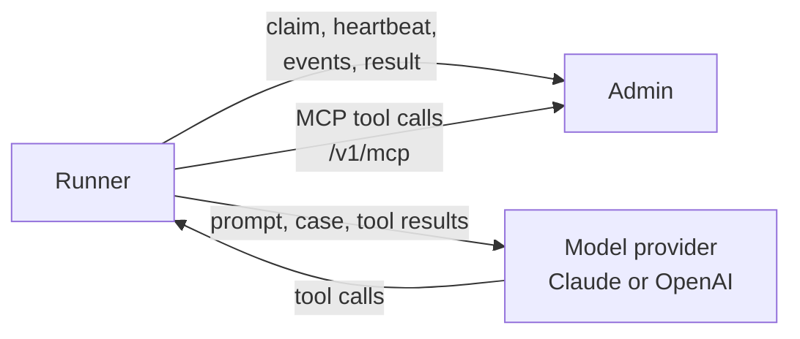

# Autopilot runner

The runner runs the model for [autopilot](../use/autopilot.md) cases. It long-polls admin for a case, runs it with the system prompt, output schema and model admin hands it, and reports the events and result back. The model's only tools are admin's [MCP tools](../reference/api.md#mcp-tools): no shell, files or web. It holds the model credentials, which never reach admin.



The runner is never on the request path: edges don't talk to it, and admin and the edges run the same without it. Without a runner nothing new is investigated (see [what runs where](../use/autopilot.md#what-runs-where)).

## Image

`chrisleekr/edge-proxy-autopilot`, released with the edge and admin images and tagged the same way (see [Deploy](index.md)). It is Node 26 on distroless, running as non-root (uid 65532), and runs its TypeScript with Node's [type stripping](https://nodejs.org/docs/latest-v26.x/api/typescript.html). Each platform's image holds the Claude Code binary for that platform only. It opens no port and has no health endpoint.

- **Read-only root filesystem:** supported. Give it a writable `/tmp`. Each run gets its own directory there, which is Claude Code's working, home and config directory for that run, and is deleted when the run ends.
- **Replicas:** one is enough. `AUTOPILOT_CONCURRENCY` runs more cases at once; more replicas share the same queue.
- **Start-up:** it exits 1 at start when a variable below is missing or out of range, and logs which one.

## Variables

| Variable | Default | Meaning |
|---|---|---|
| `AUTOPILOT_ADMIN_URL` | required | Admin's base URL, `http` or `https`, with no user, query or fragment, such as `http://admin:8081`. The runner calls `/v1/autopilot/*` and the model reaches `/v1/mcp` here |
| `AUTOPILOT_TOKEN_FILE` | required | File holding the runner token: the same token as admin's [`AUTOPILOT_TOKEN_FILE`](admin.md#variables), at least 32 characters |
| `CLAUDE_CODE_OAUTH_TOKEN` | none | Claude credential from `claude setup-token`. It draws on the Claude subscription of whoever made it, under that plan's terms: check they allow this use before you set it |
| `ANTHROPIC_API_KEY` | none | Claude API key from the Claude Console, billed to its organization |
| `OPENAI_API_KEY` | none | OpenAI API key. The Claude Code process never gets it |
| `AUTOPILOT_CONCURRENCY` | `1` | Cases run at once, 1 to 4 |
| `AUTOPILOT_CASE_TIMEOUT` | `10m` | The longest a run may take, 1s to 1h, as a number and one unit (`ms`, `s`, `m` or `h`), such as `90s`. A run past it is aborted and reported as `timeout` |
| `AUTOPILOT_MAX_TURNS` | `30` | Model turns a run may take, 1 to 100. A run that reaches it reports `error` with category `error_max_turns` |

At least one credential is required. `CLAUDE_CODE_OAUTH_TOKEN` or `ANTHROPIC_API_KEY` lets the runner take cases whose model is a Claude model, `OPENAI_API_KEY` the others ([which models go where](../use/autopilot.md#settings)). The runner tells admin only which providers it holds a credential for, as `claude` and `openai`. A case whose provider it lacks is refused by admin with a reason the runner logs, and the Autopilot page warns about it.

To reach admin over HTTPS signed by a private CA, mount the CA certificate and set `NODE_EXTRA_CA_CERTS` to its path. [Node](https://nodejs.org/api/cli.html#node_extra_ca_certsfile) reads it at start, and the runner passes it on to Claude Code, which [reads it too](https://code.claude.com/docs/en/network-config#custom-ca-certificates).

## What a run sends where

- **To the model provider:** admin's system prompt, the case and its brief, and every tool result the model reads. Tool results hold your stats, routes, rules and anomalies, what your Prometheus, Grafana and Datadog answered where [connectors](admin.md#connectors) are set, and values clients wrote (paths, hosts, user agents), which admin puts in fields named `untrusted`. Your provider's data terms apply to all of it. OpenAI runs set [`store: false`](https://platform.openai.com/docs/api-reference/responses/create), which asks OpenAI not to store the responses.
- **To admin:** the run's events (`init`, `assistant_text`, `tool_use`, `tool_result`, `permission_denied`, `result` and `verdict`), its token counts, the provider's cost estimate (Claude only; OpenAI reports none), and the size and SHA-256 of the run's transcript, the JSON lines of every event. A `tool_result` event holds only the size of the tool's answer: admin records each MCP call it handles itself, with its answer or refusal. The transcript itself is not kept. An event over 64 KiB is sent as its size and SHA-256, and only the first 500 events of a run are sent. Admin then marks the run's telemetry incomplete.
- **Nothing else:** Claude Code runs with `CLAUDE_CODE_DISABLE_NONESSENTIAL_TRAFFIC=1`, which turns off its optional [operational telemetry](https://code.claude.com/docs/en/network-config#network-access-requirements), and with auto memory off and no settings, `CLAUDE.md` or MCP servers from disk. The OpenAI Agents SDK's tracing is turned off. The runner keeps no session on disk.

If the Claude credential belongs to a Team or Enterprise organization with [server-managed settings](https://code.claude.com/docs/en/server-managed-settings), Claude Code applies those settings to the run: an empty `settingSources` stops only settings files on disk. A call to a tool outside admin's tools is still refused by `allowedTools` and the `dontAsk` permission mode, unless those settings allow it.

The runner logs JSON lines on stdout: start and stop, each run's start and end with its status, and each failed call to admin with admin's reason. It never logs the runner token or a credential.

The runner token reaches Claude Code in its MCP server settings, so it is in that process's arguments inside the container: anything that can list the container's processes can read it. Run nothing else in the container.

## Network

The runner needs to reach:

| Host | For |
|---|---|
| `AUTOPILOT_ADMIN_URL` | Claims, heartbeats, events, results and MCP tool calls |
| `api.anthropic.com` | Claude runs. With `CLAUDE_CODE_OAUTH_TOKEN`, also `platform.claude.com`, which [handles OAuth tokens](https://code.claude.com/docs/en/network-config#network-access-requirements) |
| `api.openai.com` | OpenAI runs |

## Sizing

Plan 1 CPU and 1 GiB of memory per run for Claude, the [Agent SDK's starting point](https://code.claude.com/docs/en/agent-sdk/hosting#resources) per agent, so set the container's limits to that times `AUTOPILOT_CONCURRENCY`. OpenAI runs need no Claude Code process.

Admin answers at most 4 MCP calls at once for the runner token on each admin replica, each for up to 5 seconds, or 10 for a connector call. Every run of every runner shares that token, so with several runs at once a call can be refused for being over the limit; the model gets the refusal as that tool's answer.

## Shutdown

On SIGTERM or SIGINT the runner stops claiming, aborts every run in progress and reports each as `error` with category `shutdown`, so admin queues the case again once. Then it exits 0. If that takes over 10 seconds it exits 1. Give it a termination grace period of at least 15 seconds.

## When something fails

| Failure | What the runner does |
|---|---|
| Admin unreachable or answering 5xx | Retries the claim after 1 second, doubling to at most 60 seconds, with up to 1 second of jitter. A run in progress carries on; its events and result are each tried once |
| Admin refuses the claim, such as a case whose provider it has no credential for (409) | Logs admin's reason and keeps claiming, with the same backoff |
| The lease lapsed: a heartbeat answered 409, for example after admin was unreachable for 10 minutes | Aborts the run and drops it without a result. Admin has already queued the case again |
| The model provider fails, or the model's answer doesn't match the output schema | Reports `error` with category `error_max_turns` or another Claude result subtype, `api_error` (Claude reported an API error), `refusal` (the OpenAI model refused), `exception`, or `invalid_output` (the final answer isn't JSON or doesn't match the schema). Admin queues the case again once, then fails it |
| The run passes `AUTOPILOT_CASE_TIMEOUT` | Aborts it and reports `timeout` |
| Admin refuses a batch of events (over its 1,000 events or 4 MiB a run, which its own record of each MCP call counts toward) | Stops sending that run's events; the result still goes |

## Run it

With Docker, beside an admin that has `AUTOPILOT_TOKEN_FILE` set:

```bash
docker run -d --read-only --tmpfs /tmp \
  -e AUTOPILOT_ADMIN_URL=http://admin:8081 \
  -e AUTOPILOT_TOKEN_FILE=/run/secrets/autopilot-token \
  -e ANTHROPIC_API_KEY \
  -v /etc/edge-proxy/autopilot-token:/run/secrets/autopilot-token:ro \
  chrisleekr/edge-proxy-autopilot
```

In the local demo, start `make demo`, export a credential, then run `make demo-autopilot`. The runner joins the demo with its own token, and **Autopilot** in admin shows it connected.
