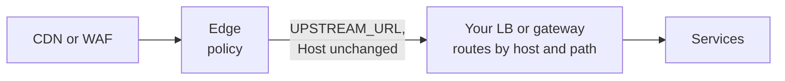
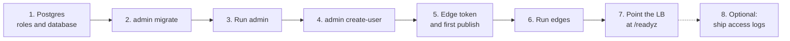

# Deploy

Three images, three deployables:

| Image | Runs | Scale |
|---|---|---|
| `chrisleekr/edge-proxy` | The proxy. Public traffic arrives from your CDN or load balancer | Horizontally, at least 2 replicas across zones |
| `chrisleekr/edge-proxy-admin` | Admin API and UI, background jobs | 1 or 2 replicas, internal network only |
| `chrisleekr/edge-proxy-autopilot` | Optional. The [autopilot runner](autopilot.md): runs the model for autopilot cases, holding the model credentials | 1 replica, internal network only; it talks only to admin and the model provider |

The edge goes between your CDN and the load balancer or gateway that already routes your services. It forwards every request there with `Host` unchanged, so routing stays where it is and the edge knows only that one address (`UPSTREAM_URL`):



On Kubernetes, the Helm chart performs every step below for you: see [Kubernetes with Helm](kubernetes.md).

The edge and admin are static Go binaries on distroless, and the runner is Node on distroless. All run as non-root (uid 65532), configured only by environment variables. A GitHub release pushes all three to Docker Hub, tagged with its version (`1.2.3`) and `latest`, for amd64 and arm64. GitLab CI pushes only a rolling amd64 `latest` from `main`, to the GitLab project's own registry. See [Development](../build/development.md#release) for how they are built.

## Requirements

| Dependency | Used by | Notes |
|---|---|---|
| CDN, WAF or load balancer in front | edge | Must set a client-IP header the edge can trust: CloudFront, Cloudflare, a named header, or `X-Forwarded-For` |
| Load balancer or gateway behind | edge | `UPSTREAM_URL`. It routes each host and path to a service. Over HTTPS it must present a certificate for every host it serves, because the edge names the request's host in TLS |
| Valkey, standalone or cluster (tested with 9.1) | edge | Rate-limit state only. No persistence needed; every key has a TTL. A cluster must set `cluster-require-full-coverage no`: with the default `yes`, one failed primary makes [every node refuse every key](https://github.com/valkey-io/valkey/blob/unstable/valkey.conf), while the edge's per-node breaker can only contain a failure that stays on that node's keys |
| Postgres (tested with 18.6) | admin | Source of truth for policy, versions, users, stats and audit |
| HTTPS in front of admin | admin | The session cookie is `Secure`; browsers allow it over plain HTTP only on `localhost` |

The images don't set `GOMEMLIMIT`. Under a container memory limit, set it to about 90% of the limit (for 256 MiB, `GOMEMLIMIT=230MiB`), so the Go garbage collector [works harder before the container is killed](https://go.dev/doc/gc-guide#Memory_limit). The Helm chart sets it for both deployables. Go [takes `GOMAXPROCS` from the container's CPU limit](https://go.dev/doc/go1.25#container-aware-gomaxprocs), or uses every host CPU without one. Admin runs that many sign-in hashes at once (at least 2), 19 MiB each, so without a CPU limit set `GOMAXPROCS` on admin low enough to fit its memory limit; the chart sets `2`.

## Install



### 1. Postgres

Create an owner role for migrations and a runtime role for admin:

```sql
CREATE ROLE edge_owner LOGIN PASSWORD '...';
CREATE ROLE edge_app LOGIN PASSWORD '...';
CREATE DATABASE edge_admin OWNER edge_owner;
REVOKE ALL ON DATABASE edge_admin FROM PUBLIC;
GRANT CONNECT ON DATABASE edge_admin TO edge_app;
```

The runtime role gets only what it needs. It can insert audit rows but never update or delete them.

### 2. Migrate

Run on install and before every upgrade. It is safe to run concurrently.

```bash
docker run --rm \
  -e MIGRATION_DATABASE_URL=postgres://edge_owner:...@db/edge_admin \
  -e DB_RUNTIME_ROLE=edge_app \
  chrisleekr/edge-proxy-admin migrate
```

### 3. Run admin

Put the variables from [Admin settings](admin.md) in `admin.env`. The minimum:

```bash
DATABASE_URL=postgres://edge_app:...@db/edge_admin
AUDIT_HMAC_KEY_ID=2026-10
# openssl rand -base64 32; keep it outside Postgres
AUDIT_HMAC_KEY=...
CLIENT_IP_SOURCE=cloudfront
```

Admin needs the edge's `CLIENT_IP_SOURCE`, and `VIEWER_HEADERS`, `ALLOW_REGEX` or `INGRESS_SECRET_HEADER` if you set them, with the same values, so it validates policy against the deployment edges really have. Then start it:

```bash
# Loopback only: the HTTPS proxy on this host is admin's only way in.
docker run -d --env-file admin.env -p 127.0.0.1:8081:8081 chrisleekr/edge-proxy-admin
```

It listens on `:8081` for the API and UI, and on `:9091` for `/metrics`, which has no authentication: let only your metrics scraper reach `:9091`, and never publish it. Docker [publishes ports on all interfaces](https://docs.docker.com/engine/network/port-publishing/) unless given an address, hence `127.0.0.1`; if the proxy runs in a container, put both on a private Docker network and publish no port instead. Put it behind an internal HTTPS proxy that appends `X-Forwarded-For`, and set `ADMIN_TRUSTED_PROXIES` to that proxy's addresses so login throttling sees each client rather than the proxy.

### 4. First admin user

`create-user` reads the password from the first line of stdin and needs the same `admin.env` as the server:

```bash
printf '%s\n' "$PASSWORD" | docker run --rm -i --env-file admin.env chrisleekr/edge-proxy-admin create-user alice admin
```

Or add `BOOTSTRAP_ADMIN_USERNAME` and `BOOTSTRAP_ADMIN_PASSWORD_FILE` to `admin.env` before step 3, and admin creates the user when it starts with no users in the database (see [Admin settings](admin.md#variables)). Nothing happens once any user exists.

### 5. Edge token and first publish

1. Sign in, open **Users**, and create a token of kind **edge**. Store it as a secret.
2. Save the starter draft with **Save draft** in the bar at the top, then publish it from **Publish**. Until something is published, edges have nothing to load and stay not ready.

For an automated install, skip both: give admin and the edges the same `EDGE_SERVICE_TOKEN_FILE`, and set `BOOTSTRAP_PUBLISH_DEFAULT=true` on admin, which publishes the starter policy (no rules, a per-IP backstop of 100 requests a second) at first start. See [Admin settings](admin.md#variables).

### 6. Run edges

Set the variables in [Edge settings](edge.md). The minimum:

```bash
CLIENT_IP_SOURCE=cloudfront
TRUSTED_PROXIES=10.0.0.0/8          # the hop directly in front of the edge, never 0.0.0.0/0
UPSTREAM_URL=https://internal-lb.example.internal   # the LB or gateway that routes your services
ADMIN_URL=https://admin.internal
EDGE_SERVICE_TOKEN_FILE=/run/secrets/edge-token
VALKEY_URL=rediss://valkey.internal:6379
SNAPSHOT_CACHE_PATH=/var/cache/edge/snapshot.json
```

Ports: `:8080` for traffic, `:9090` for `/livez`, `/readyz` and `/metrics`. Never expose `:9090` publicly.

### 7. Load balancer

| Setting | Value |
|---|---|
| Readiness / target health check | `GET :9090/readyz`. It is 200 once a policy is loaded and the edge isn't draining. It never reflects Valkey, admin or IdP health, so an outage of those can't take edges out of rotation |
| Liveness | `GET :9090/livez` |
| Idle timeout | Below the edge's `IDLE_TIMEOUT` (75s) |
| Termination grace period | More than `DRAIN_DELAY` + `SHUTDOWN_TIMEOUT` (10s + 30s by default), plus `TRACE_SHUTDOWN_TIMEOUT` (5s) with tracing on |

On SIGTERM the edge fails `/readyz`, waits `DRAIN_DELAY` for the load balancer to notice, then finishes in-flight requests for up to `SHUTDOWN_TIMEOUT`. With tracing on, it then flushes buffered spans for up to `TRACE_SHUTDOWN_TIMEOUT`.

### 8. Ship edge access logs to admin (optional)

**Routes** in admin is built from the edges' access logs; without a shipper it stays empty. Any log shipper works (the demo uses [Vector](https://vector.dev/)):

1. Put a token of at least 32 characters in a file and set `LOG_INGEST_TOKEN_FILE` on admin. It must differ from the `EDGE_SERVICE_TOKEN_FILE` token, or admin refuses to start.
2. Keep the edge's JSON lines whose `msg` is `access`.
3. `POST` them to admin's `/v1/logs/access` as newline-delimited JSON, with `Authorization: Bearer <token>`, in bodies of at most 4 MiB.
4. Retry on `429`: admin answers it while busy, and counts nothing from a refused body.

## Where an edge gets its policy

At start the edge tries, in order: admin, then `SNAPSHOT_CACHE_PATH` (written whenever a new policy arrives from admin), then `BOOTSTRAP_PATH`. It serves the first one that validates. While running it keeps the policy it has if admin is unreachable.

For an edge that must start while admin is down (a new zone, a cold start), ship a bootstrap file. Export one from admin (**Versions → Download bootstrap file**, or the API below) and refresh it at least weekly: files older than `BOOTSTRAP_MAX_AGE` (7 days) are refused unless `BOOTSTRAP_ALLOW_STALE=true`.

```bash
curl -s -H "Authorization: Bearer $TOKEN" https://admin.internal/api/export | jq .envelope > bootstrap.json
```

The token needs `config.read`.

## Platform notes

### AWS

CloudFront → internal ALB → edge tasks → `UPSTREAM_URL`, with AWS WAF on CloudFront.

- `CLIENT_IP_SOURCE=cloudfront` and `TRUSTED_PROXIES` set to the ALB's subnets: the ALB, not CloudFront, is the edge's TCP peer.
- CloudFront sends `CloudFront-Viewer-Address` and the other viewer headers only when an [origin request policy](https://docs.aws.amazon.com/AmazonCloudFront/latest/DeveloperGuide/adding-cloudfront-headers.html) includes them. `CloudFront-Viewer-Address` and `CloudFront-Viewer-ASN` can't go in a cache policy. Without `CloudFront-Viewer-Address`, the edge answers every request with 400.
- The ALB's [idle timeout defaults to 60 seconds](https://docs.aws.amazon.com/elasticloadbalancing/latest/application/edit-load-balancer-attributes.html#connection-idle-timeout), below the edge's `IDLE_TIMEOUT` of 75 seconds. Keep it below.
- On Fargate, a container's [`stopTimeout`](https://docs.aws.amazon.com/AmazonECS/latest/APIReference/API_ContainerDefinition.html) defaults to 30 seconds, at most 120. The edge's defaults need 40 (`DRAIN_DELAY` 10s + `SHUTDOWN_TIMEOUT` 30s), or 45 with tracing on (`TRACE_SHUTDOWN_TIMEOUT` 5s), so set `stopTimeout` above that, such as 50, or lower the settings to fit.
- ElastiCache for Valkey in cluster mode already defaults [`cluster-require-full-coverage` to `no`](https://docs.aws.amazon.com/AmazonElastiCache/latest/dg/ParameterGroups.Engine.html).

### Cloudflare

Cloudflare → origin load balancer → edge.

- `CLIENT_IP_SOURCE=cloudflare` and `TRUSTED_PROXIES` set to the load balancer's addresses.
- Make the origin accept only your Cloudflare zone, not just Cloudflare. Cloudflare's IP ranges are shared by every Cloudflare customer, and a Worker sending a request to a host outside Cloudflare controls `CF-Connecting-IP` ([Cloudflare HTTP headers](https://developers.cloudflare.com/fundamentals/reference/http-headers/)), so an IP allowlist alone lets anyone pick the client IP the edge believes. Use Cloudflare Tunnel, Authenticated Origin Pulls with your own certificate (Cloudflare's shared certificate "only guarantees that a request is coming from the Cloudflare network", [Protect your origin server](https://developers.cloudflare.com/fundamentals/security/protect-your-origin-server/)), or `INGRESS_SECRET_HEADER` with a secret your zone adds.
- With Cloudflare Tunnel, `cloudflared` connects to the edge itself, so its addresses go in `TRUSTED_PROXIES`; see [Kubernetes with Helm](kubernetes.md#send-traffic-through-the-edge).

## Production checklist

- [ ] `TRUSTED_PROXIES` lists only the hop directly in front of the edge, plus the proxies before it with `xff` (see [Client IP presets](edge.md#client-ip-presets)), and the edge is reachable only through it.
- [ ] `INGRESS_SECRET_HEADER` and `INGRESS_SECRET_VALUES`, so only your CDN can reach the edge. Required when the hop in front of the edge accepts a shared CDN's IP ranges (no tunnel or origin pulls with your own certificate); recommended otherwise.
- [ ] At least 2 edge replicas across zones, with headroom to lose a zone. Set `EXPECTED_REPLICAS` if any rule uses `fail_mode: local`.
- [ ] Edges can start while admin is down: `SNAPSHOT_CACHE_PATH` is on storage that survives a restart, and a scheduled job refreshes `BOOTSTRAP_PATH` with the export command above well inside `BOOTSTRAP_MAX_AGE`, for example daily. Without both, a long admin outage blocks scale-out and rolling restarts.
- [ ] `UPSTREAM_URL` is the load balancer or gateway that routes your services, and over HTTPS it presents a certificate for every public host.
- [ ] `MAX_INFLIGHT` and `MAX_STREAMS` cover your peak requests and open WebSocket and SSE streams.
- [ ] Admin is reachable only from your internal network, behind HTTPS.
- [ ] The audit HMAC key is stored outside Postgres, and its ID is recorded.
- [ ] Alerts are set up from [Monitoring](../operate/monitoring.md).
- [ ] Sized from your own numbers with [Capacity planning](capacity.md); load-test thresholds default to p99 under 50 ms until you set them.
