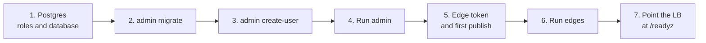

# Deploy

Two images, two deployables:

| Image | Runs | Scale |
|---|---|---|
| `chrisleekr/edge-proxy` | The proxy. Public traffic arrives from your CDN or load balancer | Horizontally, at least 2 replicas across zones |
| `chrisleekr/edge-proxy-admin` | Admin API and UI, background jobs | 1 or 2 replicas, internal network only |

Both are static Go binaries on distroless, running as non-root (uid 65532), configured only by environment variables. Tags follow releases (`1.2.3`, `latest`); see [Development](../build/development.md#release) for how they are built.

## Requirements

| Dependency | Used by | Notes |
|---|---|---|
| CDN, WAF or load balancer in front | edge | Must set a client-IP header the edge can trust: CloudFront, Cloudflare, a named header, or `X-Forwarded-For` |
| Valkey, standalone or cluster (tested with 9.1) | edge | Rate-limit state only. No persistence needed; every key has a TTL |
| Postgres (tested with 18.6) | admin | Source of truth for policy, versions, users, stats and audit |
| HTTPS in front of admin | admin | The session cookie is `Secure`; browsers allow it over plain HTTP only on `localhost` |

## Install



### 1. Postgres

Create an owner role for migrations and a runtime role for admin:

```sql
CREATE ROLE edge_owner LOGIN PASSWORD '...';
CREATE ROLE edge_app LOGIN PASSWORD '...';
CREATE DATABASE edge_admin OWNER edge_owner;
REVOKE ALL ON DATABASE edge_admin FROM PUBLIC;
GRANT CONNECT ON DATABASE edge_admin TO edge_app;
```

The runtime role gets only what it needs. It can insert audit rows but never update or delete them.

### 2. Migrate

Run on install and before every upgrade. It is safe to run concurrently.

```bash
docker run --rm \
  -e MIGRATION_DATABASE_URL=postgres://edge_owner:...@db/edge_admin \
  -e DB_RUNTIME_ROLE=edge_app \
  chrisleekr/edge-proxy-admin migrate
```

### 3. First admin user

`create-user` reads the password from the first line of stdin and needs the same environment as the server (step 4):

```bash
printf '%s\n' "$PASSWORD" | docker run --rm -i --env-file admin.env chrisleekr/edge-proxy-admin create-user alice admin
```

### 4. Run admin

Set the variables in [Admin settings](admin.md). The minimum:

```bash
DATABASE_URL=postgres://edge_app:...@db/edge_admin
AUDIT_HMAC_KEY_ID=2026-10
AUDIT_HMAC_KEY=...        # openssl rand -base64 32; keep it outside Postgres
CLIENT_IP_SOURCE=cloudfront
TRUSTED_PROXIES=10.0.0.0/8
UPSTREAMS=app=http://app.internal:8080
UPSTREAM_HOSTS=api.example.com=app
```

Admin needs the edge's deployment settings (`CLIENT_IP_SOURCE`, `TRUSTED_PROXIES`, `UPSTREAMS`, `UPSTREAM_HOSTS`, and `VIEWER_HEADERS`, `ALLOW_REGEX` or `INGRESS_SECRET_HEADER` if you set them) with the same values, so it validates policy against the deployment edges really have. It listens on `:8081`. Put it behind an internal HTTPS proxy that appends `X-Forwarded-For`, and set `ADMIN_TRUSTED_PROXIES` to that proxy's addresses so login throttling sees each client rather than the proxy.

### 5. Edge token and first publish

1. Sign in, open **Users**, and create a token of kind **edge**. Store it as a secret.
2. Save the starter draft (make any edit, then **Save draft**), then publish it from **Publish**. Until something is published, edges have nothing to load and stay not ready.

### 6. Run edges

Set the variables in [Edge settings](edge.md). The minimum:

```bash
CLIENT_IP_SOURCE=cloudfront
TRUSTED_PROXIES=10.0.0.0/8          # your CDN or LB addresses, never 0.0.0.0/0
UPSTREAMS=app=http://app.internal:8080
UPSTREAM_HOSTS=api.example.com=app
ADMIN_URL=https://admin.internal
EDGE_SERVICE_TOKEN_FILE=/run/secrets/edge-token
VALKEY_URL=rediss://valkey.internal:6379
SNAPSHOT_CACHE_PATH=/var/cache/edge/snapshot.json
```

Ports: `:8080` for traffic, `:9090` for `/livez`, `/readyz` and `/metrics`. Never expose `:9090` publicly.

### 7. Load balancer

| Setting | Value |
|---|---|
| Readiness / target health check | `GET :9090/readyz`. It is 200 once a policy is loaded and the edge isn't draining. It never reflects Valkey, admin or IdP health, so an outage of those can't take edges out of rotation |
| Liveness | `GET :9090/livez` |
| Idle timeout | Below the edge's `IDLE_TIMEOUT` (75s) |
| Termination grace period | More than `DRAIN_DELAY` + `SHUTDOWN_TIMEOUT` (10s + 30s by default) |

On SIGTERM the edge fails `/readyz`, waits `DRAIN_DELAY` for the load balancer to notice, then finishes in-flight requests for up to `SHUTDOWN_TIMEOUT`.

## Where an edge gets its policy

At start the edge tries, in order: admin, then `SNAPSHOT_CACHE_PATH` (written whenever a new policy arrives from admin), then `BOOTSTRAP_PATH`. It serves the first one that validates. While running it keeps the policy it has if admin is unreachable.

For an edge that must start while admin is down (a new zone, a cold start), ship a bootstrap file. Export one from admin and refresh it at least weekly: files older than `BOOTSTRAP_MAX_AGE` (7 days) are refused unless `BOOTSTRAP_ALLOW_STALE=true`.

```bash
curl -s -H "Authorization: Bearer $TOKEN" https://admin.internal/api/export | jq .envelope > bootstrap.json
```

The token needs `config.read`.

## Production checklist

- [ ] `TRUSTED_PROXIES` lists only your CDN or LB ranges, and the edge is reachable only through them.
- [ ] Optional but recommended: `INGRESS_SECRET_HEADER` and `INGRESS_SECRET_VALUES`, so only your CDN can reach the edge.
- [ ] At least 2 edge replicas across zones, with headroom to lose a zone. Set `EXPECTED_REPLICAS` if any rule uses `fail_mode: local`.
- [ ] `MAX_UPSTREAM_INFLIGHT` covers your peak WebSocket and SSE streams too: an open stream holds a slot.
- [ ] Admin is reachable only from your internal network, behind HTTPS.
- [ ] The audit HMAC key is stored outside Postgres, and its ID is recorded.
- [ ] Alerts are set up from [Monitoring](../operate/monitoring.md).
- [ ] Sized from your own numbers with [Capacity planning](capacity.md); load-test thresholds default to p99 under 50 ms until you set them.
