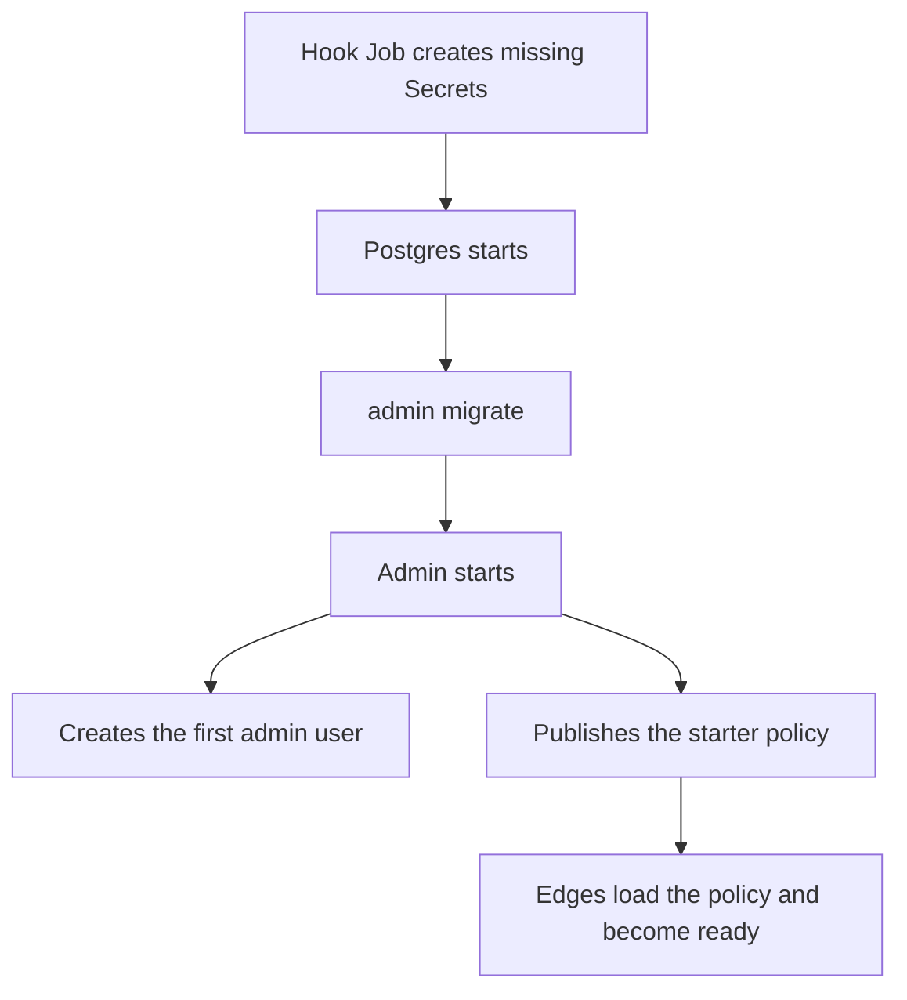
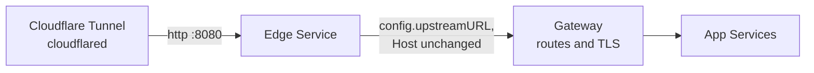

# Kubernetes with Helm

The [edge-proxy Helm chart](https://github.com/chrisleekr/helm-charts/tree/main/charts/edge-proxy) runs the edge and admin, and can bundle Postgres (through the CloudNativePG operator) and Valkey. With its defaults a fresh install needs no manual step: the chart generates every secret, admin creates the first admin user and publishes a starter policy, and the edges load that policy and become ready.

This page covers the chart. The variables it sets are described in [Edge settings](edge.md) and [Admin settings](admin.md), and the steps it automates in [Deploy](index.md).

## Requirements

| Dependency | Needed for |
|---|---|
| Kubernetes 1.27 or later, Helm 3 | Everything |
| [CloudNativePG operator](https://cloudnative-pg.io/docs/1.30/) | `postgres.cnpg.enabled`. Otherwise bring your own Postgres as in [Deploy](index.md#1-postgres) |
| A gateway or ingress with HTTPS | Reaching admin from a browser outside the cluster. The session cookie is `Secure` |

## Install

A values file for a cluster behind Cloudflare, with the bundled Postgres and Valkey:

```yaml
config:
  clientIPSource: cloudflare
  # The addresses cloudflared pods connect from, never 0.0.0.0/0.
  trustedProxies: 10.0.0.0/8
  # The gateway that routes your apps; every request goes here.
  upstreamURL: https://public-gateway.gateway-system.svc.cluster.local:443

# trustedProxies above is the whole pod range, so any pod could set its own
# client IP. Admit only cloudflared to the edge. Off by default.
networkPolicy:
  enabled: true
  edgeFrom:
    - namespaceSelector:
        matchLabels:
          kubernetes.io/metadata.name: cloudflare-tunnel
      podSelector:
        matchLabels:
          pod: cloudflared

edge:
  image:
    # In production pin a release and its digest: <version>@sha256:<digest>.
    tag: latest
admin:
  image:
    tag: latest

postgres:
  cnpg:
    enabled: true
valkey:
  enabled: true
```

Two settings in this example matter for safety:

- **NetworkPolicy.** The edge trusts the client-IP header from any peer inside `config.trustedProxies`. A pod range is wide, so without `networkPolicy.enabled` any pod in the cluster can reach the edge and choose its own client IP, which defeats per-IP limits. The chart refuses to render with `networkPolicy.enabled` and an empty `edgeFrom`. Turning it on also limits the edge's `:9090` port to `networkPolicy.metricsFrom` (empty admits nothing, so add Prometheus there if it scrapes `/metrics`). It limits admin's API port to the edges, the log shipper and `networkPolicy.adminFrom`. Chart 0.7.0 and later also limits admin's internal port `:9091`, which serves `/metrics` with no authentication, to `metricsFrom` only; `adminFrom` does not reach it.
- **Image tags.** Pin both tags to a digest (`<tag>@sha256:...`) in production, so every node runs the same build. `latest` moves with each release.

The edge-proxy chart is not yet published to the chart repository, so install it from a checkout:

```bash
git clone https://github.com/chrisleekr/helm-charts
helm dependency update helm-charts/charts/edge-proxy
helm install edge-proxy helm-charts/charts/edge-proxy --namespace edge-proxy --create-namespace -f values.yaml
```

The image repositories default to `chrisleekr/edge-proxy` and `chrisleekr/edge-proxy-admin` on Docker Hub, and the tags to the chart's `appVersion`. While that is the `0.0.0` placeholder, the render fails until `edge.image.tag` and `admin.image.tag` are set. A GitHub release pushes them to Docker Hub tagged with its version and `latest`, for amd64 and arm64. GitLab CI pushes only a rolling amd64 `latest` from `main`, to the GitLab project's own registry; to use it, set both `image.repository` values to that registry's `edge-proxy` and `edge-proxy-admin` images.

## Policy while admin is down

The chart sets `SNAPSHOT_CACHE_PATH` to a file on an `emptyDir` volume. An `emptyDir` [survives container restarts but not the pod](https://kubernetes.io/docs/concepts/storage/volumes/#emptydir), so a restarted edge container serves its last policy while admin is down, but a new pod (a rollout, a rescheduled pod, a scale-out) starts with an empty cache.

The chart sets no `BOOTSTRAP_PATH`, and its install notes say so. Without it, a new edge pod created while admin is down stays not ready until admin returns. To let it start, mount a bootstrap file exported from admin ([Where an edge gets its policy](index.md#where-an-edge-gets-its-policy)) and refresh it well inside `BOOTSTRAP_MAX_AGE` (7 days), for example daily:

```bash
curl -s -H "Authorization: Bearer $TOKEN" https://admin.internal/api/export | jq .envelope > bootstrap.json
kubectl --namespace edge-proxy create configmap edge-proxy-bootstrap --from-file=bootstrap.json \
  --dry-run=client -o yaml | kubectl apply -f -
```

```yaml
edge:
  env:
    # Maps merge, so the chart's GOMEMLIMIT stays.
    BOOTSTRAP_PATH: /etc/edge-proxy/bootstrap/bootstrap.json
  extraVolumes:
    - name: bootstrap
      configMap:
        name: edge-proxy-bootstrap
  extraVolumeMounts:
    - name: bootstrap
      mountPath: /etc/edge-proxy/bootstrap
      readOnly: true
```

A ConfigMap holds at most 1 MiB. The edge reads the file only at start.

## What the first install does



1. A `pre-install,pre-upgrade` hook Job creates the Secrets below if they do not exist. Its Role can create Secrets but cannot read them.
2. The CloudNativePG `Cluster` starts. Admin's init container runs `admin migrate` as the owner role.
3. Admin starts as the runtime role. While its database has no users, it creates `bootstrap.adminUsername` (`admin`). While nothing has been published, it publishes the starter policy: no rules, every request forwarded to `config.upstreamURL` with `Host` unchanged, and a per-IP backstop of 100 requests a second (burst 200).
4. Each edge fetches the policy with the generated edge token and turns ready.
5. The log shipper starts posting the edges' access logs to admin, which builds **Routes** from them.

Every step is skipped when its result already exists, so upgrades and restarts change nothing.

## Sign in

Read the generated password:

```bash
kubectl --namespace edge-proxy get secret edge-proxy-admin-generated -o jsonpath='{.data.ADMIN_PASSWORD}' | base64 -d; echo
```

Then forward admin's port and open `http://localhost:8081`:

```bash
kubectl --namespace edge-proxy port-forward svc/edge-proxy-admin 8081
```

Browsers send the `Secure` session cookie over plain HTTP only to `localhost`. To reach admin from elsewhere, see [Reach admin from outside the cluster](#reach-admin-from-outside-the-cluster).

Changing the password in admin does not update the Secret. Change it after the first sign-in.

## Generated secrets

Object names start with the chart's full name: the release name when it contains `edge-proxy`, otherwise `<release>-edge-proxy`. With the install above it is `edge-proxy`, which the commands on this page use.

| Secret | Keys | Used by |
|---|---|---|
| `<fullname>-edge-generated` | `EDGE_SERVICE_TOKEN` | Edges authenticate to admin with it. Admin accepts it without a token being created in the UI |
| `<fullname>-admin-generated` | `ADMIN_PASSWORD` | The first admin user's initial password |
| | `AUDIT_HMAC_KEY_ID`, `AUDIT_HMAC_KEY` | Admin signs the audit chain with it |
| `<fullname>-pg-runtime` | `username`, `password` | The Postgres role admin connects as. Created with `postgres.cnpg.enabled` only |
| `<fullname>-logs-generated` | `LOG_INGEST_TOKEN` | The log shipper posts access logs to admin with it. Created with `logShipper.enabled` only |

The edge and admin Secrets are separate, so a node running only edges never receives admin's credentials. The hook keeps any Secret that already exists with one of these names, so anyone who can create Secrets in the namespace can choose these values. Restrict that permission as you would reading Secrets.

Helm does not own these Secrets, so `helm uninstall` leaves them in place. Back up `AUDIT_HMAC_KEY` outside the cluster, as [below](#back-up-the-audit-key): without it, existing audit rows can no longer be verified.

### Back up the audit key

Export the admin Secret without its cluster metadata, and keep the file in your password manager, not in Git:

```bash
kubectl --namespace edge-proxy get secret edge-proxy-admin-generated -o json \
  | jq '{apiVersion, kind, type, metadata: {name: .metadata.name, labels: .metadata.labels}, data}' \
  > edge-proxy-admin-generated.json
```

To restore after the namespace was deleted, recreate the Secret before installing. The hook keeps a Secret that already exists, so admin starts with the old key and the restored database's audit chain still verifies:

```bash
kubectl create namespace edge-proxy
kubectl --namespace edge-proxy create -f edge-proxy-admin-generated.json
```

The key is only useful together with a backup of the database it signed.

To rotate the edge token, change `EDGE_SERVICE_TOKEN` in the Secret, then restart admin and the edges. Both read it only at start. The log shipper's token rotates the same way: change `LOG_INGEST_TOKEN`, then restart admin and the log shipper.

### Bring your own secrets

Each of these values replaces the generated Secret for its component:

| Value | Keys |
|---|---|
| `edge.existingSecret` | `EDGE_SERVICE_TOKEN`, and optionally `INGRESS_SECRET_VALUES` and `VALKEY_URL` |
| `admin.existingSecret` | `AUDIT_HMAC_KEY_ID`, `AUDIT_HMAC_KEY`, optionally `AUDIT_HMAC_PREVIOUS_KEYS`, and `DATABASE_URL` when Postgres is not bundled |
| `postgres.cnpg.runtimeRoleSecret` | A `kubernetes.io/basic-auth` Secret for the runtime role, labelled `cnpg.io/reload: "true"` |
| `logShipper.existingSecret` | `LOG_INGEST_TOKEN`, at least 32 characters and different from the edge token |

While `bootstrap.generateSecrets` is on, admin also mounts the edge Secret's `EDGE_SERVICE_TOKEN` as its `EDGE_SERVICE_TOKEN_FILE`, so the token in `edge.existingSecret` is accepted without one being created in the UI.

With your own Postgres, `admin.existingSecret` (for `DATABASE_URL`) and `migrations.existingSecret` (for `MIGRATION_DATABASE_URL`, the owner role) are required.

Set `bootstrap.generateSecrets: false` to create every Secret yourself. Admin then creates no user and reads no edge token file, so the edge token is made in the UI as in [Deploy](index.md#5-edge-token-and-first-publish) and stored in `edge.existingSecret`. With the log shipper on, `logShipper.existingSecret` is then required too.

## Send traffic through the edge

The edge goes between your CDN and the gateway that already routes your apps:



1. Set `config.upstreamURL` to the gateway's Service. Your app routes don't change: the gateway still routes by host and path.
2. Point the CDN at the edge Service, `<fullname>-edge`, port 8080. With Cloudflare Tunnel, set each public hostname's service to `http://<fullname>-edge.<namespace>.svc.cluster.local:8080`, and its `keepAliveTimeout` below the edge's 75 seconds, such as `60s`: cloudflared's default of 90 seconds would reuse connections the edge has already closed.
3. To roll back a host, point its CDN entry at the gateway again. See [Bypass the edge](../operate/runbooks.md#bypass-the-edge) for what that turns off.

Over HTTPS the edge names each request's host in TLS, so a gateway whose listeners match by hostname (SNI) picks the right certificate and route. It sets `X-Forwarded-For` to the client's address alone; a gateway that trusts one proxy hop, such as Istio with `numTrustedProxies: 1`, reads that as the client.

`networkPolicy.edgeFrom` must list whatever sends traffic to the edge: cloudflared in the [install example](#install), or the gateway pods when an Istio gateway sits in front.

If an Istio gateway sends traffic to the edge instead, set `istio.destinationRule.enabled: true`. Istio keeps idle connections for an hour by default, longer than the edge's 75 seconds, and requests sent on a connection the edge has closed fail with 503.

## Log shipper

With `logShipper.enabled` (the default) the chart runs [Vector](https://vector.dev/) as a DaemonSet, `<fullname>-log-shipper`, on the nodes that run edges. It reads the edges' access lines from the node's pod log files and posts them to admin, which builds **Routes** from them; the edge does no extra work. Without it **Routes** stays empty.

It needs a read-only `hostPath` mount of `/var/log/pods`, to run as root (pod log files are root's and not world-readable), and a ClusterRole to list and watch pods and nodes. A namespace that enforces the baseline Pod Security Standard refuses it: set `logShipper.enabled: false` there, or wherever that access is not acceptable.

| Value | Default | Meaning |
|---|---|---|
| `logShipper.enabled` | `true` | Run the DaemonSet and give admin `LOG_INGEST_TOKEN_FILE` |
| `logShipper.existingSecret` | none | Secret with `LOG_INGEST_TOKEN`; empty uses `<fullname>-logs-generated` |
| `logShipper.dataDir` | `/var/lib/edge-proxy-log-shipper` | Directory on the node for Vector's read positions, so a restart neither repeats nor skips lines. The namespace and full name are appended |
| `logShipper.nodeSelector`, `logShipper.tolerations` | the edge's | Where it runs |

While admin is unreachable, the shipper keeps up to 10,000 lines in memory and drops newer ones.

## Autopilot runner

Chart 0.7.0 and later can run the autopilot runner beside admin: set `autopilot.enabled` and `autopilot.existingSecret`; `autopilot.tokenSecret` is optional.

## Reach admin from outside the cluster

`route.admin` adds an HTTPRoute to admin. On Istio, `route.admin.oauth2Proxy` also puts an external authorization provider such as [oauth2-proxy](https://oauth2-proxy.github.io/oauth2-proxy/) in front of it, so only people who pass your single sign-on reach admin's own sign-in page.

```yaml
admin:
  # The gateway pods, so sign-in throttling sees each visitor.
  trustedProxies: 10.0.0.0/8

route:
  admin:
    enabled: true
    parentRefs:
      - name: public
        namespace: gateway-system
        sectionName: https
    hostnames:
      - edge-admin.example.com
    filters:
      - type: RequestHeaderModifier
        requestHeaderModifier:
          set:
            - name: X-Forwarded-For
              value: "%REQ(X-ENVOY-EXTERNAL-ADDRESS)%"
    oauth2Proxy:
      enabled: true
      provider: oauth2-proxy
      gateway:
        name: public
        namespace: gateway-system

networkPolicy:
  adminFrom:
    - namespaceSelector:
        matchLabels:
          kubernetes.io/metadata.name: gateway-system
      podSelector:
        matchLabels:
          gateway.networking.k8s.io/gateway-name: public
```

The gate needs:

- `provider` registered as an `envoyExtAuthzHttp` extension provider in Istio's mesh config;
- oauth2-proxy allowing redirects to the admin host, with a cookie domain that covers it;
- permission to create an AuthorizationPolicy in the gateway's namespace;
- exact hostnames: the chart refuses a wildcard, because Istio could not match it once a port is added.

The listener and certificate for the admin host belong to your gateway. `extraObjects` can render them next to the chart.

## Argo CD

The chart works unchanged as an Argo CD application:

- The hook runs as a PreSync hook on every sync. Once the Secrets exist it creates nothing.
- The generated Secrets carry no `app.kubernetes.io/instance` label, so Argo CD does not treat them as part of the application and never prunes them.
- Generated values never appear in the rendered manifests or in Git.

## Backups

The bundled Postgres holds policy history, users and the audit chain. Without `postgres.cnpg.plugins` it has no WAL archive and no backups. Configure the [Barman Cloud plugin](https://cloudnative-pg.io/docs/1.30/backup) and set `postgres.cnpg.scheduledBackup`.

## Uninstall

```bash
helm uninstall edge-proxy --namespace edge-proxy
```

This deletes the chart's objects, including the bundled Postgres `Cluster`. The generated Secrets stay. To start over completely, delete them too:

```bash
kubectl --namespace edge-proxy delete secret -l app.kubernetes.io/name=edge-proxy,app.kubernetes.io/component=generated
```

A reinstall that keeps them reuses the same admin password, edge token and audit key.
