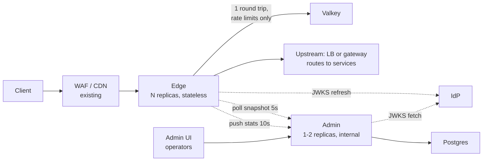
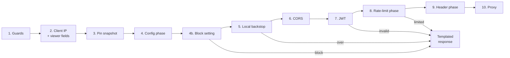
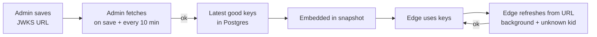
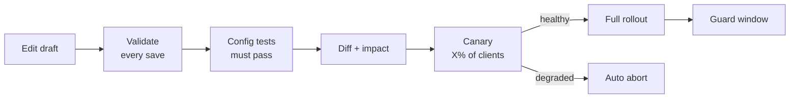

# Edge Proxy: Design

Terms are defined in the [Glossary](reference/glossary.md).

## 0. Purpose, principles, decisions

The edge is a Go reverse proxy that sits **between** an existing WAF/CDN and the load balancer or gateway that routes your services. It enforces application-aware policy, then forwards every request, Host unchanged, to that one upstream:

- rate limiting
- JWT validation
- CORS
- header transforms
- locale detection
- templated responses

An admin service with an admin UI manages that policy. The edge does not replace the WAF or CDN, and it does not route: the load balancer or gateway behind it already knows which service serves each host and path, so the edge needs only its address.

### Principles (in priority order)

| # | Principle | Meaning |
|---|---|---|
| P1 | **Availability first** | A running edge never stops serving because a dependency failed. Every dependency has a defined degraded mode ([§14](#14-availability)) |
| P2 | **Latency first** | The request path does in-memory work only, except one Valkey round trip for shared rate limits and the upstream call. Nothing is parsed, compiled, fetched or locked per request that could be done ahead of time ([§2.2](#22-latency-rules)) |
| P3 | **Platform-agnostic** | The binaries depend on Valkey, Postgres (admin only), env config and HTTP. CDN, WAF, LB and hosting are deployment choices |
| P4 | **Nothing invalid goes live** | One validator, run on every save, publish and edge activation ([§12.2](#122-validation-one-validator-everywhere)) |
| P5 | **Safe change** | Config tests, canary, shadow mode and automatic rollback ([§12.5](#125-before-going-live)–[§12.6](#126-rollback-guard-every-signal-configurable)) |

### Decisions taken

| Topic | Decision |
|---|---|
| Scope | Edge, admin service, admin UI. No WAF-log worker |
| Policy model | Rules: expression + action, grouped in phases ([§3](#3-rules-engine)) |
| Rate limiting | 4 algorithms chosen per rule. Keys from IP and/or request attributes. Fail-open by default, overridable per rule |
| JWT | Validated at the edge. Issuers defined once; config rules choose which are accepted |
| JWKS | URL set in admin. If keys were never obtained, traffic passes. Once obtained, the latest good set is kept forever |
| Locale | From `Accept-Language` only. Optional |
| Admin auth | Username/password now, OIDC later, behind extensible interfaces |
| Audit | Everything, kept forever, append-only, tamper-evident, visible in the admin UI |
| Publishing | No second approver. Every publish is a version you can view, compare and revert. Degraded publishes roll back automatically; every signal is configurable |
| Deployables | Edge and admin are separate. Only the edge scales |
| Delivery | One release |
| Tests | 100% statement coverage for the edge and every package it imports, from scenario tests. Admin: scenario tests on critical paths, no coverage gate. Load tests run in Docker Compose: a smoke profile in CI, the full profile nightly in GitHub Actions and on GitLab schedules |
| Logs | JSON, raw client IPs |
| Build vs buy | A Go proxy on `httputil.ReverseProxy`, not plugins for an existing gateway. Each gateway decides part of the request path this edge needs to control: the rate-limit algorithm, one Valkey round trip for all limits, the behavior per rule when Valkey is down, and limits on verified JWT claims ([Why a custom proxy](why-custom-proxy.md)) |

## 1. Architecture



Solid lines are on the request path. Dotted lines are background work that never blocks a request.

| | Edge (`cmd/edge`) | Admin (`cmd/admin`, serves the admin UI) |
|---|---|---|
| Role | Data plane: every user request | Control plane: operators and edges |
| Scaling | Horizontal, stateless, autoscaled on CPU or RPS | Fixed size |
| Exposure | Behind the WAF/CDN/LB | Internal only |
| Durable state | None. Snapshot in memory, optional cache file | Postgres |
| Load | All user traffic | About 0.3 req/s per edge (one cached snapshot poll per 5s, one stats report per 10s) plus operators |
| Down means | User impact; mitigated by replicas across zones | No user impact. Lost: publishing, stats, guard, admin UI. Edges keep serving |
| Replicas | At least 2 across zones, plus one-zone-loss headroom | 1 acceptable; 2 recommended. Background jobs run on the replica holding a Postgres session advisory lock, held on a **dedicated connection** outside the pool. If that connection drops, the lock is released and the job loop stops before another replica takes over |

### Repo layout (one Go module, two binaries)

```
cmd/edge/            thin main: calls edge.Main
cmd/admin/           thin main: calls admin.Main
internal/expr/       expression parser, renderer, type checker, compiler. Shared
internal/snapshot/   config types, strict decode, Compile() (validates and compiles). Shared
internal/ratelimit/  algorithms (Lua + local), backstop, penalty cache. Shared
internal/jwks/       JWKS fetch/parse, SSRF guard (also used for crawler range lists). Shared
internal/envparse/   deployment config from env vars. Shared
internal/tracing/    OpenTelemetry tracer provider: OTLP/HTTP export, capped sampler, export counters
internal/edge/       wiring, http.Server, shutdown, and the request pipeline: clientip, viewer, cors, jwt, locale, headers, respond, proxy, stats
internal/admin/      admin API, identity, sessions, RBAC, publish, snapshot endpoint, stats ingest, JWKS and crawler range refresh, canary, guard, observed routes, first-start bootstrap
internal/admindb/    Postgres queries, migrations, audit log
internal/testenv/    testcontainers helpers (Valkey, Postgres, OpenTelemetry Collector) and the Playwright browser server, for tests
web/admin/           admin UI: React + Vite + TypeScript + Tailwind, embedded into the admin binary
autopilot/           autopilot runner: TypeScript on Node, its own image, outside the Go module
loadtest/            k6 scripts, mock upstream, IdP, LB, gateway, services and stream holder, compose environment
build/               Dockerfiles for the edge, admin, autopilot runner and load-test images
docs/                MkDocs site
scripts/             CI scripts and capacity runs
```

## 2. Request path

### 2.1 Steps



Steps 8 and 10 do network I/O. The rest run in memory.

**Edge responses before step 4** (overload 503, bad client IP 400, bad path 400) can't carry CORS headers, because no policy has been resolved yet. They still carry `Cache-Control: no-store`.

| # | Step | What it does | Why here |
|---|---|---|---|
| 1 | **Guards** | Rejects with a fast 503 when concurrent **ordinary** requests exceed the in-flight cap: `MAX_INFLIGHT`, which defaults to `GOMEMLIMIT` ÷ 256 KiB (at most 10,000), lowered by the active policy's `global.max_inflight` when that is smaller. The policy is read with the same `atomic.Pointer.Load` that step 3 pins. Long-lived streams (SSE, WebSocket) have a separate cap, so they can't starve ordinary traffic. `http.Server.MaxHeaderBytes` already capped header size | Shed overload before spending any work on it |
| 2 | **Client IP + viewer fields** | Checks the ingress secret header if configured. Reads the client IP and trusted viewer metadata (country, ASN, scheme, HTTP version) from the configured CDN headers, **only** if the TCP peer is a trusted proxy ([§10](#10-client-identity-and-viewer-metadata)). Rejects ambiguous path encodings ([§3.2](#32-fields)) | Everything later keys on the real client. Spoofed values must be rejected first |
| 3 | **Pin snapshot** | One `atomic.Pointer.Load` of the compiled config, which a background poller keeps current. During a canary, picks the active or candidate config by client hash ([§12.5](#125-before-going-live)). No I/O | Keeps one request on one config version even if the poller swaps it mid-request |
| 4 | **Config phase** | Evaluates config rules ([§3](#3-rules-engine)). Resolves this request's settings: auth, accepted issuers, CORS policy, locale, response templates, body limit, upstream timeout, rate-limit headers. From here on, every edge-generated response carries the request's CORS headers and `Cache-Control: no-store` | Everything after depends on these settings |
| 4b | **Block setting** | When the resolved `block` setting is `block`, answers 403 with the `forbidden` template; `log` marks the request `would_block` and goes on. `kill_switch.block` turns `block` into `log` | A refused bot costs no backstop slot, JWT check or Valkey call. The config phase already ran, so the 403 has the request's template and CORS headers |
| 5 | **Local backstop** | In-memory per-IP token bucket | Cheap flood protection before CPU-heavy JWT and network-bound Valkey; works when Valkey is down. It comes after the config phase so its 429 uses the request's template and CORS headers. The cost: a flood still pays for the config rules, about 70 µs per request on a laptop at the limit of 200 rules of 32 conditions (`BenchmarkMatch200Rules`) and under 1 µs for a realistic config |
| 6 | **CORS** | Answers preflight when a CORS policy applies. With no policy, preflight is forwarded to the upstream like any request | Preflight needs no auth or quota. Browser JS can read edge 429/401 only with CORS headers (set from step 4) |
| 7 | **JWT** | Verifies the token if the config phase requires auth. A verified-token cache means most requests skip signature checks | Rate-limit and header rules may use verified claims |
| 8 | **Rate-limit phase** | Evaluates rate-limit rule expressions in memory. Checks the local penalty cache. Then sends **one pipelined batch** to Valkey for the rules that matched | The only shared, cross-replica decision, and the only network I/O before the upstream |
| 9 | **Header phase** | Applies request header rules, then edge-managed headers ([§7](#7-request-header-rules)). Locale is a lazy field: it's resolved the first time anything reads it, in step 8 or here ([§8](#8-locale-from-accept-language)) | Only for requests that will be forwarded |
| 10 | **Proxy** | Applies the body limit (`http.MaxBytesReader`) and a body read deadline. Forwards over pooled connections, streaming bodies, SSE and WebSocket. Never retries | The actual job |

### 2.2 Latency rules

| Rule | How |
|---|---|
| No parsing or compilation per request | Expressions, regexes, wildcards, CORS policies, templates and the locale matcher compile once per snapshot |
| At most one Valkey round trip | All matched rate-limit rules go in one pipelined batch. **Accuracy note:** with Valkey Cluster, keys on different shards go to different nodes *in parallel*. Latency is the slowest shard's round trip, not the sum |
| Skip the network whenever possible | The local penalty cache answers for subjects already blocked. Rules whose expression doesn't match cost no Valkey call. No matched rules means no Valkey call at all |
| Bounded network waits | Per-call deadline on Valkey, then a breaker. Upstream: dial and TLS handshake timeouts, and a per-request timer on `upstream_timeout` that `ModifyResponse` stops when response headers arrive |
| No global locks, minimal allocation | Stats use `atomic` adds. Request fields are extracted lazily into a fixed per-request struct. Caches are sharded, so a lock covers one shard for a short map operation. Backstop and local buckets each hold their own mutex, contended only by requests for the same subject |
| Expensive work is cached | Verified JWTs (by token hash) and locale results (by raw `Accept-Language`) |
| Responses are never cached downstream | Every edge-generated response sends `Cache-Control: no-store`, so a CDN can't serve one client's 429 or 401 to others |
| Warm before ready | Valkey pools are opened before ready (best effort, bounded wait). The upstream pool is **not** pre-warmed: opening it needs a real request, which may have side effects, so the first requests pay connection setup. An HTTPS upstream keeps idle connections per Host, so there the first requests for each Host pay it. A failed warm-up never blocks readiness (P1) |
| Runtime sized to the container | Go 1.25+ sets `GOMAXPROCS` from the cgroup CPU limit by default ([Go 1.25 release notes](https://go.dev/doc/go1.25#container-aware-gomaxprocs)). A `GOMEMLIMIT` below the container memory limit makes the GC tighten before an OOM kill. The images don't set it, so the deployment does |
| Measured, not assumed | Benchmarks gate per-request allocations and each step's cost ([§18](#18-testing)). No latency numbers are quoted until they're measured |

## 3. Rules engine

Policy is a set of **rules**: *when incoming requests match **expression**, then **action/settings***. The admin UI edits a rule as a form:

- **When incoming requests match:** Field / Operator / Value rows joined by **And** / **Or**. An empty condition is `true` and matches every request.
- A live **Expression preview**, with **Edit expression** for typing it directly.
- **Then:** the rule's settings or action.
- **Apply to draft** changes the draft in the browser. **Save draft** saves the shared draft to admin, which validates it. **Publish to all traffic** (or to a canary percentage) on the publish page makes it live.

### 3.1 Phases

| Phase (UI name) | Runs at | Action | When several rules match |
|---|---|---|---|
| `config` (Config rules) | Step 4 | Set request settings (below) | **All apply in order; a later rule overwrites the same setting.** |
| `rate_limit` (Rate limit rules) | Step 8 | Count and possibly block ([§4](#4-rate-limiting)) | Site-wide rules (expression `true`, at most 2) are always evaluated. Other matching rules are evaluated in order, up to 5 per request. Blocked if any `block` rule says no |
| `request_headers` (Request header rules) | Step 9 | Header operations ([§7](#7-request-header-rules)) | All apply in order |

**Config-phase settings** (each is left unset or set per rule):

| Setting | Effect | Default when no rule sets it |
|---|---|---|
| `auth` | `none` / `optional` / `required`, plus `accepted` issuers. `optional` passes a request without a token but rejects an invalid one (Envoy `allow_missing`) | `none` |
| `cors_policy` | Name of a global CORS policy, or none | none |
| `locale` | on / off | global setting |
| `responses` | Response kind → template name | global templates |
| `body_limit` | Max request body bytes | global setting |
| `upstream_timeout` | Response-header timeout for this request | global setting |
| `ratelimit_headers` | Emit `RateLimit` / `RateLimit-Policy` headers | off |

**Rule order:** explicit within a phase (drag-and-drop in the UI). A rule that matches every request has the expression `true`.

### 3.2 Fields

Every field, its type and its source are listed in the [Expressions reference](reference/expressions.md#fields).

- **Typed fields:** each field has a type (string, string list, int, ip, bool), so validation rejects an operator that can't apply (`gt` on a string, `wildcard` on `ip.src`) before a rule is saved.
- **Request fields** are extracted lazily ([§3.5](#35-evaluation-cost)).
- **Identity fields** come only from trusted sources: `ip.src` is the trusted client IP ([§10](#10-client-identity-and-viewer-metadata)), and JWT claims are verified claims only ([§5](#5-jwt-and-jwks)). `http.x_forwarded_for` is client-controlled on the left, so it is for matching only, never identity.
- **Phase availability:** JWT claims and `edge.locale` are resolved after the `config` phase runs, so validation rejects them there.

**Viewer fields:**
- "Viewer" fields (country, continent, AS number, scheme, HTTP version, client certificate) describe the client's connection to the CDN, which the edge can't observe itself because it sits behind a TLS-terminating proxy. They come only from trusted headers.
- The deployment setting `VIEWER_HEADERS` maps each viewer field to a header. The `cloudfront`, `cloudflare` and `gcp` presets fill it in ([Client IP presets](deploy/edge.md#client-ip-presets)).
- A field with no configured source is **unavailable**: hidden in the UI and rejected by validation, never silently empty.
- `tls.client.ja4` and `tls.client.ja3` are viewer fields too: the CDN computes the fingerprint from the client's TLS hello. A header value that isn't a well-formed fingerprint is absent, and `eq` or `in` with a literal of another shape is rejected, sharing one shape check (`expr.ValidJA4`, `expr.ValidJA3`).

**Edge-computed fields** read only the request and the snapshot, so they exist in every phase and every deployment:
- `client.signals` is a list of automation hints from the headers and viewer fields, computed lazily as a bitmask the first time anything reads it, and as names from a table built once, so a request allocates nothing for it. It takes only `eq`, `ne`, `in` and `not_in` with known names. A signal needs the viewer field it reads (`ssl`, HTTP version or JA4): validation rejects a rule naming one the deployment can't compute. Browser thresholds come from MDN's compatibility data; the tool list includes the OWASP Core Rule Set's scanners. Signals are hints for log-first rules, not a score.
- `client.verified_bot` is true when the client IP is in a crawler range list admin fetched from `VERIFIED_BOT_SOURCES` ([§5.4](#54-ssrf-guard)). The ranges travel in the snapshot envelope, only while the active or canary version reads `client.verified_bot`, and the edge compiles them into an IP set off the request path. Admin validation refuses a rule that reads the field when `VERIFIED_BOT_SOURCES` is empty (`Deployment.VerifiedBots`); edges always accept it, since their ranges arrive with the snapshot. The field is false until the first fetch succeeds.

**Path normalization (security):**
- Matching uses a copy of the path that has been percent-decoded once, except `%2F`, with path parameters (`;x`) dropped from each segment, `//` collapsed and `.` removed.
- The forwarded path keeps every escape the client sent. Only bytes a path can't carry raw (RFC 3986 §3.3), such as `|`, are percent-encoded, because Go's client can't send them; every server decodes them to the same path. Without this, Go would re-encode the decoded path whenever such a byte is present, turning `%2F` into `/`.
- **`%2F` passes through.** Apps such as GitLab need it (`group%2Fproject` IDs, file paths), so the edge doesn't reject it. Rules see it inside its segment, as the gateway behind the edge routes it when it leaves escaped slashes unchanged (Envoy's `path_with_escaped_slashes_action: KEEP_UNCHANGED`, the default). So `wildcard "/api/v4/projects/*/members"` matches `/api/v4/projects/group%2Fproject/members`, Decoding it to `/` would give rules a different path than the gateway routes on. Residual risk: an app or gateway that decodes `%2F` (nginx `location` matching) serves `/admin%2Fx` as `/admin/x`, which a rule on `/admin/` doesn't see, just as the gateway's own path routes don't. The encoded slash is detected in `URL.RawPath`, the path as sent: Go re-encodes `URL.EscapedPath` when the raw path contains a character such as `{` or `|`, which would hide it.
- The host is lowercased, without port, brackets or a trailing dot (`api.example.com.` is the same DNS name), for rules, the access log and, with an HTTPS upstream, the TLS server name.
- This stops `/%61dmin`, `//admin` or `/admin;jsessionid=1` (Tomcat and Spring route it to `/admin`) from bypassing a rule on `/admin`.
- **Ambiguous encodings are rejected with 400** at step 2. Upstreams disagree on how to treat these, so neither interpretation is safe to match on:
  - encoded backslash `%5C`
  - NUL `%00`
  - a raw `\`
  - invalid UTF-8, such as the overlong `/` in `%c0%af`
  - a `..` segment, raw or encoded (`%2e%2e`). An upstream that doesn't resolve it (Express mounts, many Node routers) routes `/admin/../public` under `/admin`, while the resolved path would match `/public`. Browsers and RFC 3986 clients remove dot-segments before sending, so real clients never send one. Dropping `.` or collapsing `//` only keeps a path under the prefix it was already under, so those are normalized, not rejected
  - `%2F` hiding a `.` or `..` part (`/public/..%2Fadmin`). A gateway that decodes `%2F` resolves it to `/admin`, outside the prefix rules saw
  - a path parameter on a dot-segment (`..;x`, `.;x`, `..%3Bx`). Tomcat reads it as `..`; nginx, Express and Go read it as a name, so dropping the parameter would match a different path than some upstreams route
- **Non-uppercase methods are rejected with 400** at step 2. RFC 9110 methods are case-sensitive and every standard one is uppercase, but Go's server accepts any token, so `post` would slip past a rule on `POST` at an upstream that folds case.
- **Warning** when a rule matches on `http.request.uri` or `http.request.full_uri`. Those fields are raw and not normalized.
- **Residual risk:** an upstream that normalizes differently can still disagree. Config tests ([§12.5](#125-before-going-live)) should include encoded variants of protected paths.

**List fields** (headers, cookies, args, claims) match if **any** value matches.

**Missing values:**
- An absent header, cookie, argument or claim, an absent client IP and an absent AS number are **missing**. A positive comparison (`eq`, `contains`, `in`, `gt`, ...) against a missing value is false.
- A negated operator is the negation of its positive form, so `ne`, `not ... contains`, `not ... in` are **true** for a missing value. `http.request.headers["x-key"] ne "secret"` matches a request with no `x-key` header.
- Plain string fields (`http.referer`, `http.user_agent`, ...) are the empty string when the header is absent.

**Values that can never match are rejected** by validation, because a dead rule looks active in the UI while doing nothing:
- uppercase letters in a case-sensitive comparison on `http.host`, lowercase on country or continent
- a path value that does not start with `/` in `eq`, `in`, `starts_with`, or a wildcard that does not start with `*` (the edge rejects any other path). A version saved under schema 1 gets a warning instead, since that schema accepted it and refusing it would stop an upgraded edge loading the version it serves
- a method value, header name or cookie name that is not an RFC 9110 token
- an IP literal with an IPv6 zone
- invalid UTF-8 anywhere (JSON storage would silently replace it, so the stored rule would differ from the validated one)

### 3.3 Operators

Every operator, the types it takes and its text form are in the [Expressions reference](reference/expressions.md#operators). The rule builder shows each by a plain label, such as "equals" or "is in", from the same operator list the parser uses, so the two cannot disagree.

### 3.4 Syntax, storage, builder

- **Canonical form:** a JSON AST in Postgres.
  - The preview text is rendered from the AST; **Edit expression** parses text back.
  - Both are in `internal/expr`, and fuzz tests check `parse(render(ast)) == ast`.
- **Syntax:** our own grammar of dotted field names, word operators and functions, e.g. `http.host eq "example.com" and starts_with(http.request.uri.path, "/api/")`. Some semantics cite another vendor's documentation where noted; no compatibility with any vendor's language is promised.
- **Builder vs text:** the visual builder edits an OR of AND-groups, which is what the And/Or rows express. Text mode allows any nesting; if it can't be shown as rows, the UI shows text only.
- **One parser:** the admin UI never parses, renders or validates in the browser. Each change calls the admin API, which uses the same Go code as the edge ([§13.6](#136-admin-ui-stack)). The AST's JSON shape matches the UI builder's tree, so no conversion layer is needed.
- **Limits** are in the [Expressions reference](reference/expressions.md#limits). They bound compile time, memory and the per-request scan ([§3.5](#35-evaluation-cost)). Text length is counted in bytes, so an `in` set is bounded by it too (roughly 250 to 300 IPv4 ranges); larger sets would need named lists, which are not planned. Rules per phase are capped at 200.

**Why our own engine:**
- **Not CEL:** `cel-go` v0.30.0 requires antlr4, protobuf and genproto (its `go.mod`). That's too heavy for the edge, and its syntax differs from the builder preview.
- **Not `ServeMux`:** it can't express OR, headers, IPs, countries or wildcards.

### 3.5 Evaluation cost

- **Compiled once per snapshot** into Go closures:
  - lowercased constants for `wildcard`
  - hash sets for `in`
  - IP sets merged into sorted address ranges (binary search)
  - a wildcard matcher with no backtracking: prefix check, left-to-right `bytes.Index` for middle segments, suffix check. The value is copied into a 512-byte stack buffer (and ASCII-lowercased for `wildcard`), so matching doesn't allocate
  - RE2 for regex
- **Lazy fields:** each field is extracted on first use and memoized in a fixed per-request struct. Rules that never reference cookies never parse cookies.
- **Short-circuit** `and` / `or`.
- **Linear scan per phase:** cost is rules × conditions.
  - A benchmark gates the worst allowed config (200 × 32 per phase) and a realistic one.
  - **If the benchmark requires it:** index rules whose top-level `and` contains `http.host eq "…"` by host, so a request scans only its host's rules plus host-independent rules.

### 3.6 Expression validation

- **Errors:**
  - Type errors.
  - Unknown or unavailable fields.
  - Fields not available in the rule's phase.
  - Invalid CIDR, regex or wildcard.
  - Limits exceeded.
- **Warnings:**
  - Trivially unsatisfiable expressions (`http.host eq "a" and http.host eq "b"`).
  - A config rule fully overwritten by a later `true` rule.
  - **Spoofable exclusions:** a rate-limit rule or a config rule with `block: block` that *excludes* traffic using a client-controlled field (header, cookie, query, X-Forwarded-For, User Agent, Referer, client signals, JA4, JA3). Exclude by `ip.src` or a verified claim instead.
  - A config rule with `block: log` that matches a client-controlled field after an earlier rule sets `block: block`, since the last matching `block` wins.
  - An `http.request.version` literal outside `1.0`, `1.1`, `2.0`, `3.0`.

## 4. Rate limiting

### 4.1 Rule

```yaml
rate_limit_rules:
  - id: login-per-ip
    expression: 'http.request.method eq "POST" and http.request.uri.path eq "/v1/login" and not ip.src in {10.0.0.0/8}'
    algorithm: sliding_window     # fixed_window | sliding_window | token_bucket | leaky_bucket | distinct
    limit: 5
    period: 1m
    burst: 5                      # token_bucket / leaky_bucket only
    key: [ip]                     # 1-5 characteristics ([§4.3](#43-keys))
    on_missing_key: fallback_ip   # skip | fallback_ip | reject
    action: block                 # block | log (shadow)
    penalty: 5m                   # optional
    fail_mode: local              # open | closed | local
    distinct_of: path             # distinct only: path | query:<n> | ip | asnum | ja4
    count_statuses: ["404"]       # optional: count upstream responses, in each edge's memory
    expires_at: 2026-11-01T00:00:00Z  # optional: the rule stops running at this time
```

**Evaluation:**
- **Site-wide rules** (expression `true`) are always evaluated, wherever they sit in the list. At most 2 are allowed (a validation error beyond that). They give the site-wide per-IP ceiling, and the cap can never skip them.
- **Other matching rules** are evaluated in order, up to 5 per request. Rules beyond 5 are skipped and `edge_ratelimit_rules_capped_total` is incremented.
  - **Only rules that can block use the cap first.** Blocking rules take slots before shadow (`action: log`) rules, and a rule skipped for a missing key (`on_missing_key: skip`) takes no slot. Clients choose which rules match through the fields they send, so otherwise five matching shadow or skipped rules could push a blocking rule such as a login limit out of evaluation.
- So a request costs at most 7 commands, all in one pipelined batch.
- **Rules are independent counters, not atomic with each other.** A request blocked by one rule still consumes quota in the others it matched. Checking before consuming would need a second round trip, which P2 rules out.
- **A penalty applies only to `action: block` rules.** Shadow rules record that the penalty *would* start, but never block.
- **A rule past its `expires_at` is skipped** before it takes a slot, and counted as `expired` on `/metrics`. Each edge compares it with the request's start time on its own clock, so clock skew between edges moves the end by that much; run NTP. A penalty from the rule ends with it, since the penalty cache is only read for rules that run. Validation checks only the format: an expired rule is valid, so a bootstrap file exported while it ran still loads. A draft save or check warns when one of the draft's rules has already expired, since it will not run.

**Count rules** (`count_statuses`) count the upstream's answers, such as 404s from a scanner or 401s from a password guesser, not requests:
- **Per edge, in memory.** Counting happens in `ModifyResponse`, after the answer, so a shared count would need a second Valkey call per request (P2). Each replica counts against the full limit in its bounded local store; a client spread over N edges gets up to N × limit before every edge blocks it. That is accepted for signals that need many answers to mean anything.
- **Over the limit, the key goes into the penalty cache** until the penalty ends or the count resets, so later requests are refused at step 8 without a Valkey call or an upstream request. The answer that went over is already sent.
- **5xx can't be counted:** it is usually the upstream's fault, and counting it would lock clients out after an outage.
- **Own cap of 5 per request,** apart from the Valkey rules' cap, because they cost no Valkey command. They are never site-wide rules nor the `ip` partner, and send no `RateLimit` headers.

### 4.2 Algorithms

Every algorithm keeps its state in **one Valkey key** and reads time from Valkey's `TIME`.

- **One key:** in Valkey Cluster, a script may touch only keys passed in `KEYS`, and they must share a slot (valkey.io/topics/eval-intro).
- **Server time:** avoids clock skew between replicas.

| Algorithm | State | Behavior | `Retry-After` |
|---|---|---|---|
| `fixed_window` | Hash `{a: window start, b: count}` | Simplest; up to 2× limit across a boundary | Time to window end |
| `sliding_window` | Hash `{a: window start, b: current, c: previous}`; estimate = `prev × overlap + cur` | Smooths the boundary burst | Window end, plus `period/limit` when the current window is full (an upper bound) |
| `token_bucket` | Hash `{a: tokens × period, b: last update}` | Bursts to `burst`, refills at `limit/period` | Time to next token |
| `leaky_bucket` | Hash `{a: level × period, b: last update}`: the leaky bucket as a meter, which is equivalent to GCRA (ITU-T I.371) | Steady drain with burst tolerance. **Rejects, never queues** (queueing holds connections, against P1/P2) | Time until one request fits |
| `distinct` | String: a 1024-bit map, then the window start and blocked-until as 15 digits each (158 bytes). The edge sends the value's bit (FNV-1a, then MurmurHash3's 64-bit finalizer, top 10 bits); the script sets it and estimates `-1024 × ln(clear bits / 1024)` (linear counting) | Different values of `distinct_of` per subject per period, starting with the first value. Over the limit, every request is refused until the period ends | Time to period end |

Notes:
- **Integer milliseconds, one model.** Every script works in whole milliseconds, and `ratelimit.Step` is the same arithmetic in Go. Step serves `fail_mode: local` and the backstop, and a differential test runs random sequences against real Valkey (standalone and cluster), comparing each decision, the stored state and the TTL.
  - Lua numbers are doubles, so validation keeps `burst × period(ms)` at most 2^51 for the bucket algorithms (e.g. at most 26,062,497 per 24h). Sliding-window weights use parts per million so products stay below 2^53, and the weighted previous count rounds **up**: rounding down would admit one extra request just after every boundary. Stored numbers are formatted with `%d`, because Lua's default conversion keeps only 14 digits.
  - A blocked request (active penalty) writes nothing; the key's TTL already covers the penalty.
- **Rejected:** sliding-window *log*, because its memory grows with the limit.
- **Distinct is an estimate, bounded by design.** A set of seen values per subject grows with the values; a fixed 1024-bit map does not. Linear counting stays within 10% (about 4% in tests) up to the 1000 values validation allows (a test against real Valkey checks it), and drifts beyond. The plain FNV-1a low bits cluster for similar strings, so the hash is finalized before the top bits are taken. It has no `Step` model, so `fail_mode: local` is refused: a map per subject would outgrow the bounded local store. `distinct_of` is hashed into the key prefix, so changing it starts fresh state and a query name can't add a brace to the cluster hash tag.
- **Token vs leaky bucket:** with equal parameters, leaky bucket as a meter admits the same traffic as token bucket. Both are offered for operator familiarity.
- **Changing a rule:**
  - A change to `limit` or `burst` applies on the next call.
  - A change to `algorithm` or `period` changes the key (both are in it), so state starts fresh. Old state isn't misread under a new window, and the old keys expire on their own TTL.
- **TTLs:** every key's TTL is the longer of its algorithm window and any active penalty, and the penalty extends it.

### 4.3 Keys

| Characteristic | Source |
|---|---|
| `ip` | Trusted client IP. IPv6 truncated to /64 |
| `header:<n>`, `cookie:<n>`, `query:<n>` | Request (attacker-controlled) |
| `jwt_claim:<n>` | Verified JWT |
| `host`, `method`, `country`, `asnum`, `ja4`, `locale` | Request / viewer / [§8](#8-locale-from-accept-language) |
| `constant` | One bucket for the rule. A hot key on one shard, so use only with low limits |

- **Valkey key:** `rl:<algo>:<period ms>:<rule_id>:{<b64url(sha256(subject))[:16 bytes]>}`. The subject is a domain byte followed by length-prefixed values, or a different domain byte followed by the client IP for `fallback_ip`. So a client-chosen header value can never produce another client's fallback bucket. The hash bounds key size and keeps raw values out of Valkey. The `{}` hash tag spreads subjects across slots.
- **Rule: attacker-controlled keys need a partner.** Clients can rotate header, cookie or query values to get a fresh bucket each time, and also `host` (the edge forwards any Host to the one upstream, so any Host reaches the rule), `method` (any uppercase token is a valid method) and `ja4` (a client picks its TLS stack). So a rule keyed only on those is a validation error unless its own key also includes `ip` or `jwt_claim`, or a site-wide rule keyed on `ip` exists that counts requests in Valkey (a count or `distinct` rule doesn't limit request rates). Whether two arbitrary expressions overlap is undecidable, so validation doesn't try.
- **JWT claims are available only when this request's `auth` setting verified a token.** Otherwise `jwt_claim` keys count as missing (`on_missing_key`).
- **Rule: `on_missing_key` defaults to `fallback_ip`.** With `skip` (the AWS WAF and NGINX behavior), omitting the header bypasses the rule.

### 4.4 Actions and penalty

- **`action: log` (shadow mode):** evaluate and count, never block. Peers: Envoy `shadow_mode`, NGINX `limit_req_dry_run`, AWS WAF `Count`.
- **`penalty`:** keeps a subject blocked for a set time after it exceeds.
  - It's stored as `blocked_until` in the same key.
  - Each replica also keeps a bounded local copy (100,000 subjects). **Checking it comes first, so a blocked subject costs no Valkey call.** When the copy is full, Valkey still enforces the penalty.

### 4.5 Local backstop

- A per-IP token bucket in each replica, always on, with one global setting. The effective ceiling is about N replicas × the setting.
- **It runs `ratelimit.Step`'s token bucket,** not `x/time/rate`. Each IP's bucket locks only itself; a shard lock covers only the map lookup. That needs no extra dependency. The state survives snapshot swaps unless the backstop settings change.
- **IPv6 is keyed by /64,** like the shared rate limits, so rotating addresses within one subscriber prefix doesn't create new buckets.
- **Memory is bounded:** a sharded map with `max_entries` and an idle sweep.
- **When the map is full, new IPs aren't tracked.** They pass the backstop, which is fail-open, and `edge_backstop_untracked_total` is incremented. Sharing one overflow bucket would throttle innocent users together. The shared Valkey limits still apply to them.

### 4.6 Valkey failure

- A per-call deadline (`VALKEY_TIMEOUT`), then a breaker **per Valkey node**: after 5 consecutive failures, skip that node for 1s, then let one probe through. One failed shard affects only the keys that live on it.
  - Consecutive failures rather than an error ratio: the breaker is three atomics, with no lock or ring buffer on the request path.
  - valkey-go keeps its slot map private, so the edge reads `CLUSTER SLOTS` every 5s off the request path and computes each key's slot (CRC16, hash tags) to find its node's breaker.
  - **Cluster deployments must set `cluster-require-full-coverage no`.** With the default `yes`, one failed primary makes every node answer `CLUSTERDOWN` for every key, and the per-node breaker can't contain it.
- **Startup never waits on Valkey.** valkey-go dials when a client is created, so the edge connects in a background loop. Until it has a client **and** a slot map, calls fail fast into each rule's `fail_mode`. Each attempt reads the slot map before loading scripts, so a node that refuses `SCRIPT LOAD` (ACL, failover) can't leave breakers on a stale map; such a node is served through the `NOSCRIPT` → `EVAL` fallback. A best-effort connect before ready is bounded by the dial timeout (1s default, `dial_timeout` in `VALKEY_URL`) plus 2s.
- **`fail_mode` per rule:**

  | Mode | On Valkey failure |
  |---|---|
  | `open` (default) | Allow |
  | `closed` | 503 with `Retry-After` |
  | `local` | Per-replica bucket at `limit / fleet_size` (degraded). State is bounded (100,000 subjects per replica, split evenly between rules, so a rule keyed on client-chosen values can only fill its own share). It survives publishes, matched by rule ID, so a publish during an outage can't reset counts; it starts fresh only when the number of rules changes. `fleet_size` is the number of edges admin saw reporting in the last minute. The snapshot envelope carries it ([§12.3](#123-distribution)), and admin's answer to every stats report updates it ([§15.2](#152-stats-push-to-admin)), so edges coming and going never change the snapshot. If it's unknown, `EXPECTED_REPLICAS` from deployment config is used |

- **No retries.** A call consumes quota, so a timeout is ambiguous.
  - **Verified in valkey-go v1.0.78:** network-error retry applies only to commands carrying the retryable tag (`client.go` `Do`/`DoMulti`; `cluster.go` `doresultfn` for `TRYAGAIN`, `CLUSTERDOWN` and `LOADING`). A plain `EVALSHA` from the command builder has no such tag, and `DisableRetry` is set as well.
  - **Batch, not `Lua.ExecMulti`:** `ExecMulti` runs `SCRIPT LOAD` on every node on every call (`lua.go`), which would add round trips. The edge preloads the scripts once per node, at connect time or when a topology refresh finds a new node, then sends one `DoMulti` of `EVALSHA`. A node that loses them (restart, failover) gets them back through the `NOSCRIPT` → `EVAL` fallback, because `EVAL` caches the script.
  - Remaining retries are safe, because the command never ran: `MOVED`/`ASK` redirects and the `NOSCRIPT` → `EVAL` fallback.
- **A dedicated valkey-go client for rate limiting,** with its own short timeouts.

### 4.7 Response headers

- `Retry-After` on every 429 (RFC 9110 §10.2.3).
- `RateLimit` / `RateLimit-Policy` (IETF draft-11, not an RFC) only where the `ratelimit_headers` setting is on. One item per enforced rule, named by rule ID: `RateLimit-Policy: "login";q=5;w=60` and `RateLimit: "login";r=2;t=41`. Shadow rules are left out. They replace any the upstream sent.
- `on_missing_key: reject` answers 400 `bad_request`.
- `fail_mode: closed` answers 503 `unavailable` with `Retry-After: 1`. A shadow rule never fails closed.

## 5. JWT and JWKS

### 5.1 Issuers

Issuers are defined once. The `auth` setting in a config rule lists which ones are **accepted**. A list, not a single override, supports several IdPs and IdP migrations (accept old and new together). Envoy `jwt_authn` uses the same shape: named providers, plus per-route "any of" requirements.

```yaml
auth:
  issuers:
    - id: corp
      issuer: https://auth.example.com/
      audiences: [api]
      jwks_url: https://auth.example.com/.well-known/jwks.json
      algorithm: RS256
  default_accepted: [corp]
config_rules:
  - id: orders-auth
    expression: 'starts_with(http.request.uri.path, "/v1/orders")'
    settings: { auth: { mode: required, accepted: [corp, corp-new] } }
```

With a single IdP, `accepted` is never set and the UI shows no issuer choice.

### 5.2 Keys



- **Cold starts work while the IdP is down,** because edges seed their keys from the snapshot.
- **Keys live in their own store on the edge, separate from the compiled config.**
  - Each issuer's key set carries `fetched_at`, from whoever fetched it: admin or the edge.
  - Key sets belong to an issuer **and its JWKS URL**, in Postgres, in the snapshot and on the edge. A canary that moves an issuer to a new URL carries both sets, so the active version never verifies with the new IdP's keys.
  - **The newest `fetched_at` wins.** A snapshot swap never replaces newer keys the edge fetched itself with older keys from admin.
  - Each replacement takes a new `generation` number (used by the token cache, [§5.3](#53-verification)).
  - **Keys belong to the JWKS URL.** When a publish changes an issuer's URL, its keys start over from the snapshot and the new URL; keys from the old URL are never used for it.
- **Edges also refresh directly,** in the background every 10 minutes.
- **On an unknown `kid`:** one shared fetch per issuer (single-flight), at most once per 30s.
  - Requests carrying that `kid` wait for it, up to 1 second, then get 401.
  - Other requests are never blocked.
- **Keys are replaced only by a successful parse, and never cleared.**
  - A JWKS with no usable signing key counts as a failed fetch.
  - Keys this edge can't verify with are skipped, not fatal: encryption keys (`use: enc`), symmetric keys, other curves, RSA keys under 2048 bits (RFC 7518 §3.3), and malformed keys. IdPs publish such keys next to their signing keys.
- **"Forever" means the latest good set, not every key ever seen.** A key the IdP removes (rotation or compromise) is dropped on the next good fetch.
- **No key ever obtained for an issuer → traffic passes at runtime.** It goes through without `X-Edge-Auth-*` headers, logs `edge.auth=pass_no_keys` and counts `edge_auth_total{result="pass_no_keys"}` for alerting. The edge keeps trying to fetch keys, at most once per 30s per issuer. Upstreams must still validate tokens. This keeps traffic flowing if the IdP is down when an issuer is first set up.
- **But publish is blocked** if a rule with `auth: required` accepts an issuer whose JWKS has **never** been fetched successfully. That catches a mistyped JWKS URL before it opens a protected path.
  - A publisher can override, with an audited reason, e.g. "IdP is down, publishing anyway".
  - The override is shown on the version ([§12.7](#127-versions-and-revert)).

### 5.3 Verification

0. The token comes only from `Authorization: Bearer` (RFC 6750 §2.1; the scheme is case-insensitive). Query-string tokens are never read: they end up in logs. Another scheme counts as no token. Two `Authorization` headers are ambiguous and rejected.
1. Token ≤ 4096 bytes (Envoy's default `jwt_max_token_size`).
2. Read `iss` (untrusted) only to pick an issuer. Reject it if it isn't accepted for this request.
3. Require that issuer's configured `alg`, and verify with **that issuer's keys only**. This prevents algorithm confusion and cross-issuer key use.
   - The key is picked by `kid`, and must be of the type and curve the algorithm needs, and match the JWK's own `alg` when it has one.
   - A token without `kid` is accepted only when the issuer has exactly one key, so the edge never tries several keys.
4. Check `exp`/`nbf` with a 60s clock skew (Envoy's default `clock_skew_seconds`), `iss` and `aud` (any configured audience). `exp` is required, so no token is valid forever.
5. On failure: 401 with `WWW-Authenticate: Bearer` (RFC 9110 §15.5.2), adding `error="invalid_token"` when a token was presented (RFC 6750 §3.1).
6. On success the upstream gets `X-Edge-Auth-Issuer` (issuer id) and `X-Edge-Auth-Sub` (the `sub` claim), set after header rules so none can override them. `Authorization` is still forwarded, so upstreams can validate themselves.

**Claims as fields:** each claim becomes a string list. Strings and booleans are kept as text, numbers exactly as sent, arrays per element. Objects and nulls have no string form and are absent.

**Verified-token cache:**
- **Key:** SHA-256 of the token. Each entry records the issuer it verified under and that issuer's key `generation`. A hit counts only while both are still current, so when keys rotate or a publish changes the issuer config (iss, audiences, alg, URL), old entries simply stop matching. A publish that doesn't touch the issuer keeps the cache.
- Bounded at `TOKEN_CACHE_SIZE` tokens, default 10,000 (new tokens are verified but not stored when full, so a flood of fresh tokens can't push out the ones real clients reuse), with entries expiring at `min(exp + clock skew, 10 minutes after verification)`.
- Only valid tokens are cached, like Envoy `jwt_cache_config`.
- **A cache hit skips only the signature check.** These checks still run on every request, because they're cheap comparisons that depend on this request's config:
  - the token's `iss` is in this request's accepted list
  - `exp`/`nbf` against the current time
- Each token's signature is checked once per replica per key generation.

### 5.4 SSRF guard

Admin users enter JWKS URLs that admin and edges then fetch, and admin fetches the deployment's `VERIFIED_BOT_SOURCES` crawler range lists with the same client, so `internal/jwks` enforces for both:

- HTTPS only, TLS 1.2 or later.
- Resolved addresses must be public unicast: not loopback, private, link-local (cloud metadata), unspecified, multicast, shared (`100.64.0.0/10`) or NAT64 (`64:ff9b::/96`) of any of those. `JWKS_ALLOWED_HOSTS` lists hosts (by URL host) exempt from this.
- No proxy from the environment: the dial check would see only the proxy's address.
- **Checked at connect time,** in `net.Dialer.Control` against the address actually dialed. A pre-resolution check alone is open to DNS rebinding: resolving to a public IP once, then to a private one.
- 64 KB response cap; 512 KiB for crawler range lists.
- A 5s timeout.
- Redirects only to the same host over https, at most 3.

## 6. CORS

- **Built in-house per the Fetch standard.** Named policies are defined globally, and a config rule selects one with `cors_policy`.
- **Policy fields:** origins, methods, request headers, exposed headers, credentials, `max_age`.
- **Preflight** is answered by the edge. It counts against the local backstop only.
- **Edge-generated responses from step 4 onward carry CORS headers.** Earlier ones can't ([§2.1](#21-steps)).
- **`Vary: Origin`** is added whenever a CORS policy applied and the allowed origin depends on the request (any list other than a single fixed origin), so caches don't serve one origin's headers to another (Fetch standard, CORS protocol and HTTP caches).
- **Preflight with no policy** is forwarded to the upstream unchanged.
- **A refused preflight carries no `Access-Control-*` headers** rather than an error status, which the browser treats as a failed check. What a preflight answer and the allowed origin look like is in [CORS](use/policy.md#cors).
- `ModifyResponse` strips upstream `Access-Control-*` headers when a policy applied, so the edge's policy is the only one the browser sees.
- **Validation rejects `*` together with credentials.**

## 7. Request header rules

```yaml
request_headers:
  forward: { mode: denylist, names: [X-Debug] }    # global: all | allowlist | denylist
request_header_rules:
  - id: keep-original-ua
    expression: 'http.user_agent ne ""'
    ops: [ { op: copy, from: User-Agent, to: X-Original-User-Agent } ]
  - id: tenant
    expression: 'http.request.jwt.claims["tenant"] ne ""'
    ops: [ { op: set, name: X-Tenant, value: "{{jwt_claim:tenant}}" } ]
  - id: orders-allowlist
    expression: 'starts_with(http.request.uri.path, "/v1/orders")'
    ops: [ { op: forward, mode: allowlist, names: [Authorization, Content-Type, Accept, Cookie] } ]
```

The operations, placeholders and reserved headers are listed in [Header rules](use/policy.md#header-rules).

- **Copy and rename with an absent source remove the target,** so a client can't supply its own value for it by omitting the source.
- **Placeholders** are resolved from the per-request field struct, so they cost no extra parsing. Header and claim values have control characters removed (CR/LF would split the header; the transport rejects other controls). Literal parts are validated free of them.
- **The forward filter always keeps reserved headers.** `ReverseProxy` sets `Connection`, `Upgrade` and `Te` before `Rewrite`, so an allowlist without them would break WebSockets and gRPC trailers.
- **Order:**
  1. Forward filter.
  2. Rule operations, in rule order.
  3. **Edge-managed headers last**, which no rule can override: `X-Forwarded-*`, `X-Edge-Client-IP`, `X-Edge-Geo-*`, `X-Edge-Auth-*`, `X-Edge-Locale`, `X-Request-Id`, and `traceparent`/`tracestate` when tracing is on.
- **Reserved headers are never targetable,** because the edge or the transport owns them.
  - **Nor readable,** on every path that names a header: ops, header placeholders, `header:<n>` rate-limit keys and `http.request.headers["<n>"]` in expressions. A client can forge `X-Edge-*` before the edge replaces it (forging `X-Edge-Auth-Sub` into an upstream header would bypass authorization), and source headers can carry the ingress secret. The edge also strips client `X-Edge-*` and source headers from the forwarded request at step 9, before the header rules run.
- **Warnings:** an allowlist that drops `Authorization`, `Cookie` or `Content-Type`; a copy or rename whose source any forward filter can drop.
- **Config tests** see `upstream_headers` from the same step 9 code as live traffic (`Simulate`), including the strip of client `X-Edge-*` and source headers, without the deployment-dependent forwarding headers (`X-Forwarded-*`, `X-Edge-Client-IP`, `X-Request-Id`, and the trace context the edge sets when tracing is on).

## 8. Locale from `Accept-Language`

- **Off by default.** Turned on globally or by the `locale` config setting. The settings and how a locale is chosen are in [Locale](use/policy.md#locale).

**Per request:**

0. **Locale is a lazy field.** It's resolved the first time anything reads it: a rate-limit key or expression (step 8), a header rule or placeholder, or the output header (step 9). Then it's memoized for the request.
1. If locale is off, do nothing (zero cost).
2. If `Accept-Language` is missing or over 256 bytes, use `default`.
3. Look up the cache by the raw header string. **A hit costs one map read.**
4. On a miss, run `language.ParseAcceptLanguage`, then a `language.Matcher` built per snapshot (`golang.org/x/text/language`), and cache the result.
5. Strip any client `X-Edge-Locale`, then set it.

**Notes:**
- **Why x/text:** correct BCP 47 matching (scripts, regions, q-values) is easy to get wrong by hand, e.g. `zh-TW` vs `zh-Hant`.
- **Cache:** bounded per replica. When full, new strings are matched but not stored.
- **Latency:** browsers send the user's language settings verbatim, so distinct header values are few and hits should dominate. Misses cost one bounded parse. Both are benchmarked, and the hit rate is measured in load tests.
- **CDN caching:** if a CDN caches language-varying responses, its cache key must include `Accept-Language`.

## 9. Responses

Templates are global. The `responses` config setting maps response kinds to templates per request, e.g. JSON for `/api/`, HTML elsewhere.

```yaml
responses:
  rate_limited_json:
    status: 429
    content_type: application/json
    body: '{"error":"rate_limited","retry_after":{{retry_after}},"request_id":"{{request_id}}"}'
  rate_limited_html:
    status: 429
    content_type: text/html; charset=utf-8
    body: '<!doctype html><title>Too many requests</title><p>Try again in {{retry_after}} seconds.</p>'
```

- **Kinds and their required status:** `bad_request` 400, `unauthorized` 401, `payload_too_large` 413, `rate_limited` 429, `bad_gateway` 502, `unavailable` 503, `overloaded` 503, `gateway_timeout` 504. `global.defaults.responses` must map every kind, because the edge can send any of them on any request.
- **Headers on every edge-generated response:** `Cache-Control: no-store`; `Retry-After` on 429 and 503; CORS headers from step 4 onward.
- **Placeholders:** `{{retry_after}}`, `{{request_id}}`, `{{status}}`. All are edge-generated, so nothing from the request can be injected. Templates are split into literal and placeholder parts at compile time and rendered with appends. `{{request_id}}` is safe in JSON and HTML only because the edge accepts an incoming `X-Request-Id` solely in a restricted character set ([§11](#11-proxy-and-http-server)).
- **Validation:** status 400–599, body ≤ 32 KB, allowed content types only, JSON valid after sample substitution.

## 10. Client identity and viewer metadata

`CLIENT_IP_SOURCE` names where the client IP comes from: a CDN preset (`cloudfront`, `cloudflare`, `gcp`) that also fills in the viewer headers, a named header, `X-Forwarded-For` walked right to left past trusted proxies, or the TCP peer (`remote_addr`). The headers each preset reads are in [Client IP presets](deploy/edge.md#client-ip-presets).

**Trust needs three controls together:**

1. **The origin accepts only CDN traffic.** This is network-level and the deployment's job: CloudFront VPC origin or prefix list + secret header; Cloudflare IP ranges, Authenticated Origin Pulls or a tunnel; for `gcp`, the load balancer in front of the edge, which overwrites only the headers it adds, so every header the edge reads (and the ingress secret) must be one of its custom request headers.
2. **`TRUSTED_PROXIES`:** headers are honored only if the TCP peer is trusted; otherwise 400.
3. **Normalize:** parse with `netip` and drop the port. Strip all client-IP and viewer source headers, the standard `Forwarded` header (RFC 7239) and the ingress secret header before forwarding, and send `X-Edge-Client-IP` / `X-Edge-Geo-*` instead.

**Viewer value forms differ by CDN,** so step 2 normalizes them: `ssl` is true for `https` (a scheme) or `true` (GCP's `{client_encrypted}`); the HTTP version is written `1.0`, `1.1`, `2.0` or `3.0` whether the CDN sends that or `HTTP/2`, and any other value is absent; a malformed fingerprint is absent and, with an `ssl` source, so is any fingerprint on a request that wasn't HTTPS, since only TLS has one. Rules then compare one form, and a version literal outside those four gets a validation warning rather than an error, so versions published before the check still load. JA3 and JA4 are opt-in through `VIEWER_HEADERS` on every preset, and so is ASN on `gcp`: a header the load balancer doesn't add reaches the edge as the client sent it, and the regional external Application Load Balancer has no `{asn}` variable. The edge forwards JA4 to the upstream as `X-Edge-TLS-JA4`.

**Ingress secret header (optional):**
- When `INGRESS_SECRET_HEADER` and its value(s) are configured, a request without a matching value gets 400 at step 2. More than one value is allowed, so the secret can be rotated without downtime.
- The value is compared in constant time and is never logged or forwarded.
- This is extra assurance for CDNs that can add an origin header. It doesn't replace the network-level control.

**Untrusted peer, or a missing or unparseable client-IP header:** 400 with the `bad_request` template. The edge never silently falls back to `remote_addr`, because that would rate-limit everyone as the LB's IP.

**`ip_port` parsing:**
- If the value starts with `[`, use bracket form; otherwise split on the last `:`. The format is declared per preset, because `2001:db8::1:443` is itself a valid IPv6 address.
- **CloudFront IPv6 is undocumented by AWS** (the docs show only `198.51.100.10:46532`). Evidence conflicts:
  - An nginx bug report (trac.nginx.org) shows an unbracketed value from a real CloudFront request.
  - 18F `identity-idp` test fixtures assume brackets.
- The preset accepts both. Parse failures are a metric with an alert.

## 11. Proxy and HTTP server

**`httputil.ReverseProxy` with `Rewrite`** (`Director` is deprecated since Go 1.26, go.dev/doc/go1.26):
- `SetURL(upstream)`
- `Out.Host = In.Host`
- **Forwarding headers, set explicitly. Don't call `SetXForwarded()`.**
  - In go1.27.3 `reverseproxy.go`, `SetXForwarded` takes the client IP from `In.RemoteAddr`, which here is the LB. It also sets `X-Forwarded-Proto` from `In.TLS`, which here is always `http` because TLS ends at the CDN/LB.
  - The edge sets instead:
    - `X-Forwarded-For` = the trusted client IP ([§10](#10-client-identity-and-viewer-metadata))
    - `X-Forwarded-Proto` = the viewer `ssl` field (`https`/`http`), or `http` if no viewer source is configured
    - `X-Forwarded-Host` = `In.Host`
  - Incoming `Forwarded`, `X-Forwarded-For`, `X-Forwarded-Host` and `X-Forwarded-Proto` are already removed from `Out` before `Rewrite` is called (the `ReverseProxy.Rewrite` doc comment).
- **Query string:** Go also removes unparsable query parameters from `Out` before `Rewrite`. We keep that default and don't copy `In.URL.RawQuery` back. The upstream then sees the same parameters the rules matched on. The `Rewrite` doc comment warns that copying the raw query can cause security issues when the proxy and upstream interpret it differently.
- then [§7](#7-request-header-rules)

**Upstream:**
- `UPSTREAM_URL` in deployment config is the one load balancer or gateway every request goes to. Policy can't change it, so admin users can't point traffic anywhere new.
- The edge doesn't route. `Host` is forwarded unchanged and the upstream routes by host and path, as it did before the edge was added.
- **HTTPS upstream:** the TLS server name and the certificate check use the request's host, the same name as `Host`. A load balancer or Istio gateway that picks its certificate and listener by SNI then serves that host. The dialer always connects to `UPSTREAM_URL`'s address; the host only names the server. A host the upstream has no certificate for fails with 502.
- One shared `http.Transport`. Its idle pool is keyed by host for an HTTPS upstream, and clients choose the host, so the total is capped as well (`UPSTREAM_MAX_IDLE`).
- **The edge never retries upstream requests.** A request may not be safe to repeat, and retries multiply load during an incident. (Go's `Transport` itself may retry a request that failed on a reused idle connection before any response; that's the stdlib's own behavior and stays.)

**Streaming:**
- **SSE:** ReverseProxy flushes immediately for `text/event-stream` and `ContentLength == -1` (go1.27.3 `reverseproxy.go`).
- **WebSocket:** handled through the stdlib's upgrade path. Hijacking clears connection deadlines (`server.go` `hijackLocked`).
- Rate limiting and JWT apply at connect only.
- **Stats:** a stream's latency is its time to response headers. Its lifetime would fill the top histogram bucket, which the guard's `p99_latency` reads. A WebSocket is counted and logged as 101; the access log's `duration_ms` is the stream's lifetime.
- **Half-close:** when the upstream closes a WebSocket, ReverseProxy half-closes the client side; the stream slot is freed when the client closes too (RFC 6455 §7.1.1).
- **h2c:** `Upgrade: h2c` reaches the upstream without `HTTP2-Settings`, because ReverseProxy drops headers named in `Connection`. A compliant upstream can't switch to HTTP/2 and carry requests the edge never checked.

**`http.Server`:**
- `WriteTimeout = 0`; anything else would cut SSE.
- `ReadHeaderTimeout` set.
- **No global `ReadTimeout`,** because it would cut long uploads and streams. A **body read deadline** is set per request with `http.ResponseController.SetReadDeadline`, from the required `global.defaults.body_read_timeout` (the starter policy sets 30s). No rule overrides it. Slow-body clients can't hold connections forever.
- `MaxHeaderBytes` set explicitly (the default is 1 MB).
- `IdleTimeout` above the front LB's idle timeout, on the internal server too.
- **Framing:** conflicting `Content-Length` values get 400. With `Content-Length` and `Transfer-Encoding: chunked` together, Go drops `Content-Length` (RFC 9112 §6.3) but keeps the connection open, although RFC 9112 §6.1 says to close it, and the edge can't see the dropped header. Each request is re-framed to the upstream, so the upstream sees what the edge checked; a front that framed by `Content-Length` would disagree with the edge.

**Request ID:**
- `X-Request-Id` is accepted only from trusted peers and only if it matches `^[A-Za-z0-9._-]{1,128}$`; otherwise the edge generates one. Response templates embed it in JSON and HTML, so any other character could inject markup or break the JSON.
- **Trace context:** with tracing off, `traceparent` and `tracestate` pass through untouched. With it on, the edge takes part in the trace ([§15.4](#154-traces)): it joins the caller's [W3C Trace Context](https://www.w3.org/TR/trace-context/) trace from any peer and replaces both headers with its own span's context. No forward filter drops them, so a trace ID the client sends survives the edge either way.

**Shutdown on SIGTERM:**
1. Fail `/readyz`.
2. Wait `DRAIN_DELAY`.
3. `Shutdown` with `SHUTDOWN_TIMEOUT`.
4. Cancel the base context, which closes hijacked connections and streams.
5. With tracing on, wait for the handlers that step 4 ended to record their spans, then flush, all within `TRACE_SHUTDOWN_TIMEOUT`.

Clients must reconnect streams.

## 12. Config lifecycle

### 12.1 Model

**Snapshot envelope** (`GET /v1/snapshot`, also the cache and bootstrap file format):

```yaml
exported_at: 2026-01-01T00:00:00Z   # used by the bootstrap age check ([§12.3](#123-distribution))
active: <config>                     # the version every request uses outside a canary
candidate: <config>                  # present only during a canary
canary_percent: 10
canary_expires_at: ...               # edges drop the candidate after this if admin never promotes or aborts
fleet_size: 6                        # edges admin saw reporting in the last minute ([§4.6](#46-valkey-failure))
keys: [ { issuer_id: corp, jwks_url: ..., fetched_at: ..., jwks: ... } ]   # latest good keys per issuer and URL; merged by newest fetched_at ([§5.2](#52-keys))
verified_bots: [ { source: https://..., prefixes: [...] } ]   # crawler ranges; only while the active or canary version reads client.verified_bot
```

**`<config>`** (tests are stored with versions in admin; edges don't receive them):

```yaml
schema: 2
version: 42
kill_switch: { rate_limit: false, auth: false, block: false }
global: { backstop: {...}, defaults: {...}, cors_policies: {...}, responses: {...}, locale: {...}, request_headers: {...} }
auth: { issuers: [...], default_accepted: [...] }
config_rules: [...]
rate_limit_rules: [...]
request_header_rules: [...]
```

**`kill_switch`:**
- `rate_limit: true` turns every rate-limit rule into `action: log`. Counting and stats continue; nothing is blocked. The local backstop stays on.
- `auth: true` turns every `auth` setting into `none`. Tokens aren't checked and no `X-Edge-Auth-*` headers are sent.
- `block: true` turns every config rule's `block` setting into `log`.
- All three are published like any config change, audited, and shown as a red banner on the dashboard while on.

### 12.2 Validation (one validator, everywhere)

`snapshot.Compile()` validates and compiles in one pass. It runs on **every save** (drafts included), on publish, and on the edge before activation (`CompileEnvelope`). Building the compiled form while validating means the two can't drift apart. Wire format is JSON: expressions as the AST, durations as Go duration strings (`"1m"`), header ops as `{op, name, value, from, to, mode, names}`.

| Layer | Checks |
|---|---|
| Decode | Unknown fields rejected; types and ranges |
| Fields | Limits, periods, status codes, CIDRs, header tokens, reserved headers, template sizes |
| Expressions | [§3.6](#36-expression-validation) |
| Cross-object | Referenced templates, CORS policies and issuers exist. Attacker-key partner rule. CORS `*` + credentials |
| Budgets | Rule counts, conditions, set sizes. Serialized `<config>` ≤ 8 MB. A benchmark checks compiled memory for the worst allowed config, which during a canary is held twice |
| Database | `CHECK` and foreign keys as the last line |

**Enforcement:**
- **Errors:** RFC 9457 problem details listing every field error. Nothing is saved.
- **Concurrent edits:** optimistic concurrency (`If-Match` revision, otherwise `412`).
- **Warnings** return on success.
- **JWKS reachability** is a warning, not an error. It's an environmental fact, and [§5.2](#52-keys) defines the "no keys" behavior.

### 12.3 Distribution

**Startup** tries admin, then the cache file, then the bootstrap file, until one validates and compiles:
1. **Admin.**
2. **Local cache file:** written after every successful poll. It only helps where the platform keeps disk across restarts.
3. **Bootstrap file:** mounted at `BOOTSTRAP_PATH`; the edge image holds only the binary. The deployment refreshes it within the age limit below, for example with a scheduled job calling admin's `GET /api/export`, which returns `{envelope, tests}`. The edge decodes the file strictly (unknown fields are rejected), so the file is the `envelope` alone, carrying its `exported_at` time. See [Where an edge gets its policy](deploy/index.md#where-an-edge-gets-its-policy).

**Bootstrap age limit:**
- **Used only if** `now - exported_at < BOOTSTRAP_MAX_AGE` (deployment config, default `168h`; Go durations, so no `d` unit).
- **Too old:** the edge stays not-ready, logs `bootstrap_too_old` with the age, and keeps retrying admin with backoff. Running replicas keep serving. An old policy could be missing current auth or limits, so serving it would quietly weaken protection.
- **Emergency override:** `BOOTSTRAP_ALLOW_STALE=true` lets an old bootstrap serve. It's logged at error level on every startup and reported in the stats heartbeat, so admin shows "replica X is running a stale bootstrap".

**Poller:**
- Every 5s ±20% jitter: `GET /v1/snapshot` with `If-None-Match`; an unchanged version gets `304`.
- On `200`: validate, compile both `active` and any `candidate` ([§12.5](#125-before-going-live)), swap with `atomic.Pointer.Store`, write the cache file.

**Schema compatibility:**
- An edge keeps its current snapshot if a new one has a higher major `schema`.
- A build reads every `schema` from `MinSchema` to its `max_schema`, so a version saved under an older schema still loads on an upgraded edge.
- A field added in a later schema is omitted from JSON when unset. A config that doesn't use it then encodes exactly as before, so edges not yet upgraded, which reject unknown fields, keep loading snapshots from an admin upgraded first. Tests pin the schema 1, 3 and 4 encodings.
- A config of any schema may set such a field. `Compile` then reports the schema an edge must read (`NeedsSchema`), and admin publishes it only when every live edge reads that schema. So a stored schema 1 policy can use `global.max_inflight` (schema 3) without migrating. A rate-limit rule's `expires_at` needs schema 5.
- Schema 2 has no `upstream` config setting and no 421 `misdirected` response kind, because the edge forwards everything to one upstream. Compile reads a schema 1 config by dropping its `misdirected` template choices from a copy, so the stored version is served unchanged; a schema 1 rule that sets `upstream` fails to decode, because its routing can't be kept.
- Admin won't publish a schema the oldest reporting edge can't read. Each stats report carries the edge's `max_schema`; publish, revert and import return 409 naming the edge while it is live (reported within the last minute).
- Admin won't publish while a live edge runs with different deployment settings (`CLIENT_IP_SOURCE`, `VIEWER_HEADERS`, `INGRESS_SECRET_HEADER`, `ALLOW_REGEX`) than admin validates against. That edge would reject the config and keep its old snapshot, and the guard would only ever see `insufficient_data`. Each stats report carries a fingerprint of the edge's `snapshot.Deployment`; publish and import return 409 naming the edge. Reverts and guard rollbacks skip the check: they restore content edges already served, and an edge token reporting a bogus fingerprint must not block the way back. Edges that report no fingerprint aren't checked.

Reverts and rollbacks are covered in [§12.7](#127-versions-and-revert).

### 12.4 When admin is unavailable

- **Running edge:** keeps its snapshot with no expiry, retries with backoff and jitter, and raises a staleness alert.
- **Cold start:** cache file, then bootstrap file within its age limit ([§12.3](#123-distribution)). Running on bootstrap counts as ready, with an alert. If all sources fail, the edge stays not-ready while other replicas serve.
- **Recovery:** jitter spreads the edges' requests when admin returns.

### 12.5 Before going live



| Layer | Catches |
|---|---|
| Validation | Malformed or contradictory config |
| **Config tests** | Valid but wrong config: wrong rules match, a setting or header is missing |
| Diff + impact | Unintended edits. Shows would-block estimates for changed rules, from shadow-mode stats |
| Shadow mode | A limit that's too tight (`action: log` first) |
| **Canary** | Config that passes everything but still hurts real traffic |
| Guard ([§12.6](#126-rollback-guard-every-signal-configurable)) | Degradation after full rollout |
| Staging promotion | Export from a staging admin, import to production, where it repeats every layer |

**Config tests** work like Envoy's `router_check_tool`, which checks a route table against expected results:

```yaml
tests:
  - name: login is limited per IP
    request: { method: POST, host: api.example.com, path: /v1/login, ip: 203.0.113.9 }
    expect: { rate_limit_rules: [login-per-ip], settings: { auth_mode: none } }
  - name: encoded admin path is still protected
    request: { method: GET, host: api.example.com, path: /%61dmin/users }
    expect: { config_rules: [admin-auth] }
  - name: tenant header from token
    request: { method: GET, host: api.example.com, path: /v1/orders/1, jwt_claims: { tenant: acme } }
    expect: { upstream_headers: { X-Tenant: acme } }
```

They run through the edge's own `Simulate` with the same compiler as the edge, on every save, and a failure **blocks publish**.

- **Request and expectation fields** are in [Config tests](use/policy.md#config-tests). `expect` checks only what it lists, so a test pins the behavior it is about and survives unrelated edits.
- A test follows the edge's step order and stops where the edge would: a CORS preflight the edge answers, required auth with no `jwt_claims` (`rejected: auth`), or a missing key under `on_missing_key: reject`. The backstop and quotas depend on the running edge and aren't simulated.
- A failing test doesn't stop a save; it is reported with the save and blocks publish.

**Canary:**
1. Edges compile both `active` and `candidate`.
2. **Choosing the cohort:** a request uses the candidate when `hash(client IP) mod 10000 < percent × 100`, with IPv6 hashed by /64. That's sticky per client and works even with 3 replicas.
   - **If admin disappears mid-canary,** edges drop the candidate at `canary_expires_at` and go back to `active`.
3. **Comparing the cohorts:** stats are tagged by version, and admin compares the **candidate cohort against the active cohort over the same minutes**.
   - **Correction to a naive reading:** an attack doesn't hit both cohorts equally. Attackers use few IPs, and each IP hashes into one cohort.
   - So the comparison **excludes the top-K most-limited subjects** in both cohorts, and compares ratios rather than counts.
   - Guard decisions also need the `min_requests` sample in each cohort.
4. Steps are configurable (e.g. 1% → 10% → 50% → 100%), with a minimum time and request count per step.
5. Promotion is manual only (`POST /api/canary/promote`).
6. Rule state is keyed by rule ID and algorithm, so unchanged rules share counters across cohorts.
7. A publish without `canary_percent` goes to all traffic at once. It's audited, and the guard still watches it for `window` after publish, against the previous version ([§12.6](#126-rollback-guard-every-signal-configurable)).

### 12.6 Rollback guard (every signal configurable)

```yaml
guard:
  enabled: true
  window: 10m
  min_requests: 1000
  evaluate_every: 30s
  max_auto_rollbacks_per_publish: 1
  signals:
    fleet_adoption:               { mode: rollback, min_ratio: 0.9, after: 2m }
    edge_5xx_ratio:               { mode: rollback, factor: 2.0, floor: 0.01 }
    upstream_5xx_ratio:           { mode: rollback, factor: 2.0, floor: 0.02 }
    changed_rule_limited_ratio:   { mode: rollback, max_ratio: 0.05, max_vs_shadow: 3.0 }
    unchanged_rule_limited_ratio: { mode: alert,    factor: 3.0 }
    p99_latency:                  { mode: alert,    factor: 1.5, floor_ms: 50 }
    auth_failure_ratio:           { mode: alert,    factor: 2.0, floor: 0.02 }
```

- **`mode`:** `rollback` (or abort the canary), `alert`, or `off`.
- **Every signal is required,** in the settings and in a per-publish override, with the thresholds its check reads unless it is `off`: `factor` at least 1, ratio floors from 0 to 1, `min_ratio` and `max_ratio` above 0 and at most 1, `max_vs_shadow` at least 1. A missing signal or threshold would otherwise never trip, or trip on any traffic.
- **Comparisons:** `factor` is relative to the baseline (the active cohort during a canary; the pre-publish window after rollout). `floor` and `max_ratio` are absolute.
- **Defaults:** roll back on signals that only config causes. Alert only on signals an attack can also cause.
- **Per-publish override:** a publisher can change the guard for one publish, with a required, audited reason.
- **Fixed:** never roll back a rollback, and every automatic action is audited and alerted.
- **How it runs:** on the leader, every `evaluate_every`.
  - During a canary it compares the candidate with active over the same minutes since the step started (at most `window`), and renews the canary's expiry (10-minute lease) once less than half of it, or less than two `evaluate_every` intervals, is left, so edges drop the candidate on their own within 10 minutes if admin goes away. The expiry is part of the snapshot ETag, so renewing on every run would make every edge download and recompile an unchanged snapshot on every guard run (every 30 seconds by default).
  - After full rollout it judges the latest version a person published (or a revert or rollback made), not an autopilot publish: autopilot changes only its own rules. It compares that version's first `window`, with the minutes of the autopilot versions after it but not of a canary aborted since, with every earlier version over the `window` before the publish. Fleet adoption counts edges on that version or an autopilot version after it.
  - Autopilot rules are left out of the rule signals. Each has its own guard ([§13.7](#137-autopilot)), so an autopilot rule blocking an attack never rolls back a person's publish. A rollback restores the version before the judged one with the current autopilot rules.
  - The rule signals cover rate-limit rules and config rules with a `block` setting. A config rule evaluates every request, so its blocked share is of all the cohort's requests; heavy hitters aren't taken out of it, since stats keep no per-client config counts. The candidate's baseline is the larger of the share the active cohort logged as `would_block` and the share it blocked; above 0, it trips only above that share × `max_vs_shadow`, since blocking what was logged or already blocked is the reviewed intent. Without either, `max_ratio` applies. Rate-limit rules trip on either threshold.
  - Both cohorts need `min_requests`, else the outcome is `insufficient_data`. Rule counts leave out the most-limited subjects in each cohort, but only heavy hitters: a subject holding at least 5% of a rule's limited requests in a minute. A subject counts as its top-K estimate less `err`, the count it inherited when it took an evicted subject's slot, so only requests it surely sent make it heavy. Heavy subjects are found minute by minute, but their estimates are summed over the window and left out once, less a sampling allowance of 3·√(16·H) for a sum H: an estimate is 16 per sampled request (`edge.TopSample`), unbiased with a variance of about 16·H. Taken once, one minute's shortfall and another's overshoot cancel; taken per minute with a floor at 0, every shortfall would count as over-blocking. Many clients limited a little each is the over-blocking the guard exists to catch. The cost: an attacker spread over enough IPs that each stays under 5% is counted, and can trip `changed_rule_limited_ratio` on a rule aimed at them. That is accepted: the result is one audited rollback to a known-good version, and a rule published against an ongoing attack should carry a guard override with its reason.
  - The outcome (decision and every signal's value and baseline) is stored on the version. An alert is audited when it starts, not on every run.
  - A tripped `rollback` signal aborts the canary, or publishes the previous version again as `source: guard_rollback` and marks the bad one `rolled_back`, at most `max_auto_rollbacks_per_publish` times. A revert or guard rollback is only ever alerted on.
  - `step_min_time` (default 5m) and `min_requests` gate each canary step and promotion.

### 12.7 Versions and revert

Every publish is a numbered, immutable version you can open, compare and revert to.

**What a version stores** (Postgres, kept forever):

| Field | Purpose |
|---|---|
| `version` | Monotonic number |
| `author`, `published_at` | Who and when |
| `message` | Required short note ("Tighten login limit to 5/min") |
| `source` | `manual`, `revert`, `guard_rollback`, `import`, `autopilot` (an overlay publish) |
| `based_on` | For a revert: the version whose content was restored |
| `status` | `active`, `canary`, `superseded`, `rolled_back` |
| `config` | The full config, without JWKS keys (see below) |
| `test_results`, `guard_outcome` | What happened when it went live |
| `change_summary` | in words, such as "2 rules added, 1 rule changed", computed at publish |

Configs are small: they're bounded by the budgets in [§12.2](#122-validation-one-validator-everywhere). Keeping every version forever costs little.

**Versions page (admin UI):**

- **Timeline:** version, author, time, message, change summary, status badge and guard outcome. The active version is pinned at the top.
- **Actions per version:**
  - **View**
  - **Compare** with any other version
  - **Revert to this version**
  - **Copy to draft** (start editing from it)
- **Compare** has two views:
  - **Semantic diff (default):** rules added, removed or changed per phase. Each changed rule shows its field-level differences, e.g. `limit: 10 → 5`, an expression before and after, and rule order changes. This is what people actually need to read.
  - **Raw diff:** the two whole configs as indented JSON, shown side by side. JSON rather than YAML keeps admin on the standard library.
- **Per-rule history:** open any rule to see its versions over time, and copy an earlier version of *just that rule* into the draft. That's a partial revert without touching other changes.
- **Audit links:** each version links to its audit entries, and back.

**Revert semantics:**

1. **A revert creates a new version** (N+1) whose content is version K's own rules with the current overlay (see **Overlay** below). History is never rewritten; versions only go up ([§12.3](#123-distribution)).
2. **It is validated against today's deployment.** An old version can reference something that no longer exists, e.g. a viewer field the CDN no longer sends, or a template since deleted.
   - Validation errors block the revert, and the UI says exactly what's missing.
   - The old version's own config tests run too, since tests are versioned with config.
3. **JWKS keys are not reverted.** Keys are environmental state, not config. The reverted version embeds the **current** latest-good keys. Restoring old keys could re-accept a key the IdP has revoked.
4. **Schema:** K reverts as it was saved, since every build reads schemas from `MinSchema` up ([§12.3](#123-distribution)). A version older than `MinSchema` fails validation and the revert is blocked with the reason, so raising `MinSchema` needs admin to upgrade stored versions first.
5. **Speed:**
   - **"Revert now"** (the default for reverts) skips the canary, because K already ran in production.
   - It reaches every edge on its next poll, within about **6 seconds** (5s interval + up to 20% jitter), plus compile time.
   - "Revert with canary" is available when K is old enough that you'd rather stage it.
6. **Guard:** a revert is watched by the guard, which **alerts only**. It never rolls back a revert ([§12.6](#126-rollback-guard-every-signal-configurable)).
7. **One-click emergency:** the active-version banner has **"Revert to previous"**. It's the same flow with K = the previous good version, plus a confirm dialog.
8. **Permission and audit:** reverting requires `config.rollback`. The reason is mandatory and recorded in the audit log.

**Draft model:**

- There is one shared draft, with optimistic concurrency ([§12.2](#122-validation-one-validator-everywhere)), so concurrent editors don't overwrite each other.
- **The draft records `base_version`,** the active version it was started from.
- **Before the first save,** the draft is the active version (or, when nothing is published, a starter config with the default response templates and no rules) at revision 0. Saving it with `If-Match: "0"` creates the draft. Any publish except an autopilot publish, the first-start one included, creates it at revision 1 when no draft exists, holding the new version's rules, so an editor still holding the older start gets 412 and reloads instead of overwriting the new version.
- **Publishing when `base_version` is no longer active** (e.g. a revert or guard rollback happened meanwhile) is blocked. The UI shows a three-way view: what changed in the draft, what changed in the active version, and the result of applying the draft on top of the current active version. The publisher must **rebase** (accept that result) before publishing. A revert therefore can't be silently undone by publishing an older draft. While a canary runs, a draft based on the canary version has nothing to rebase: rebasing onto active would strip the canary's changes.
  - **Merge rules:** rules are matched by ID per phase. Rules the draft added, removed or edited keep the draft's state; rules the draft left alone take active's state (edited, removed, or added at active's position). `kill_switch`, `global` and `auth` are taken whole from the draft if it changed them, else from active. Where both changed the same rule or section, the draft wins and the view lists it as a conflict.
- "Copy to draft" replaces the draft after a confirm that shows what would be lost.
- Publishing turns the draft into the next version.
- **Base checked under the lock:** publish locks the draft row, then takes the publish lock, then compares `base_version` with the active version. Reverts and guard rollbacks take the same lock, so none can commit between the check and the new version.

**Overlay (autopilot rules):**

- Rate-limit rules whose ids start `ap-` are autopilot's **overlay**, placed after the rules people write. There is no overlay table: the current overlay is the active version's `ap-` rules, and every publish path carries it over. `ap-` is reserved: a person's rule with such an id, in any phase, is refused at its `id` on save and check, and migration refuses to upgrade an install whose active version, canary or draft has one, naming the rule.
- **The draft holds people's rules only.** A save and check compile it merged with the current overlay, so the 200-rule limit and every other check see what the next publish will. A diff of the draft against a version uses the merged config.
- **Config tests leave the overlay out of `rate_limit_rules`.** The expected list is compared with people's rules only, so a test does not change as autopilot rules come and go.
- **An overlay publish** (`source: autopilot`, audit `config.overlay_publish`) is the active version's own rules and tests plus the new overlay, through every publish check, except that one which only takes autopilot rules out skips the deployment and schema checks, like a revert. Admin refuses (422) an overlay rule whose id lacks the `ap-` prefix, that has no `expires_at`, or whose `expires_at` is more than 24h ahead, and leaves out one whose `expires_at` has already passed. An overlay rule's content is fixed per id: republishing a live `ap-` id with anything but `action` and `expires_at` changed is refused (422), so a changed rule needs a new id; `action` moves it from log to block, and a later `expires_at` renews it. An id adopted in the draft and no longer live is refused (422), so a new overlay rule needs a new id. It publishes over issuers whose keys admin never fetched, as the active version did, because its people's rules already ran that way, and records its own fixed reason in `override_reason`. It locks the draft row and then the publish lock, like a person's publish, and moves a draft based on the active version onto the new one without changing its content or revision, so the person editing it needs no rebase. It waits for a canary like any publish.
- **Every publish, revert, guard rollback and import drops expired overlay rules**, those whose `expires_at` has passed.
- **A person's publish, an import and a guard rollback** keep the current overlay. Import ignores `ap-` rate-limit rules in its input and refuses an `ap-` id in `config_rules` or `request_header_rules` with 422; an export carries the overlay, so a bootstrap edge keeps blocking until the rules expire.
- **Revert and guard rollback** restore version K's own rules with the current overlay. An `ap-` rule of K comes back too while it has not expired, when its unprefixed id is a rate-limit rule in the current rules but not in K's: restoring K drops the adopted copy, and the attack it answers may still be on. When a revert or a guard rollback is refused with the overlay (validation, the schema the edges can load, or the config tests) but the restored rules alone pass validation and the config tests, admin publishes them with no overlay, so the overlay never blocks either, and the version's audit event records `overlay_dropped: true`. The autopilot rules that were live are retired in the same transaction, so autopilot does not publish them back; for a canary revert their transitions record `waits_for_canary`, since the active version runs them until the canary ends. That fallback skips the schema check: the rules ran before, and an edge too old to read them keeps its snapshot, so the check must not block the way back. A version saved before the upgrade with a person's `ap-` rule, in any phase, loses that rule when restored.
- **Adopt** copies an overlay rule into the draft without its prefix and expiry (409 when the draft already has a rule with that id in any phase, since rule ids are unique across phases, 404 when the overlay has no such rule) and records it in the draft's `adopted` list. The next publish of a draft holding the copy drops the `ap-` rule from the overlay in the same transaction.
- **Known limit: overlay rules can be capped.** They come after people's rules, so in a request whose people's non-site-wide rules fill the 5 slots, an overlay rule it matches is past the per-request cap: it is counted as `capped` instead of checked. The order keeps people's rules in their slots, and lets the overlay hold more rules than the cap. The edge counts it on `/metrics`, as `edge_ratelimit_rule_total{outcome="capped"}` for the rule and `edge_ratelimit_rules_capped_total`, and in its stats reports, so admin's stats carry each rule's `capped` count.

## 13. Admin

### 13.1 Identity (extensible)

Three independent layers:

1. **Authenticators** prove who someone is: local password now, OIDC next, SAML or LDAP later.
2. **Identity linking** maps that proof to one internal user, so one user can log in several ways.
3. **Authorization** checks permissions.

Sessions, MFA, API tokens and audit are shared by every method.

```go
type Authenticator interface {
    ID() string                                   // "local", "oidc:corp"
    Kind() Kind                                   // KindForm | KindRedirect
    Begin(w http.ResponseWriter, r *http.Request) // redirect flows start here
    Complete(ctx context.Context, r *http.Request) (ExternalIdentity, error)
}
type ExternalIdentity struct{ Provider, Subject, Email string; Groups []string }
type SecondFactor interface {
    Kind() string // "totp", later "webauthn"
    Verify(ctx context.Context, userID uuid.UUID, r *http.Request) error
}
```

**Tables:**
- `users`
- `user_identities (provider, subject) → user_id`
- `local_credentials`
- `roles`, `role_permissions`, `user_roles`, `group_role_mappings`
- `sessions`
- `api_tokens`
- `audit_events`

**Local passwords:**
- **Hashing:** Argon2id at OWASP's minimum (19 MiB, 2 iterations, parallelism 1).
- **NIST SP 800-63B Rev 4 §3.1.1.2:** minimum 15 characters single-factor, 8 with MFA; accept at least 64; check the whole password against a blocklist and say why it was rejected; no composition rules; no periodic rotation.
  - Passwords are NFKC-normalized before hashing and checking, as SP 800-63B Rev 4 §3.1.1.2 recommends. At most 256 characters, which only caps hashing work.
  - Login runs before authentication, so its body is capped at 8 KB, and at most `GOMAXPROCS` (at least 2) hashes run at once; more wait. Each hash holds 19 MiB, so a burst of logins can't exhaust admin's memory.
  - **The blocklist is the operator's file** (`PASSWORD_BLOCKLIST_PATH`, one password per line, compared case-insensitively), so the image ships no third-party list. The username and the service name are always refused as parts of a password.
  - MFA is not built yet, so every password needs 15 characters.
- **Login protection** (SP 800-63B Rev 4 §3.2.2), per admin replica, each budget per 15 minutes. The peer is the TCP peer, unless that is one of `ADMIN_TRUSTED_PROXIES` (admin's own HTTPS proxy, which the `Secure` session cookie requires): then it is the rightmost `X-Forwarded-For` address none of them added. Without it every user would share the proxy's budgets, and one guesser could lock out everyone. Audit records the same peer.
  - Username and peer: 10 attempts, against guessing from one place.
  - Peer: 100, against spraying many usernames.
  - Username: 100 (NIST's cap on failures per account), against guessing from many places. **A peer the user signed in from in the last 30 days skips this budget,** so a distributed attack can't lock the user out of their usual place. Throttling without this would hand attackers a lockout.
  - Keys a full table can't track share one small overflow budget (6 per minute, so under the per-account cap): refusing them would let anyone lock everyone out; allowing them would let anyone guess without limit.
  - Changing a password needs a session already, so checking the current password has a strict budget per account (10 per 15 minutes, from anywhere). It can block only password changes, never sign-ins. One error for "unknown user" and "wrong password", and an unknown user still costs one Argon2id hash, so timing doesn't reveal which usernames exist. Every attempt is audited. Expired entries are swept every minute.

**Sessions:**
- 256-bit random, only the SHA-256 stored.
- `__Host-` cookie, `HttpOnly`, `Secure`, `SameSite=Lax`.
- Idle (`SESSION_IDLE_TIMEOUT`, default 30m) and absolute (`SESSION_MAX_AGE`, default 12h) expiry. Rotated on login: a session ID the browser already had is revoked. A password change, role change or disable ends every session of that user. Revocable server-side.

**No lockout:** a user can't disable their own account, and a role change or disable that would leave no enabled user with `users.manage` is refused (409). Without this, only the CLI could recover.

**CSRF:** stdlib `http.CrossOriginProtection` (Go `net/http/csrf.go`).

**Requests:** each JSON body is one value, read through [`http.MaxBytesReader`](https://pkg.go.dev/net/http#MaxBytesReader): 10 MB for API calls, 1 MB for a stats report, 8 KB for login. A larger body gets 413 and data after the value gets 400. The server sets `ReadTimeout` 30s and `IdleTimeout` 120s, and no `WriteTimeout`, because audit export streams its response.

**OIDC (next):**
- `github.com/coreos/go-oidc/v3` + `golang.org/x/oauth2`, authorization code flow with PKCE, `state`, `nonce`.
- **Provider settings live in deployment config, not the UI.** UI-editable settings would let an admin add an IdP they control, or lock everyone out.
- Roles come from `group_role_mappings`.
- Local login can be limited to break-glass accounts, which require MFA.

**Bootstrap and machines:**
- The first `admin` is created from the CLI (`admin create-user <name> admin`, password on stdin), or at first start from `BOOTSTRAP_ADMIN_USERNAME` and `BOOTSTRAP_ADMIN_PASSWORD_FILE` when no user exists yet. There are no default credentials.
- `BOOTSTRAP_PUBLISH_DEFAULT=true` publishes the starter policy at first start when no version exists yet. Both bootstrap steps are audited with actor `bootstrap` (actions `user.create` and `config.publish`).
- `admin migrate` runs migrations as the owner role (`MIGRATION_DATABASE_URL`) and grants `DB_RUNTIME_ROLE` its limited access.
- Edges send a bearer token: an edge token created in admin (`POST /api/tokens` with kind `edge`) or the deployment's `EDGE_SERVICE_TOKEN_FILE`. Either is limited to `GET /v1/snapshot` and `POST /v1/edge/report`.

### 13.2 Authorization

Handlers check **permissions** (`require("config.publish")`), never role names.

| Role | Permissions |
|---|---|
| `viewer` | `config.read`, `stats.read`, `audit.read` |
| `editor` | viewer + `config.write`, `config.test` |
| `publisher` | editor + `config.publish`, `config.rollback`, `canary.manage`, `routes.manage` |
| `admin` | publisher + `users.manage`, `settings.manage`, `tokens.manage` |

Every role has `autopilot.read`; `publisher` and `admin` also have `autopilot.manage`. `autopilot.agent` belongs to no role: only the `AUTOPILOT_TOKEN_FILE` token (actor `deployment:autopilot`) holds it, and it holds nothing else.

- API token scopes are a subset of the owner's permissions.
- User tokens must expire, within 365 days: they stand in for sessions, which end within hours. Edge service tokens have no expiry by default; deployments rotate them.
- **No permission allows changing audit data.**

### 13.3 Audit

**Recorded, forever:**
- **Config:** every save with field-level before/after, test changes, publish, rollback, canary actions, kill switch.
- **Automation:** guard decisions with the signal values, JWKS key changes, verified crawler range changes (`system:verified_bots`).
- **Identity:** login success/failure, logout, session revoke, MFA, password change.
- **Access:** users, roles, mappings, tokens.
- **Settings.**
- **Audit itself:** exports and verification results.
- **Never recorded:** secrets. Only their IDs are.

**Protection layers:**

| Layer | Stops | Doesn't stop |
|---|---|---|
| No edit/delete path in the app | Misuse through the product | Direct DB access |
| Runtime DB role: `INSERT, SELECT` only on `audit_events`; migrations run as a separate owner role | A compromised admin process or stolen app credentials | Owner or superuser |
| `BEFORE UPDATE OR DELETE` and `BEFORE TRUNCATE` triggers raise errors | Accidents by the owner | A superuser who disables triggers |
| HMAC chain: `hmac = HMAC-SHA256(key, prev_hmac ‖ canonical(row))`. The key (`AUDIT_HMAC_KEY`, with `key_id`) is in deployment secrets, **not Postgres** | **Detects** any middle edit, delete or insert, even by a superuser | Truncating the newest rows, on its own |
| External anchors: every 5 min the latest `seq` + `hmac` goes to the JSON log stream | **Detects** tail truncation | Control of both Postgres and the log system |

**Mechanics:**
- **Same transaction:** the audit row is written in the same transaction as the change, so no change exists without its row.
- **Chain order:** a transaction-scoped advisory lock serializes chain inserts. Volume is low.
- **Exact bytes:** `details` is a `json` column, which keeps the exact input text, not `jsonb`, which reorders keys and normalizes numbers. The HMAC covers the stored bytes, so an edit can't hide behind an equivalent encoding (such as two integers above 2^53 that round to one float).
- **Key rotation:** keys are ordered, oldest first (`AUDIT_HMAC_PREVIOUS_KEYS`, then `AUDIT_HMAC_KEY`). A row may not use a key older than the row before it, so a leaked retired key can't sign new rows.
- **Incremental verification** first re-checks the last row it verified, so deleting rows already verified is caught at the next run. Rows deleted before any run reached them are what the external anchors catch.
- **Verification:** incremental every few minutes and full daily, on the leader. A break is a critical alert.
- **Retention:** one unpartitioned table; rows are never dropped.

**Admin UI audit screen** (read-only for everyone):
- filters
- before/after diff
- an integrity badge ("intact to event N" or red "tampering found at event N")
- export with HMACs (each export is audited)

### 13.4 API

Every route with its permission is in the [Admin API reference](reference/api.md). The design choices behind it:

- **One shared draft** holds the whole config and its tests. Every save is validated, and `If-Match` on the draft revision stops one operator's save from overwriting another's.
- **Expression helpers** (`/api/expr/*`) exist so the browser never parses, renders or validates an expression ([§3.4](#34-syntax-storage-builder)).
- **Import** publishes through every publish check (validation, tests, keys) as `source: import`, so staging promotion can't skip a gate.
- **Audit reads that write** (`verify`, `export`) are POST because each writes its own audit row. No endpoint edits audit rows.
- **Edge endpoints** (`GET /v1/snapshot`, `POST /v1/edge/report`) accept only edge service tokens. The snapshot ETag fingerprints what the envelope is built from, except the fleet size: active version, canary row and each key row's `xmin`. An unchanged snapshot is a 304 after one query, with no transaction and no config loaded, so polling every 5s from every edge stays cheap. It is 503 until the first publish, so edges use their cache or bootstrap. The report is answered with the live `fleet_size`.
- **Canary:** no other publish, revert or import runs during a canary (409 until it is promoted or aborted), so the guard compares only the candidate against the active version.
- **Background jobs** run on the replica holding the leader lock: JWKS refresh every 10 minutes (only changed key sets are written, each change audited), incremental audit verification and an anchor log line every 5 minutes, a full verification and stats retention daily, and the guard. Saving a draft also fetches keys for any issuer that has none yet; a failure there is a warning.

### 13.5 Admin UI screens

- Rule lists per phase (ordered, drag-and-drop)
- Rule editor (form builder and expression text)
- Templates
- CORS policies
- Issuers
- Settings and guard
- Tests and simulate
- Diff, publish and canary
- Versions: timeline, view, semantic and raw compare, revert, per-rule history ([§12.7](#127-versions-and-revert))
- Fleet (per edge: versions loaded, `UPSTREAM_URL`, config source, last report)
- Stats (charts, most-limited keys)
- Notifications (open and recent anomalies, defaults per signal, per-rule settings)
- Audit
- Users, roles and tokens

### 13.6 Admin UI stack

**Decision: a React + Vite + TypeScript single-page app styled with Tailwind, built to static files and embedded in the admin binary with `go:embed`.**

**Why not Go templates:**

- The hardest screen, the rule builder, is a **client-side state problem**. It needs:
  - a nested And/Or tree with drag-and-drop
  - searchable field and operator dropdowns
  - a live preview
  - a code editor kept in sync with the rows
- **Go templates** (`html/template` or templ) **+ htmx** render pages on the server, which suits forms and tables. For this builder they leave the tree editor, the code editor, the diff view, charts and drag-and-drop to hand-written JS. That JS is the actual product.
- **Go projects with heavy interactive UIs use a bundled JS framework:**
  - Grafana: React (github.com/grafana/grafana `package.json`).
  - Traefik dashboard: React + Vite (github.com/traefik/traefik `webui/package.json`).
  - Temporal UI: SvelteKit (github.com/temporalio/ui `package.json`).
  - Gitea: Go templates for its pages, with Vue for the interactive parts (github.com/go-gitea/gitea `package.json`).

**Building blocks** (exact versions are pinned in `web/admin/package.json`):

| Need | Library | Why |
|---|---|---|
| Rule builder | `react-querybuilder`, `@react-querybuilder/dnd` | Field / Operator / Value rows with per-field operator lists (`getOperators`) and value editors (`getValueEditorType`, `getValues`). Nested And/Or groups, group `not`, drag-and-drop ([docs](https://react-querybuilder.js.org/docs)) |
| Styling | Tailwind CSS | Native elements (`select`, `table`, `form`) are accessible as they are; no component registry or Radix dependency |
| Visual language | Design tokens in `web/admin/src/index.css` | Achromatic light and dark themes that follow the system setting, with colour kept for status, so a red or amber state is never lost among brand colour. Dark mode is a black canvas for long sessions in dark rooms. Edges are 1px shadows so controls in a row align exactly. Geist Sans and Geist Mono, bundled because the admin CSP blocks font CDNs |
| Expression, body and JSON editors | CodeMirror 6 | Small, chosen over Monaco for size. A rule's action fields, templates, CORS, issuers, settings and the simulated request are forms, with JSON as a fallback; each draft edit is checked with `POST /api/draft/check`, which runs the one validator and returns errors with their paths |
| Rule reordering | `@dnd-kit/core`, `@dnd-kit/sortable` | Drag-and-drop for the ordered rule lists |
| Data fetching | TanStack Query | Debounced server calls with caching |

Versions compare with the semantic diff; the raw view shows both JSON documents side by side. The stats screen draws requests per minute as inline SVG. The audit log pages on the server, 100 rows at a time, into a plain table.

**How the builder keeps one source of truth (the Go parser):**

1. **The stored expression AST is designed to be the same JSON shape as react-querybuilder's rule-group tree:** `{combinator, not, rules: [{field, key, operator, value} | group]}`. The only step between them drops the three bookkeeping keys the builder adds (`id`, `path`, `valueSource`), which the strict API decoder would reject. Keyed fields use a custom field selector that sets `key`.
2. **Every builder change** is debounced and posted to `POST /api/expr/render`. The Go code returns:
   - the canonical preview text
   - the character count
   - validation errors with their positions

   The browser never formats or validates expressions itself; no second implementation in TypeScript.
3. **Edit expression (text mode):** CodeMirror text goes to `POST /api/expr/parse`, which returns the AST.
   - If the AST fits the row model, the builder shows it.
   - If not, because it's nested deeper than rows can show, the UI stays in text mode. This is the rule from [§3.4](#34-syntax-storage-builder).
4. **Field and operator lists** come from `GET /api/expr/schema`. That's the same field and operator tables the edge compiles with, including which fields are *available* in this deployment and phase. The UI therefore can't offer something the validator rejects.

**Build and serving:**

- **Node is a build-time-only dependency, needed in CI and on machines that build the UI.**
  - The steps are `npm ci && npm run build` (output `web/admin/dist/app`), then `go build ./cmd/admin`. The package `web/admin` embeds `dist`, which keeps a committed `.gitkeep` so Go builds and tests compile without Node.
  - Generated `dist` is not committed.
- **Serving:** `//go:embed` the `dist` directory and serve it with `http.FileServerFS`, falling back to `index.html` for client-side routes. API routes live under `/api/`.
- **Without Node:** a binary built without the UI finds no `index.html`, logs that the UI is not built and serves the API only. No build tag is needed.
- **Static files** get `Content-Security-Policy` (`default-src 'self'`, `frame-ancestors 'none'`; styles also allow `'unsafe-inline'` because CodeMirror injects `<style>` elements, while scripts stay `'self'` only), `nosniff` and `Referrer-Policy: same-origin`. Hashed `assets/` files are cached for a year; `index.html` is `no-cache`. Unknown `/api/` and `/v1/` paths stay JSON 404s instead of falling back to the app.
- **Dependency pins:** every UI package is pinned exactly to the newest release at least two weeks old when added, so a compromised release has time to be caught before it is installed.
- **Same origin:** the SPA and API are served from one origin, so the session cookie (`__Host-`, `SameSite=Lax`) and `http.CrossOriginProtection` ([§13.1](#131-identity-extensible)) work unchanged. No CORS is needed for the admin.

**Testing:**

- **No coverage gate** ([§18.1](#181-policy)).
- **Playwright browser smoke tests** (`web/admin/e2e/smoke.spec.ts`) for the critical flows, run by `TestUISmoke` against a real admin and Postgres:
  - build a rule with And/Or
  - switch to text and back
  - publish through the canary
  - compare versions
  - revert
  - read the audit log
- TypeScript strict mode and ESLint in CI.

TypeScript is pinned to 6.0.x because typescript-eslint 8.71 supports `<6.1.0`.

**Cost to accept:**

- Go developers need some TypeScript and React.
- Tailwind and react-querybuilder's defaults keep that small.

### 13.7 Autopilot

**Decision: a language model investigates and proposes; admin decides with fixed checks and budgets, and publishes short-lived rules as the overlay.** The model never writes policy. User guide: [Autopilot](use/autopilot.md).

- **Split.** Admin holds cases, rules, checks, the publish and the audit. A separate runner holds the model credentials, claims cases by long poll and calls admin's MCP server. Credentials never reach admin, Postgres or the UI; the runner reports only which providers it holds one for, and a claim takes the oldest queued case whose model's provider the runner holds; it is refused (409) only when cases are queued and the runner holds the provider of none of them. The provider follows from the model id (`claude` in it, else `openai`), set only in admin settings.
- **The model is untrusted.** Client-written values, anomaly summaries and earlier runs' summaries reach it inside `untrusted` fields. It proposes only through `propose`, and retires only sensors; every proposal runs the fixed shape checks (not site-wide, `fail_mode: open`, a key with `ip` or a JWT claim, no constant or host-only key, no `on_missing_key: reject`, TTL and lifetime caps, no named subjects, no duplicate, no suppressed rule), then `snapshot.Compile` over the active rules, the overlay, the pending rules and the candidate, then the budgets. Every check and its reason is returned and stored.
- **Watch before block.** Every rule publishes as `action: log`. An enforce rule blocks only after `observe_for`, and only if its shadow counts since it went live keep the collateral share of fleet requests under `max_block_share` (heavy subjects, each at least 5% of a minute's would-limits, are found minute by minute and their summed estimates left out once over the window, less the sampling allowance of 3·√(16·H), as the guard leaves them out; an attack spread so thin that each subject stays under 5% is collateral and is refused), name no verified crawler or protected subject, and show the attack in the last `observe_for`. `observe` mode adds a person's approval.
- **State lives in Postgres.** `autopilot_rules` holds each rule's state; the active version's `ap-` rules are what runs. The leader's 30 second job moves every rule one step and publishes the overlay at most once, under the draft lock then the publish lock, like any publish. Additions wait until no canary runs and `min_publish_interval` has passed; removals wait only for the canary. A publish that only takes rules out skips the deployment and schema checks, like a revert, since edges already ran what remains. When a publish with new rules is refused, for not compiling with today's rules (422) or by a live edge's deployment or schema (409), the job publishes again without them and rejects the proposed rules with that reason (`compile`, `deployment` or `schema`); when that is refused by an edge too (409), it publishes removals only. Settings are read under the job's locks, so a kill switch is never undone by a run already in progress.
- **Expiry is the safety net.** Every rule expires within `max_ttl` (at most 24h). A sensor is renewed while due; an enforcing rule only if it blocked in the last 10 minutes. Both stop at `max_lifetime`. A rule renews in the last quarter of its TTL, on a 30 second tick that publishes at most every `min_publish_interval`, so a TTL under 4 × (30s + `min_publish_interval`) could expire before a renewal goes out: settings refuse `default_ttl` and `max_ttl` below that, a proposal under it fails `not_overlay_shape`, and stored settings below it are raised when read. An enforce rule's TTL restarts when it starts blocking, capped at `max_lifetime` from when it or its cited sensor went live, so observing doesn't use up the time it needs to be renewed. A runner outage changes nothing on the edges: rules run out.
- **Per-rule guard.** For the guard's `window` after an autopilot rule starts blocking, it trips when the rule limits over `max_vs_shadow` times its shadow ratio (or over `max_ratio` when that ratio is 0, as when every shadow limit went to heavy subjects) or over `max_block_share` of fleet requests, using `changed_rule_limited_ratio`'s mode. The stored shadow ratio leaves heavy subjects out, as the guard's limited count does. An attack spread so thin that each subject stays under 5% of a minute still counts against the rule and can roll it back, by design: the guard can't tell it from over-blocking. A rollback ends the rule and suppresses its shape for `max_lifetime`.
- **Kill switch.** `mode: off` retires every rule, cancels open cases and publishes the active version without the overlay in one transaction; refused during a canary.
- **Records.** Runs, run results, runner events, proposals, rule transitions, note revisions, note uses and model prices are append-only tables (no `UPDATE`, `DELETE` or `TRUNCATE` for the runtime role, blocked by triggers). Every state change writes an audit row in its transaction. A proposal's tool call event is written in the proposal's transaction, so a run with no room left for it gets no proposal. Events and the result of one run are ordered by a lock on the run; no event is recorded after the result. A run keeps at most 1,000 events and 4 MiB; an event over 64 KiB keeps its size and hash.
- **Runner.** A separate Node deployable (`autopilot/`, [Autopilot runner](deploy/autopilot.md)), because the Claude Agent SDK, which drives the Claude Code binary, ships for TypeScript and Python only; the OpenAI Agents SDK runs beside it in the same process. It is a thin loop around them: claim, run the model with admin's prompt and output schema and admin's MCP server as its only tools, heartbeat every 60 seconds, report events and the result. A Claude run gets no built-in tools, no settings, memory or MCP servers from disk, and its own directory. The runner checks the model's answer against the verdict schema itself, since the OpenAI run uses the schema in non-strict mode. A run past `AUTOPILOT_CASE_TIMEOUT` reports `timeout`; a heartbeat answered 409 drops the run without a result, since admin already requeued it; SIGTERM reports each run as `error`/`shutdown`. The runner hashes the full transcript as JSON lines and sends only the hash and size. Claims back off from 1s to 60s on any failure, and no call is retried otherwise: a lost event batch shows as incomplete telemetry.
- **Memory.** A case run records what it learned as a note (`record_learning`), and later runs read notes (`search_notes`) and cite them in proposals. Notes go live without a person, so poisoning is stopped by structure, not review. An observed note's claim is a predicate over a metric admin keeps (fleet and rule counts, top subjects, observed routes), which admin recomputes when it is written, with statistics against the 14 days before, and on every use; a hypothesis has no claim and is never confirmed. Evidence must be stats reads of the same run, so a note can't vouch for itself; it is kept as references to run events, which are never pruned. A note that makes the autopilot less likely to act needs an anchor an attacker can't create: an identity it can't spoof, or a claim that held on 7 of 14 days; a subject or history counts only for a tight claim, within a factor of 2 of what admin found, since a loose one holds whatever the traffic does, and history only for a claim also within a factor of 2 of the days' median, since a ceiling over a one-day spike holds on every normal day. One case confirms a note when its statistics clear a fixed bar and the case's outcome held; only a confirmed note has an effect, and only on a proposal that cites it, bounded by kind (narrower keys, a lower block share, a doubled evidence bar, a shorter observe time). A rollback or false positive on a rule that an attack signature or key preference pushed retracts that note (a note that held the rule back stays), an ablation re-run without it that disagrees demotes it for good, and 3 failed uses make it dormant. Limits (3 a run, 20 a day, 5 a scope, 200 kept) are counted under one lock. The SDKs' own memory is not used: it is provider-specific, lives in a stateless container and is outside the audit.
- **Exclusions are a person's trust.** A client a person found legitimate on a host and path prefix is left out of every autopilot rule proposed while the exclusion is active, as the protected networks are, sharing their half of an expression. Only a person makes or ends one; no model tool or note can. A rule's content never changes under its id, so an exclusion that ends retires the observing sensors carrying it, and an enforce rule carrying it runs out by its own renewal rule rather than stop blocking an attack.
- **Cost** is recorded and reported, from admin's price table at the run's start and from the runner's own figure. It is never a budget: an unpriced model still runs.
- **Connectors.** Where the deployment sets them, read-only Prometheus, Grafana and Datadog connectors give the runner six more tools. They are deployment config, like the upstream and the IdP, so they are called without the SSRF guard, with a plain `http.Client` that treats a redirect as an error, so a token never goes to a host the deployment didn't name. Only the runner's token calls them, since a connector reaches whatever its credentials do, which is more than `stats.read`. Unset connectors' tools are left out of the list, so a deployment's tool hash is stable and the model never spends turns on tools that can only fail. Answers are bounded (10 seconds, 256 KiB read, 48 KiB passed on), scrubbed of credential-like strings, and their labels, titles and log lines are `untrusted`. A connector read can be cited as evidence, but claims stay on admin's own metrics: admin can't size the sample of an outside query, so such a note could never be confirmed, and a connector outage would be a new way for notes to fail. A recorded connector answer can hold other services' data, so reading it needs `autopilot.manage` as well as `stats.read` and `config.read`.
- **Replay.** `GET /api/autopilot/contract` returns what a claim gives the runner, less the case. The runner's `replay` command combines it with a case's recorded tool calls and serves them to a model from a local MCP server: recorded calls get their recorded answers, any other call an error. Admin calls no model and opens no run for it, so only the runner holds model credentials. A replay is not deterministic: new arguments get "not recorded", and the prompt text is not stored, so it uses the current prompt and reports when the hash differs. Golden cases are bundles from the load test's synthetic attacks, replayed against a real provider only by hand.
- **Bounded.** 100 open cases, one per target, `cases_per_hour` runs, 4 MCP calls in flight per token, 5 seconds (10 for a connector call) and 64 KiB per call, the model metric label at 16 models per provider.

## 14. Availability

### 14.1 Dependency matrix

| Down | Running edge | Cold-start edge |
|---|---|---|
| Valkey | Breaker; per-rule `fail_mode`; backstop and penalty cache still work | Unaffected |
| Admin | Current snapshot, no expiry | Cache, then bootstrap |
| Postgres | Admin serves its in-memory snapshot | As admin down |
| IdP | Current keys | Keys from snapshot; never obtained → pass |
| Stats ingest | Report dropped | n/a |
| Upstream | 502/504 template | n/a |
| Trace collector | Spans dropped when the queue is full; requests unaffected | n/a |

### 14.2 Rules

1. **Readiness** means a snapshot is loaded and the edge isn't draining. It never reflects dependency health.
2. **Every outbound call has a timeout;** the per-request ones also have a breaker.
3. **Overload is shed:**
   - an in-flight cap for ordinary requests (step 1)
   - a separate cap for streams
   - `MaxHeaderBytes`, body limits and the body read deadline
4. **No single point of failure:** at least 2 edges across zones with one-zone-loss headroom. Admin can be 1 or 2.
5. **Kill switch** in the snapshot.
6. **Edge bypass:** the CDN can send traffic straight to the load balancer or gateway behind the edge, which routes it as before, because the edge never routes ([Bypass the edge](operate/runbooks.md#bypass-the-edge)).
7. **Graceful shutdown** ([§11](#11-proxy-and-http-server)).

## 15. Observability

### 15.1 Logs

- **Format:** JSON lines via `log/slog`.
- **OTel HTTP semantic-convention names** (stable):
  - `http.request.method`
  - `server.address` (the `Host` header, lowercased, without port)
  - `url.path`
  - `http.response.status_code`
  - `client.address` (raw)
  - `user_agent.original`
  - `client.as.number`, `client.geo.country_iso_code`, `tls.client.ja4` (when the deployment has their sources)
  - `client.signals` (names, when any; on every logged request that reached the config phase, so rules can be tuned from the logs. The bitmask is copied on the request path and named in the writer goroutine)
- **Edge fields:**
  - `edge.config_version`
  - `edge.cohort`
  - `edge.config_rules`
  - `edge.query_keys` (the query's parameter names, sorted and unique, at most 32)
  - `edge.query_keys_dropped` (keys not logged: a pair without `=`, which can be a bare token; a key that does not match `[A-Za-z0-9_.[\]-]{1,64}`; keys past 32)
  - `edge.rate_limit_rule`
  - `edge.decision` (`allow`, `would_block`, or the rejection reason)
  - `edge.auth` (`verified`, `cached`, `missing`, `invalid`, `pass_no_keys`; absent when auth is off)
  - `edge.upstream_answered` (whether the response came from the upstream; on every line. A CORS preflight the edge answers is `allow` but `false`, and the upstream answered the request even when its response is 5xx. A 101 whose `Upgrade` doesn't match the request's is `false`: the edge answers it with its own 502)
  - `edge.upstream_error` (at most 512 bytes, cut at a rune boundary) and `edge.upstream_error_kind` when the edge got no answer from the upstream: `dns`, `refused`, `reset`, `tls` (decision `upstream_tls`), `timeout` (decision `upstream_timeout`) or `other`. `proxyError` classifies the cause once, on the error path (`*net.DNSError`, `ECONNREFUSED`, `ECONNRESET`, a TLS alert or certificate error, a timeout), and keeps the cause and the `error` value, neither of which allocates; the writer goroutine formats the message. There is no separate warn line per failure: slog's JSON handler holds a mutex for its write, so during an outage every failing request would take that lock on the request path. Go quotes whole header lines (`net/textproto`) and the client's and upstream's `Upgrade` values (`ReverseProxy`) in some errors, and those can carry a cookie or token. So the writer keeps the message as it is only when the chain holds a `*net.DNSError`, `*tls.CertificateVerificationError` or `*net.OpError`, whose text is addresses, syscalls and certificate names; in any other error each quoted span becomes `"…"`
  - `request_id`
  - `duration_ms`
- **Access logs are written asynchronously:** a bounded channel feeds a writer goroutine. When the channel is full, the line is dropped and `edge_log_dropped_total` is incremented. Logging never blocks a request.
- **Sampling:** allowed requests below 500 are sampled, upstream 4xx included. Every rejection and `would_block` (any decision other than `allow`) and every 5xx is always logged. A sampled line carries `edge.sample_rate`, so a reader can count it as 1/rate requests.
- **Redaction:** never log `Authorization`, `Cookie` or query values. Parameter names are logged so routes can be grouped by query shape; a key that could itself be a secret is only counted.

### 15.2 Stats: push to admin

- **Request path:** `atomic.AddUint64` on fixed per-rule, per-version counters, plus latency histogram buckets. Each finished request is one add in `codes[origin][min(status, 600)]`, where the origin is the edge or the upstream, slot 0 is a request that got no answer and 600 holds any code above 599 (Go accepts any three digits from an upstream). The report derives requests, edge 5xx, upstream 5xx and edge 401s (auth failures) from those counts, so the guard and notifications read the same totals, and carries the non-zero codes since the last report as `status_codes`. An upstream failure adds one to its cause's counter on the error path, and reports carry the non-zero causes as `upstream_errors`. Rate-limit rules count requests checked, limited, would-limit and failed. Config and request-header rules count the requests they matched and how those ended (edge 5xx, upstream 5xx, edge 401), and the config rule whose `block` setting decided counts the request as blocked or would block: one add per matched rule, at the end of the request, on counters padded to their own cache line so a hot rule doesn't slow its neighbours.
- **Top-K most-limited keys:**
  - Updated only on a limit, and **sampled** 1 in 16 so an attack doesn't serialize on its mutex. Counts are estimates (sampled count × 16).
  - **Space-Saving** (Metwally, Agrawal, El Abbadi, 2005) per config version: at most 256 subjects; a new subject replaces the smallest and inherits its count. Any subject above 1/256 of the sampled limits stays tracked, and counts never underestimate. Each report carries the top 20 per version, then starts over.
  - Entries carry the rule, the rate-limit key (which holds only a hash of the subject) and a **display value** for the admin UI: the IP or /64, `AS<n>`, host, method or country in full, and header, cookie, query and claim values as at most their first 4 characters and never more than half of the value, e.g. `X-Api-Key=sk_l…` (a 4-character value shows 2), with unprintable characters shown as `?`. Admin refuses a report whose rule IDs, keys or display values contain NUL, which Postgres refuses in `jsonb` and which would fail the whole minute's batch. Secrets such as API keys are never shown in full; the key's hash tells subjects with one prefix apart.
- **Reporter:** every 10s each replica posts `{instance, config_source, bootstrap_age_seconds, interval_seconds, max_schema, deployment, upstream}` (`deployment` is the deployment config fingerprint, `upstream` its `UPSTREAM_URL`) plus, per config version, count deltas and top-K. It authenticates with the edge service token ([§13.1](#131-identity-extensible)); admin rejects unauthenticated reports, so a forged report can't trigger the guard. On failure the report is dropped.
- **Admin:**
  - Aggregates in memory, per minute and config version, bounded (at most 1000 most-limited subjects per minute and version).
  - Validates `status_codes` (codes 0 to 600) and `upstream_errors` (the six cause names), with counts below the same bound as the other counts, and accepts a report without them from an older edge. Both are summed per minute into `edge_stats_minute`, and `/api/stats` sums them across replicas. Admin stores counts only; the lines themselves stay in the deployment's log store, which `LOG_SEARCH_URL` links to from the UI.
  - `/api/stats?step=N` sums rows into buckets of N minutes from UTC midnight and keeps the 20 most limited clients per rule in each bucket, summing as it reads, so memory follows the buckets rather than the stored minutes.
  - Writes one batch every 10s into `edge_stats_minute`, the minute in progress included: each write replaces the row with the minute's running sum, so the dashboard is at most one report and one write behind. Each admin replica writes its own rows for the reports it received, under its name plus its start time so a restarted replica never overwrites its previous run's minute, and readers sum across replicas, so replicas never merge each other's arrays. On a write failure a finished minute is dropped; the minute in progress is written again on the next one. On shutdown admin stops accepting connections, waits for reports in flight, then writes everything it still holds, giving up after 5s so an unresponsive Postgres can't keep the replica from exiting.
  - 30-day retention by a daily delete on the leader.
  - `fleet` keeps each edge's last report, which the Fleet screen shows with the edge's `UPSTREAM_URL`; `fleet_size` counts edges seen in the last minute. Admin answers each report with it.
- **Why push, not pull:**
  - Pull needs per-platform replica discovery and a network path into every replica. That breaks P3.
  - Pull misses short-lived replicas.
  - Pull is too slow for canary and guard decisions.
- **`/metrics`:** the edges also expose Prometheus text format on the internal port, for platform scrapers. A process-wide `codes[origin][slot]` array, added to once per request in place of a counter by class, gives `edge_responses_total{origin,code}` (non-zero series only, except the edge's 502, 503 and 504, which are always present so rate() sees the first one) and `edge_requests_total{class}`, derived from it. `edge_upstream_errors_total{cause}` is counted on the error path. `edge_request_duration_seconds` (the guard's latency buckets, with no `_sum`, since only bucket counts are kept) and `edge_ratelimit_rule_total{rule,outcome}` are read from the per-version counters already kept for reports, plus one atomic add per rule the per-request cap skips or that has expired, so they add no lock or allocation to the request path. When a retired version's last delta is reported, its counts are folded into registry totals so exported counters never go down; a rule's folded counts are dropped once no held version has the rule, which bounds the series to the rules of the versions still held. A scrape copies the totals under the registry lock and writes after releasing it. Admin serves its own counters on a separate internal address (`ADMIN_INTERNAL_ADDR`, default `:9091`) with no authentication; only the leader exports the fleet gauges (`admin_edges_live`, `admin_anomalies_firing`), from what its last notification check read, so a scrape never queries Postgres. Trends and graphs belong in the deployment's metrics stack; admin keeps per-version counts for the guard and its own pages.

### 15.2.1 Notifications: anomalies from the stats

[Notifications](operate/notifications.md) find anomalies in `edge_stats_minute`, so the edge does no extra work for them.

- **Where:** a leader job every minute compares the last window with the baseline before it, over every version, for the fleet and for each rule of the active and canary versions. Process health (not ready, snapshot rejected, overload, panics, Valkey errors) stays with Prometheus and the edges' `/metrics`: a dead edge sends no stats.
- **Decisions:** thresholds relative to the baseline with an absolute floor and a minimum count, as in the guard. No learned model: an operator can read why an alert fired. Hysteresis (`fire_after`, `resolve_after`) drops one-minute blips. Per-rule checks are measured against the fleet in the same window (a rule's expected matches follow its share of requests, and its failure share must pass `factor` times the fleet's), so one cause such as an upstream outage sends one alert rather than one per rule; grouping and inhibition beyond that are left to Alertmanager.
- **Settings apart from the policy:** defaults per signal plus per-rule settings, in `settings` like the guard's. Edges decode snapshots strictly, so a field there would need a schema bump; and turning off a noisy alert must not need a publish, which itself starts a guard watch.
- **State:** `anomalies` holds at most one open row per signal and subject, so leadership can change mid-anomaly. Firing and resolving are audited in the same transaction.
- **Delivery:** Alertmanager's API v2, which owns grouping, silences and routing. Firing alerts are sent every check with an end three checks ahead; resolved ones for 5 minutes. A failed send is logged and retried at the next check; nothing queues. `ALERTMANAGER_URL` is deployment config.
- **What the autopilot works is held back.** While the autopilot runs, an autopilot rule's would-block and dominant-subject anomalies are not sent, unless critical: they open cases, and a person hears the conclusion. A non-critical anomaly that opens a case waits up to 10 minutes for the verdict and is sent with it, without the case's summary, which the model writes after reading traffic clients control; only an `info` one closed benign is dropped, since traffic an attacker shapes could talk the model into a benign verdict. Nothing is held back while no runner is connected, and an anomaly already sent is sent until it resolves.

### 15.3 Observed routes: built from access logs

Routes are built from the access lines the edges already write, so the edge does no extra work for them. A log shipper reads the edge containers' stdout, and nothing else, and posts access lines to admin; the edge never waits for it. Any process can write a line that looks like an access line, so the shipper must not collect other containers.

- **Ingest:** `POST /v1/logs/access`, one access line per line (newline-delimited JSON), at most 4 MiB a request. A line over 64 KiB is skipped alone. Lines are counted only once the whole body is read, so a failed request adds nothing. Only the deployment's shipper token (`LOG_INGEST_TOKEN_FILE`) may post, and it may do nothing else; admin refuses to start if it equals the edge token. Two ingests run at once; a third gets 429 and the shipper sends the batch again.
- **Lines used:** `msg` is `access` and host, method and path are present. Rejections of the request line itself (`path`, `method`) say nothing about a route and are skipped, as is any line with NUL, which Postgres refuses in `jsonb`.
- **Grouping:** a route is host, method and path template. A segment of digits becomes `{id}`, a UUID `{uuid}`, 16 or more hex digits `{hex}`, and 20 or more letters and digits with both, anything with `@`, or anything longer than 64 characters, `{token}`. Query key names go through the same rules. Other segments are stored as they are and shown to anyone with `stats.read`. Operator patterns, where `*` is one segment, are tried first, host patterns before every-host ones, then the most literal. Admin suggests a pattern when 20 or more literal routes share a parent. Creating one merges the routes it now groups, leaving those a more specific pattern groups, in the same transaction as its audit row; creates run one at a time. Lines still held in memory are grouped with the current patterns when they are flushed.
- **Counts:** per route and hour: logged requests, status classes and codes, upstream failures by `edge.upstream_error_kind` (the six cause names only), latency buckets (the edge's bounds), decisions, matched config rules, the rate-limit rule, and query shapes (sorted key names). A line counts once, except a sampled line (`edge.sample_rate` below 1), which counts as 1/rate requests, at most 1,000,000, rounded up or down at random so the expected total is exact. The scaled requests are kept as `estimated` so the UI can mark them; rejections and 5xx are always logged and stay exact. Each replica sums in memory and adds its deltas to the shared rows every 10s, in one order on every replica so flushes never deadlock, and rows are never read back and rewritten. On failure the deltas are dropped.
- **Bounds:** 5,000 stored routes and 10,000 route hours between flushes. A route seen only with error answers, such as a login whose every request is rate limited, is stored apart and marked, at most 500 of them, so a scanner's 404s and rejections can't push other routes out; the mark clears on its first 1xx to 3xx answer, which takes a place among the 5,000 or is not grouped, so the two limits bound the table together. Traffic that isn't stored, and templates over 512 characters or 32 segments, are counted as not grouped. Per route and hour, 20 query shapes of at most 256 characters and 200 rule IDs or decisions, with the rest summed under `*`; reads cap the summed range the same way.
- **Coverage:** lines served under a policy version, divided by the requests the edges reported in `edge_stats_minute`. It falls below 100% when lines are dropped, or when edges sample without saying their rate.
- **What applies to a route:** admin runs the edge's `Simulate` on a sample of the route, with placeholders filled and the most common query shape. Each rule is then classed as always, never or depends. Conditions on host, method and path are compiled by `internal/expr` and run against several sample paths, including ones built from the condition's own values; a regex on a path with placeholders is unknown. Agreement across samples is evidence, not proof. Conditions on any other field are unknown and named by their label. `and`, `or` and `not` combine these with three-valued logic.
- **Retention:** route hours are kept 30 days, and routes with no hours left are dropped, by the leader's daily job. Deleting a route, or all routes, is audited; new traffic collects them again.

### 15.4 Traces

Off unless `OTEL_EXPORTER_OTLP_TRACES_ENDPOINT` (or the base `OTEL_EXPORTER_OTLP_ENDPOINT`) is set. Edge and admin share `internal/tracing`: the OpenTelemetry Go SDK, OTLP/HTTP export and the sampler below.

- **Why the SDK:** OTLP export, W3C propagation and batching are protocol code the OpenTelemetry project maintains; written here they would be several hundred lines to own. The exporter pulls in gRPC even over HTTP, and gRPC's `golang.org/x/net/trace` imports `html/template`, whose `reflect` method lookups stop the linker from dropping unused methods anywhere in the binary. Every build therefore uses `-tags grpcnotrace` (gRPC's own build tag), which keeps the edge about 3 MB larger instead of 16 MB; `make container` fails an image built without it.
- **Spans:** one server span per request that is not shed at step 1, including requests rejected at step 2, named by the method (`HTTP` for a non-standard one, since clients choose methods), with the access log's fields; and a `valkey ratelimit` client span around the one Valkey round trip. Shed requests (step 1) get none, so shedding stays the cheapest path. A span starts at the request's start time, so its duration matches `duration_ms`.
- **Trust:** the trace context is extracted from every peer, including one that fails identification, whose rejected request is recorded in the caller's trace. Trace context only correlates; nothing in the edge trusts it. A client therefore chooses its trace ID and sampled flag, and only the cap below bounds what that can force.
- **Sampling:** `ParentBased(TraceIDRatioBased(TRACE_SAMPLE_RATE))`, wrapped in a per-replica cap of `TRACE_MAX_PER_SECOND` trace starts per second, counted separately for traces the edge starts and traces joined from callers, so forged flags can't starve the edge's own sampling. The ratio sampler decides from the trace ID's bits and parent-based sampling follows the caller's flag, and a client controls both, so only the cap bounds what it can force. A client can also keep its own requests out of traces with the flag off; the access log still has them. Child spans follow their parent and are not counted, so a sampled request keeps all its spans. A capped trace is forwarded with the sampled flag off.
- **Headers:** `traceparent` and `tracestate` are not reserved. A rule that writes them or a forward filter that names them gets a warning rather than an error, so a snapshot that already did still loads. Forward filters always keep them, and when tracing is on the edge replaces them, so a rule's value never arrives. The edge propagates context even for unsampled requests, and logs `trace_id` and `span_id` on every access line, so logs on both sides of the edge join up.
- **Bounded:** the batch processor's queue (2048 spans) drops when full and never blocks; attribute values are cut at 512 characters (the SDK default is unlimited, and a path can be as long as `MAX_HEADER_BYTES`).
- **Failure:** OTel reports errors through process-wide hooks that print plain text to stderr; both are routed to the JSON log. Errors are logged at most once a minute (`opentelemetry error`), and both count failed exports, in `edge_trace_export_errors_total` and `admin_trace_export_errors_total`. OTel warnings are below the log's Info level and are dropped, so the SDK's own `OTEL_*` variables (TLS, compression, queue sizes) silently fall back to their defaults when malformed. The header variables are checked at startup instead, because the exporter would log a malformed one with its value, usually the collector credential.
- **Shutdown:** `http.Server` waits for neither hijacked connections nor, after its timeout, active handlers, so after cancelling the base context the edge waits for in-flight handlers (an atomic count, decremented after the access log and span are written) and then flushes. Both share `TRACE_SHUTDOWN_TIMEOUT`, apart from `SHUTDOWN_TIMEOUT`, which `http.Server.Shutdown` can use up.
- **Admin:** `otelhttp` wraps the handler and traces `/api/` only: `/v1/` is edge, log-shipper and autopilot runner traffic every few seconds, and `/` serves files. A `pgx` query tracer in `internal/admindb` adds a span per query, only under a request span, so background jobs start no traces; it records the statement with its placeholders and never arguments or error messages, and a failed query's span has error status only. Edge traffic uses its own, untraced pool. Unlike the edge, only a trusted proxy (`ADMIN_TRUSTED_PROXIES`) joins a caller's trace; otherwise the caller's context is kept as a link. The span's `client.address` is the trusted client IP audit uses, set over otelhttp's, which takes the leftmost `X-Forwarded-For` entry from any peer, and `http.route` is set after the mux matches, since otelhttp reads the pattern before routing.
- **Cost:** 9 more allocations per unsampled request and 16 per sampled one, held by `TestTracedRequestAllocations`. Sampled requests are capped per second, so their cost doesn't grow with traffic.

## 16. Capacity inputs

Two numbers are needed:

- **Latency budget:** the most the edge may add at p99.
- **Peak RPS**, plus growth.

Worked example with **hypothetical** inputs, to show the method:

| Parameter | Derivation (hypothetical) |
|---|---|
| Valkey deadline | Budget +10 ms, Valkey p99 1.5 ms → about 5 ms |
| Breaker | 5 consecutive failures on a node open it for 1s. Consecutive failures rather than an error ratio keep it to three atomics |
| Valkey ops/s | 20k RPS × 1.5 matched rules = 30k ops/s → shard count after a benchmark |
| Valkey memory | 1M IPs/min × 2 rules × about 120 B ≈ 240 MB |
| Edge replicas | Measured 5k RPS per replica → 4, ×1.5 for losing 1 of 3 zones → 6 |
| In-flight cap | Little's law: 5k RPS × 50 ms ≈ 250 concurrent; cap around 2×. Memory bounds it too: a load test on Kubernetes measured about 100 KiB per in-flight request, kernel socket buffers included, so the default allows 256 KiB each |
| Log sampling | 20k RPS × 400 B = 8 MB/s unsampled → sample allowed requests at 1–10% |
| Backstop | Above the busiest legitimate client, e.g. an office NAT |

Per-replica figures come from the load tests ([§18.3](#183-load)). Measured on a 2 vCPU laptop: 1.55 Valkey calls per request for the scenario mix, 124 bytes per key, 21 µs of Valkey CPU per call, and at least 5,300 RPS per edge vCPU.

## 17. Deployment contract

Every variable with its default is in [Edge settings](deploy/edge.md) and [Admin settings](deploy/admin.md). Example AWS and Cloudflare setups are in [Platform notes](deploy/index.md#platform-notes).

| Concern | Contract |
|---|---|
| Artifacts | Two OCI images (edge, admin), configured by environment variables only. Admin's arguments choose a command (`serve`, `migrate`, `create-user`), not settings |
| Trust | Trusted proxies, the client-IP source, the upstream URL, secrets and the deployment settings admin validates against (`CLIENT_IP_SOURCE`, `VIEWER_HEADERS`, `INGRESS_SECRET_HEADER`, `ALLOW_REGEX`, [§12.3](#123-distribution)) come only from the deployment, never from admin-editable config |
| Runtime | `GOMAXPROCS` is left to Go's cgroup default; `GOMEMLIMIT` is set by the deployment ([§2.2](#22-latency-rules)) |
| Placement | Edge: at least 2 across zones. Admin: internal network only |

## 18. Testing

### 18.1 Policy

**Edge: 100% statement coverage, enforced in CI.**

- **Scope:** every package in the module **except an explicit admin-only list**: `cmd/admin`, `internal/admin`, `internal/admindb`, `loadtest`, `web/admin`, plus the test tooling in `internal/testenv`.
  - New packages are gated by default.
  - **CI also fails if `cmd/edge` imports any admin-only package** (`go list -deps ./cmd/edge`). The edge/admin split is therefore enforced, not just documented.
- **Shared packages** (`expr`, `snapshot`, `ratelimit`, `jwks`, `envparse`) are in scope because the edge runs them. Admin gets that coverage for free.
- **Measurement:** coverage is merged from:
  - unit and integration tests run with `-coverpkg=<edge-scope packages>` (`scripts/ci/test.sh`)
  - end-to-end runs of `cmd/edge` built with `go build -cover` (`GOCOVERDIR`, merged with `go tool covdata`)
- CI fails below 100%.

**Admin: no coverage gate.** Scenario tests are required for the paths where a bug causes real damage:

- audit chain, triggers and tamper detection
- login, sessions, CSRF and permission checks
- validation API, and that nothing invalid is saved
- publish, revert, canary and guard decisions
- the snapshot endpoint the edges depend on

The admin UI is covered by a small set of end-to-end browser smoke tests for the rule builder, publish and revert. Its UI code has no coverage target.

**Browser stream tests:** `TestBrowserStreams` (`internal/edge`, run with `BROWSER_SMOKE=1`) serves a small page (`internal/edge/testdata/browser`) through a real edge, and Playwright (`web/admin/edge-streams`) runs it in Chromium, Firefox and WebKit:
- EventSource is counted as a stream and resumes with `Last-Event-ID` after the upstream ends it.
- An edge rejection closes the EventSource instead of retrying.
- A streamed fetch body arrives chunk by chunk.
- A WebSocket echoes masked frames, with its subprotocol and `Origin`.
- A refused upgrade closes the WebSocket with 1006.

**Autopilot runner:** `TestAutopilotRunner` (`internal/admin`, run with `AUTOPILOT_RUNNER=1` by `scripts/ci/autopilot.sh`) runs the real runner process with a scripted adapter in place of a model (`autopilot/test/scripted.ts`) against a real admin and Postgres: a case closing with its proposal and complete telemetry, a claim refused for a missing credential, a run timing out on both attempts, an answer without a verdict failing as `invalid_output` on both attempts, two cases running at once with `AUTOPILOT_CONCURRENCY=2`, a lapsed lease and SIGTERM. Every case also checks the runner's output holds neither its token nor its credential. The runner's own unit tests (`node:test`) cover its settings, the event recorder and the mapping of each SDK's messages, against fixtures typed by the SDKs.

**How tests are written (both):**
- **Scenario-based:** a real situation plus its observable outcome. Never write a test to reach a line.
- **Valid inputs only:** a line reachable only by impossible input is dead code; delete it.
- **Straightforward:** table-driven, behavior-named cases, one behavior per case.
- **Real dependencies:** Valkey and Postgres in testcontainers. Mocks only for the IdP, the upstream and the services behind it, shared with the load tests.
- **Hard-to-trigger failures** are injected at a narrow boundary and tested as scenarios.
- **No coverage exclusions** in edge scope.

**Limit:** coverage proves every line ran, not that behavior is right. The scenarios and fuzz tests carry that.

### 18.2 Functional

**Unit tests:**
- Every validation rule.
- Expression parse/render/type-check and every operator × type.
- Path normalization.
- Each algorithm against a reference model with a fake clock.
- Client-IP presets with trusted and untrusted peers.
- JWT: multi-issuer, alg confusion, cache, no-keys pass.
- SSRF guard.
- CORS spec cases.
- Header operation order.
- Locale matching.
- Templates.
- Auth: hashing, throttling, sessions, CSRF, permissions.
- Audit chain and triggers.

**Fuzz tests:**
- expression parser (round trip)
- IP parsing
- key extraction
- snapshot decode

**Integration:**
- Shared quota across N edges, against standalone and cluster Valkey.
- Fail modes with readiness staying green.
- Admin and IdP outages.
- Canary cohort split.
- Guard rollback.
- Audit tamper detection (edit, delete, truncate tail).
- SSE/WebSocket and shutdown.

**Benchmarks:**
- Allocations per request on the allow path.
- Expression evaluation at the rule-count budget.
- JWT cold vs cached.
- Locale hit vs miss.
- Each Lua script.

### 18.3 Load

**Tool:** k6 (Docker image `grafana/k6:2.3.0`) against `loadtest/compose.yaml`. Nothing goes through AWS, a WAF or Cloudflare.

**The compose environment runs:**
- 3 edges
- 1 admin
- Postgres
- Valkey (standalone and 3-shard cluster)
- **No mock CDN:** k6 sends `CloudFront-Viewer-Address` itself from inside `TRUSTED_PROXIES`, so one machine can simulate millions of client IPs through the real `cloudfront` preset.
- **Mock LB:** idle timeout and draining.
- **Mock IdP.**
- **Mock upstream:** latency, status, SSE and WebSocket echo.
- **Vector log shipper** (`make demo` only): posts edge-1's access lines to admin's `POST /v1/logs/access`.

**When:** a smoke profile on every merge; the full profile nightly and before release.

| Scenario | Pass criteria (set once [§16](#16-capacity-inputs) inputs exist) |
|---|---|
| Edge overhead vs direct | Added p99 ≤ budget |
| Max RPS per replica | Feeds [§16](#16-capacity-inputs) |
| 1M IPs, all algorithms | Accuracy within tolerance; Valkey CPU and memory recorded |
| 200 rules per phase | p99 within budget at the rule budget |
| Hot key | Saturation point found |
| One IP far over the limit, with penalty | Near-zero Valkey ops for it |
| JWT cached vs not; locale mix | Hit rates and CPU recorded |
| Valkey, admin, Postgres, IdP failures | No readiness flaps; bounded latency; fail modes correct |
| Publish every 10s; canary | No spikes; cohorts correct; convergence |
| Over-blocking publish | Canary aborts or guard rolls back |
| Five attacks with the autopilot on | A case opens and a rule enforces for each, with collateral 429s under `max_block_share`; each rule expires after its attack |
| 10k SSE/WebSocket for 1h | Flat memory and goroutines; drain completes |
| Rolling restart via mock LB | No 5xx |
| Lose 1 of 3 edges | Target load held |

**Smoke profile:** `make load` runs the Tier 1 smoke: 3 edges, admin, Postgres, standalone Valkey, mock upstream and mock IdP (`loadtest/tools`). k6 sends the CloudFront viewer header itself from inside `TRUSTED_PROXIES`, standing in for the CDN without adding a hop to the latency it measures. It checks:

- edge overhead against the upstream directly, at 300 RPS
- one login quota shared by three edges (100 per minute: 100 to 130 allowed per 40s run, as the sliding window spans two minutes; separate counters would allow 300)
- JWT auth end to end with the mock IdP's ES256 keys
- a 20s Valkey outage under load: no failed requests, readiness steady, and limits enforced again once Valkey returns

`make capacity` steps one edge through fixed rates with scenario-shaped traffic and reports per-unit costs (edge CPU, Valkey calls, bytes per key, CPU per call) for [§16](#16-capacity-inputs), and with `SENSORS=N` adds N log-only rules shaped like the autopilot's sensors, so two runs give a sensor's cost; a worked sizing is in the docs' Capacity planning page. `make container` checks that the edge image becomes ready from a bootstrap snapshot with no admin or Valkey.

Measurements on Docker Desktop with **2 vCPUs and 4 GB shared by every container including k6**, so they are a floor, not the edge's capacity:

| Measure | Result |
|---|---|
| Added latency at 300 RPS (3 runs) | p50 0.3 ms, p95 0.6–1.0 ms, p99 1.9–3.9 ms |
| One edge, no errors | Up to 9.3k RPS achieved; k6 dropped iterations from 4k RPS, where p99 was 11 ms |
| Valkey down 20s | 0 failed requests, p99 5–36 ms, readiness 100% |

**Full profile:** `make load-full` (`scripts/ci/load-full.sh`, nightly in GitHub Actions and on GitLab schedules) runs every row of the table above. It adds a mock LB (`loadtest/tools lb`: round robin over edges whose `/readyz` passes), a stream holder (`loadtest/tools streams`: SSE and RFC 6455 WebSocket), a scripted autopilot runner (`loadtest/tools agent`: answers cases from a fixed plan over admin's MCP, so no model is called), and a second compose project with a 3-shard Valkey cluster. `ONLY=<regex>` runs a subset. The default profile uses 20k IPs and a 5 minute stream hold; `PROFILE=release` uses 1M IPs and 1h. Load-test publishes carry a guard override with a reason, because they limit traffic on purpose.

Measured on the same 2 vCPU machine with the default profile, per scenario across runs:

| Scenario | Result |
|---|---|
| Accuracy, 4 algorithms | Excess allowed always stays within the counted fail-open events, which come from Valkey timeouts while k6, three edges and Valkey share 2 vCPUs. Worst excess: 0.69% standalone, 0.75% on the cluster; one cluster run was exact |
| 200 rules per phase | Added p99 1.9–2.7 ms |
| Hot key | Clean to 2k RPS on one key |
| Penalty | 13 `EVALSHA` calls for 12k requests from one IP; 10 allowed |
| JWT; locale | Cached p99 6–12 ms, uncached 11–19 ms; locale p99 5–39 ms |
| Valkey, admin, Postgres, IdP outages | Pass: no readiness flaps, fail modes as configured |
| Publish every 10s; canary at 30% | Convergence at most 9.5 s; canary share 29.9–30.4% |
| Over-blocking publish | Guard aborts it |
| 10k SSE/WebSocket for 5 min | 0 failures; edge memory about 220 MB, flat; drain 36 s, exit 0 |
| Rolling restart; losing 1 of 3 edges | 0 errors, 0 dropped |

The guard excludes from the cohort counts only keys holding at least 5% of a rule's limited requests, so a publish that blocks many keys a little stays visible to it ([§12.6](#126-rollback-guard-every-signal-configurable)). An open stream holds a `MAX_STREAMS` slot, not a `MAX_INFLIGHT` one ([§17](#17-deployment-contract)), so stream-heavy deployments must size `MAX_STREAMS` for their peak streams. Thresholds stay conservative (p99 under 50 ms) until the capacity inputs ([§16](#16-capacity-inputs)) are given.

**Local testing can't prove these, so they're handled differently:**

| Gap | Handling |
|---|---|
| Real CDN header formats | Both IPv6 forms are accepted; parse-failure alert in production |
| Real cross-zone Valkey latency | `tc netem` injection; the deadline is tuned from production p99 |
| Real WAF/CDN behavior | Owned by the WAF/CDN, out of scope |

## 19. Open decisions

| # | Decision | Recommendation |
|---|---|---|
| D2 | Canary promotion | Manual only today; automatic promotion is not built |
| D3 | Close WebSockets at token `exp` | No; the upstream owns session lifetime |
| D4 | `matches` regex operator | Off by default |
| D5 | Capacity inputs | Latency budget and peak RPS ([§16](#16-capacity-inputs)) |
| D6 | h2c with the LB | Only if the LB requires it |
| D7 | Guard thresholds | Start conservative; tune from alerts |

## 20. Deferred

- Counting by response status (e.g. only failed logins).
- Response header transform rules.
- Challenges (CAPTCHA/JS); these belong to the WAF/CDN.
- Body inspection.
- Per-message WebSocket limits.
- Multi-region quotas.
- OIDC: designed, built after local auth.

## 21. Glossary

Terms are defined in the [Glossary](reference/glossary.md).
