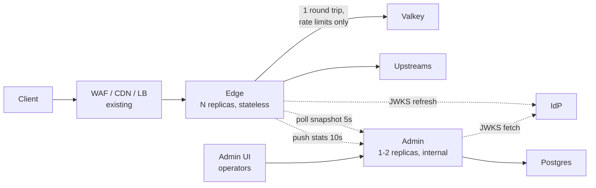
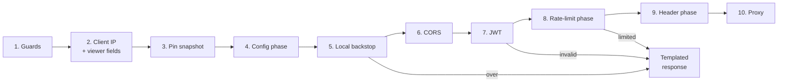
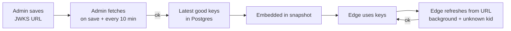
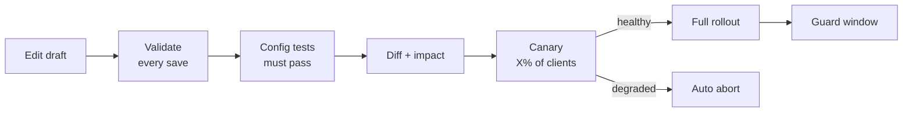

# Edge Proxy: Design

Status: draft for discussion. Open points are marked **DECIDE**. Terms are defined in the [Glossary](#22-glossary).

## 0. Purpose, principles, decisions

The edge is a Go reverse proxy that sits **behind** an existing WAF/CDN/LB and enforces application-aware policy before forwarding to upstreams:

- rate limiting
- JWT validation
- CORS
- header transforms
- locale detection
- templated responses

An admin service with an admin UI manages that policy. The edge does not replace the WAF or CDN.

### Principles (in priority order)

| # | Principle | Meaning |
|---|---|---|
| P1 | **Availability first** | A running edge never stops serving because a dependency failed. Every dependency has a defined degraded mode ([§14](#14-availability)) |
| P2 | **Latency first** | The request path does in-memory work only, except one Valkey round trip for shared rate limits and the upstream call. Nothing is parsed, compiled, fetched or locked per request that could be done ahead of time ([§2.2](#22-latency-rules)) |
| P3 | **Platform-agnostic** | The binaries depend on Valkey, Postgres (admin only), env config and HTTP. CDN, WAF, LB and hosting are deployment choices |
| P4 | **Nothing invalid goes live** | One validator, run on every save, publish and edge activation ([§12.2](#122-validation-one-validator-everywhere)) |
| P5 | **Safe change** | Config tests, canary, shadow mode and automatic rollback ([§12.5](#125-before-going-live)–[§12.6](#126-rollback-guard-every-signal-configurable)) |

### Decisions taken

| Topic | Decision |
|---|---|
| Scope | Edge, admin service, admin UI. No WAF-log worker |
| Policy model | Rules: expression + action, grouped in phases ([§3](#3-rules-engine)) |
| Rate limiting | 4 algorithms chosen per rule. Keys from IP and/or request attributes. Fail-open by default, overridable per rule |
| JWT | Validated at the edge. Issuers defined once; config rules choose which are accepted |
| JWKS | URL set in admin. If keys were never obtained, traffic passes. Once obtained, the latest good set is kept forever |
| Locale | From `Accept-Language` only. Optional |
| Admin auth | Username/password now, OIDC later, behind extensible interfaces |
| Audit | Everything, kept forever, append-only, tamper-evident, visible in the admin UI |
| Publishing | No second approver. Every publish is a version you can view, compare and revert. Degraded publishes roll back automatically; every signal is configurable |
| Deployables | Edge and admin are separate. Only the edge scales |
| Delivery | One release |
| Tests | 100% statement coverage for the edge and every package it imports, from scenario tests. Admin: scenario tests on critical paths, no coverage gate. Load tests run locally only |
| Logs | JSON, raw client IPs |

## 1. Architecture



Solid lines are on the request path. Dotted lines are background work that never blocks a request.

| | Edge (`cmd/edge`) | Admin (`cmd/admin`, serves the admin UI) |
|---|---|---|
| Role | Data plane: every user request | Control plane: operators and edges |
| Scaling | Horizontal, stateless, autoscaled on CPU or RPS | Fixed size |
| Exposure | Behind the WAF/CDN/LB | Internal only |
| Durable state | None. Snapshot in memory, optional cache file | Postgres |
| Load | All user traffic | About 0.3 req/s per edge (one cached snapshot poll per 5s, one stats report per 10s) plus operators |
| Down means | User impact; mitigated by replicas across zones | No user impact. Lost: publishing, stats, guard, admin UI. Edges keep serving |
| Replicas | At least 2 across zones, plus one-zone-loss headroom | 1 acceptable; 2 recommended. Background jobs run on the replica holding a Postgres session advisory lock, held on a **dedicated connection** outside the pool. If that connection drops, the lock is released and the job loop stops before another replica takes over |

### Repo layout (one Go module, two binaries)

```
cmd/edge/            wiring, http.Server, shutdown
cmd/admin/           admin API + UI, publish, snapshot endpoint, stats ingest, JWKS fetch, guard, audit
internal/expr/       expression parser, renderer, type checker, compiler. Shared
internal/snapshot/   config types, strict decode, Compile() (validates and compiles). Shared
internal/ratelimit/  algorithms (Lua + local), backstop, penalty cache
internal/jwks/       JWKS fetch/parse, SSRF guard. Shared
internal/edge/       request pipeline: clientip, viewer, cors, jwt, locale, headers, respond, proxy, stats
internal/admin/      identity, sessions, RBAC, audit, canary, guard
internal/admindb/    Postgres queries, migrations
web/admin/           admin UI: React + Vite + TypeScript + Tailwind, embedded into cmd/admin
loadtest/            k6 scripts, mock CDN/LB/IdP/upstream, compose environment
```

## 2. Request path

### 2.1 Steps



Steps 8 and 10 do network I/O. The rest run in memory.

**Edge responses before step 4** (overload 503, bad client IP 400, bad path 400) can't carry CORS headers, because no policy has been resolved yet. They still carry `Cache-Control: no-store`.

| # | Step | What it does | Why here |
|---|---|---|---|
| 1 | **Guards** | Rejects with a fast 503 when concurrent **ordinary** requests exceed the in-flight cap. Long-lived streams (SSE, WebSocket) have a separate cap, so they can't starve ordinary traffic. `http.Server.MaxHeaderBytes` already capped header size | Shed overload before spending any work on it |
| 2 | **Client IP + viewer fields** | Checks the ingress secret header if configured. Reads the client IP and trusted viewer metadata (country, ASN, scheme, HTTP version) from the configured CDN headers, **only** if the TCP peer is a trusted proxy ([§10](#10-client-identity-and-viewer-metadata)). Rejects ambiguous path encodings ([§3.2](#32-fields)) | Everything later keys on the real client. Spoofed values must be rejected first |
| 3 | **Pin snapshot** | One `atomic.Pointer.Load` of the compiled config, which a background poller keeps current. During a canary, picks the active or candidate config by client hash ([§12.5](#125-before-going-live)). No I/O | Keeps one request on one config version even if the poller swaps it mid-request |
| 4 | **Config phase** | Evaluates Configuration Rules ([§3](#3-rules-engine)). Resolves this request's settings: auth, accepted issuers, CORS policy, locale, response templates, body limit, upstream, upstream timeout. From here on, every edge-generated response carries the request's CORS headers and `Cache-Control: no-store` | Everything after depends on these settings |
| 5 | **Local backstop** | In-memory per-IP token bucket | Cheap flood protection before CPU-heavy JWT and network-bound Valkey; works when Valkey is down. It comes after the config phase so its 429 uses the request's template and CORS headers. The cost: a flood still pays for the config rules, about 70 µs per request on a laptop at the limit of 200 rules of 32 conditions (`BenchmarkMatch200Rules`) and under 1 µs for a realistic config |
| 6 | **CORS** | Answers preflight when a CORS policy applies. With no policy, preflight is forwarded to the upstream like any request | Preflight needs no auth or quota. Browser JS can read edge 429/401 only with CORS headers (set from step 4) |
| 7 | **JWT** | Verifies the token if the config phase requires auth. A verified-token cache means most requests skip signature checks | Rate-limit and header rules may use verified claims |
| 8 | **Rate-limit phase** | Evaluates rate-limit rule expressions in memory. Checks the local penalty cache. Then sends **one pipelined batch** to Valkey for the rules that matched | The only shared, cross-replica decision, and the only network I/O before the upstream |
| 9 | **Header phase** | Applies Header Transform Rules, then edge-managed headers ([§7](#7-header-transform-rules)). Locale is a lazy field: it's resolved the first time anything reads it, in step 8 or here ([§8](#8-locale-from-accept-language)) | Only for requests that will be forwarded |
| 10 | **Proxy** | Enforces the per-upstream in-flight cap (the upstream is known only now). Applies the body limit (`http.MaxBytesReader`) and a body read deadline. Forwards over pooled connections, streaming bodies, SSE and WebSocket. Never retries | The actual job |

### 2.2 Latency rules

| Rule | How |
|---|---|
| No parsing or compilation per request | Expressions, regexes, wildcards, CORS policies, templates and the locale matcher compile once per snapshot |
| At most one Valkey round trip | All matched rate-limit rules go in one pipelined batch. **Accuracy note:** with Valkey Cluster, keys on different shards go to different nodes *in parallel*. Latency is the slowest shard's round trip, not the sum |
| Skip the network whenever possible | The local penalty cache answers for subjects already blocked. Rules whose expression doesn't match cost no Valkey call. No matched rules means no Valkey call at all |
| Bounded network waits | Per-call deadline on Valkey, then a breaker. `ResponseHeaderTimeout` and dial timeouts upstream |
| No global locks, minimal allocation | Stats use `atomic` adds. Request fields are extracted lazily into a fixed per-request struct. Caches are sharded, so a lock covers one shard for a short map operation. Backstop and local buckets each hold their own mutex, contended only by requests for the same subject |
| Expensive work is cached | Verified JWTs (by token hash) and locale results (by raw `Accept-Language`) |
| Responses are never cached downstream | Every edge-generated response sends `Cache-Control: no-store`, so a CDN can't serve one client's 429 or 401 to others |
| Warm before ready | Valkey pools are opened before ready (M4, best effort, bounded wait). Upstream pools are **not** pre-warmed: opening them needs a real request, which may have side effects, so the first requests per upstream pay connection setup. A failed warm-up never blocks readiness (P1) |
| Runtime sized to the container | Go 1.25+ sets `GOMAXPROCS` from the cgroup CPU limit by default (go.dev/doc/go1.25). Set `GOMEMLIMIT` to about 90% of the container memory limit, so GC tightens before an OOM kill |
| Measured, not assumed | Benchmarks gate per-request allocations and each step's cost ([§18](#18-testing)). No latency numbers are quoted until they're measured |

## 3. Rules engine

Policy is a set of **rules**: *when incoming requests match **expression**, then **action/settings***. The admin UI edits a rule as a form:

- Field / Operator / Value rows joined by **And** / **Or**.
- An **All incoming requests** option.
- A live **Expression preview**, with **Edit expression** for typing it directly.
- "Then the settings are…" with **+ Add** per setting.
- **Save as Draft** / **Deploy**.

### 3.1 Phases

| Phase (UI name) | Runs at | Action | When several rules match |
|---|---|---|---|
| `config` (Configuration Rules) | Step 4 | Set request settings (below) | **All apply in order; a later rule overwrites the same setting.** |
| `rate_limit` (Rate Limiting Rules) | Step 8 | Count and possibly block ([§4](#4-rate-limiting)) | Site-wide rules (expression `true`, at most 2) are always evaluated. Other matching rules are evaluated in order, up to 5 per request. Blocked if any `block` rule says no |
| `request_headers` (Header Transform Rules) | Step 9 | Header operations ([§7](#7-header-transform-rules)) | All apply in order |

**Config-phase settings** (each one is an **+ Add** in the UI):

| Setting | Effect | Default when no rule sets it |
|---|---|---|
| `auth` | `none` / `optional` / `required`, plus `accepted` issuers. `optional` passes a request without a token but rejects an invalid one (Envoy `allow_missing`) | `none` |
| `cors_policy` | Name of a global CORS policy, or none | none |
| `locale` | on / off | global setting |
| `responses` | Response kind → template name | global templates |
| `body_limit` | Max request body bytes | global setting |
| `upstream` | Name of an upstream defined in deployment config | host-based mapping |
| `upstream_timeout` | Response-header timeout for this request | global setting |
| `ratelimit_headers` | Emit `RateLimit` / `RateLimit-Policy` headers | off |

**Rule order:** explicit within a phase (drag-and-drop in the UI). An **All incoming requests** rule is the expression `true`.

### 3.2 Fields

Each field has a type and a source. "Viewer" fields describe the client's connection to the CDN, which the edge can't observe itself because it sits behind a TLS-terminating proxy. Those fields come only from trusted headers.

| UI field | Expression | Type | Source |
|---|---|---|---|
| URI Full | `http.request.full_uri` | string | Request (scheme, host, path, query) |
| URI | `http.request.uri` | string | Request (path + query) |
| URI Path | `http.request.uri.path` | string | Request, **normalized** (below) |
| URI Query String | `http.request.uri.query` | string | Request, raw |
| URI Query Argument | `http.request.uri.args["name"]` | string list | Request |
| Hostname | `http.host` | string | Request, lowercased (`strings.ToLower`), port removed. Rule values must be lowercase |
| Request Method | `http.request.method` | string | Request. Methods that aren't all uppercase are rejected with 400 at step 2, so rule values must be uppercase tokens |
| Header | `http.request.headers["name"]` | string list | Request. The name must be an RFC 9110 token and is lowercased when saved |
| Cookie | `http.cookie` | string | Request (whole header) |
| Cookie (named) | `http.request.cookies["name"]` | string list | Request, parsed lazily once. The name must be a token |
| Referer | `http.referer` | string | Request |
| User Agent | `http.user_agent` | string | Request |
| X-Forwarded-For | `http.x_forwarded_for` | string | Request. Client-controlled on the left; for matching only, never identity |
| IP Source Address | `ip.src` | ip | Trusted client IP ([§10](#10-client-identity-and-viewer-metadata)). Compared without IPv6 zone, IPv4-mapped as IPv4 |
| Country | `ip.src.country` | string | Viewer header, uppercased ISO 3166-1 alpha-2. Rule values must be uppercase |
| Continent | `ip.src.continent` | string | From a viewer header mapped in `VIEWER_HEADERS`, uppercase codes. Deriving it from Country needs a verified ISO table and is not built |
| AS Num | `ip.src.asnum` | int | Viewer header |
| SSL/HTTPS | `ssl` | bool | Viewer header (the client's scheme) |
| HTTP Version | `http.request.version` | string | Viewer header (the client's version) |
| Client Certificate Verified | `client_cert.verified` | bool | Trusted header from whatever terminates mTLS |
| Locale | `edge.locale` | string | [§8](#8-locale-from-accept-language). Not available in `config` |
| JWT claim | `http.request.jwt.claims["name"]` | string list | Verified JWT ([§5](#5-jwt-and-jwks)). Not available in `config` |

**Viewer fields:**
- The deployment setting `VIEWER_HEADERS` maps each viewer field to a header. The `cloudfront` and `cloudflare` presets fill it in (Appendix A).
- A field with no configured source is **unavailable**: hidden in the UI and rejected by validation, never silently empty.

**Path normalization (security):**
- Matching uses a copy of the path that has been percent-decoded once, with path parameters (`;x`) dropped from each segment, `//` collapsed and `.` removed. The forwarded path is unchanged.
- The host is lowercased, without port, brackets or a trailing dot (`api.example.com.` is the same DNS name), for both routing and rules.
- This stops `/%61dmin`, `//admin` or `/admin;jsessionid=1` (Tomcat and Spring route it to `/admin`) from bypassing a rule on `/admin`.
- **Ambiguous encodings are rejected with 400** at step 2. Upstreams disagree on how to treat these, so neither interpretation is safe to match on:
  - encoded slash `%2F`
  - encoded backslash `%5C`
  - NUL `%00`
  - a raw `\`
  - invalid UTF-8, such as the overlong `/` in `%c0%af`
  - a `..` segment, raw or encoded (`%2e%2e`). An upstream that doesn't resolve it (Express mounts, many Node routers) routes `/admin/../public` under `/admin`, while the resolved path would match `/public`. Browsers and RFC 3986 clients remove dot-segments before sending, so real clients never send one. Dropping `.` or collapsing `//` only keeps a path under the prefix it was already under, so those are normalized, not rejected
  - a path parameter on a dot-segment (`..;x`, `.;x`, `..%3Bx`). Tomcat reads it as `..`; nginx, Express and Go read it as a name, so dropping the parameter would match a different path than some upstreams route

  The encoded-slash check reads the raw request target, not `URL.EscapedPath`: Go re-encodes the decoded path when the raw one contains a character such as `{` or `|`, which would turn `%2F` back into `/`.

  Envoy offers the same choice for escaped slashes (`path_with_escaped_slashes_action`, `REJECT_REQUEST`). A global setting can allow `%2F` for APIs that need it.
- **Non-uppercase methods are rejected with 400** at step 2. RFC 9110 methods are case-sensitive and every standard one is uppercase, but Go's server accepts any token, so `post` would slip past a rule on `POST` at an upstream that folds case.
- **Warning** when a rule matches on `http.request.uri` or `http.request.full_uri`. Those fields are raw and not normalized.
- **Residual risk:** an upstream that normalizes differently can still disagree. Config tests ([§12.5](#125-before-going-live)) should include encoded variants of protected paths.

**List fields** (headers, cookies, args, claims) match if **any** value matches.

**Missing values:**
- An absent header, cookie, argument or claim, an absent client IP and an absent AS number are **missing**. A positive comparison (`eq`, `contains`, `in`, `gt`, ...) against a missing value is false.
- A negated operator is the negation of its positive form, so `ne`, `not ... contains`, `not ... in` are **true** for a missing value. `http.request.headers["x-key"] ne "secret"` matches a request with no `x-key` header.
- Plain string fields (`http.referer`, `http.user_agent`, ...) are the empty string when the header is absent.

**Values that can never match are rejected** by validation, because a dead rule looks active in the UI while doing nothing:
- uppercase letters in a case-sensitive comparison on `http.host`, lowercase on country or continent
- a method value, header name or cookie name that is not an RFC 9110 token
- an IP literal with an IPv6 zone
- invalid UTF-8 anywhere (JSON storage would silently replace it, so the stored rule would differ from the validated one)

### 3.3 Operators

| UI operator | Expression | Types | Semantics |
|---|---|---|---|
| equals / does not equal | `eq` / `ne` | all | Case-sensitive for strings |
| contains / does not contain | `contains` / `not (… contains …)` | string | Case-sensitive substring |
| starts with / does not start with | `starts_with(f, "x")` / `not …` | string | Case-sensitive |
| ends with / does not end with | `ends_with(f, "x")` / `not …` | string | Case-sensitive |
| wildcard | `wildcard` | string | **Case-insensitive (ASCII letters only)**, matches the **whole** value, `*` = zero or more characters, `**` is invalid, `\*` and `\\` escape. Non-ASCII letters are compared exactly |
| strict wildcard | `strict wildcard` | string | As wildcard, case-sensitive |
| is in / is not in | `in {…}` / `not (… in {…})` | string, int, ip | Set membership. IP sets accept IPs and CIDRs |
| matches regex | `matches` | string | Go RE2 (guaranteed linear time). **Global setting, off by default.** Pattern ≤ 1 KB |
| greater / less (or equal) | `gt` `ge` `lt` `le` | int | e.g. AS Num |
| is true / is false | `f` / `not f` | bool | |

**Logic:** `not` > `and` > `or`, plus parentheses.

### 3.4 Syntax, storage, builder

- **Canonical form:** a JSON AST in Postgres.
  - The preview text is rendered from the AST; **Edit expression** parses text back.
  - Both are in `internal/expr`, and fuzz tests check `parse(render(ast)) == ast`.
- **Syntax:** our own grammar of dotted field names, word operators and functions, e.g. `http.host eq "example.com" and starts_with(http.request.uri.path, "/api/")`. Some semantics cite another vendor's documentation where noted; no compatibility with any vendor's language is promised.
- **Builder vs text:** the visual builder edits an OR of AND-groups, which is what the And/Or rows express. Text mode allows any nesting; if it can't be shown as rows, the UI shows text only.
- **One parser:** the admin UI never parses, renders or validates in the browser. Each change calls the admin API, which uses the same Go code as the edge ([§13.6](#136-admin-ui-stack)). The AST's JSON shape matches the UI builder's tree, so no conversion layer is needed.
- **Limits:**

  | Limit | Value |
  |---|---|
  | Expression length | ≤ 4000 characters |
  | Conditions per rule | ≤ 32 |
  | `in` set size | Bounded by expression length (roughly 250 to 300 IPv4 ranges). Larger sets would need named lists, not planned |
  | Rules per phase | ≤ 200 |

**Why our own engine:**
- **Not CEL:** `cel-go` v0.30.0 requires antlr4, protobuf and genproto (its `go.mod`). That's too heavy for the edge, and its syntax differs from the builder preview.
- **Not `ServeMux`:** it can't express OR, headers, IPs, countries or wildcards.

### 3.5 Evaluation cost

- **Compiled once per snapshot** into Go closures:
  - lowercased constants for `wildcard`
  - hash sets for `in`
  - IP sets merged into sorted address ranges (binary search)
  - a wildcard matcher with no backtracking: prefix check, left-to-right `bytes.Index` for middle segments, suffix check. The value is copied into a 512-byte stack buffer (and ASCII-lowercased for `wildcard`), so matching doesn't allocate
  - RE2 for regex
- **Lazy fields:** each field is extracted on first use and memoized in a fixed per-request struct. Rules that never reference cookies never parse cookies.
- **Short-circuit** `and` / `or`.
- **Linear scan per phase:** cost is rules × conditions.
  - A benchmark gates the worst allowed config (200 × 32 per phase) and a realistic one.
  - **If the benchmark requires it:** index rules whose top-level `and` contains `http.host eq "…"` by host, so a request scans only its host's rules plus host-independent rules.

### 3.6 Expression validation

- **Errors:**
  - Type errors.
  - Unknown or unavailable fields.
  - Fields not available in the rule's phase.
  - Invalid CIDR, regex or wildcard.
  - Limits exceeded.
- **Warnings:**
  - Trivially unsatisfiable expressions (`http.host eq "a" and http.host eq "b"`).
  - A config rule fully overwritten by a later `true` rule.
  - **Spoofable exclusions:** a rate-limit rule whose expression *excludes* traffic using a client-controlled field (header, cookie, query, X-Forwarded-For, User Agent, Referer). Exclude by `ip.src` or a verified claim instead.

## 4. Rate limiting

### 4.1 Rule

```yaml
rate_limit_rules:
  - id: login-per-ip
    expression: 'http.request.method eq "POST" and http.request.uri.path eq "/v1/login" and not ip.src in {10.0.0.0/8}'
    algorithm: sliding_window     # fixed_window | sliding_window | token_bucket | leaky_bucket
    limit: 5
    period: 1m
    burst: 5                      # token_bucket / leaky_bucket only
    key: [ip]                     # 1-5 characteristics ([§4.3](#43-keys))
    on_missing_key: fallback_ip   # skip | fallback_ip | reject
    action: block                 # block | log (shadow)
    penalty: 5m                   # optional
    fail_mode: local              # open | closed | local
```

**Evaluation:**
- **Site-wide rules** (expression `true`) are always evaluated, wherever they sit in the list. At most 2 are allowed (a validation error beyond that). They give the site-wide per-IP ceiling, and the cap can never skip them.
- **Other matching rules** are evaluated in order, up to 5 per request. Rules beyond 5 are skipped and `ratelimit.rules_capped` is incremented.
  - **Only rules that can block use the cap first.** Blocking rules take slots before shadow (`action: log`) rules, and a rule skipped for a missing key (`on_missing_key: skip`) takes no slot. Clients choose which rules match through the fields they send, so otherwise five matching shadow or skipped rules could push a blocking rule such as a login limit out of evaluation.
- So a request costs at most 7 commands, all in one pipelined batch.
- **Rules are independent counters, not atomic with each other.** A request blocked by one rule still consumes quota in the others it matched. Checking before consuming would need a second round trip, which P2 rules out.
- **A penalty applies only to `action: block` rules.** Shadow rules record that the penalty *would* start, but never block.

### 4.2 Algorithms

Every algorithm keeps its state in **one Valkey key** and reads time from Valkey's `TIME`.

- **One key:** in Valkey Cluster, a script may touch only keys passed in `KEYS`, and they must share a slot (valkey.io/topics/eval-intro).
- **Server time:** avoids clock skew between replicas.

| Algorithm | State | Behavior | `Retry-After` |
|---|---|---|---|
| `fixed_window` | Hash `{a: window start, b: count}` | Simplest; up to 2× limit across a boundary | Time to window end |
| `sliding_window` | Hash `{a: window start, b: current, c: previous}`; estimate = `prev × overlap + cur` | Smooths the boundary burst | Window end, plus `period/limit` when the current window is full (an upper bound) |
| `token_bucket` | Hash `{a: tokens × period, b: last update}` | Bursts to `burst`, refills at `limit/period` | Time to next token |
| `leaky_bucket` | Hash `{a: level × period, b: last update}`: the leaky bucket as a meter, which is equivalent to GCRA (ITU-T I.371) | Steady drain with burst tolerance. **Rejects, never queues** (queueing holds connections, against P1/P2) | Time until one request fits |

Notes:
- **Integer milliseconds, one model.** Every script works in whole milliseconds, and `ratelimit.Step` is the same arithmetic in Go. Step serves `fail_mode: local` and the backstop, and a differential test runs random sequences against real Valkey (standalone and cluster), comparing each decision, the stored state and the TTL.
  - Lua numbers are doubles, so validation keeps `burst × period(ms)` at most 2^51 for the bucket algorithms (e.g. at most 26,062,497 per 24h). Sliding-window weights use parts per million so products stay below 2^53, and the weighted previous count rounds **up**: rounding down would admit one extra request just after every boundary. Stored numbers are formatted with `%d`, because Lua's default conversion keeps only 14 digits.
  - A blocked request (active penalty) writes nothing; the key's TTL already covers the penalty.
- **Rejected:** sliding-window *log*, because its memory grows with the limit.
- **Token vs leaky bucket:** with equal parameters, leaky bucket as a meter admits the same traffic as token bucket. Both are offered for operator familiarity.
- **Changing a rule:**
  - A change to `limit` or `burst` applies on the next call.
  - A change to `algorithm` or `period` changes the key (both are in it), so state starts fresh. Old state isn't misread under a new window, and the old keys expire on their own TTL.
- **TTLs:** every key's TTL is the longer of its algorithm window and any active penalty, and the penalty extends it.

### 4.3 Keys

| Characteristic | Source |
|---|---|
| `ip` | Trusted client IP. IPv6 truncated to /64 |
| `header:<n>`, `cookie:<n>`, `query:<n>` | Request (attacker-controlled) |
| `jwt_claim:<n>` | Verified JWT |
| `host`, `method`, `country`, `asnum`, `locale` | Request / viewer / [§8](#8-locale-from-accept-language) |
| `constant` | One bucket for the rule. A hot key on one shard, so use only with low limits |

- **Valkey key:** `rl:<algo>:<period ms>:<rule_id>:{<b64url(sha256(subject))[:16 bytes]>}`. The subject is a domain byte followed by length-prefixed values, or a different domain byte followed by the client IP for `fallback_ip`. So a client-chosen header value can never produce another client's fallback bucket. The hash bounds key size and keeps raw values out of Valkey. The `{}` hash tag spreads subjects across slots.
- **Rule: attacker-controlled keys need a partner.** Clients can rotate header, cookie or query values to get a fresh bucket each time, and also `host` (any Host reaches the rule when a config rule routes every host) and `method` (any uppercase token is a valid method). So a rule keyed only on those is a validation error unless its own key also includes `ip` or `jwt_claim`, or a site-wide rule keyed on `ip` exists. Whether two arbitrary expressions overlap is undecidable, so validation doesn't try.
- **JWT claims are available only when this request's `auth` setting verified a token.** Otherwise `jwt_claim` keys count as missing (`on_missing_key`).
- **Rule: `on_missing_key` defaults to `fallback_ip`.** With `skip` (the AWS WAF and NGINX behavior), omitting the header bypasses the rule.

### 4.4 Actions and penalty

- **`action: log` (shadow mode):** evaluate and count, never block. Peers: Envoy `shadow_mode`, NGINX `limit_req_dry_run`, AWS WAF `Count`.
- **`penalty`:** keeps a subject blocked for a set time after it exceeds.
  - It's stored as `blocked_until` in the same key.
  - Each replica also keeps a bounded local copy (100,000 subjects). **Checking it comes first, so a blocked subject costs no Valkey call.** When the copy is full, Valkey still enforces the penalty.

### 4.5 Local backstop

- A per-IP token bucket in each replica, always on, with one global setting. The effective ceiling is about N replicas × the setting.
- **It runs `ratelimit.Step`'s token bucket,** not `x/time/rate`. Each IP's bucket locks only itself; a shard lock covers only the map lookup. That needs no extra dependency. The state survives snapshot swaps unless the backstop settings change.
- **IPv6 is keyed by /64,** like the shared rate limits, so rotating addresses within one subscriber prefix doesn't create new buckets.
- **Memory is bounded:** a sharded map with `max_entries` and an idle sweep.
- **When the map is full, new IPs aren't tracked.** They pass the backstop, which is fail-open, and `backstop.untracked` is incremented. Sharing one overflow bucket would throttle innocent users together. The shared Valkey limits still apply to them.

### 4.6 Valkey failure

- A per-call deadline (`VALKEY_TIMEOUT`), then a breaker **per Valkey node**: after 5 consecutive failures, skip that node for 1s, then let one probe through. One failed shard affects only the keys that live on it.
  - Consecutive failures rather than an error ratio: the breaker is three atomics, with no lock or ring buffer on the request path.
  - valkey-go keeps its slot map private, so the edge reads `CLUSTER SLOTS` every 5s off the request path and computes each key's slot (CRC16, hash tags) to find its node's breaker.
  - **Cluster deployments must set `cluster-require-full-coverage no`.** With the default `yes`, one failed primary makes every node answer `CLUSTERDOWN` for every key, and the per-node breaker can't contain it.
- **Startup never waits on Valkey.** valkey-go dials when a client is created, so the edge connects in a background loop. Until it has a client **and** a slot map, calls fail fast into each rule's `fail_mode`. Each attempt reads the slot map before loading scripts, so a node that refuses `SCRIPT LOAD` (ACL, failover) can't leave breakers on a stale map; such a node is served through the `NOSCRIPT` → `EVAL` fallback. A best-effort connect before ready is bounded by the dial timeout (1s default, `dial_timeout` in `VALKEY_URL`) plus 2s.
- **`fail_mode` per rule:**

  | Mode | On Valkey failure |
  |---|---|
  | `open` (default) | Allow |
  | `closed` | 503 with `Retry-After` |
  | `local` | Per-replica bucket at `limit / fleet_size` (degraded). State is bounded (100,000 subjects per replica, split evenly between rules, so a rule keyed on client-chosen values can only fill its own share). It survives publishes, matched by rule ID, so a publish during an outage can't reset counts; it starts fresh only when the number of rules changes. `fleet_size` is the number of edges admin saw reporting in the last minute. The snapshot envelope carries it ([§12.3](#123-distribution)), and admin's answer to every stats report updates it ([§15.2](#152-stats-push-to-admin)), so edges coming and going never change the snapshot. If it's unknown, `EXPECTED_REPLICAS` from deployment config is used |

- **No retries.** A call consumes quota, so a timeout is ambiguous.
  - **Verified in valkey-go v1.0.78:** network-error retry applies only to commands carrying the retryable tag (`client.go` `Do`/`DoMulti`; `cluster.go` `doresultfn` for `TRYAGAIN`, `CLUSTERDOWN` and `LOADING`). A plain `EVALSHA` from the command builder has no such tag, and `DisableRetry` is set as well.
  - **Batch, not `Lua.ExecMulti`:** `ExecMulti` runs `SCRIPT LOAD` on every node on every call (`lua.go`), which would add round trips. The edge preloads the scripts at connect time and on every topology refresh, then sends one `DoMulti` of `EVALSHA`.
  - Remaining retries are safe, because the command never ran: `MOVED`/`ASK` redirects and the `NOSCRIPT` → `EVAL` fallback.
- **A dedicated valkey-go client for rate limiting,** with its own short timeouts.

### 4.7 Response headers

- `Retry-After` on every 429 (RFC 9110 §10.2.3).
- `RateLimit` / `RateLimit-Policy` (IETF draft-11, not an RFC) only where the `ratelimit_headers` setting is on. One item per enforced rule, named by rule ID: `RateLimit-Policy: "login";q=5;w=60` and `RateLimit: "login";r=2;t=41`. Shadow rules are left out. They replace any the upstream sent.
- `on_missing_key: reject` answers 400 `bad_request`.
- `fail_mode: closed` answers 503 `unavailable` with `Retry-After: 1`. A shadow rule never fails closed.

## 5. JWT and JWKS

### 5.1 Issuers

Issuers are defined once. The `auth` setting in a config rule lists which ones are **accepted**. A list, not a single override, supports several IdPs and IdP migrations (accept old and new together). Envoy `jwt_authn` uses the same shape: named providers, plus per-route "any of" requirements.

```yaml
auth:
  issuers:
    - id: corp
      issuer: https://auth.example.com/
      audiences: [api]
      jwks_url: https://auth.example.com/.well-known/jwks.json
      algorithm: RS256
  default_accepted: [corp]
config_rules:
  - id: orders-auth
    expression: 'starts_with(http.request.uri.path, "/v1/orders")'
    settings: { auth: { mode: required, accepted: [corp, corp-new] } }
```

With a single IdP, `accepted` is never set and the UI shows no issuer choice.

### 5.2 Keys



- **Cold starts work while the IdP is down,** because edges seed their keys from the snapshot.
- **Keys live in their own store on the edge, separate from the compiled config.**
  - Each issuer's key set carries `fetched_at`, from whoever fetched it: admin or the edge.
  - Key sets belong to an issuer **and its JWKS URL**, in Postgres, in the snapshot and on the edge. A canary that moves an issuer to a new URL carries both sets, so the active version never verifies with the new IdP's keys.
  - **The newest `fetched_at` wins.** A snapshot swap never replaces newer keys the edge fetched itself with older keys from admin.
  - Each replacement takes a new `generation` number (used by the token cache, [§5.3](#53-verification)).
  - **Keys belong to the JWKS URL.** When a publish changes an issuer's URL, its keys start over from the snapshot and the new URL; keys from the old URL are never used for it.
- **Edges also refresh directly,** in the background every 10 minutes.
- **On an unknown `kid`:** one shared fetch per issuer (single-flight), at most once per 30s.
  - Requests carrying that `kid` wait for it, up to 1 second, then get 401.
  - Other requests are never blocked.
- **Keys are replaced only by a successful parse, and never cleared.**
  - A JWKS with no usable signing key counts as a failed fetch.
  - Keys this edge can't verify with are skipped, not fatal: encryption keys (`use: enc`), symmetric keys, other curves, RSA keys under 2048 bits (RFC 7518 §3.3), and malformed keys. IdPs publish such keys next to their signing keys.
- **"Forever" means the latest good set, not every key ever seen.** A key the IdP removes (rotation or compromise) is dropped on the next good fetch.
- **No key ever obtained for an issuer → traffic passes at runtime.** It goes through without `X-Edge-Auth-*` headers, logs `edge.auth=pass_no_keys` and counts `edge_auth_total{result="pass_no_keys"}` for alerting. The edge keeps trying to fetch keys, at most once per 30s per issuer. Upstreams must still validate tokens. This keeps traffic flowing if the IdP is down when an issuer is first set up.
- **But publish is blocked** if a rule with `auth: required` accepts an issuer whose JWKS has **never** been fetched successfully. That catches a mistyped JWKS URL before it opens a protected path.
  - A publisher can override, with an audited reason, e.g. "IdP is down, publishing anyway".
  - The override is shown on the version ([§12.7](#127-versions-and-revert)).

### 5.3 Verification

0. The token comes only from `Authorization: Bearer` (RFC 6750 §2.1; the scheme is case-insensitive). Query-string tokens are never read: they end up in logs. Another scheme counts as no token. Two `Authorization` headers are ambiguous and rejected.
1. Token ≤ 4096 bytes (Envoy's default `jwt_max_token_size`).
2. Read `iss` (untrusted) only to pick an issuer. Reject it if it isn't accepted for this request.
3. Require that issuer's configured `alg`, and verify with **that issuer's keys only**. This prevents algorithm confusion and cross-issuer key use.
   - The key is picked by `kid`, and must be of the type and curve the algorithm needs, and match the JWK's own `alg` when it has one.
   - A token without `kid` is accepted only when the issuer has exactly one key, so the edge never tries several keys.
4. Check `exp`/`nbf` with a 60s clock skew (Envoy's default `clock_skew_seconds`), `iss` and `aud` (any configured audience). `exp` is required, so no token is valid forever.
5. On failure: 401 with `WWW-Authenticate: Bearer` (RFC 9110 §15.5.2), adding `error="invalid_token"` when a token was presented (RFC 6750 §3.1).
6. On success the upstream gets `X-Edge-Auth-Issuer` (issuer id) and `X-Edge-Auth-Sub` (the `sub` claim), set after header rules so none can override them. `Authorization` is still forwarded, so upstreams can validate themselves.

**Claims as fields:** each claim becomes a string list. Strings and booleans are kept as text, numbers exactly as sent, arrays per element. Objects and nulls have no string form and are absent.

**Verified-token cache:**
- **Key:** SHA-256 of the token. Each entry records the issuer it verified under and that issuer's key `generation`. A hit counts only while both are still current, so when keys rotate or a publish changes the issuer config (iss, audiences, alg, URL), old entries simply stop matching. A publish that doesn't touch the issuer keeps the cache.
- Bounded at `TOKEN_CACHE_SIZE` tokens, default 10,000 (new tokens are verified but not stored when full, so a flood of fresh tokens can't push out the ones real clients reuse), with entries expiring at `min(exp + clock skew, 10 minutes after verification)`.
- Only valid tokens are cached, like Envoy `jwt_cache_config`.
- **A cache hit skips only the signature check.** These checks still run on every request, because they're cheap comparisons that depend on this request's config:
  - the token's `iss` is in this request's accepted list
  - `exp`/`nbf` against the current time
- Each token's signature is checked once per replica per key generation.

### 5.4 SSRF guard

Admin users enter URLs that admin and edges then fetch, so `internal/jwks` enforces:

- HTTPS only, TLS 1.2 or later.
- Resolved addresses must be public unicast: not loopback, private, link-local (cloud metadata), unspecified, multicast, shared (`100.64.0.0/10`) or NAT64 (`64:ff9b::/96`) of any of those. `JWKS_ALLOWED_HOSTS` lists hosts (by URL host) exempt from this.
- No proxy from the environment: the dial check would see only the proxy's address.
- **Checked at connect time,** in `net.Dialer.Control` against the address actually dialed. A pre-resolution check alone is open to DNS rebinding: resolving to a public IP once, then to a private one.
- 64 KB response cap.
- A 5s timeout.
- Redirects only to the same host over https, at most 3.

## 6. CORS

- **Built in-house per the Fetch standard.** Named policies are defined globally, and a config rule selects one with `cors_policy`.
- **Policy fields:** origins, methods, request headers, exposed headers, credentials, `max_age`.
- **Preflight** is answered by the edge. It counts against the local backstop only.
- **Edge-generated responses from step 4 onward carry CORS headers.** Earlier ones can't ([§2.1](#21-steps)).
- **`Vary: Origin`** is added whenever a CORS policy applied and the allowed origin depends on the request (any list other than a single fixed origin), so caches don't serve one origin's headers to another (Fetch standard, CORS protocol and HTTP caches).
- **Preflight with no policy** is forwarded to the upstream unchanged.
- **Preflight answers:** always `204` with `Cache-Control: no-store`. When the origin, the requested method (CORS-safelisted `GET`/`HEAD`/`POST` need no listing) and every requested header are allowed, the response echoes the requested method and headers in `Access-Control-Allow-Methods`/`-Headers`, plus `Access-Control-Max-Age`. Otherwise it carries no `Access-Control-*` headers, which the browser treats as a failed check.
- **Allowed origin:** `*` sends `*`; a single listed origin is always sent as is; a list echoes the request's `Origin` when it is listed. Only the list form varies by request, so only it sends `Vary: Origin`.
- `ModifyResponse` strips upstream `Access-Control-*` headers when a policy applied.
- **Validation rejects `*` together with credentials.**

## 7. Header Transform Rules

```yaml
request_headers:
  forward: { mode: denylist, names: [X-Debug] }    # global: all | allowlist | denylist
request_header_rules:
  - id: keep-original-ua
    expression: 'http.user_agent ne ""'
    ops: [ { op: copy, from: User-Agent, to: X-Original-User-Agent } ]
  - id: tenant
    expression: 'http.request.jwt.claims["tenant"] ne ""'
    ops: [ { op: set, name: X-Tenant, value: "{{jwt_claim:tenant}}" } ]
  - id: orders-allowlist
    expression: 'starts_with(http.request.uri.path, "/v1/orders")'
    ops: [ { op: forward, mode: allowlist, names: [Authorization, Content-Type, Accept, Cookie] } ]
```

- **Operations:**
  - `set`
  - `append`
  - `remove`
  - `copy` (keeps the source). Copy and rename read the headers as forwarded, after the filter and earlier ops. When the source is absent the target is **removed**, so a client can't supply its own value for it by omitting the source.
  - `rename`
  - `forward` (replaces the forward filter; the last matching one wins)
- **Placeholders:** `{{header:<n>}}`, `{{client_ip}}`, `{{jwt_claim:<n>}}`, `{{country}}`, `{{locale}}`, `{{request_id}}`. All are resolved from the per-request field struct. Header and claim values have control characters removed (CR/LF would split the header; the transport rejects other controls). Literal parts are validated free of them.
- **The forward filter always keeps reserved headers.** `ReverseProxy` sets `Connection`, `Upgrade` and `Te` before `Rewrite`, so an allowlist without them would break WebSockets and gRPC trailers.
- **Order:**
  1. Forward filter.
  2. Rule operations, in rule order.
  3. **Edge-managed headers last**, which no rule can override: `X-Forwarded-*`, `X-Edge-Client-IP`, `X-Edge-Geo-*`, `X-Edge-Auth-*`, `X-Edge-Locale`, `X-Request-Id`.
- **Reserved, never targetable:** `Host`, `Connection`, `Upgrade`, `Transfer-Encoding`, `Content-Length`, the client-IP and viewer source headers, and `X-Edge-*`.
  - **Never readable either,** on every path that names a header: ops, `{{header:<n>}}`, `header:<n>` rate-limit keys and `http.request.headers["<n>"]` in expressions. A client can forge `X-Edge-*` before the edge replaces it (forging `X-Edge-Auth-Sub` into an upstream header would bypass authorization), and source headers can carry the ingress secret. The edge also strips client `X-Edge-*` and source headers at step 2, before any rule runs.
- **Warnings:** an allowlist that drops `Authorization`, `Cookie` or `Content-Type`; a copy or rename whose source any forward filter can drop.
- **Config tests** see `upstream_headers` from the same step 9 code as live traffic (`Simulate`), including the strip of client `X-Edge-*` and source headers, without the deployment-dependent forwarding headers (`X-Forwarded-*`, `X-Edge-Client-IP`, `X-Request-Id`).

## 8. Locale from `Accept-Language`

- **Off by default.** Turned on globally or by the `locale` config setting.
- **Config:** `supported` (BCP 47 tags), `default`, `output_header` (default `X-Edge-Locale`).

**Per request:**

0. **Locale is a lazy field.** It's resolved the first time anything reads it: a rate-limit key or expression (step 8), a header rule or placeholder, or the output header (step 9). Then it's memoized for the request.
1. If locale is off, do nothing (zero cost).
2. If `Accept-Language` is missing or over 256 bytes, use `default`.
3. Look up the cache by the raw header string. **A hit costs one map read.**
4. On a miss, run `language.ParseAcceptLanguage`, then a `language.Matcher` built per snapshot (`golang.org/x/text/language`), and cache the result.
5. Strip any client `X-Edge-Locale`, then set it.

**Notes:**
- **Why x/text:** correct BCP 47 matching (scripts, regions, q-values) is easy to get wrong by hand, e.g. `zh-TW` vs `zh-Hant`.
- **Cache:** bounded per replica. When full, new strings are matched but not stored.
- **Latency:** browsers send the user's language settings verbatim, so distinct header values are few and hits should dominate. Misses cost one bounded parse. Both are benchmarked, and the hit rate is measured in load tests.
- **CDN caching:** if a CDN caches language-varying responses, its cache key must include `Accept-Language`.

## 9. Responses

Templates are global. The `responses` config setting maps response kinds to templates per request, e.g. JSON for `/api/`, HTML elsewhere.

```yaml
responses:
  rate_limited_json:
    status: 429
    content_type: application/json
    body: '{"error":"rate_limited","retry_after":{{retry_after}},"request_id":"{{request_id}}"}'
  rate_limited_html:
    status: 429
    content_type: text/html; charset=utf-8
    body: '<!doctype html><title>Too many requests</title><p>Try again in {{retry_after}} seconds.</p>'
```

- **Kinds and their required status:** `bad_request` 400, `unauthorized` 401, `misdirected` 421, `payload_too_large` 413, `rate_limited` 429, `bad_gateway` 502, `unavailable` 503, `overloaded` 503, `gateway_timeout` 504. `global.defaults.responses` must map every kind, because the edge can send any of them on any request.
- **Headers on every edge-generated response:** `Cache-Control: no-store`; `Retry-After` on 429 and 503; CORS headers from step 4 onward.
- **Placeholders:** `{{retry_after}}`, `{{request_id}}`, `{{status}}`. All are edge-generated, so nothing from the request can be injected. Templates are split into literal and placeholder parts at compile time and rendered with appends. `{{request_id}}` is safe in JSON and HTML only because the edge accepts an incoming `X-Request-Id` solely in a restricted character set ([§11](#11-proxy-and-http-server)).
- **Validation:** status 400–599, body ≤ 32 KB, allowed content types only, JSON valid after sample substitution.

## 10. Client identity and viewer metadata

| `CLIENT_IP_SOURCE` | Client IP header | Viewer headers (preset) |
|---|---|---|
| `cloudfront` | `CloudFront-Viewer-Address` (`ip:port`) | `CloudFront-Viewer-Country`, `CloudFront-Viewer-ASN`, `CloudFront-Forwarded-Proto`, `CloudFront-Viewer-Http-Version` |
| `cloudflare` | `CF-Connecting-IP` (`ip`) | `CF-IPCountry`; scheme from a trusted `X-Forwarded-Proto` |
| `header:<Name>:<ip\|ip_port>` | any | via `VIEWER_HEADERS` |
| `xff` | `X-Forwarded-For`, walked right to left past trusted proxies | via `VIEWER_HEADERS` |
| `remote_addr` | TCP peer | none |

**Sources for the header names:**
- CloudFront: "Adding CloudFront request headers" in the CloudFront developer guide.
- Cloudflare: "HTTP request headers" in Cloudflare's docs. It also documents `True-Client-IP` (Enterprise) and `CF-Connecting-IPv6` with Pseudo IPv4.

**Trust needs three controls together:**

1. **The origin accepts only CDN traffic.** This is network-level and the deployment's job: CloudFront VPC origin or prefix list + secret header; Cloudflare IP ranges, Authenticated Origin Pulls or a tunnel.
2. **`TRUSTED_PROXIES`:** headers are honored only if the TCP peer is trusted; otherwise 400.
3. **Normalize:** parse with `netip` and drop the port. Strip all client-IP and viewer source headers, the standard `Forwarded` header (RFC 7239) and the ingress secret header before forwarding, and send `X-Edge-Client-IP` / `X-Edge-Geo-*` instead.

**Ingress secret header (optional):**
- When `INGRESS_SECRET_HEADER` and its value(s) are configured, a request without a matching value gets 400 at step 2. More than one value is allowed, so the secret can be rotated without downtime.
- The value is compared in constant time and is never logged or forwarded.
- This is extra assurance for CDNs that can add an origin header. It doesn't replace the network-level control.

**Untrusted peer, or a missing or unparseable client-IP header:** 400 with the `bad_request` template. The edge never silently falls back to `remote_addr`, because that would rate-limit everyone as the LB's IP.

**`ip_port` parsing:**
- If the value starts with `[`, use bracket form; otherwise split on the last `:`. The format is declared per preset, because `2001:db8::1:443` is itself a valid IPv6 address.
- **CloudFront IPv6 is undocumented by AWS** (the docs show only `198.51.100.10:46532`). Evidence conflicts:
  - An nginx bug report (trac.nginx.org) shows an unbracketed value from a real CloudFront request.
  - 18F `identity-idp` test fixtures assume brackets.
- The preset accepts both. Parse failures are a metric with an alert.

## 11. Proxy and HTTP server

**`httputil.ReverseProxy` with `Rewrite`** (`Director` is deprecated since Go 1.26, go.dev/doc/go1.26):
- `SetURL(upstream)`
- `Out.Host = In.Host`
- **Forwarding headers, set explicitly. Don't call `SetXForwarded()`.**
  - In go1.27.2 `reverseproxy.go`, `SetXForwarded` takes the client IP from `In.RemoteAddr`, which here is the LB. It also sets `X-Forwarded-Proto` from `In.TLS`, which here is always `http` because TLS ends at the CDN/LB.
  - The edge sets instead:
    - `X-Forwarded-For` = the trusted client IP ([§10](#10-client-identity-and-viewer-metadata))
    - `X-Forwarded-Proto` = the viewer `ssl` field (`https`/`http`), or `http` if no viewer source is configured
    - `X-Forwarded-Host` = `In.Host`
  - Incoming `Forwarded`, `X-Forwarded-For`, `X-Forwarded-Host` and `X-Forwarded-Proto` are already removed from `Out` before `Rewrite` is called (the `ReverseProxy.Rewrite` doc comment).
- **Query string:** Go also removes unparsable query parameters from `Out` before `Rewrite`. We keep that default and don't copy `In.URL.RawQuery` back. The upstream then sees the same parameters the rules matched on. The `Rewrite` doc comment warns that copying the raw query can cause security issues when the proxy and upstream interpret it differently.
- then [§7](#7-header-transform-rules)

**Upstreams:**
- `UPSTREAMS` in deployment config defines named upstreams, plus a host → name map.
- The `upstream` config setting can pick a **name**, never a URL, so admin users can't point traffic anywhere new.
- One shared `http.Transport` per upstream, with `MaxIdleConnsPerHost` far above its default of 2, plus dial, TLS and `ResponseHeaderTimeout`.
- **A host with no upstream mapping** gets 421 with the `misdirected` template.
- **The edge never retries upstream requests.** A request may not be safe to repeat, and retries multiply load during an incident. (Go's `Transport` itself may retry a request that failed on a reused idle connection before any response; that's the stdlib's own behavior and stays.)

**Streaming:**
- **SSE:** ReverseProxy flushes immediately for `text/event-stream` and `ContentLength == -1` (go1.27.2 `reverseproxy.go`).
- **WebSocket:** handled through the stdlib's upgrade path. Hijacking clears connection deadlines (`server.go` `hijackLocked`).
- Rate limiting and JWT apply at connect only.
- **Stats:** a stream's latency is its time to response headers. Its lifetime would fill the top histogram bucket, which the guard's `p99_latency` reads. A WebSocket is counted and logged as 101; the access log's `duration_ms` is the stream's lifetime.
- **Half-close:** when the upstream closes a WebSocket, ReverseProxy half-closes the client side; the stream slot is freed when the client closes too (RFC 6455 §7.1.1).
- **h2c:** `Upgrade: h2c` reaches the upstream without `HTTP2-Settings`, because ReverseProxy drops headers named in `Connection`. A compliant upstream can't switch to HTTP/2 and carry requests the edge never checked.

**`http.Server`:**
- `WriteTimeout = 0`; anything else would cut SSE.
- `ReadHeaderTimeout` set.
- **No global `ReadTimeout`,** because it would cut long uploads and streams. A **body read deadline** is set per request with `http.ResponseController.SetReadDeadline`, from config (default 60s, extendable for upload paths). Slow-body clients can't hold connections forever.
- `MaxHeaderBytes` set explicitly (the default is 1 MB).
- `IdleTimeout` above the front LB's idle timeout, on the internal server too.
- **Framing:** conflicting `Content-Length` values get 400. With `Content-Length` and `Transfer-Encoding: chunked` together, Go drops `Content-Length` (RFC 9112 §6.3) but keeps the connection open, although RFC 9112 §6.1 says to close it, and the edge can't see the dropped header. Each request is re-framed to the upstream, so the upstream sees what the edge checked; a front that framed by `Content-Length` would disagree with the edge.

**Request ID:**
- `X-Request-Id` is accepted only from trusted peers and only if it matches `^[A-Za-z0-9._-]{1,128}$`; otherwise the edge generates one. Response templates embed it in JSON and HTML, so any other character could inject markup or break the JSON.
- `traceparent` passes through untouched.

**Shutdown on SIGTERM:**
1. Fail `/readyz`.
2. Wait `DRAIN_DELAY`.
3. `Shutdown` with `SHUTDOWN_TIMEOUT`.
4. Cancel the base context, which closes hijacked connections and streams.

Clients must reconnect streams.

## 12. Config lifecycle

### 12.1 Model

**Snapshot envelope** (`GET /v1/snapshot`, also the cache and bootstrap file format):

```yaml
exported_at: 2026-01-01T00:00:00Z   # used by the bootstrap age check ([§12.3](#123-distribution))
active: <config>                     # the version every request uses outside a canary
candidate: <config>                  # present only during a canary
canary_percent: 10
canary_expires_at: ...               # edges drop the candidate after this if admin never promotes or aborts
fleet_size: 6                        # edges admin saw reporting in the last minute ([§4.6](#46-valkey-failure))
keys: [ { issuer_id: corp, jwks_url: ..., fetched_at: ..., jwks: ... } ]   # latest good keys per issuer and URL; merged by newest fetched_at ([§5.2](#52-keys))
```

**`<config>`** (tests are stored with versions in admin; edges don't receive them):

```yaml
schema: 1
version: 42
kill_switch: { rate_limit: false, auth: false }
global: { backstop: {...}, defaults: {...}, cors_policies: {...}, responses: {...}, locale: {...}, request_headers: {...} }
auth: { issuers: [...], default_accepted: [...] }
config_rules: [...]
rate_limit_rules: [...]
request_header_rules: [...]
```

**`kill_switch`:**
- `rate_limit: true` turns every rate-limit rule into `action: log`. Counting and stats continue; nothing is blocked. The local backstop stays on.
- `auth: true` turns every `auth` setting into `none`. Tokens aren't checked and no `X-Edge-Auth-*` headers are sent.
- Both are audited, show as a red banner in the admin UI, and alert while on.

### 12.2 Validation (one validator, everywhere)

`snapshot.Compile()` validates and compiles in one pass. It runs on **every save** (drafts included), on publish, and on the edge before activation (`CompileEnvelope`). Building the compiled form while validating means the two can't drift apart. Wire format is JSON: expressions as the AST, durations as Go duration strings (`"1m"`), header ops as `{op, name, value, from, to, mode, names}`.

| Layer | Checks |
|---|---|
| Decode | Unknown fields rejected; types and ranges |
| Fields | Limits, periods, status codes, CIDRs, header tokens, reserved headers, template sizes |
| Expressions | [§3.6](#36-expression-validation) |
| Cross-object | Referenced templates, CORS policies, issuers and upstream names exist. Attacker-key partner rule. CORS `*` + credentials |
| Budgets | Rule counts, conditions, set sizes. Serialized `<config>` ≤ 8 MB. A benchmark checks compiled memory for the worst allowed config, which during a canary is held twice |
| Database | `CHECK` and foreign keys as the last line |

**Enforcement:**
- **Errors:** RFC 9457 problem details listing every field error. Nothing is saved.
- **Concurrent edits:** optimistic concurrency (`If-Match` revision, otherwise `412`).
- **Warnings** return on success.
- **JWKS reachability** is a warning, not an error. It's an environmental fact, and [§5.2](#52-keys) defines the "no keys" behavior.

### 12.3 Distribution

**Startup** tries admin, then the cache file, then the bootstrap file, until one validates and compiles:
1. **Admin.**
2. **Local cache file:** written after every successful poll. It only helps where the platform keeps disk across restarts.
3. **Bootstrap file:** built into the container image. The image build pipeline calls admin `GET /export` and stores the result with its `exported_at` time.

**Bootstrap age limit:**
- **Used only if** `now - exported_at < BOOTSTRAP_MAX_AGE` (deployment config, default `7d`).
- **Too old:** the edge stays not-ready, logs `bootstrap_too_old` with the age, and keeps retrying admin with backoff. Running replicas keep serving. An old policy could be missing current auth or limits, so serving it would quietly weaken protection.
- **Emergency override:** `BOOTSTRAP_ALLOW_STALE=true` lets an old bootstrap serve. It's logged at error level on every startup and reported in the stats heartbeat, so admin shows "replica X is running a stale bootstrap".

**Poller:**
- Every 5s ±20% jitter: `GET /v1/snapshot` with `If-None-Match`; an unchanged version gets `304`.
- On `200`: validate, compile both `active` and any `candidate` ([§12.5](#125-before-going-live)), swap with `atomic.Pointer.Store`, write the cache file.

**Schema compatibility:**
- An edge keeps its current snapshot if a new one has a higher major `schema`.
- A build reads every `schema` from `MinSchema` to its `max_schema`, so a version saved under an older schema still loads on an upgraded edge.
- A field added in a later schema is omitted from JSON when unset and needs that schema when set. A config that doesn't use it then encodes exactly as before, so edges not yet upgraded, which reject unknown fields, keep loading snapshots from an admin upgraded first. A test pins the schema 1 encoding.
- Admin won't publish a schema the oldest reporting edge can't read. Each stats report carries the edge's `max_schema`; publish, revert and import return 409 naming the edge while it is live (reported within the last minute).
- Admin won't publish while a live edge runs with different deployment settings (`UPSTREAMS`, `CLIENT_IP_SOURCE`, `VIEWER_HEADERS`, `INGRESS_SECRET_HEADER`, `ALLOW_REGEX`) than admin validates against. That edge would reject the config and keep its old snapshot, and the guard would only ever see `insufficient_data`. Each stats report carries a fingerprint of the edge's `snapshot.Deployment`; publish and import return 409 naming the edge. Reverts and guard rollbacks skip the check: they restore content edges already served, and an edge token reporting a bogus fingerprint must not block the way back. Edges that report no fingerprint aren't checked.

Reverts and rollbacks are covered in [§12.7](#127-versions-and-revert).

### 12.4 When admin is unavailable

- **Running edge:** keeps its snapshot with no expiry, retries with backoff and jitter, and raises a staleness alert.
- **Cold start:** cache file, then bootstrap file within its age limit ([§12.3](#123-distribution)). Running on bootstrap counts as ready, with an alert. If all sources fail, the edge stays not-ready while other replicas serve.
- **Recovery:** jitter spreads the edges' requests when admin returns.

### 12.5 Before going live



| Layer | Catches |
|---|---|
| Validation | Malformed or contradictory config |
| **Config tests** | Valid but wrong config: wrong rules match, a setting or header is missing |
| Diff + impact | Unintended edits. Shows would-block estimates for changed rules, from shadow-mode stats |
| Shadow mode | A limit that's too tight (`action: log` first) |
| **Canary** | Config that passes everything but still hurts real traffic |
| Guard ([§12.6](#126-rollback-guard-every-signal-configurable)) | Degradation after full rollout |
| Staging promotion | Export from a staging admin, import to production, where it repeats every layer |

**Config tests** work like Envoy's `router_check_tool`, which checks a route table against expected results:

```yaml
tests:
  - name: login is limited per IP
    request: { method: POST, host: api.example.com, path: /v1/login, ip: 203.0.113.9 }
    expect: { rate_limit_rules: [login-per-ip], settings: { auth_mode: none } }
  - name: encoded admin path is still protected
    request: { method: GET, host: api.example.com, path: /%61dmin/users }
    expect: { config_rules: [admin-auth] }
  - name: tenant header from token
    request: { method: GET, host: api.example.com, path: /v1/orders/1, jwt_claims: { tenant: acme } }
    expect: { upstream_headers: { X-Tenant: acme } }
```

They run through `/simulate` with the same compiler as the edge, on every save, and a failure **blocks publish**.

- **Wire format** (JSON): `request` takes `method` (default `GET`), `host`, `path` (as sent, query included), `ip` (default `192.0.2.1`), `headers`, `country`, `asn`, `ssl` and `jwt_claims` (one value each). `expect` checks only what it lists: `rejected`, `preflight`, `config_rules`, `rate_limit_rules`, `settings` (by key: `auth_mode`, `accepted`, `cors_policy`, `locale`, `responses`, `body_limit`, `upstream`, `upstream_timeout`, `ratelimit_headers`) and `upstream_headers` (first value; `""` means absent).
- A test follows the edge's step order and stops where the edge would: a CORS preflight the edge answers, required auth with no `jwt_claims` (`rejected: auth`), or a missing key under `on_missing_key: reject`. The backstop, quotas and the `UPSTREAM_HOSTS` fallback depend on the running edge and aren't simulated.
- A failing test doesn't stop a save; it is reported with the save and blocks publish.

**Canary:**
1. Edges compile both `active` and `candidate`.
2. **Choosing the cohort:** a request uses the candidate when `hash(client IP) mod 10000 < percent × 100`, with IPv6 hashed by /64. That's sticky per client and works even with 3 replicas.
   - **If admin disappears mid-canary,** edges drop the candidate at `canary_expires_at` and go back to `active`.
3. **Comparing the cohorts:** stats are tagged by version, and admin compares the **candidate cohort against the active cohort over the same minutes**.
   - **Correction to a naive reading:** an attack doesn't hit both cohorts equally. Attackers use few IPs, and each IP hashes into one cohort.
   - So the comparison **excludes the top-K most-limited subjects** in both cohorts, and compares ratios rather than counts.
   - Guard decisions also need the `min_requests` sample in each cohort.
4. Steps are configurable (e.g. 1% → 10% → 50% → 100%), with a minimum time and request count per step.
5. **DECIDE:** manual or automatic promotion. Recommended: manual at first.
6. Rule state is keyed by rule ID and algorithm, so unchanged rules share counters across cohorts.
7. `--no-canary` exists for emergencies. It's audited and still guarded.

### 12.6 Rollback guard (every signal configurable)

```yaml
guard:
  enabled: true
  window: 10m
  min_requests: 1000
  evaluate_every: 30s
  max_auto_rollbacks_per_publish: 1
  signals:
    fleet_adoption:               { mode: rollback, min_ratio: 0.9, after: 2m }
    edge_5xx_ratio:               { mode: rollback, factor: 2.0, floor: 0.01 }
    upstream_5xx_ratio:           { mode: rollback, factor: 2.0, floor: 0.02 }
    changed_rule_limited_ratio:   { mode: rollback, max_ratio: 0.05, max_vs_shadow: 3.0 }
    unchanged_rule_limited_ratio: { mode: alert,    factor: 3.0 }
    p99_latency:                  { mode: alert,    factor: 1.5, floor_ms: 50 }
    auth_failure_ratio:           { mode: alert,    factor: 2.0, floor: 0.02 }
```

- **`mode`:** `rollback` (or abort the canary), `alert`, or `off`.
- **Every signal is required,** in the settings and in a per-publish override, with the thresholds its check reads unless it is `off`: `factor` at least 1, ratio floors from 0 to 1, `min_ratio` and `max_ratio` above 0 and at most 1, `max_vs_shadow` at least 1. A missing signal or threshold would otherwise never trip, or trip on any traffic.
- **Comparisons:** `factor` is relative to the baseline (the active cohort during a canary; the pre-publish window after rollout). `floor` and `max_ratio` are absolute.
- **Defaults:** roll back on signals that only config causes. Alert only on signals an attack can also cause.
- **Per-publish override:** a publisher can change the guard for one publish, with a required, audited reason.
- **Fixed:** never roll back a rollback, and every automatic action is audited and alerted.
- **How it runs:** on the leader, every `evaluate_every`.
  - During a canary it compares the candidate with active over the same minutes since the step started (at most `window`), and renews the canary's expiry (10-minute lease), so edges drop the candidate on their own if admin goes away.
  - After full rollout it compares the new version during its first `window` with the previous version over the `window` before the publish.
  - Both cohorts need `min_requests`, else the outcome is `insufficient_data`. Rule counts leave out the most-limited subjects in each cohort, but only heavy hitters: a subject holding at least 5% of a rule's limited requests in a minute. Many clients limited a little each is the over-blocking the guard exists to catch. The cost: an attacker spread over enough IPs that each stays under 5% is counted, and can trip `changed_rule_limited_ratio` on a rule aimed at them. That is accepted: the result is one audited rollback to a known-good version, and a rule published against an ongoing attack should carry a guard override with its reason.
  - The outcome (decision and every signal's value and baseline) is stored on the version. An alert is audited when it starts, not on every run.
  - A tripped `rollback` signal aborts the canary, or publishes the previous version again as `source: guard_rollback` and marks the bad one `rolled_back`, at most `max_auto_rollbacks_per_publish` times. A revert or guard rollback is only ever alerted on.
  - `step_min_time` (default 5m) and `min_requests` gate each canary step and promotion.

### 12.7 Versions and revert

Every publish is a numbered, immutable version you can open, compare and revert to.

**What a version stores** (Postgres, kept forever):

| Field | Purpose |
|---|---|
| `version` | Monotonic number |
| `author`, `published_at` | Who and when |
| `message` | Required short note ("Tighten login limit to 5/min") |
| `source` | `manual`, `revert`, `guard_rollback`, `import` |
| `based_on` | For a revert: the version whose content was restored |
| `status` | `active`, `canary`, `superseded`, `rolled_back` |
| `config` | The full config, without JWKS keys (see below) |
| `test_results`, `guard_outcome` | What happened when it went live |
| `change_summary` | e.g. "+2 rules, ~1 changed, −0", computed at publish |

Configs are small: they're bounded by the budgets in [§12.2](#122-validation-one-validator-everywhere). Keeping every version forever costs little.

**Versions page (admin UI):**

- **Timeline:** version, author, time, message, change summary, status badge and guard outcome. The active version is pinned at the top.
- **Actions per version:**
  - **View**
  - **Compare** with any other version
  - **Revert to this version**
  - **Copy to draft** (start editing from it)
- **Compare** has two views:
  - **Semantic diff (default):** rules added, removed or changed per phase. Each changed rule shows its field-level differences, e.g. `limit: 10 → 5`, an expression before and after, and rule order changes. This is what people actually need to read.
  - **Raw diff:** the two whole configs as indented JSON, shown side by side. JSON rather than YAML keeps admin on the standard library.
- **Per-rule history:** open any rule to see its versions over time, and copy an earlier version of *just that rule* into the draft. That's a partial revert without touching other changes.
- **Audit links:** each version links to its audit entries, and back.

**Revert semantics:**

1. **A revert creates a new version** (N+1) whose content is version K's. History is never rewritten; versions only go up ([§12.3](#123-distribution)).
2. **It is validated against today's deployment.** An old version can reference something that no longer exists, e.g. an upstream name removed from deployment config, or a template since deleted.
   - Validation errors block the revert, and the UI says exactly what's missing.
   - The old version's own config tests run too, since tests are versioned with config.
3. **JWKS keys are not reverted.** Keys are environmental state, not config. The reverted version embeds the **current** latest-good keys. Restoring old keys could re-accept a key the IdP has revoked.
4. **Schema:** K reverts as it was saved, since every build reads schemas from `MinSchema` up ([§12.3](#123-distribution)). A version older than `MinSchema` fails validation and the revert is blocked with the reason, so raising `MinSchema` needs admin to upgrade stored versions first.
5. **Speed:**
   - **"Revert now"** (the default for reverts) skips the canary, because K already ran in production.
   - It reaches every edge on its next poll, within about **6 seconds** (5s interval + up to 20% jitter), plus compile time.
   - "Revert with canary" is available when K is old enough that you'd rather stage it.
6. **Guard:** a revert is watched by the guard, which **alerts only**. It never rolls back a revert ([§12.6](#126-rollback-guard-every-signal-configurable)).
7. **One-click emergency:** the active-version banner has **"Revert to previous"**. It's the same flow with K = the previous good version, plus a confirm dialog.
8. **Permission and audit:** reverting requires `config.rollback`. The reason is mandatory and recorded in the audit log.

**Draft model:**

- There is one shared draft, with optimistic concurrency ([§12.2](#122-validation-one-validator-everywhere)), so concurrent editors don't overwrite each other.
- **The draft records `base_version`,** the active version it was started from.
- **Before the first save,** the draft is the active version (or, when nothing is published, a starter config with the default response templates and no rules) at revision 0. Saving it with `If-Match: "0"` creates the draft.
- **Publishing when `base_version` is no longer active** (e.g. a revert or guard rollback happened meanwhile) is blocked. The UI shows a three-way view: what changed in the draft, what changed in the active version, and the result of applying the draft on top of the current active version. The publisher must **rebase** (accept that result) before publishing. A revert therefore can't be silently undone by publishing an older draft.
  - **Merge rules:** rules are matched by ID per phase. Rules the draft added, removed or edited keep the draft's state; rules the draft left alone take active's state (edited, removed, or added at active's position). `kill_switch`, `global` and `auth` are taken whole from the draft if it changed them, else from active. Where both changed the same rule or section, the draft wins and the view lists it as a conflict.
- "Copy to draft" replaces the draft after a confirm that shows what would be lost.
- Publishing turns the draft into the next version.

## 13. Admin

### 13.1 Identity (extensible)

Three independent layers:

1. **Authenticators** prove who someone is: local password now, OIDC next, SAML or LDAP later.
2. **Identity linking** maps that proof to one internal user, so one user can log in several ways.
3. **Authorization** checks permissions.

Sessions, MFA, API tokens and audit are shared by every method.

```go
type Authenticator interface {
    ID() string                                   // "local", "oidc:corp"
    Kind() Kind                                   // KindForm | KindRedirect
    Begin(w http.ResponseWriter, r *http.Request) // redirect flows start here
    Complete(ctx context.Context, r *http.Request) (ExternalIdentity, error)
}
type ExternalIdentity struct{ Provider, Subject, Email string; Groups []string }
type SecondFactor interface {
    Kind() string // "totp", later "webauthn"
    Verify(ctx context.Context, userID uuid.UUID, r *http.Request) error
}
```

**Tables:**
- `users`
- `user_identities (provider, subject) → user_id`
- `local_credentials`
- `user_second_factors`
- `roles`, `role_permissions`, `user_roles`, `group_role_mappings`
- `sessions`
- `api_tokens`
- `audit_events`

**Local passwords:**
- **Hashing:** Argon2id at OWASP's minimum (19 MiB, 2 iterations, parallelism 1).
- **NIST SP 800-63B Rev 4 §3.1.1.2:** minimum 15 characters single-factor, 8 with MFA; accept at least 64; check the whole password against a blocklist and say why it was rejected; no composition rules; no periodic rotation.
  - Passwords are NFKC-normalized before hashing and checking, as SP 800-63B Rev 4 §3.1.1.2 recommends. At most 256 characters, which only caps hashing work.
  - Login runs before authentication, so its body is capped at 8 KB, and at most `GOMAXPROCS` (at least 2) hashes run at once; more wait. Each hash holds 19 MiB, so a burst of logins can't exhaust admin's memory.
  - **The blocklist is the operator's file** (`PASSWORD_BLOCKLIST_PATH`, one password per line, compared case-insensitively), so the image ships no third-party list. The username and the service name are always refused as parts of a password.
  - MFA is not built yet, so every password needs 15 characters.
- **Login protection** (SP 800-63B Rev 4 §3.2.2), per admin replica, each budget per 15 minutes. The peer is the TCP peer, unless that is one of `ADMIN_TRUSTED_PROXIES` (admin's own HTTPS proxy, which the `Secure` session cookie requires): then it is the rightmost `X-Forwarded-For` address none of them added. Without it every user would share the proxy's budgets, and one guesser could lock out everyone. Audit records the same peer.
  - Username and peer: 10 attempts, against guessing from one place.
  - Peer: 100, against spraying many usernames.
  - Username: 100 (NIST's cap on failures per account), against guessing from many places. **A peer the user signed in from in the last 30 days skips this budget,** so a distributed attack can't lock the user out of their usual place. Throttling without this would hand attackers a lockout.
  - Keys a full table can't track share one small overflow budget (6 per minute, so under the per-account cap): refusing them would let anyone lock everyone out; allowing them would let anyone guess without limit.
  - Changing a password needs a session already, so checking the current password has a strict budget per account (10 per 15 minutes, from anywhere). It can block only password changes, never sign-ins. One error for "unknown user" and "wrong password", and an unknown user still costs one Argon2id hash, so timing doesn't reveal which usernames exist. Every attempt is audited. Expired entries are swept every minute.

**Sessions:**
- 256-bit random, only the SHA-256 stored.
- `__Host-` cookie, `HttpOnly`, `Secure`, `SameSite=Lax`.
- Idle (`SESSION_IDLE_TIMEOUT`, default 30m) and absolute (`SESSION_MAX_AGE`, default 12h) expiry. Rotated on login: a session ID the browser already had is revoked. A password change, role change or disable ends every session of that user. Revocable server-side.

**CSRF:** stdlib `http.CrossOriginProtection` (Go `net/http/csrf.go`).

**Requests:** each JSON body is one value, read through [`http.MaxBytesReader`](https://pkg.go.dev/net/http#MaxBytesReader): 10 MB for API calls, 1 MB for a stats report, 8 KB for login. A larger body gets 413 and data after the value gets 400. The server sets `ReadTimeout` 30s and `IdleTimeout` 120s, and no `WriteTimeout`, because audit export streams its response.

**OIDC (next):**
- `github.com/coreos/go-oidc/v3` + `golang.org/x/oauth2`, authorization code flow with PKCE, `state`, `nonce`.
- **Provider settings live in deployment config, not the UI.** UI-editable settings would let an admin add an IdP they control, or lock everyone out.
- Roles come from `group_role_mappings`.
- Local login can be limited to break-glass accounts, which require MFA.

**Bootstrap and machines:**
- The first `admin` is created from the CLI (`admin create-user <name> admin`, password on stdin). There are no default credentials.
- `admin migrate` runs migrations as the owner role (`MIGRATION_DATABASE_URL`) and grants `DB_RUNTIME_ROLE` its limited access.
- Edges use a service token or mTLS, limited to `GET /v1/snapshot` and `POST /v1/edge/report`.

### 13.2 Authorization

Handlers check **permissions** (`require("config.publish")`), never role names.

| Role | Permissions |
|---|---|
| `viewer` | `config.read`, `stats.read`, `audit.read` |
| `editor` | viewer + `config.write`, `config.test` |
| `publisher` | editor + `config.publish`, `config.rollback`, `canary.manage` |
| `admin` | publisher + `users.manage`, `settings.manage`, `tokens.manage` |

- API token scopes are a subset of the owner's permissions.
- User tokens must expire, within 365 days: they stand in for sessions, which end within hours. Edge service tokens have no expiry by default; deployments rotate them.
- **No permission allows changing audit data.**

### 13.3 Audit

**Recorded, forever:**
- **Config:** every save with field-level before/after, test changes, publish, rollback, canary actions, kill switch.
- **Automation:** guard decisions with the signal values, JWKS key changes.
- **Identity:** login success/failure, logout, session revoke, MFA, password change.
- **Access:** users, roles, mappings, tokens.
- **Settings.**
- **Audit itself:** exports and verification results.
- **Never recorded:** secrets. Only their IDs are.

**Protection layers:**

| Layer | Stops | Doesn't stop |
|---|---|---|
| No edit/delete path in the app | Misuse through the product | Direct DB access |
| Runtime DB role: `INSERT, SELECT` only on `audit_events`; migrations run as a separate owner role | A compromised admin process or stolen app credentials | Owner or superuser |
| `BEFORE UPDATE OR DELETE` and `BEFORE TRUNCATE` triggers raise errors | Accidents by the owner | A superuser who disables triggers |
| HMAC chain: `hmac = HMAC-SHA256(key, prev_hmac ‖ canonical(row))`. The key (`AUDIT_HMAC_KEY`, with `key_id`) is in deployment secrets, **not Postgres** | **Detects** any middle edit, delete or insert, even by a superuser | Truncating the newest rows, on its own |
| External anchors: every 5 min the latest `seq` + `hmac` goes to the JSON log stream | **Detects** tail truncation | Control of both Postgres and the log system |

**Mechanics:**
- **Same transaction:** the audit row is written in the same transaction as the change, so no change exists without its row.
- **Chain order:** a transaction-scoped advisory lock serializes chain inserts. Volume is low.
- **Exact bytes:** `details` is a `json` column, which keeps the exact input text, not `jsonb`, which reorders keys and normalizes numbers. The HMAC covers the stored bytes, so an edit can't hide behind an equivalent encoding (such as two integers above 2^53 that round to one float).
- **Key rotation:** keys are ordered, oldest first (`AUDIT_HMAC_PREVIOUS_KEYS`, then `AUDIT_HMAC_KEY`). A row may not use a key older than the row before it, so a leaked retired key can't sign new rows.
- **Incremental verification** first re-checks the last row it verified, so deleting rows already verified is caught at the next run. Rows deleted before any run reached them are what the external anchors catch.
- **Verification:** incremental every few minutes and full daily, on the leader. A break is a critical alert.
- **Retention:** monthly partitions, never dropped.

**Admin UI audit screen** (read-only for everyone):
- filters
- before/after diff
- an integrity badge ("verified to seq N" or red "broken at N")
- export with HMACs (each export is audited)

### 13.4 API

- **Rules and config:** CRUD for rules, templates, CORS policies, issuers and settings. Every write is validated.
- **Expression helpers** (used by the builder): `GET /expr/schema`, `POST /expr/parse`, `/expr/render`, `/expr/validate`.
- **Publishing:**
  - `POST /publish`, `POST /versions/{v}/revert`, `POST /versions/{v}/copy-to-draft`
  - `GET /versions`, `GET /versions/{v}`, `GET /diff/{a}/{b}?view=semantic|raw`, `GET /rules/{id}/history`
  - `/canary` (start, promote, abort)
  - `/settings/guard`
- **Testing:** `POST /simulate`, `/tests/run`.
- **Portability:** `GET /export` returns `{envelope, tests}`: the envelope is the bootstrap file (active config and its keys), the tests travel with it. `POST /import` publishes a config through every publish check (validation, tests, keys) as `source: import`.
- **Identity:** `/auth/*`, `/users`, `/roles`, `/tokens`.
- **Audit:** `GET /audit`, `POST /audit/verify`, `POST /audit/export` (POST because each is itself audited; export streams rows). No endpoint edits audit rows.
- **Edges:** `GET /v1/snapshot` (the ETag fingerprints what the envelope is built from, except the fleet size: active version, canary row and each key row's `xmin`. An unchanged snapshot is a 304 without loading any config; 503 until the first publish, so edges use their cache or bootstrap), `POST /v1/edge/report` (answers with the live `fleet_size`). Only edge service tokens may call them.
- **Canary:** `POST /publish` with `canary_percent` (needs `canary.manage` too) starts one; `/canary/step`, `/canary/promote`, `/canary/abort` (with a reason). No other publish, revert or import runs during a canary.
- **Background jobs** run on the replica holding the leader lock: JWKS refresh every 10 minutes (only changed key sets are written, each change audited), incremental audit verification and an anchor log line every 5 minutes, a full verification and stats retention daily, and the guard. Saving a draft also fetches keys for any issuer that has none yet; a failure there is a warning.
- **Dashboards:** `GET /stats`, `/fleet`.

### 13.5 Admin UI screens

- Rule lists per phase (ordered, drag-and-drop)
- Rule editor (form builder and expression text)
- Templates
- CORS policies
- Issuers
- Settings and guard
- Tests and simulate
- Diff, publish and canary
- Versions: timeline, view, semantic and raw compare, revert, per-rule history ([§12.7](#127-versions-and-revert))
- Fleet (version per edge)
- Stats (charts, most-limited keys)
- Audit
- Users, roles and tokens

### 13.6 Admin UI stack

**Decision: a React + Vite + TypeScript single-page app styled with Tailwind, built to static files and embedded in the admin binary with `go:embed`.**

**Why not Go templates:**

- The hardest screen, the rule builder, is a **client-side state problem**. It needs:
  - a nested And/Or tree with drag-and-drop
  - searchable field and operator dropdowns
  - a live preview
  - a code editor kept in sync with the rows
- **Go templates** (`html/template` or templ) **+ htmx** render pages on the server, which suits forms and tables. For this builder they leave the tree editor, the code editor, the diff view, charts and drag-and-drop to hand-written JS. That JS is the actual product.
- **Go projects with heavy interactive UIs use a bundled JS framework:**
  - Grafana: React (github.com/grafana/grafana `package.json`).
  - Traefik dashboard: React + Vite (github.com/traefik/traefik `webui/package.json`).
  - Temporal UI: SvelteKit (github.com/temporalio/ui `package.json`).
  - Gitea: Go templates for its pages, with Vue for the interactive parts (github.com/go-gitea/gitea `package.json`).

**Building blocks** (exact versions are pinned in `web/admin/package.json`):

| Need | Library | Why |
|---|---|---|
| Rule builder | `react-querybuilder`, `@react-querybuilder/dnd` | Field / Operator / Value rows with per-field operator lists (`getOperators`) and value editors (`getValueEditorType`, `getValues`). Nested And/Or groups, group `not`, drag-and-drop ([docs](https://react-querybuilder.js.org/docs)) |
| Styling | Tailwind CSS | Native elements (`select`, `table`, `form`) are accessible as they are; no component registry or Radix dependency |
| Expression and section editors | CodeMirror 6 | Small, chosen over Monaco for size. Templates, CORS, issuers, settings and a rule's action fields are edited as JSON; save runs the one validator and returns errors with their paths |
| Rule reordering | `@dnd-kit/core`, `@dnd-kit/sortable` | Drag-and-drop for the ordered rule lists |
| Data fetching | TanStack Query | Debounced server calls with caching |

Versions compare with the semantic diff; the raw view shows both JSON documents side by side. The stats screen draws requests per minute as inline SVG. The audit log pages on the server, 100 rows at a time, into a plain table.

**How the builder keeps one source of truth (the Go parser):**

1. **The stored expression AST is designed to be the same JSON shape as react-querybuilder's rule-group tree:** `{combinator, not, rules: [{field, key, operator, value} | group]}`. The only step between them drops the three bookkeeping keys the builder adds (`id`, `path`, `valueSource`), which the strict API decoder would reject. Keyed fields use a custom field selector that sets `key`.
2. **Every builder change** is debounced and posted to `POST /expr/render`. The Go code returns:
   - the canonical preview text
   - the character count
   - validation errors with their positions

   The browser never formats or validates expressions itself; no second implementation in TypeScript.
3. **Edit expression (text mode):** CodeMirror text goes to `POST /expr/parse`, which returns the AST.
   - If the AST fits the row model, the builder shows it.
   - If not, because it's nested deeper than rows can show, the UI stays in text mode. This is the rule from [§3.4](#34-syntax-storage-builder).
4. **Field and operator lists** come from `GET /expr/schema`. That's the same field and operator tables the edge compiles with, including which fields are *available* in this deployment and phase. The UI therefore can't offer something the validator rejects.

**Build and serving:**

- **Node is a build-time-only dependency, needed in CI and on machines that build the UI.**
  - The steps are `npm ci && npm run build` (output `web/admin/dist/app`), then `go build ./cmd/admin`. The package `web/admin` embeds `dist`, which keeps a committed `.gitkeep` so Go builds and tests compile without Node.
  - Generated `dist` is not committed.
- **Serving:** `//go:embed` the `dist` directory and serve it with `http.FileServerFS`, falling back to `index.html` for client-side routes. API routes live under `/api/`.
- **Without Node:** a binary built without the UI finds no `index.html`, logs that the UI is not built and serves the API only. No build tag is needed.
- **Static files** get `Content-Security-Policy` (`default-src 'self'`, `frame-ancestors 'none'`; styles also allow `'unsafe-inline'` because CodeMirror injects `<style>` elements, while scripts stay `'self'` only), `nosniff` and `Referrer-Policy: same-origin`. Hashed `assets/` files are cached for a year; `index.html` is `no-cache`. Unknown `/api/` and `/v1/` paths stay JSON 404s instead of falling back to the app.
- **Dependency pins:** every UI package is pinned exactly to the newest release at least two weeks old when added, so a compromised release has time to be caught before it is installed.
- **Same origin:** the SPA and API are served from one origin, so the session cookie (`__Host-`, `SameSite=Lax`) and `http.CrossOriginProtection` ([§13.1](#131-identity-extensible)) work unchanged. No CORS is needed for the admin.

**Testing:**

- **No coverage gate** ([§18.1](#181-policy)).
- **Playwright browser smoke tests** (`web/admin/e2e/smoke.spec.ts`) for the critical flows, run by `TestUISmoke` against a real admin and Postgres:
  - build a rule with And/Or
  - switch to text and back
  - publish through the canary
  - compare versions
  - revert
  - read the audit log
- TypeScript strict mode and ESLint in CI.

**Prototype result:** react-querybuilder is kept. The risk spike (`web/admin/e2e/builder.spec.ts`) confirmed, with the dnd-kit adapter from `@react-querybuilder/dnd`:

- a rule dragged from the root into a nested group moves there in the AST sent for preview
- a keyed field sends `key`, and a list operator sends a JSON array
- text parsed by the server, with a nested negated group, shows as nested rows
- the builder adds `valueSource` to rules on reset, so it is stripped with `id` and `path`

TypeScript is pinned to 6.0.x because typescript-eslint 8.71 supports `<6.1.0`.

**Cost to accept:**

- Go developers need some TypeScript and React.
- Tailwind and react-querybuilder's defaults keep that small.

## 14. Availability

### 14.1 Dependency matrix

| Down | Running edge | Cold-start edge |
|---|---|---|
| Valkey | Breaker; per-rule `fail_mode`; backstop and penalty cache still work | Unaffected |
| Admin | Current snapshot, no expiry | Cache, then bootstrap |
| Postgres | Admin serves its in-memory snapshot | As admin down |
| IdP | Current keys | Keys from snapshot; never obtained → pass |
| Stats ingest | Report dropped | n/a |
| Upstream | 502/504 template | n/a |

### 14.2 Rules

1. **Readiness** means a snapshot is loaded and the edge isn't draining. It never reflects dependency health.
2. **Every outbound call has a timeout;** the per-request ones also have a breaker.
3. **Overload is shed:**
   - an in-flight cap for ordinary requests (step 1)
   - a separate cap for streams
   - a per-upstream cap (step 10)
   - `MaxHeaderBytes`, body limits and the body read deadline
4. **No single point of failure:** at least 2 edges across zones with one-zone-loss headroom. Admin can be 1 or 2.
5. **Kill switch** in the snapshot.
6. **Edge-bypass runbook:** the front LB can route straight to upstreams. Tested.
7. **Graceful shutdown** ([§11](#11-proxy-and-http-server)).

## 15. Observability

### 15.1 Logs

- **Format:** JSON lines via `log/slog`.
- **OTel HTTP semantic-convention names** (stable):
  - `http.request.method`
  - `url.path`
  - `http.response.status_code`
  - `client.address` (raw)
- **Edge fields:**
  - `edge.config_version`
  - `edge.cohort`
  - `edge.config_rules`
  - `edge.rate_limit_rule`
  - `edge.decision`
  - `edge.auth` (`verified`, `cached`, `missing`, `invalid`, `pass_no_keys`; absent when auth is off)
  - `request_id`
  - `duration_ms`
- **Access logs are written asynchronously:** a bounded channel feeds a writer goroutine. When the channel is full, the line is dropped and `log.dropped` is incremented. Logging never blocks a request.
- **Sampling:** allowed requests are sampled. Limited requests, errors and 5xx are always logged.
- **Redaction:** never log `Authorization`, `Cookie` or query strings.

### 15.2 Stats: push to admin

- **Request path:** `atomic.AddUint64` on fixed per-rule, per-version counters, plus latency histogram buckets.
- **Top-K most-limited keys:**
  - Updated only on a limit, and **sampled** 1 in 16 so an attack doesn't serialize on its mutex. Counts are estimates (sampled count × 16).
  - **Space-Saving** (Metwally, Agrawal, El Abbadi, 2005) per config version: at most 256 subjects; a new subject replaces the smallest and inherits its count. Any subject above 1/256 of the sampled limits stays tracked, and counts never underestimate. Each report carries the top 20 per version, then starts over.
  - Entries carry the rule, the rate-limit key (which holds only a hash of the subject) and a **display value** for the admin UI: the IP or /64, `AS<n>`, host, method or country in full, and header, cookie, query and claim values as at most their first 4 characters and never more than half of the value, e.g. `X-Api-Key=sk_l…` (a 4-character value shows 2), with unprintable characters shown as `?`. Admin refuses a report whose rule IDs, keys or display values contain NUL, which Postgres refuses in `jsonb` and which would fail the whole minute's batch. Secrets such as API keys are never shown in full; the key's hash tells subjects with one prefix apart.
- **Reporter:** every 10s each replica posts deltas + top-K + `{instance, version, cohort, config_source, bootstrap_age}`. It authenticates with the edge service token ([§13.1](#131-identity-extensible)); admin rejects unauthenticated reports, so a forged report can't trigger the guard. On failure the report is dropped.
- **Admin:**
  - Aggregates in memory, per minute and config version, bounded (at most 1000 most-limited subjects per minute and version).
  - Writes one batch per minute into `edge_stats_minute`. Each admin replica writes its own rows for the reports it received, and readers sum across replicas, so replicas never merge each other's arrays. On a write failure the minute is dropped. On shutdown admin stops accepting connections, waits for reports in flight, then writes everything it still holds, giving up after 5s so an unresponsive Postgres can't keep the replica from exiting.
  - 30-day retention by a daily delete on the leader. Partitioning can come later if volume needs it.
  - `fleet` keeps each edge's last report; `fleet_size` counts edges seen in the last minute. Admin answers each report with it.
- **Why push, not pull:**
  - Pull needs per-platform replica discovery and a network path into every replica. That breaks P3.
  - Pull misses short-lived replicas.
  - Pull is too slow for canary and guard decisions.
- **`/metrics`:** the edges also expose Prometheus text format on the internal port, for platform scrapers.

## 16. Capacity inputs

Two numbers are needed:

- **Latency budget:** the most the edge may add at p99.
- **Peak RPS**, plus growth.

Worked example with **hypothetical** inputs, to show the method:

| Parameter | Derivation (hypothetical) |
|---|---|
| Valkey deadline | Budget +10 ms, Valkey p99 1.5 ms → about 5 ms |
| Breaker | An error ratio over 1s, not a consecutive-error count; at high RPS, counts trip too fast |
| Valkey ops/s | 20k RPS × 1.5 matched rules = 30k ops/s → shard count after a benchmark |
| Valkey memory | 1M IPs/min × 2 rules × about 120 B ≈ 240 MB |
| Edge replicas | Measured 5k RPS per replica → 4, ×1.5 for losing 1 of 3 zones → 6 |
| In-flight cap | Little's law: 5k RPS × 50 ms ≈ 250 concurrent; cap around 2× |
| Log sampling | 20k RPS × 400 B = 8 MB/s unsampled → sample allowed requests at 1–10% |
| Backstop | Above the busiest legitimate client, e.g. an office NAT |

Per-replica figures come from the load tests ([§18.3](#183-load-local-only)). Measured on a 2 vCPU laptop: 1.55 Valkey calls per request for the scenario mix, 124 bytes per key, 21 µs of Valkey CPU per call, and at least 5,300 RPS per edge vCPU.

## 17. Deployment contract

The complete variable lists with defaults are in [Edge deployment](deploy/edge.md) and [Admin deployment](deploy/admin.md).

| Concern | Contract |
|---|---|
| Artifacts | Two OCI images (edge, admin), configured by env/flags |
| Edge ports | `LISTEN_ADDR` (public, default `:8080`); `INTERNAL_ADDR` (default `:9090`: `/livez`, `/readyz`, `/metrics`) |
| Trust | `CLIENT_IP_SOURCE` (`cloudfront`, `cloudflare`, `header:<Name>:<ip\|ip_port>`, `xff`, `remote_addr`), `TRUSTED_PROXIES` (CIDRs or IPs), `VIEWER_HEADERS` (`field=Header,...`, adds to the preset), optional `INGRESS_SECRET_HEADER` + `INGRESS_SECRET_VALUES` (comma-separated, several for rotation) |
| Upstreams | `UPSTREAMS` (`name=URL,...`), `UPSTREAM_HOSTS` (`host=name,...`), `UPSTREAM_DIAL_TIMEOUT`, `UPSTREAM_MAX_IDLE_PER_HOST` |
| Valkey | `VALKEY_URL` (valkey-go `ParseURL` forms: standalone, Sentinel via `master_set`, Cluster via extra `addr` parameters, TLS via `rediss://`, ACL user and password, `dial_timeout`), `VALKEY_TIMEOUT` (per batch, default 50ms until the capacity inputs set it). Cluster needs `cluster-require-full-coverage no` ([§4.6](#46-valkey-failure)). Every key has a TTL |
| Snapshot | `ADMIN_URL` + `EDGE_SERVICE_TOKEN` (or `EDGE_SERVICE_TOKEN_FILE`, for a mounted secret; not both), `SNAPSHOT_CACHE_PATH`, `BOOTSTRAP_PATH` (tried in that order; at least one required), `BOOTSTRAP_MAX_AGE` (default `168h`; Go durations, so no `d` unit), `BOOTSTRAP_ALLOW_STALE` (emergency), `POLL_INTERVAL` (default 5s), `STATS_INTERVAL` (default 10s) |
| Limits | `EXPECTED_REPLICAS` (fallback for `fail_mode: local`, M4), `MAX_INFLIGHT`, `MAX_STREAMS`, `MAX_UPSTREAM_INFLIGHT`, `MAX_HEADER_BYTES`, `TOKEN_CACHE_SIZE` ([§5.3](#53-verification)). Defaults are conservative until the capacity inputs ([§16](#16-capacity-inputs)) arrive. An open SSE or WebSocket stream also holds a `MAX_UPSTREAM_INFLIGHT` slot, so size it for the streams an upstream serves plus its ordinary concurrency |
| JWKS | `JWKS_ALLOWED_HOSTS` (optional) |
| Logs and stats | `INSTANCE` (replica name in reports, default the hostname), `LOG_SAMPLE_RATE` (share of allowed, non-5xx requests logged) |
| Runtime | `GOMEMLIMIT` ≈ 90% of the memory limit; `GOMAXPROCS` left to Go's cgroup default |
| Timing | `READ_HEADER_TIMEOUT`, `IDLE_TIMEOUT` (default 75s, above common 60s LB idle timeouts), `DRAIN_DELAY`, `SHUTDOWN_TIMEOUT` |
| Admin | `LISTEN_ADDR` (default `:8081`), `DATABASE_URL` (runtime role without audit `UPDATE`/`DELETE`/`TRUNCATE`), `MIGRATION_DATABASE_URL` + `DB_RUNTIME_ROLE` (for `admin migrate`), `AUDIT_HMAC_KEY_ID` + `AUDIT_HMAC_KEY` (base64, ≥ 32 bytes), `AUDIT_HMAC_PREVIOUS_KEYS` (`id=base64,...`, oldest first), `PASSWORD_BLOCKLIST_PATH`, `SESSION_IDLE_TIMEOUT`, `SESSION_MAX_AGE`, `JWKS_ALLOWED_HOSTS`, `ADMIN_TRUSTED_PROXIES` (CIDRs or IPs of admin's own HTTPS proxy), `INSTANCE`, and the edges' `UPSTREAMS`, `CLIENT_IP_SOURCE`, `VIEWER_HEADERS`, `INGRESS_SECRET_HEADER` and `ALLOW_REGEX`, so admin validates config against the deployment its edges run in ([§12.3](#123-distribution)). OIDC provider settings later |
| Placement | Edge: at least 2 across zones. Admin: internal network only |

## 18. Testing

### 18.1 Policy

**Edge: 100% statement coverage, enforced in CI.**

- **Scope:** every package in the module **except an explicit admin-only list**: `cmd/admin`, `internal/admin`, `internal/admindb`, `loadtest`.
  - This gates `internal/expr` from day one, before `cmd/edge` exists.
  - New packages are gated by default.
  - **CI also fails if `cmd/edge` imports any admin-only package** (`go list -deps ./cmd/edge`). The edge/admin split is therefore enforced, not just documented.
- **Shared packages** (`expr`, `snapshot`, `jwks`) are in scope because the edge runs them. Admin gets that coverage for free.
- **Measurement:** coverage is merged from:
  - unit and integration tests run with `-coverpkg=<edge-scope packages>` (`scripts/ci/test.sh`)
  - end-to-end runs of `cmd/edge` built with `go build -cover` (`GOCOVERDIR`, merged with `go tool covdata`)
- CI fails below 100%.

**Admin: no coverage gate.** Scenario tests are required for the paths where a bug causes real damage:

- audit chain, triggers and tamper detection
- login, sessions, CSRF and permission checks
- validation API, and that nothing invalid is saved
- publish, revert, canary and guard decisions
- the snapshot endpoint the edges depend on

The admin UI is covered by a small set of end-to-end browser smoke tests for the rule builder, publish and revert. Its UI code has no coverage target.

**Browser stream tests:** `TestBrowserStreams` (`internal/edge`, run with `BROWSER_SMOKE=1`) serves a small page (`internal/edge/testdata/browser`) through a real edge, and Playwright (`web/admin/browser`) runs it in Chromium, Firefox and WebKit:
- EventSource is counted as a stream and resumes with `Last-Event-ID` after the upstream ends it.
- An edge rejection closes the EventSource instead of retrying.
- A streamed fetch body arrives chunk by chunk.
- A WebSocket echoes masked frames, with its subprotocol and `Origin`.
- A refused upgrade closes the WebSocket with 1006.

**How tests are written (both):**
- **Scenario-based:** a real situation plus its observable outcome. Never write a test to reach a line.
- **Valid inputs only:** a line reachable only by impossible input is dead code; delete it.
- **Straightforward:** table-driven, behavior-named cases, one behavior per case.
- **Real dependencies:** Valkey and Postgres in testcontainers. Mocks only for the CDN, IdP and upstream, shared with the load tests.
- **Hard-to-trigger failures** are injected at a narrow boundary and tested as scenarios.
- **No coverage exclusions** in edge scope.

**Limit:** coverage proves every line ran, not that behavior is right. The scenarios and fuzz tests carry that.

### 18.2 Functional

**Unit tests:**
- Every validation rule.
- Expression parse/render/type-check and every operator × type.
- Path normalization.
- Each algorithm against a reference model with a fake clock.
- Client-IP presets with trusted and untrusted peers.
- JWT: multi-issuer, alg confusion, cache, no-keys pass.
- SSRF guard.
- CORS spec cases.
- Header operation order.
- Locale matching.
- Templates.
- Auth: hashing, throttling, sessions, CSRF, permissions.
- Audit chain and triggers.

**Fuzz tests:**
- expression parser (round trip)
- IP parsing
- key extraction
- snapshot decode

**Integration:**
- Shared quota across N edges, against standalone and cluster Valkey.
- Fail modes with readiness staying green.
- Admin and IdP outages.
- Canary cohort split.
- Guard rollback.
- Audit tamper detection (edit, delete, truncate tail).
- SSE/WebSocket and shutdown.

**Benchmarks:**
- Allocations per request on the allow path.
- Expression evaluation at the rule-count budget.
- JWT cold vs cached.
- Locale hit vs miss.
- Each Lua script.

### 18.3 Load (local only)

**Tool:** k6 (Docker image `grafana/k6:2.3.0`) against `loadtest/compose.yaml`. Nothing goes through AWS, a WAF or Cloudflare.

**The compose environment runs:**
- 3 edges
- 1–2 admins
- Postgres
- Valkey (standalone and 3-shard cluster)
- **Mock CDN:** injects `CloudFront-Viewer-*` (bracketed and unbracketed IPv6) or `CF-*` from k6-supplied values, so one machine can simulate millions of client IPs through the real presets.
- **Mock LB:** idle timeout and draining.
- **Mock IdP.**
- **Mock upstream:** latency, status, SSE and WebSocket echo.

**When:** a smoke profile on every merge; the full profile nightly and before release.

| Scenario | Pass criteria (set once [§16](#16-capacity-inputs) inputs exist) |
|---|---|
| Edge overhead vs direct | Added p99 ≤ budget |
| Max RPS per replica | Feeds [§16](#16-capacity-inputs) |
| 1M IPs, all algorithms | Accuracy within tolerance; Valkey CPU and memory recorded |
| 200 rules per phase | p99 within budget at the rule budget |
| Hot key | Saturation point found |
| One IP far over the limit, with penalty | Near-zero Valkey ops for it |
| JWT cached vs not; locale mix | Hit rates and CPU recorded |
| Valkey, admin, Postgres, IdP failures | No readiness flaps; bounded latency; fail modes correct |
| Publish every 10s; canary | No spikes; cohorts correct; convergence |
| Over-blocking publish | Canary aborts or guard rolls back |
| 10k SSE/WebSocket for 1h | Flat memory and goroutines; drain completes |
| Rolling restart via mock LB | No 5xx |
| Lose 1 of 3 edges | Target load held |

**As built (M9):** `make load` runs the Tier 1 smoke: 3 edges, admin, Postgres, standalone Valkey, mock upstream and mock IdP (`loadtest/tools`). k6 sends the CloudFront viewer header itself from inside `TRUSTED_PROXIES`, standing in for the CDN without adding a hop to the latency it measures. It checks:

- edge overhead against the upstream directly, at 300 RPS
- one login quota shared by three edges (100 per minute: 100 to 130 allowed per 40s run so far, as the sliding window spans two minutes; separate counters would allow 300)
- JWT auth end to end with the mock IdP's ES256 keys
- a 20s Valkey outage under load: no failed requests, readiness steady, and limits enforced again once Valkey returns

`make capacity` steps one edge through fixed rates with scenario-shaped traffic and reports per-unit costs (edge CPU, Valkey calls, bytes per key, CPU per call) for [§16](#16-capacity-inputs); a worked sizing is in the docs' Capacity planning page. `make container` checks that the edge image becomes ready from a bootstrap snapshot with no admin or Valkey.

First measurements, on Docker Desktop with **2 vCPUs and 4 GB shared by every container including k6**, so they are a floor, not the edge's capacity:

| Measure | Result |
|---|---|
| Added latency at 300 RPS (3 runs) | p50 0.3 ms, p95 0.6–1.0 ms, p99 1.9–3.9 ms |
| One edge, no errors | Up to 9.3k RPS achieved; k6 dropped iterations from 4k RPS, where p99 was 11 ms |
| Valkey down 20s | 0 failed requests, p99 5–36 ms, readiness 100% |

**As built (full profile):** `make load-full` (`scripts/ci/load-full.sh`, nightly in GitHub Actions and on GitLab schedules) runs every row of the table above. It adds a mock LB (`loadtest/tools lb`: round robin over edges whose `/readyz` passes), a stream holder (`loadtest/tools streams`: SSE and RFC 6455 WebSocket), and a second compose project with a 3-shard Valkey cluster. `ONLY=<regex>` runs a subset. The default profile uses 20k IPs and a 5 minute stream hold; `PROFILE=release` uses 1M IPs and 1h. Load-test publishes carry a guard override with a reason, because they limit traffic on purpose.

Measured on the same 2 vCPU machine, per scenario across runs (the release profile has not run yet):

| Scenario | Result |
|---|---|
| Accuracy, 4 algorithms | Excess allowed always stays within the counted fail-open events, which come from Valkey timeouts while k6, three edges and Valkey share 2 vCPUs. Worst excess: 0.69% standalone, 0.75% on the cluster; one cluster run was exact |
| 200 rules per phase | Added p99 1.9–2.7 ms |
| Hot key | Clean to 2k RPS on one key |
| Penalty | 13 `EVALSHA` calls for 12k requests from one IP; 10 allowed |
| JWT; locale | Cached p99 6–12 ms, uncached 11–19 ms; locale p99 5–39 ms |
| Valkey, admin, Postgres, IdP outages | Pass: no readiness flaps, fail modes as configured |
| Publish every 10s; canary at 30% | Convergence at most 9.5 s; canary share 29.9–30.4% |
| Over-blocking publish | Guard aborts it |
| 10k SSE/WebSocket for 5 min | 0 failures; edge memory about 220 MB, flat; drain 36 s, exit 0 |
| Rolling restart; losing 1 of 3 edges | 0 errors, 0 dropped |

Findings fixed along the way: the guard subtracted every top-K key from the cohort counts, so a publish that blocked many keys a little was invisible to it; now only keys holding at least 5% of a rule's limited requests are excluded ([§12.6](#126-rollback-guard-every-signal-configurable)). An open stream holds a `MAX_UPSTREAM_INFLIGHT` slot ([§17](#17-deployment-contract)), so stream-heavy deployments must size that cap for their peak streams. Thresholds stay conservative (p99 under 50 ms) until the capacity inputs ([§16](#16-capacity-inputs)) are given.

**Local testing can't prove these, so they're handled differently:**

| Gap | Handling |
|---|---|
| Real CDN header formats | Both IPv6 forms are accepted; parse-failure alert in production |
| Real cross-zone Valkey latency | `tc netem` injection; the deadline is tuned from production p99 |
| Real WAF/CDN behavior | Owned by the WAF/CDN, out of scope |

## 19. Delivery: one release, built in dependency order

| Order | Build |
|---|---|
| 1 | `internal/expr`, `internal/snapshot` (validate, compile, test runner) |
| 2 | Edge core: guards, client IP/viewer, phases, proxy, streaming, shutdown, logs, metrics, warm-up |
| 3 | Rate limiting: algorithms, keys, penalty, shadow, backstop, fail modes |
| 4 | CORS, header rules, locale, responses |
| 5 | JWT/JWKS lifecycle, SSRF guard |
| 6 | Admin: identity, RBAC, audit, rules API + expression helpers, publish/rollback, tests, simulate |
| 7 | Stats push, fleet, canary, guard, admin UI |
| 8 | Load tests and the coverage gate (go-live gate) |

**Launch safely:** every rate-limit rule starts in `action: log`, and auth and locale are enabled on a few paths only. Rules are then promoted with the canary. The code ships at once; enforcement turns on gradually.

## 20. Open decisions

| # | Decision | Recommendation |
|---|---|---|
| D1 | Rule builder drag-and-drop across nested groups | Prototype react-querybuilder for a day before committing ([§13.6](#136-admin-ui-stack)) |
| D2 | Canary promotion | Manual first, automatic later |
| D3 | Close WebSockets at token `exp` | No; the upstream owns session lifetime |
| D4 | `matches` regex operator | Off by default |
| D5 | Capacity inputs | Latency budget and peak RPS ([§16](#16-capacity-inputs)) |
| D6 | h2c with the LB | Only if the LB requires it |
| D7 | Guard thresholds | Start conservative; tune from alerts |

## 21. Deferred

- Counting by response status (e.g. only failed logins).
- Response header transform rules.
- Challenges (CAPTCHA/JS); these belong to the WAF/CDN.
- Body inspection.
- Per-message WebSocket limits.
- Multi-region quotas.
- OIDC: designed, built after local auth.

## 22. Glossary

| Term | Meaning |
|---|---|
| **Accept-Language** | Request header listing preferred languages with weights |
| **Advisory lock** | Postgres lock on an application-chosen number; used for leader election and audit ordering |
| **Algorithm confusion** | Attack where a token claims an unintended `alg` |
| **Allowlist / denylist** | Only these permitted / these excluded |
| **Append-only** | Rows can be added, never changed or removed |
| **Argon2id** | Memory-hard password hash; OWASP's first choice |
| **AST** | Abstract syntax tree; the structured form of an expression |
| **Backstop** | Always-on local per-IP limiter in each replica |
| **BCP 47** | Language tag standard, e.g. `en-AU`, `zh-Hant` |
| **Break-glass account** | Emergency local login for when the IdP is down; MFA required |
| **Breaker** | Stops calling a failing dependency for a cool-down, then probes |
| **Burst** | Requests above the steady rate tolerated at once |
| **Canary / cohort** | Applying new config to a sticky share of clients first / the requests served by one version |
| **CDN** | Content Delivery Network |
| **CEL** | Common Expression Language; considered and not used |
| **CGNAT / NAT** | Address translation; many users share one IP |
| **Characteristic** | Request attribute used to build a rate-limit key |
| **CIDR** | IP range notation, e.g. `10.0.0.0/8` |
| **Cold start** | A replica starting with nothing in memory |
| **Compile** | Validate config and build ready-to-run structures off the request path |
| **Config test** | Stored sample request + expected rules/settings/headers; failures block publish |
| **Control plane / data plane** | Manages config (admin) / handles traffic (edge) |
| **CORS / preflight** | Browser cross-origin rules / the `OPTIONS` check before a cross-origin request |
| **Coverage (statement)** | Share of statements executed by tests |
| **CSRF** | Cross-Site Request Forgery |
| **ETag / If-None-Match / 304** | Version tag; server replies `304 Not Modified` if unchanged |
| **Expression** | A rule's condition, built from fields, operators and values |
| **External anchor** | Latest audit hash stored outside Postgres, to detect deleted newest rows |
| **Fail-open / fail-closed** | On dependency failure: allow / reject |
| **Fetch standard** | WHATWG spec defining CORS |
| **Fixed / sliding window** | Count per fixed slot / blended estimate over the last period |
| **GCRA / TAT** | Generic Cell Rate Algorithm / its state, Theoretical Arrival Time |
| **go:embed** | Go directive that compiles files (here, the built UI) into the binary |
| **GOMAXPROCS / GOMEMLIMIT** | Go's CPU parallelism setting / soft memory limit for the GC |
| **Guard** | Admin process that watches a publish and rolls back on configured signals |
| **h2c** | HTTP/2 without TLS |
| **Hash chain / HMAC** | Each record hashes the previous one / keyed hash that can't be forged without the key |
| **Hash slot / hash tag** | Valkey Cluster key placement; `{...}` decides the slot |
| **Hijack** | Go taking over a raw connection (WebSocket) |
| **Hop-by-hop headers** | Per-connection headers; not forwarded |
| **Hot key** | A key with a disproportionate share of traffic |
| **IdP** | Identity Provider |
| **In-flight cap** | Max concurrent requests; excess rejected fast |
| **JWKS / `kid`** | Issuer's public key set / key ID in a token |
| **JWT; `sub` `iss` `aud` `exp` `nbf`** | JSON Web Token; subject, issuer, audience, expiry, not-before |
| **k6** | Load-testing tool with scripted scenarios and thresholds |
| **Kill switch** | Snapshot flag disabling enforcement globally |
| **LB** | Load balancer |
| **Leader election** | Choosing one replica to run once-only jobs |
| **Leaky / token bucket** | Drains / refills at a steady rate; overflow / empty means limited |
| **Little's law** | Concurrency = arrival rate × time in system |
| **LKG** | Last-known-good config or keys |
| **Locale** | User language preference, e.g. `ko`, `en-AU` |
| **Lua script / EVALSHA** | Atomic server-side Valkey script / calling it by hash |
| **MFA / TOTP / WebAuthn** | Multi-factor auth / one-time codes / passkeys |
| **mTLS** | Both sides present certificates |
| **OCI image** | Standard container image format |
| **OIDC / PKCE** | OpenID Connect / protection for the authorization-code flow |
| **Optimistic concurrency** | A write fails if someone saved since you loaded |
| **OTel** | OpenTelemetry |
| **p99** | 99th-percentile latency |
| **Path normalization** | Decoding and resolving a path before matching, to prevent bypasses |
| **Penalty** | Keep blocking a subject for a time after it exceeds |
| **Permission / RBAC** | One allowed action / roles bundling permissions |
| **Phase** | A point in the request path where one kind of rule runs |
| **Pipelining** | Several commands in one network round trip |
| **Playwright** | Browser automation tool used for UI end-to-end tests |
| **Problem details** | RFC 9457 JSON error format |
| **Pseudo IPv4** | Cloudflare feature mapping IPv6 clients to IPv4 |
| **Push / pull (stats)** | Sources send / collector fetches |
| **RE2** | Go's regex engine; guaranteed linear time |
| **react-querybuilder** | React library for Field / Operator / Value query builders with nested groups |
| **Readiness / liveness** | "Send me traffic" / "I am alive" |
| **Replica** | One running instance |
| **RPS** | Requests per second |
| **SAML / LDAP** | Other enterprise login protocols |
| **Sentinel / Cluster** | Valkey HA modes: managed failover / sharding |
| **Shadow mode** | `action: log`; records, never blocks |
| **Snapshot** | Immutable, versioned, complete compiled-ready config |
| **SPA** | Single-page application; the UI runs in the browser and calls the API |
| **Space-Saving (top-K)** | Fixed-memory tracking of the K most frequent items |
| **SSE** | Server-Sent Events; a streaming HTTP response |
| **SSRF** | Tricking a server into fetching an internal URL |
| **Tamper-evident** | Changes are detectable even if not preventable |
| **Testcontainers** | Starts real dependencies in containers for tests |
| **Upstream** | Service the edge forwards to |
| **Valkey** | Open-source Redis-compatible in-memory store |
| **Viewer field** | Fact about the client's connection to the CDN, from a trusted header |
| **WAF** | Web Application Firewall |
| **WebSocket** | Upgraded HTTP connection with two-way messages |
| **Wildcard / strict wildcard** | Whole-value `*` match, case-insensitive / case-sensitive |
| **XFF** | `X-Forwarded-For` header |
| **Zone** | Independent failure domain in a region |

## Appendix A. Example deployment profiles

**AWS:**
- CloudFront → (VPC origin) internal ALB → edge.
- `CLIENT_IP_SOURCE=cloudfront`, `TRUSTED_PROXIES=<ALB subnets>`. Add the viewer headers with an origin request policy.
- ALB idle timeout defaults to 60s, so `IDLE_TIMEOUT` must be at least 75s.
- Fargate `stopTimeout` defaults to 30s (max 120s); `DRAIN_DELAY + SHUTDOWN_TIMEOUT` must fit inside it.
- ElastiCache for Valkey.
- AWS WAF stays in front.

**Cloudflare:**
- Cloudflare → origin LB → edge.
- `CLIENT_IP_SOURCE=cloudflare`.
- The origin accepts only Cloudflare: IP ranges, Authenticated Origin Pulls or a tunnel.
- `TRUSTED_PROXIES=<LB addresses>`.
