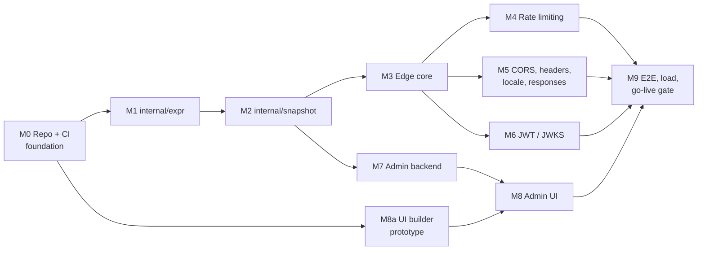

# Implementation Plan

## Goal

Build the edge proxy, the admin service and the admin UI exactly as specified in the [design](design.md), and ship them as **one release** that passes the go-live gate below.

## Go-live gate (definition of done)

All of these must be true at the same time, on the same commit:

| # | Gate | Evidence |
|---|---|---|
| G1 | Edge coverage is 100% | Merged profile from unit, integration and e2e runs of `cmd/edge`. Scope is every package except the admin-only list in `scripts/ci/test.sh`, and `cmd/edge` may not import admin-only packages |
| G2 | Every functional scenario in [design §18.2](design.md#182-functional) passes | `go test -race ./...` against real Valkey (standalone + cluster) and Postgres in testcontainers |
| G3 | Fuzz smoke passes | Expression parser round trip, IP parsing, key extraction, snapshot decode |
| G4 | Every load scenario in [design §18.3](design.md#183-load-local-only) meets its threshold | k6 thresholds against `loadtest/compose.yaml`. Thresholds need the capacity inputs ([design §16](design.md#16-capacity-inputs), D5) |
| G5 | Admin critical paths pass | Scenario tests for audit, auth, validation, publish/revert/canary/guard, snapshot endpoint |
| G6 | Admin UI smoke passes | Playwright: build a rule with And/Or, switch to text and back, publish via canary, compare versions, revert, read audit |
| G7 | Static checks are clean | `go vet`, `golangci-lint`, `govulncheck`, TypeScript strict, ESLint |
| G8 | Both images build and start | Edge becomes ready from a bootstrap snapshot. Admin serves the embedded UI |

## Milestones

M8a is the risk spike from [design §13.6](design.md#136-admin-ui-stack). It has no backend dependency, so it runs early, in parallel.

| Milestone | Scope | Exit criteria |
|---|---|---|
| **M0 Foundation** | `git init`, `go.mod`, Makefile targets, CI scripts for GitHub + GitLab, golangci-lint config, edge coverage-gate script, `compose.yaml` with Valkey and Postgres. Testcontainers helpers and the Valkey cluster setup arrive with their first user (M4, M7), so no untested helper code exists early | `make test` runs an empty suite green in CI; the coverage gate fails on a deliberately uncovered line |
| **M1 `internal/expr`** | Grammar, parser, renderer, AST (shaped like react-querybuilder's tree), type checker, phase-availability check, compiler to closures, all operators, rejection of values that can never match | 100% coverage. Fuzz: text round trip, builder JSON (no panic, storage-stable), wildcard vs RE2, IP set vs linear scan. Zero allocations per match. Benchmarks: 200 rules × 32 conditions, realistic, compile |
| **M2 `internal/snapshot`** | Config types, strict JSON decode (unknown fields, trailing data, size), `Compile` (validates all layers in [§12.2](design.md#122-validation-one-validator-everywhere) and builds matchers, templates, locale matcher), envelope (active, candidate, canary, keys, fleet size), `edge.locale` rule values must be in the locale `supported` list | 100% coverage. Every validation rule has a scenario test. Fuzz decode + compile (no panic, cache round trip). Memory benchmark of the largest config |
| **M3 Edge core** | Request field extraction shared by the edge and the **config test runner** (runs the edge's own extraction on synthetic requests, so tests and traffic can't disagree; `upstream_headers` expectations arrive with M5), `X-Request-Id` charset check, strip client `X-Edge-*` and source headers at step 2 before any rule reads them, `http.Server` and timeouts, guards (ordinary and stream caps), client IP presets and viewer fields (host lowercased with `strings.ToLower`, country uppercased, IPv6 zones dropped), ingress secret, path normalization and rejection, non-uppercase method rejection, snapshot poller (admin / cache / bootstrap with max age), pin + canary cohort, config phase, proxy with explicit forwarding headers, upstream map and 421, per-upstream cap, body limit and read deadline, responses with `no-store`, SSE and WebSocket, warm-up, shutdown, JSON access log (async, bounded), `/metrics`, stats reporter | 100% coverage. Scenario tests for every [§2.1](design.md#21-steps) step and every [§14.1](design.md#141-dependency-matrix) row that doesn't need later milestones |
| **M4 Rate limiting** | 4 Lua scripts (one key, server `TIME`, `period` in key), key building, site-wide-first evaluation with cap, pipelined batch, penalty and local penalty cache, shadow mode, backstop (/64, fail-open when full), per-node breaker, fail modes (`local` uses `fleet_size`) | 100% coverage. Each algorithm checked against a reference model with a fake clock, and against real Valkey standalone and cluster. Shared quota across N edges |
| **M5 Per-request features** | CORS policies (Fetch standard, `Vary: Origin`, edge responses from step 4), header transform rules and forward filter (plus the validation warning for copying a header an earlier forward dropped), header values from placeholders sanitized of CR/LF before sending, lazy locale with x/text and cache, response templates | 100% coverage. CORS spec cases, header order, locale hit/miss benchmark |
| **M6 Auth** | Issuers, accepted lists, key store (newest `fetched_at` wins, generation counter), background refresh, single-flight unknown `kid`, verified-token cache, SSRF guard with dial-time check, no-keys pass | 100% coverage. Alg confusion, cross-issuer, rotation, cache invalidation, DNS rebinding |
| **M7 Admin backend** | Postgres migrations (runtime + owner roles), identity layers, local auth (Argon2id, NIST rules, throttling), sessions, CSRF, RBAC, audit (same transaction, HMAC chain, triggers, anchors, verify), config CRUD and `/expr/*` API, draft with `base_version` and rebase, publish (tests, no-keys block with override), versions, semantic/raw diff, revert, snapshot endpoint, JWKS fetch, stats ingest, canary, guard, leader lock on a dedicated connection, export/import | Critical-path scenario tests ([design §18.1](design.md#181-policy)) green |
| **M8a UI prototype** | react-querybuilder with our AST shape, nested-group drag-and-drop, server-side preview round trip (mocked API) | Works, or we switch to a hand-built tree component; decided within about 1 day |
| **M8 Admin UI** | Vite + React + TS + Tailwind app, all screens in [design §13.5](design.md#135-admin-ui-screens), embedded with `go:embed`; API-only when the UI isn't built | Playwright smoke (G6) green |
| **M9 Go-live** | Mock CDN/LB/IdP/upstream, k6 scenarios, e2e coverage merge for `cmd/edge`, image builds with bootstrap export | Every gate G1–G8 green on one commit |

## Inputs

| Input | Value |
|---|---|
| Go module path | `github.com/chrisleekr/edge-proxy` |
| CI provider | GitHub Actions **and** GitLab CI. Both call the same `scripts/ci/*.sh`; provider YAML holds only triggers and services |
| Postgres migration tool | Decide in M7; verify options before choosing |
| Capacity inputs ([design §16](design.md#16-capacity-inputs), D5) | **Pending.** M9 ran with conservative thresholds (p99 under 50 ms); first measurements are in [design §18.3](design.md#183-load-local-only) |

## Working rules

- Each milestone is a separate branch and merge request, with tests in the same change.
- No milestone is "done" until its exit criteria run green in CI, not only locally.
- The [design](design.md) is updated in the same change whenever implementation finds the design wrong.
