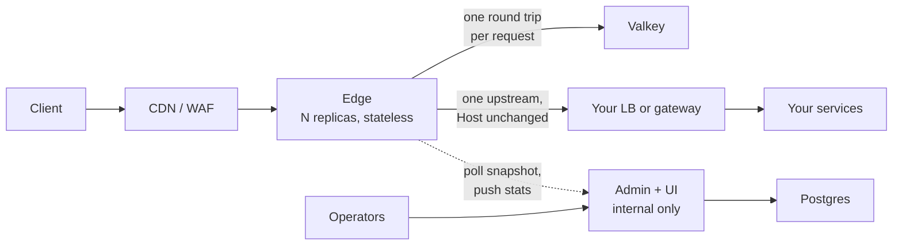

# Edge Proxy

A Go reverse proxy that sits **between** your CDN or WAF and the load balancer or gateway that routes your services. It enforces application policy for all of them in one layer, then forwards each request, `Host` unchanged, to that one load balancer or gateway:

- exact rate limits shared by every replica (Valkey)
- JWT validation against your identity providers
- CORS, request header rules and locale detection
- templated error responses

Policy is managed in an admin UI. Every change is validated, tested, published as a version, optionally canaried, watched by a rollback guard and written to a tamper-evident audit log. From the edges' access logs, admin also lists every route served, with its traffic and what each rule does to it ([Routes](use/dashboard.md#routes)).

## Why it exists

**So each microservice doesn't build its own rate limiting.** Without a shared layer, every service ends up with its own limiter, its own JWT checks and its own CORS handling, each written, tested and fixed separately and each slightly different. Edge Proxy guards every route in one layer in front of all your services, so they receive only traffic that has already passed policy, and a new route is protected by adding a rule, not by writing code.

A CDN or WAF could be that layer, but for application policy it hits the same limits:

- **Their rate limits are approximate.** Every major vendor counts per point of presence (POP, one of its data centres), server or region, and several say not to rely on it for precise limits. "5 login attempts per minute" can't mean exactly 5.
- **Limits on who the user is need custom code.** Keying a limit on a verified JWT claim, such as a user or tenant ID, takes edge functions or an Enterprise add-on.
- **Policy is locked to one vendor.** Each has its own rule language, so moving CDN or running two clouds means writing every rule again.
- **Services can't trust edge headers.** Without a fixed contract, a client can send its own copy of a header the service relies on, such as a user ID.
- **Policy changes are risky.** Few vendors let you test a rule change, canary it and roll it back automatically when errors rise.
- **An outage in a supporting service shouldn't become your outage.** Policy enforcement that depends on a database or identity provider at request time fails when they do.

Edge Proxy fixes these behind whatever CDN you already run, with a stateless Go proxy and a separate admin service: exact limits from one shared Valkey counter, verified identity as a rate-limit key, edge headers clients can't forge, one policy model on any cloud, tested and canaried changes, and a defined degraded mode for every dependency.

If approximate per-IP limits and static headers are all you need, a vendor alone is simpler. See [Compared with vendors](vendor-comparison.md).

Solid lines are on the request path. Dotted lines are background work: if admin or Postgres is down, edges keep serving with the policy they have.

## What it does not do

- **It is not a WAF or CDN.** No OWASP rules, bot detection, DDoS absorption or TLS for the public internet. Keep those in front.
- **It does not route.** Every request goes to one upstream, `UPSTREAM_URL`: your load balancer or gateway, which already knows which service serves each host and path. Adding a service means adding a route there, not on the edge.
- **It never stops serving because a dependency failed.** Valkey, admin, Postgres and the identity provider each have a defined degraded mode. Readiness reflects only "a policy is loaded and the edge is not draining".
- **It never retries a rate-limit call**, so a request can't consume quota twice.

## Where to start

| You want to | Go to |
|---|---|
| Try it on your machine in five minutes | [Get started](get-started.md) |
| Write rules | [Policy](use/policy.md) and [Rate limiting](use/rate-limiting.md) |
| Ship a change safely | [Publish and roll back](use/publishing.md) |
| Find your way around the admin UI | [Dashboard](use/dashboard.md) |
| Run it in production | [Deploy](deploy/index.md), then [Operate](operate/monitoring.md) |
| Change the code | [Development](build/development.md) and the full [Design](design.md) |
| Look up a term | [Glossary](reference/glossary.md) |
