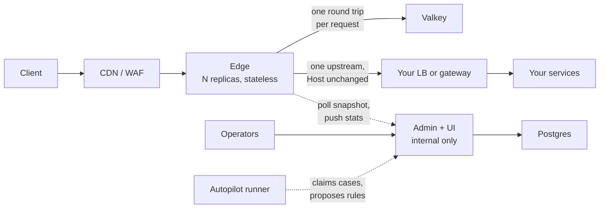
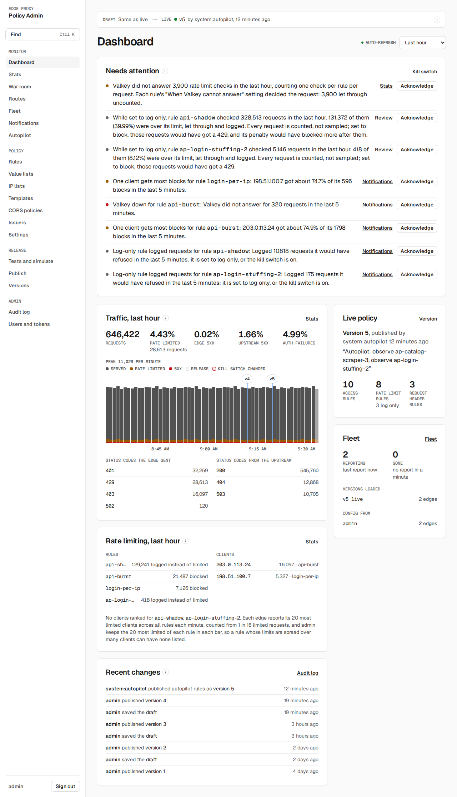
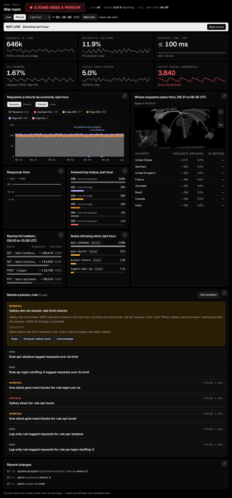

# Edge Proxy

Edge Proxy is one shared policy layer in front of all your services. It sits behind your content delivery network (CDN) or web application firewall (WAF), decides what each request may do, and forwards what it allows to the load balancer or gateway that routes your services. No service has to build its own rate limiting, token checks or Cross-Origin Resource Sharing (CORS) handling.

**What it can do**

- **Limit traffic.** Exact rate limits counted once across every replica, keyed on the client IP, a user or tenant ID from a verified token, or other request values.
- **Control access.** Block, ban or always allow clients, and require a valid JSON Web Token (JWT) on a route.
- **Shape requests and answers.** Set the headers your services receive, answer CORS, pick the visitor's language and return your own error pages.
- **Change policy safely.** Test a rule before you publish it, send it to a share of traffic first, roll it back automatically when errors rise, and keep every change in a tamper-evident audit log.
- **See and respond.** Traffic per route and per rule, a [War room](tour/monitor.md#war-room) screen for incidents, alerts, and an optional [autopilot](use/autopilot.md) that adds short-lived rate limits during an attack.

**Who it is for**

- Teams with many services behind one load balancer or gateway who want application policy in one place.
- Teams whose CDN rate limits are too approximate, or who need limits per signed-in user.
- Not for replacing a WAF or CDN, or for routing. See [What it does not do](#what-it-does-not-do).

The admin UI's dashboard, then the War room during an incident:

## Where to start

Pick the path for what you do:

- **Deciding whether to use it:** [Why a custom proxy](why-custom-proxy.md), then [Compared with vendors](vendor-comparison.md), then [Get started](get-started.md).
- **Writing policy:** [Get started](get-started.md), then [Use cases](use/cases/index.md) for a rule per job, then [Publish and roll back](use/publishing.md).
- **Running it in production:** [Deploy](deploy/index.md), then [Monitoring](operate/monitoring.md) and [Notifications](operate/notifications.md).
- **On call during an incident:** the [War room](tour/monitor.md#war-room) in the admin UI and the [Runbooks](operate/runbooks.md).
- **Changing the code:** [Development](build/development.md), then the [Design](design.md).

Or jump straight to a task:

| You want to | Go to |
|---|---|
| Try it on your machine in five minutes | [Get started](get-started.md) |
| Find the rule for a job | [Use cases](use/cases/index.md) |
| Write rules | [Policy](use/policy.md) and [Rate limiting](use/rate-limiting.md) |
| Let autopilot add rate limits during an attack | [Autopilot](use/autopilot.md) |
| Ship a change safely | [Publish and roll back](use/publishing.md) |
| Find your way around the admin UI | [Admin UI tour](tour/index.md) |
| Run it in production | [Deploy](deploy/index.md), then [Operate](operate/monitoring.md) |
| Change the code | [Development](build/development.md) and the full [Design](design.md) |
| Know why it isn't built on Envoy or another gateway | [Why a custom proxy](why-custom-proxy.md) |
| Look up a term | [Glossary](reference/glossary.md) |

## Why it exists

**So each microservice doesn't build its own rate limiting.** Without a shared layer, every service ends up with its own limiter, its own JWT checks and its own CORS handling, each written, tested and fixed separately and each slightly different. Edge Proxy guards every route in one layer in front of all your services, so they receive only traffic that has already passed policy, and a new route is protected by adding a rule, not by writing code.

A CDN or WAF could be that layer, but for application policy it hits the same limits:

- **Their rate limits are approximate.** Every major vendor counts per point of presence (POP, one of its data centres), server or region, and several say not to rely on it for precise limits. "5 login attempts per minute" can't mean exactly 5.
- **Limits on who the user is need custom code.** Keying a limit on a verified JWT claim, such as a user or tenant ID, takes edge functions or an Enterprise add-on.
- **Policy is locked to one vendor.** Each has its own rule language, so moving CDN or running two clouds means writing every rule again.
- **Services can't trust edge headers.** Without a fixed contract, a client can send its own copy of a header the service relies on, such as a user ID.
- **Policy changes are risky.** Few vendors let you test a rule change, canary it and roll it back automatically when errors rise.
- **An outage in a supporting service shouldn't become your outage.** Policy enforcement that depends on a database or identity provider at request time fails when they do.

Edge Proxy fixes these behind whatever CDN you already run, with a stateless Go proxy and a separate admin service: exact limits from one shared Valkey counter, verified identity as a rate-limit key, edge headers clients can't forge, one policy model on any cloud, tested and canaried changes, and a defined degraded mode for every dependency.

If approximate per-IP limits and static headers are all you need, a vendor alone is simpler. See [Compared with vendors](vendor-comparison.md). For why Edge Proxy doesn't build on Envoy, APISIX, Kong or another gateway, see [Why a custom proxy](why-custom-proxy.md).

## What it does not do

- **It is not a WAF or CDN.** No OWASP rules, bot scores, DDoS absorption or TLS for the public internet. Keep those in front.
- **It does not route.** Every request goes to one upstream, `UPSTREAM_URL`: your load balancer or gateway, which already knows which service serves each host and path. Adding a service means adding a route there, not on the edge.
- **It never stops serving because a dependency failed.** Valkey, admin, Postgres and the identity provider each have a defined degraded mode. Readiness reflects only "a policy is loaded and the edge is not draining".
- **It never retries a rate-limit call**, so a request can't consume quota twice.

## What it can do

| Feature | What it does | Read |
|---|---|---|
| Exact shared rate limits | Five algorithms, with counters shared by every edge through Valkey | [Rate limiting](use/rate-limiting.md#the-algorithms) |
| Counting responses and distinct values | Limit by the responses the upstream sends, or by how many different values a client tries | [Counting responses](use/rate-limiting.md#counting-responses) and [Distinct](use/rate-limiting.md#distinct) |
| JWT validation | Check tokens against your identity providers and use claims as limit keys and headers | [Issuers and tokens](use/tokens.md) |
| Blocking, bans, always-allow and the trusted client allowlist | Refuse, ban or exempt clients by rule | [Blocking requests](use/policy.md#blocking-requests), [Banning a client](use/policy.md#banning-a-client), [Always allow](use/policy.md#always-allow) and [Trusted clients](use/policy.md#trusted-clients) |
| IP lists and value lists | Reusable sets of addresses and values that rules match against | [IP lists](use/ip-lists.md) and [Value lists](use/value-lists.md) |
| Bot signals, TLS fingerprints and verified crawlers | Tell tools, stale browsers and real crawlers from people | [Bot detection](use/bots.md) and [Client signals](reference/expressions.md#client-signals) |
| Cross-Origin Resource Sharing (CORS) | Answer preflights and set allowed origins per route | [CORS](use/cors.md) |
| Locale detection | Pick a supported language from `Accept-Language` | [Locale](use/policy.md#locale) |
| Request header rules | Set, remove, rename or filter the headers the upstream receives | [Header rules](use/policy.md#header-rules) |
| Response templates by `Accept` | Answer edge errors in HTML, JSON or text | [Response templates](use/templates.md) |
| Policy tests and simulate | Prove a rule before you publish it | [Policy tests](use/policy.md#policy-tests) and [Tests and simulate](tour/release.md#tests-and-simulate) |
| Draft, publish, canary, rollback guard and revert | Ship a change to a share of traffic and undo it | [Publish and roll back](use/publishing.md) |
| Autopilot | Adds short-lived limits during an attack, within checks and budgets you set | [Autopilot](use/autopilot.md) |
| Routes | Every route served, with its traffic and what each rule does to it | [Routes](tour/monitor.md#routes) |
| War room | One screen for an incident, made to stay open on a wall | [War room](tour/monitor.md#war-room) |
| Stats, Fleet and Dashboard | Exact counts per rule, the edges in the fleet and the overview | [Fleet](tour/monitor.md#fleet), [Stats](tour/monitor.md#stats) and [Overview](tour/monitor.md#dashboard) |
| Notifications | Anomaly checks every minute, sent to Alertmanager | [Notifications](operate/notifications.md) |
| Audit log | A tamper-evident record of every change | [Audit log](tour/admin.md#audit-log) |
| Users, roles and tokens | Who can do what in the admin UI | [Users and tokens](tour/admin.md#users-and-tokens) |
| Monitoring, logs and traces | Metrics, access logs and traces from edge and admin | [Monitoring](operate/monitoring.md) |
