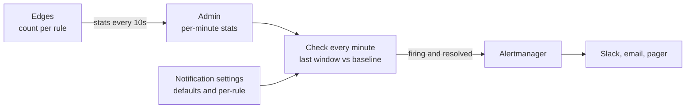
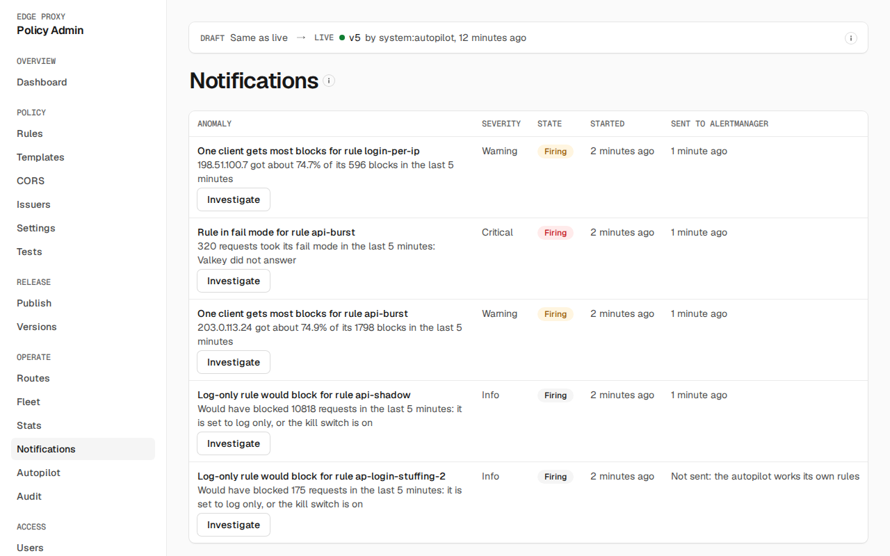

# Notifications

Admin checks the edges' stats every minute for anomalies and sends each one to [Alertmanager](https://prometheus.io/docs/alerting/latest/alertmanager/), which groups, silences and routes it (to Slack, email or a pager). It covers the whole fleet and every rule. The edges do nothing extra for it: they already count each rule's requests and outcomes in their stats reports.

Set [`ALERTMANAGER_URL`](../deploy/admin.md#variables) to send them. Without it, anomalies are still found and shown on **Notifications** in the admin UI.

## How a check decides

Each minute, admin compares the last **window** (5 minutes) with the **baseline** before it (60 minutes), both whole minutes, summed over every version and edge. The newest 30 seconds are left out, since edges may still be reporting them.

- A signal **trips** when its value passes its thresholds, and only with at least `min_requests` to judge, so a quiet hour can't page anyone. A share of errors also needs at least `min_events` of them (the 5xx or failed token checks), so a handful of errors in a quiet window doesn't trip it. Saved settings keep the thresholds they were saved with, and one missing from a saved signal is 0: only a signal never saved takes the defaults, so set a missing `min_events` on **Notifications**.
- An anomaly starts **pending** and notifies (**firing**) after `fire_after` checks in a row trip (2). A blip that trips once is dropped.
- A firing anomaly **resolves** after `resolve_after` checks in a row pass (5). Admin sends the resolved alert for 5 more minutes, so Alertmanager sends its resolved notification even across a restart; an anomaly never sent firing sends no resolved alert.
- Turning notifications or a signal off, or removing the rule, resolves its open anomalies at the next check.

One cause notifies once. Per-rule checks are measured against the fleet in the same window, so a change every rule shares is reported by the fleet signal alone:

- `rule_match_surge` and `rule_stopped_matching` expect the rule's baseline share of requests. The share counts only the baseline minutes and versions the rule was live on, as the edges' reports list it, so a rule published partway through the baseline is judged by its own minutes. Both multiply it by the window requests the rule was live for, so a rule only on a canary is judged against the canary's requests, and a rule whose versions served no window requests is expected to match none. A rule no edge reports in the window is expected at its baseline share of all requests, multiplied by all the window's requests, so `rule_stopped_matching` still notifies for it. A fleet-wide surge or drop notifies as `traffic_surge` or `traffic_drop`, and a rule that holds steady while traffic moves still notifies, since its share changed. Either signal is judged only when the baseline requests the rule was live for, scaled to the window, are at least the rule's `min_requests`; otherwise the rule has no share yet, as when it was just published, and neither fires for it; a surge of its traffic notifies as `traffic_surge`. A rule that was live all through the baseline and matched nothing, then matches many, still notifies.
- `rule_edge_5xx_ratio`, `rule_upstream_5xx_ratio` and `rule_auth_failure_ratio` also need the rule's share to be over `factor` times the fleet's share in the window. An upstream outage notifies as the fleet signal; failures concentrated on one rule still name the rule.
- A rule that matches more than one in `factor` of all requests (half, at the default 2) can't pass the fleet share, so only the fleet signal reports it. If the fleet stays under its own floor, say 1.5% edge 5xx on a rule with 60% of traffic, which is 0.9% fleet-wide, nothing notifies.
- A token check fails only on requests a rule with `auth` matched, so during an IdP outage the fleet's share is those rules' share of all requests, and each such rule fails all of its own. When they carry less than one in `factor` of all requests, `rule_auth_failure_ratio` notifies too. The UI lists it under `auth_failure_ratio`; in Alertmanager, an inhibit rule with source `alertname="EdgeProxyAuthFailureRatio"` and target `alertname="EdgeProxyRuleAuthFailureRatio"` mutes it.
- The comparison reads the stats, not the fleet signal's settings: turning a fleet signal off does not bring its per-rule copies back, so a rise every rule shares then notifies nowhere.

On **Notifications**, and in **Needs attention** on the dashboard, a rule anomaly that is open while its fleet signal is open too, such as `rule_upstream_5xx_ratio` with `upstream_5xx_ratio`, is listed under the fleet anomaly. The pairs are the edge 5xx, upstream 5xx and auth failure ratios, `rule_match_surge` with `traffic_surge`, and `rule_stopped_matching` with `traffic_drop`.

Firing and resolving are written to the audit log (`anomaly.fire`, `anomaly.resolve`), and admin logs `anomaly firing` and `anomaly resolved`. Resolved anomalies are kept for 30 days.

With `LOG_SEARCH_URL` set ([admin settings](../deploy/admin.md)), each anomaly on **Notifications** has **Search the logs**, which opens your log store from when it started to when it resolved. An anomaly has no status code or host, so a template that uses `{status}` or `{host}` shows no link here.

With `autopilot.manage`, each open anomaly on **Notifications** has **Investigate**, which asks the [autopilot](../use/autopilot.md#cases) about it and opens the case.

## Signals

**Fleet**, from every edge's totals:

| Signal | Trips when (defaults) | Severity |
|---|---|---|
| `traffic_drop` | Requests fall below a third of the baseline's rate, which had at least 300 per window | warning |
| `traffic_surge` | Requests rise above 5 times the baseline's rate, with at least 1000 | warning |
| `edge_5xx_ratio` | 5xx the edge sent itself are over 2 times their baseline share and over 1%, with at least 20 of them | critical |
| `upstream_5xx_ratio` | 5xx from the upstream are over 2 times their baseline share and over 2%, with at least 20 of them | critical |
| `auth_failure_ratio` | Requests failing their token check are over 2 times their baseline share and over 5%, with at least 20 of them | warning |
| `p99_latency` | p99 latency is over 1.5 times the baseline's and over 100ms, with at least 1,000 requests, so p99 rests on the 10 slowest or more | warning |

**Per rule**, for every rule of the active and canary versions:

| Signal | Rules | Trips when (defaults) | Severity |
|---|---|---|---|
| `rule_stopped_matching` | all | The rule matched none of the window requests it was live for, though its baseline share of them gives at least 100, when the baseline holds enough traffic while the rule was live to give it a share. A rule no edge reports in the window is judged against all the window's requests | warning |
| `rule_match_surge` | all | The rule matched over 5 times its baseline share of the window requests it was live for, at least 500, when the baseline holds enough traffic while the rule was live to give it a share | info |
| `rule_edge_5xx_ratio` | config, request headers | 5xx the edge sent are over 2 times their baseline share of the rule's requests, over 2 times their share of all requests, and over 1%, with at least 10 of them | warning |
| `rule_upstream_5xx_ratio` | config, request headers | 5xx from the upstream are over 2 times their baseline share of the rule's requests, over 2 times their share of all requests, and over 5%, with at least 10 of them | warning |
| `rule_auth_failure_ratio` | config | Failed token checks are over 2 times their baseline share of the rule's requests, over 2 times their share of all requests, and over 10%, with at least 10 of them | warning |
| `rule_block_spike` | rate limit, config | The rule blocks over 3 times its baseline share of the requests it checks, and over 1%. A config rule checks every request, and blocks with its `block` setting | warning |
| `rule_would_block` | rate limit, config | A rule that isn't blocking (set to log only, or under the rate-limit or block kill switch) would have refused at least one request | info |
| `rule_fail_mode` | rate limit | A request took the rule's `fail_mode` because Valkey did not answer | critical |
| `rule_subject_dominates` | rate limit | One client got over half of the rule's blocks, with at least 100 blocks: a targeted flood, or one client misbehaving | warning |

**Autopilot**, from [autopilot](../use/autopilot.md)'s own state while it is on. They have no thresholds: each holds while its condition does.

| Signal | Trips when | Severity |
|---|---|---|
| `autopilot_enforced` | An autopilot rule is blocking, one anomaly per rule | info |
| `autopilot_rolled_back` | An autopilot rule was rolled back for blocking too much, in the last hour | warning |
| `autopilot_budget_exhausted` | `max_enforcing` or `max_sensors` refused a proposal in the last hour, or `cases_per_hour` is used up while a case waits. A full sensor budget alone is normal, since sensors renew | warning |
| `autopilot_agent_down` | Runners have connected, and none was seen in the last 2 minutes | warning |
| `autopilot_needs_person` | A case closed `unsure` or failed in the last hour, or closed `attack` with no enforce rule accepted on it, or with one accepted in `observe` mode that no person has approved yet; not for an attack on an autopilot rule that already enforces | warning |
| `autopilot_note_contested` | An ablation case, re-run without a confirmed [note](../use/autopilot.md#re-checks), got another verdict in the last hour; one anomaly per note | warning |

A request matched by a config or request-header rule counts toward that rule's outcome; request-header rules only see requests that reach the upstream. Rate-limit rules count every request their expression matched. The client counts behind `rule_subject_dominates` are estimated from a sample, as on **Stats**.

## Per-rule settings

Each rule can replace a signal's settings: turn it off, change its severity, or set its own thresholds. A rule's setting replaces the default for that rule and signal only; fleet signals have no per-rule setting. Settings for a rule ID no longer in the policy stay saved and are shown as unused.

Notification settings are saved on their own, apart from the draft, like the rollback guard's: changing them needs `settings.manage`, needs no publish, and takes effect at the next check. Every change is audited (`settings.notifications`).

## Alerts

Each alert is named after its signal (`rule_block_spike` is `EdgeProxyRuleBlockSpike`) and carries these labels, for routing and silences in Alertmanager:

| Label | Value |
|---|---|
| `alertname` | `EdgeProxy` and the signal |
| `service` | `edge-proxy` |
| `signal` | The signal |
| `severity` | `critical`, `warning` or `info`, as set when the anomaly fired; a later change applies from its next firing |
| `rule`, `phase` | The rule's ID and phase; fleet alerts have neither |

Annotations: `summary` names the signal and rule, and `description` gives the numbers, such as "Blocked 31.0% of the requests it checked in the last 5 minutes, against 1.0% in the hour before".

Admin sends firing alerts every minute with an end three minutes ahead, as [Alertmanager expects of clients](https://prometheus.io/docs/alerting/latest/alerts_api/). If Alertmanager doesn't answer, admin logs `background job failed` and sends again at the next check; nothing queues. **Notifications** shows when Alertmanager last accepted each anomaly.

Admin can only notify while it runs and receives stats. Alert on admin itself from Prometheus: `rate(edge_stats_dropped_total[5m]) > 0` fires when edges can't report to admin (see [Monitoring](monitoring.md#alerts-worth-having)).

## What the autopilot holds back

While the [autopilot](../use/autopilot.md) is on and a runner was seen in the last 2 minutes, admin holds back an anomaly it hasn't sent yet in three cases, and **Notifications** says which:

- **Its own rule:** a `rule_would_block` or `rule_subject_dominates` anomaly on an autopilot rule (`ap-`), sensor or enforce, other than a critical one, is the autopilot's input. It opens a case from it and notifies what it concludes: `autopilot_needs_person` for an unsure verdict, a failed case, or an attack with no enforce rule accepted, or with one waiting for a person's approval in `observe` mode. Its other anomalies, such as `rule_fail_mode`, are treated as any rule's, except `rule_block_spike` and `rule_stopped_matching`, which an autopilot rule trips by design when it starts blocking and when the attack ends: they are not checked on `ap-` rules, and `autopilot_enforced` and `autopilot_rolled_back` report those changes.
- **Investigating:** an anomaly that opens a case, other than a critical one, waits up to 10 minutes after it fired for the case's verdict, and is then sent with "Autopilot case N: verdict." added to `description`. The case's summary is left out: the model writes it after reading traffic clients control.
- **Benign:** an `info` anomaly whose case closed `benign` is not sent. A warning closed benign is still sent, with the verdict: traffic an attacker shapes could talk the model into a benign verdict, so the verdict only delays it.

A critical anomaly is never held back, and nothing is while the autopilot is off or no runner is connected. An anomaly already sent keeps being sent until it resolves, whatever its case concludes.
