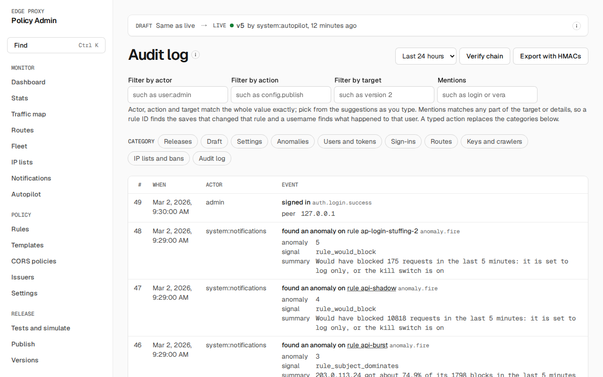
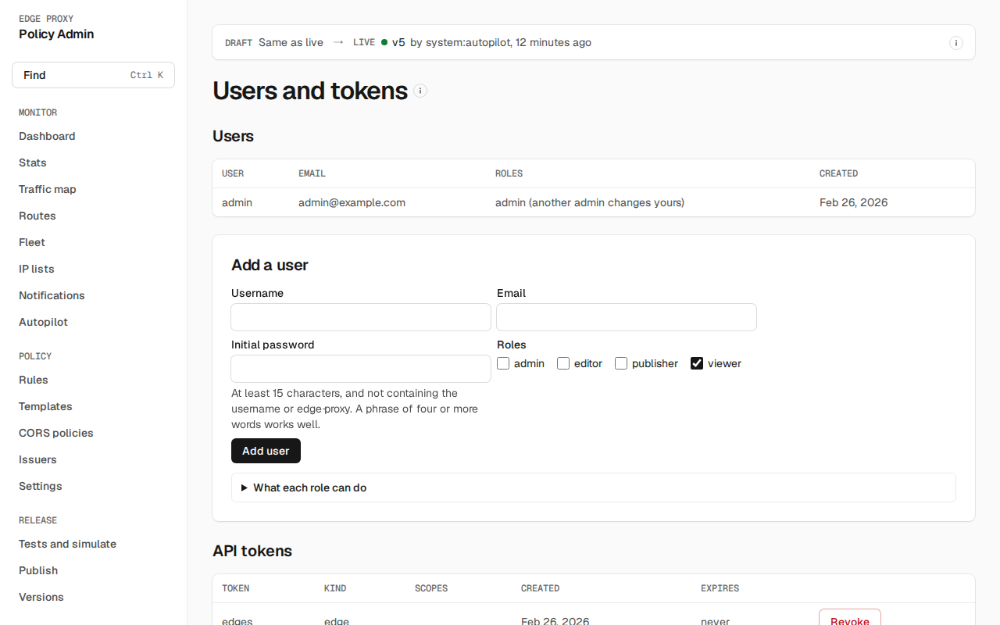
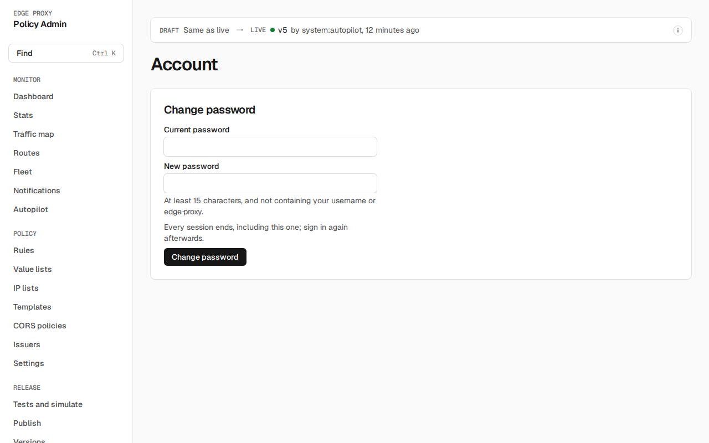

# Admin

The pages under **Admin** in the menu, and your own account.

## Audit log

**Audit log** lists every change, sign-in and automatic action in words, newest first.

- Each entry has its action name for the filter, a diff for config changes, the changed fields for a settings change, and the tripped signals of a guard event.
- A version, or a rule the draft still has, links to its page.
- It shows the events in the [time range](index.md#time-range), counted back from when the page opened.
- **Older events** loads the next 100. Where the range ends, a line under the list says so, and older events are in a longer range or **Export with HMACs**.
- **Export with HMACs** exports the log. Check the integrity badge: it shows whether the last recorded verification of the HMAC chain (daily, manual, or a detected break) passed.

Filters:

- **Category** narrows it to one or more kinds of event: releases, draft, settings, anomalies, users and tokens, sign-ins, routes, keys and crawlers, or the audit log itself.
- Filter by actor, action or target, which match exactly.
- **Mentions** finds any part of the target or details: a rule ID such as `login` finds the saves that changed it, and a username finds what happened to that user.
- A typed action replaces the categories.

## Users and tokens

Add users, set their roles and disable them.

- Your own roles and account are changed by another admin.
- A change that would leave no enabled user who can manage users is refused.

Create **tokens** here too:

- **edge tokens**, which edges use to fetch config and send stats;
- **user tokens** with scopes picked from the permissions you hold, for automation.

A token is shown once, when it is created.

## Account

Change your own password. Passwords are hashed with Argon2id and checked against the optional blocklist (`PASSWORD_BLOCKLIST_PATH`); sign-in attempts are throttled.
