# Monitor

The pages under **Monitor** in the menu: how traffic is doing and what the edges are doing.

## Dashboard

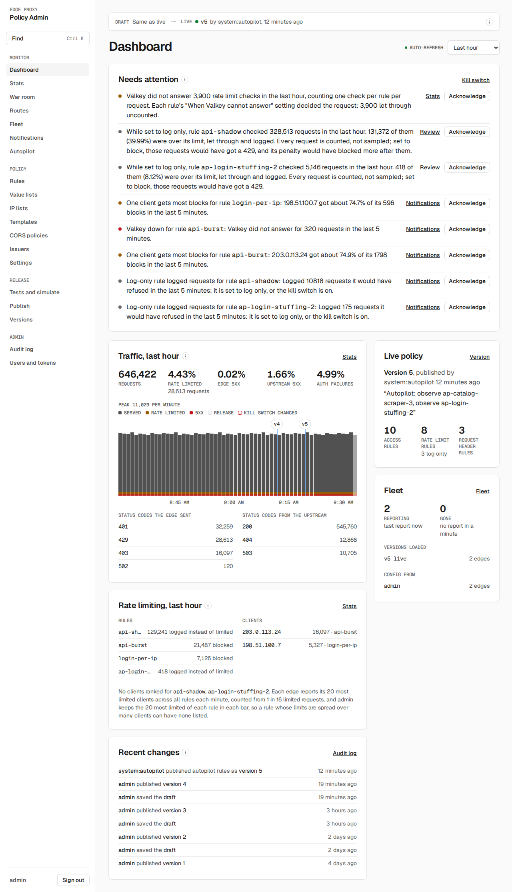

The first screen after sign-in: what needs attention, how traffic is doing and what changed.

- The [time range](index.md#time-range) picks the window for the traffic figures.
- Each panel is shown only to roles that can read its page, and links to it.
- **Needs attention** lists what to act on.
- **Traffic** shows requests and outcomes over time.
- **Rate limiting** lists the rules and clients that limited the most.
- **Live policy** shows the live version and how many rules each phase has.
- **Fleet** shows how many edges are reporting and how many are gone, the versions they have loaded and where their config came from.
- **Recent changes** lists changes to policy, releases, settings, users, tokens and routes (deleted or grouped), without sign-ins or anomalies, with the latest audit chain check.

### Needs attention

Each item is read from admin: a state, or an anomaly the [notification checks](../operate/notifications.md) found firing.

- The dashboard sets no thresholds of its own.
- **Acknowledge** hides an item for everyone until that condition clears. It changes nothing about traffic or notifications.
- Hidden items stay listed under **acknowledged items** with who and when, and **Undo** brings one back.
- Each acknowledgement, undo and clear is in the audit log.
- An acknowledgement clears when someone who can acknowledge opens the dashboard, every check has loaded and the item is gone. Valkey and log-only items clear only on the default 24 hour range.

Items you may see:

- **A kill switch is on** (rate limiting, JWT checks or blocking by access rules): enforcement is off everywhere. Turn it off in **Settings** once the emergency is over.
    - The **Kill switch** card takes effect only after **Save draft** and **Publish**.
    - **Publish** ships the whole draft, including unpublished edits, so check **Publish** first.
- **A canary was aborted**, with its reason, or **the guard rolled back a version**: a canary, or a full publish it replaced with a copy of the version before.
    - The line names the version edges now serve and, for a rollback, the signals that tripped and the version they were compared with.
    - Fix the change in the draft and publish again; **Publish** shows how.
- **The guard raised an alert** on the live or canary version: the signals that tripped, the version they were compared with, and why the version stayed. Open the version and decide whether to keep or revert it.
- **A canary is running**, with its percent and start time. Promote or abort it in **Publish**.
- **Live edges serve a cache or bootstrap snapshot** because they can't get config from admin, or **live edges have not loaded the live version**. They keep serving an older policy; check them in **Fleet**.
- **Valkey did not answer rate limit checks**, split by what each rule's **When Valkey cannot answer** setting then did.
    - Let the request through uncounted.
    - Answered `503` (a rule that fails closed, unless another rule answered `429`).
    - Counted on the edge alone.
    - Check Valkey; **Stats** has the counts per rule.
- **Rule X logged requests over its limit**, for up to three log only rules, with how many requests it logged that a block would have stopped. Review the rule before switching it to block.
- **An anomaly is firing**, with its summary, such as a surge in upstream 5xx. Red is critical, amber a warning. **Notifications** has the details.
- **A crawler range source stopped refreshing**: an anomaly for `verified_bots_stale`, named `source <url>`, whose action opens **Fleet** at [Verified crawler ranges](#fleet) instead of **Notifications**.
- **The audit log failed its tamper check**, with the event where the chain broke. Open **Audit log**.

??? note "Details"
    - A rule anomaly for the same signal as a firing fleet anomaly, such as upstream 5xx for one rule while upstream 5xx rise across the fleet, is listed under the fleet line instead of on its own.
    - Such a rule anomaly fires only when the rule is out of line with the fleet, so it shows where the fleet anomaly is concentrated, not its cause.
    - The rate limit counts include every request, not a sample, though a report an edge could not deliver is missing.
    - Each count is read against the version that served it, so a rule changed during the range is counted by its settings at the time.
    - A line goes away when its state does, or is hidden for everyone once acknowledged (see **Needs attention** above), and the **Audit log** and **Stats** keep the history.
    - With nothing to list, the panel says what it checked.

### Traffic

**Traffic** shows requests, and the share rate limited, edge 5xx, upstream 5xx and auth failures, over a chart of requests split into served, rate limited and 5xx.

- Below the chart are the commonest status codes the edge sent and those from the upstream, so a `502` the edge sent because it could not reach the upstream reads apart from a `502` the upstream sent.
- Hover a bar for its numbers.
- Drag across bars to zoom in to them, and the traffic and rate limiting figures follow, while **Needs attention** keeps the whole range. **Reset zoom** goes back.
- From the keyboard, focus the chart, move with the arrow keys, hold Shift to select, then press Enter to zoom or Escape to cancel.
- Each bar is 1 minute for the last hour, 2 minutes for 6 hours, 10 minutes for 24 hours, an hour for 7 days and 6 hours for 30 days. The bar still in progress is paler.

Marks above the chart are releases:

- A release is a publish, revert, import, an autopilot publish, canary step, promote or abort, or a guard rollback or canary abort, each labelled with its version, such as `v4`.
- Hover over one for what happened and when, and click it to open the version.
- A red mark with square corners, **Kill switch changed**, is a release whose kill switch differs from the live version's. For a canary that is the canary's start, and the change applies to the canary's share of traffic.
- A range shows at most the latest 100 releases. When more marks than fit the chart's width, kill switch changes and the newest are marked and the key says how many more there are.
- Releases show only to roles that can read the audit log.

### Rate limiting

**Rate limiting** lists the rules that blocked the most requests, or for log only rules found the most over their limit, and the most limited clients.

- A rule that limited requests but has no client in the ranking is named below it.
- Each edge reports only its 20 most limited clients across all rules each minute, counted from 1 in 16 limited requests.
- Admin keeps the 20 most limited of each rule in each bar.

### Figures

- Counts of a million or more are shortened, such as 12.35M. Hover over the request count for the exact number.
- The figures update as [Time range](index.md#time-range) says, and include the minute in progress.
- Edges report every 10 seconds and admin writes what it has every 10 seconds, so a request shows within about 20 seconds.

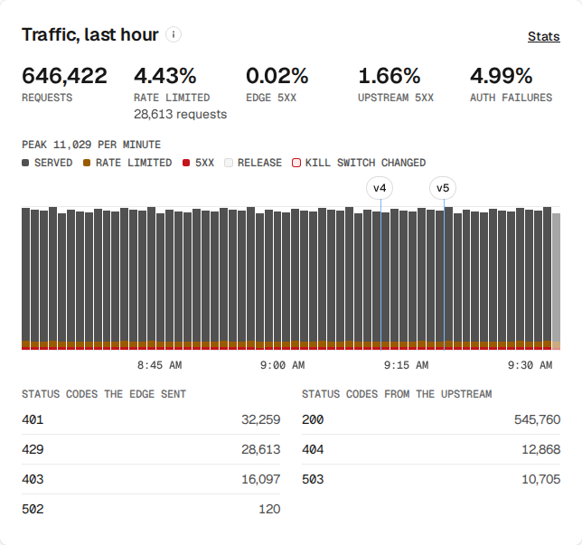

## Stats

Exact counts of what the edges did with every request, for the [time range](index.md#time-range).

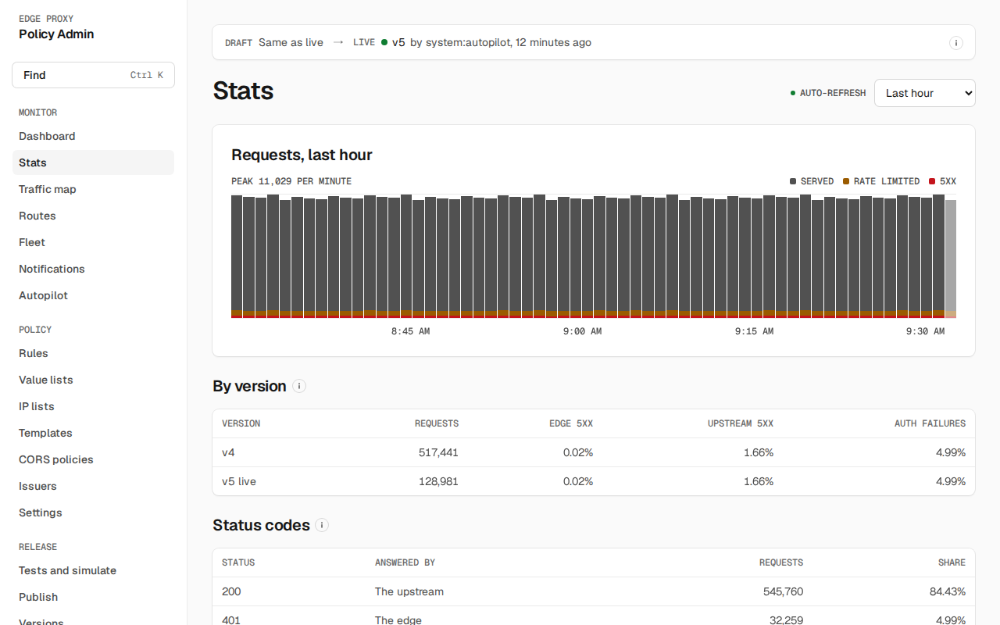

**Stats** shows:

| Item | What it shows or does |
|---|---|
| Per version | Requests, 5xx and auth failures per version. |
| Status codes | Every status code with who answered it (**The edge** or **The upstream**) and its share. |
| **Upstream failures** | Why the edge got no answer from the upstream. Each is a 502 or 504 the edge sent and counted exactly. See below. |
| **Client signals** | How many requests showed each client signal and their share, counted exactly. One request can show several, and minutes from before edges counted signals are left out of the share. |
| Per-rule counts | Every request per rule: **Checked**, **Blocked**, **Logged instead of limited**, and **Valkey down** for checks Valkey didn't answer. |
| **Blocking access rules** | The access rules whose `block` setting decided requests: **Matched**, **Blocked** with 403, **Logged instead of blocked**, and **Lifted by an allow**. |
| Most-limited clients | For all rules or for the one picked in **Rule**. |

- **Lifted by an allow** counts requests the rule would have blocked or logged that an always-allow rule or the client allowlist let through.
- The chart zooms as on the dashboard.
- Each client shows its sampled estimate of requests blocked and, for log-only rules, requests over the limit, so you can see who a log-only rule would hit before switching it to `block`.

**Upstream failures** causes:

- The upstream's name did not resolve.
- Nothing accepted the connection.
- The upstream dropped it.
- The TLS handshake failed because the upstream refused it, or its certificate is not valid for the request's Host or not trusted.
- The upstream did not connect, finish the TLS handshake or send response headers in time.
- Another error.

### Log links

- Admin keeps counts, not access lines: the lines stay in your log store.
- With `LOG_SEARCH_URL` set ([admin settings](../deploy/admin.md)), status codes and causes on **Stats**, **Dashboard** and a route link to the matching lines there, opening in a new tab.
- A link is shown only where every placeholder the template uses has a value, so a template with `{host}` links only from a route.
- Edges older than this admin don't send status codes or causes, so their minutes count requests but list none.

## Client page

Click a client for its page, which lists the rules that limited it over the time range, with requests blocked and over the limit for each and a small chart of them.

- A client can also be opened from [Find](index.md#find).
- Its counts come from the same ranking, so they are sampled estimates, and a client limited only a little, or among many others, can be missing.

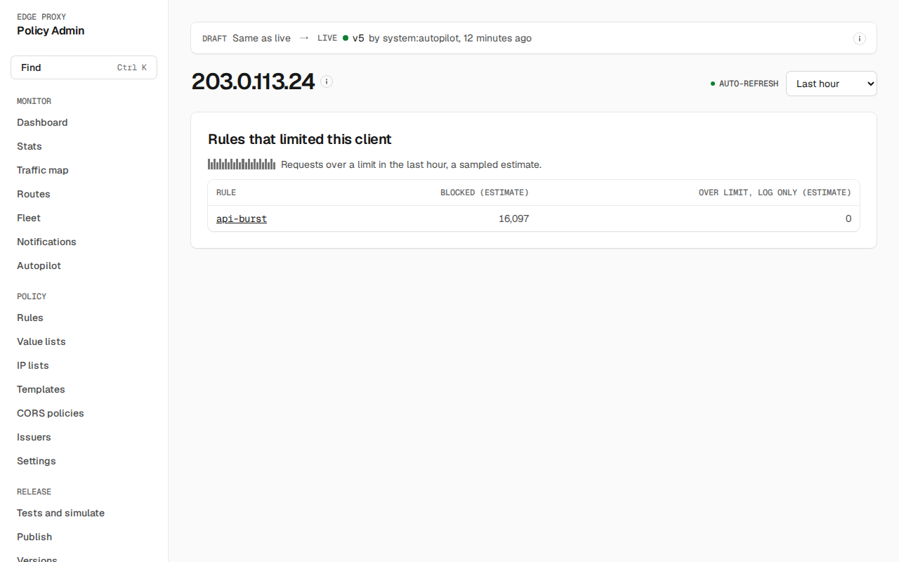

## War room

One screen for an incident, made to stay open on a wall: what needs a person, how traffic is ending, and where it comes from.

- It fills the browser with no menu. **Leave war room** goes back to the dashboard.
- It needs `stats.read`, and each part your role can't read is left out.
- Versions and kill switches need `config.read`.
- **Recent changes** and release marks need `audit.read`.
- Asking the autopilot needs `autopilot.manage`.

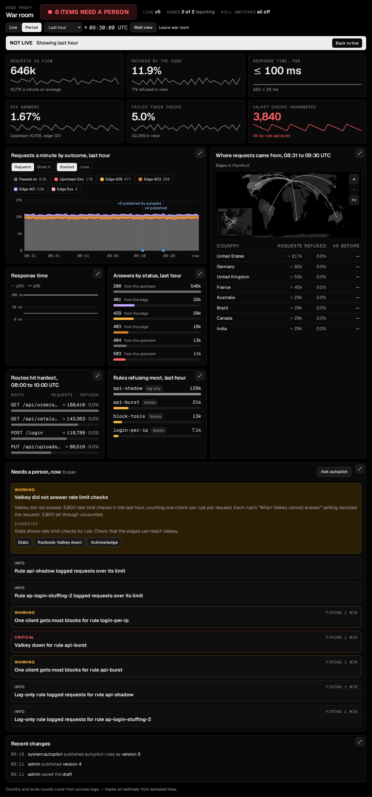

### Status and window

- **Status:** the box at the top counts what **Needs a person** lists, the same items as the dashboard's **Needs attention** that nobody has acknowledged.
    - It is red with an urgent item, amber with one that needs a look and grey with only notes.
    - With none it reads **CHECKING…** while the checks load, **SOME CHECKS FAILED** (amber) when a check could not be read, and otherwise **ALL CLEAR**.
    - The empty **Needs a person** panel lists what was checked.
    - Beside it are the live version, a running canary, how many edges report, and the kill switches.
- **Live and Period:**
    - **Live** shows each figure for the last 5 full minutes, as a rate a minute, beside the hour before them, and refreshes every 10 seconds.
    - **Period** shows totals over the [time range](index.md#time-range), with a **NOT LIVE** bar that reads **Showing** the range, and **Back to live**.
    - Drag across the outcome chart to zoom into a span. That leaves Live, freezes the picked span (it stops refreshing), and adds a **Picked** option to the time range.
    - **Back to live** (or **Reset zoom** in Period, a double-click, or Escape) undoes it.

### Figures and charts

- **Figures:** requests, the share the edge refused (its own 429, 403 and 401 answers), the p99 response time, the 5xx share, failed token checks and Valkey checks that got no answer.
    - Response time is the edges' time to response headers, upstream included, kept in buckets of 1, 2, 5, 10 and 25 ms and up, so it reads as the bucket it falls in, such as **≤ 10 ms**.
    - A figure turns red or amber only when an item in **Needs a person** is about it, and amber once that item is acknowledged.
- **Requests by outcome:** passed on to the upstream, upstream 5xx, and the edge's own 429, 403, 401 and 5xx answers, plus any other answer the edge gave itself.
    - Switch between requests and share, stacked and lines, and hide a series with its chip.
    - Publishes and canary steps are marked on the chart.
    - Up to two fleet-wide anomalies that fired in view are shaded from when they fired.
    - In Live a dashed line shows the hour before.
- **Response time, Answers by status, Routes hit hardest and Rules refusing most** follow the window, with some differences in Live.
    - **Response time** covers the last hour.
    - **Answers by status** and **Rules refusing most** cover the last 5 minutes, as a rate a minute.
    - Routes are counted by the hour, so in Live they cover this hour so far, and in Period the whole hours around the period. Their title says the window they cover.

### The map

- **The map** shows where requests come from, counted by the viewer's country from the access logs, with Europe enlarged in the corner. When the edges are outside that corner, European lines start from a small dot at the country on the world map.
- Once a role with `settings.manage` sets **Where the edges are** in **Settings** (latitude, longitude and a place name, audited as `settings.traffic_map`), lines run from each of the 14 busiest countries to the edges, moving in Live.
- A route that would cross the map's left and right edges is drawn as an arc across the map instead.
- A country with more than 5% of its requests refused is amber.
- Zoom with the buttons, the mouse wheel or a double-click, and drag to pan.
- In Period the map and the country table cover the period exactly to the minute when it starts within the last 150 minutes, otherwise the whole hours around it. The title says the window they cover.

The country table:

- It lists the busiest countries with their requests, the share refused and how they compare with the time before.
- In Period, the time before is the same length just before the window shown, with nothing shown when the two windows would overlap after rounding to whole hours.
- Select a country for its trend, to ask the autopilot about it, or, with a `LOG_SEARCH_URL` that uses `{country}` and not `{status}` or `{host}`, to search its access logs.
- The war room fills only the time range and the country, while other pages fill the status and host but never the country, so one template cannot link from both.
- The link is not offered for **Country not known** or **Other countries**.

### Needs a person

- **Needs a person:** each item with what the autopilot has done about it, a suggested next step, and buttons for it.
    - The page that shows it.
    - A runbook in these docs.
    - The autopilot case.
    - **Approve blocking** for a rule the autopilot proposed and is observing.
    - **Ask autopilot**.
    - **Acknowledge**.
- **Ask autopilot** at the top opens a case for any question, against the cases-per-hour budget it shows.

### Display modes

- **Expand** (top right of each card) lays it over the screen. Escape or the backdrop closes it.
- **Wall view** goes full screen and stays Live. **Exit wall view** or leaving full screen ends it.
- Wall view hides every control, the chart's view controls (**Requests**, **Share %**, **Stacked** and **Lines**), the smaller cards and the item details.
- In wall view the series chips stay as the legend but are disabled, and a drag on the chart does nothing.

### What the counts mean

- **Refused** on the map, the country table and **Routes hit hardest** counts the edge's blocked decisions: the edge refused the request instead of passing it on, for example a rate limit, an access rule, an overloaded edge or a rejected path.
- **Refused by the edge** in the figures counts only the edge's own 429, 403 and 401 answers, so it can be lower.
- Log-only matches, an upstream error or timeout, and a client that left are not counted.
- **Estimates:** the edges log only a share of allowed requests (`LOG_SAMPLE_RATE`), and each logged request counts for the requests it stands for, so such counts are marked **≈**.
- **Countries** need a trusted country header: the edge logs one only when `CLIENT_IP_SOURCE` or `VIEWER_HEADERS` names a source for it.
- Requests with none are listed as **Country not known**.
- Countries too small for the [Natural Earth](https://www.naturalearthdata.com/) outlines are marked **not on the map**.

## Routes

**Routes** lists every route the edges served, built from their access logs.

- A log shipper posts the logs to admin, so the edge does no extra work for this page.
- Without a shipper the page says no access logs have arrived.
- The Helm chart runs one by default, and [admin's settings](../deploy/admin.md) name its token.

### What a route is

A route is a host, a method and a path template.

- Path segments that are IDs, UUIDs, long hex strings or tokens become `{id}`, `{uuid}`, `{hex}` and `{token}`.
- So do the hash and number pieces of file names such as `app.3f9a1c2b7d.js`.
- Admin keeps up to 5,000 routes and 30 days of hourly counts.
- Requests it could not group are counted on the page.

??? note "Details"
    - A route that has only ever been answered with errors, such as a login whose every request is rate limited, is marked **only errors so far**.
    - Such a route is kept under its own limit of 500, so scans for missing pages cannot push other routes out.
    - Its first 1xx to 3xx answer removes the mark and moves it under the main 5,000 limit.
    - If that limit is full, the route keeps the mark, and its traffic that includes a 1xx to 3xx answer is counted as not grouped until there is room.

### The list

**The list** shows each route with:

- Its host and its requests.
- An **Outcome** bar of the shares forwarded to the upstream, rate limited, and refused or shed. Hover over it for each share and the share answered 5xx, which can come from any of them.
- p95 latency.
- When it was last seen.

Finding routes:

- **Outcome** sorts by the 5xx share, and the column headers sort the list.
- **Search** matches a path, host, query argument name or rule ID.
- **Host**, **Method** and the **Show only** buttons narrow the list.
- Routes are counted by the hour, so the [time range](index.md#time-range) covers whole hours from the time the page names, such as `in the last hour (since 8:00 AM)`. 30 days is the most kept.
- The address keeps the time range, search, filters and sort, so a view can be bookmarked or shared.

### How complete the counts are

- The note below the list compares the requests logged with those the edges counted.
- A notice above the list appears when the logs fall well short of the edges' own counts.
- When the edges log only a sample of allowed requests (`LOG_SAMPLE_RATE` below 1), each logged one counts for the requests it stands for, so shares match the traffic.
- Those counts are estimates, marked ≈, while refused requests and 5xx are logged every time and stay exact.

### Grouping and deleting

- **Similar routes**, a card below the list, appears when 20 or more paths under one parent differ only in their last segment, such as blog posts.
- **Group as one route** adds a grouping, such as `/blog/*`, that merges them and their history into `/blog/{*}`, and new paths like them join it.
- Under **Groupings** you can add one yourself, for one host or every host, where each `*` stands for one segment, or delete one. A more specific grouping wins over a broader one.
- **Delete all**, in the **Delete routes** card at the end of the page, deletes every route and its history. Routes that still get traffic come back within a minute.

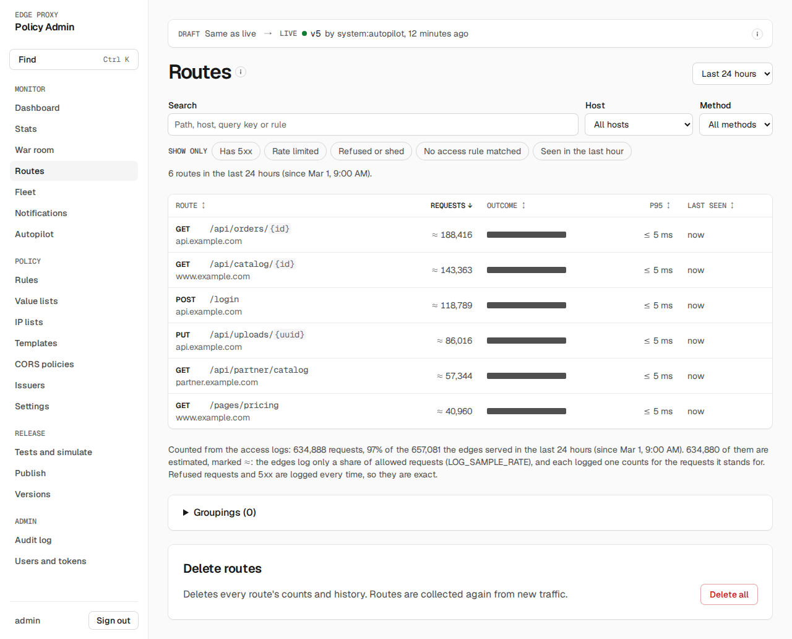

### Route detail

Open a route for its figures:

- Requests per hour (per day for 7 and 30 days, the last day ending with the hour in progress) with the same release marks as the dashboard.
- Query shapes: the sets of query argument names seen, never their values.
- Outcomes.
- Answers by status code, marked ≈ below 500 when allowed lines are sampled.
- **Upstream failures**: the edge's failures to get an answer, by cause.
- **What happens to this traffic**, described next.

**What happens to this traffic** takes a request like the route's, with each placeholder filled in, and walks it through the edge's steps in the order the edge runs them, using the same simulation as **Tests and simulate**.

- Above it, pick the policy to walk: **Live policy**, **Canary** (only while a canary runs), or **Saved draft**, which shows what a change will do to this route before you publish it.
- Each rule in a step is marked **Always**, **Never** (hidden until you ask), or **Depends on** what decides it, such as `Header x-beta` or the client's country.
- Lines starting **Logged:** say what the logs show happened.
- In the **Access rules** and **Rate limits** steps, each log-only rule also shows how many requests it logged instead of blocked or limited.
- The **Block** step names the access rule whose block setting applies to the sample. When it answers 403, the flow ends there.
- When the policy has a trusted client allowlist, the flow says so and whether its sample client IP is on it.

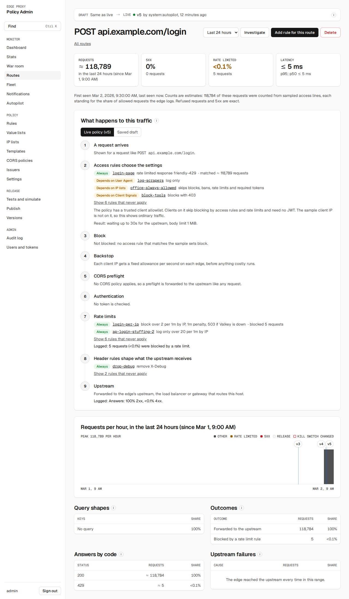

Actions on a route:

- **Add rule for this route** opens a new access, rate limit or header rule whose condition matches the route's host, method and path. A path with a placeholder becomes a `wildcard` condition, and its `*` also matches deeper paths, so narrow it if the rule should match this route only.
- **Investigate**, with `autopilot.manage`, asks the [autopilot](../use/autopilot.md#reading-a-case) about the route and opens the case.
- **Delete** deletes one route and its history.
- Deleting and grouping routes need the publisher or admin role, and each is recorded in the audit log.

## Fleet

Every edge that fetched config from admin.

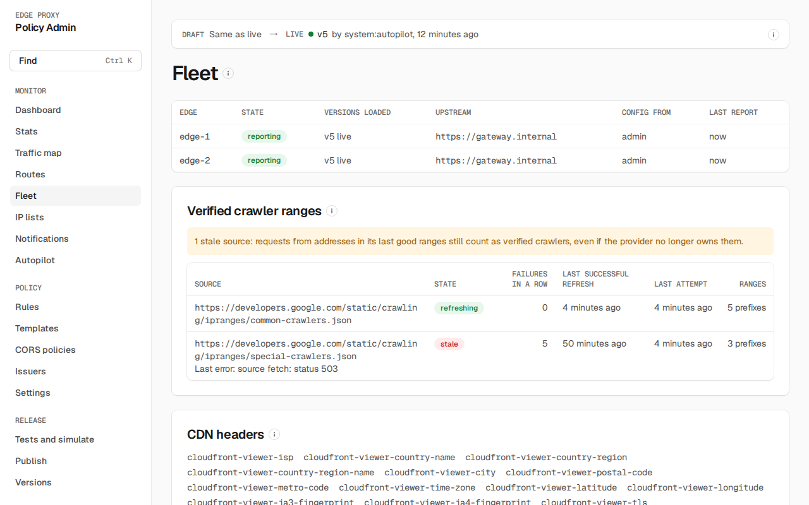

**Fleet** lists every edge with:

- Its state: **reporting** when it reported in the last minute, otherwise **gone**, plus **settings differ** on a reporting edge whose deployment settings differ from admin's.
- The versions it has loaded.
- Its upstream: the `UPSTREAM_URL` it forwards to, read-only because only the deployment sets it.
- Where its config came from (admin, cache file or bootstrap).
- Its last report.

Reporting edges come first. When some are gone and some reporting, the gone ones are hidden behind **Show N gone edges** (`?gone=1`). When none is reporting they are all listed.

**Settings differ**:

- While any reporting edge shows it, a notice names it and says publishing is held.
- `CLIENT_IP_SOURCE`, `VIEWER_HEADERS`, `INGRESS_SECRET_HEADER`, `CDN_HEADERS` and `ALLOW_REGEX` must be the same on admin and every edge.
- An edge old enough not to report its settings is never flagged.
- An edge from the release before `CDN_HEADERS` does report them, so on a `cloudfront` or `cloudflare` deployment it shows **settings differ** until it runs the new release.

### Verified crawler ranges

When [`VERIFIED_BOT_SOURCES`](../deploy/admin.md#variables) is set, **Fleet** also has **Verified crawler ranges**, for roles with `stats.read`. Without it the card is absent.

- It lists each source in configuration order with a state in words, its failures in a row, the time of its last successful refresh and last attempt (hover for the exact time) and its range count.
- A source with failures shows its last error under its URL.
- When any source is stale, a banner explains that edges keep matching its last good ranges, or none for a source never fetched.
- The card reloads every minute, and **Needs attention** links to it.

The states:

| State | Meaning |
|---|---|
| **not fetched yet** | Admin has not tried it yet. |
| **refreshing** | The last attempt succeeded. |
| **failing** | Failures in a row, below the limit. |
| **stale** | Failures in a row at or over the limit, 3 unless changed under **Notifications** for **Verified crawler ranges stopped refreshing**. |
| **never fetched** | Stale with no success yet. |

### CDN headers

**Fleet** also has a **CDN headers** card listing the names in [`CDN_HEADERS`](../deploy/edge.md#cdn-headers).

- Each is logged on every access line, as the CDN sent it, and suggested in the rule builder.
- Which of them rules can trust is set in **Settings → Trusted CDN headers**, linked from the card.
- Names a rule can't read are not suggested. These are source headers, which rules read through their field, such as `ip.src.country`, and edge-managed names such as `X-Edge-*`, `X-Forwarded-*` and `Host`, which rules can't read at all.
- A second line, **Also logged**, names them.

## Notifications

Anomalies admin found in the edges' stats, and when each signal notifies.

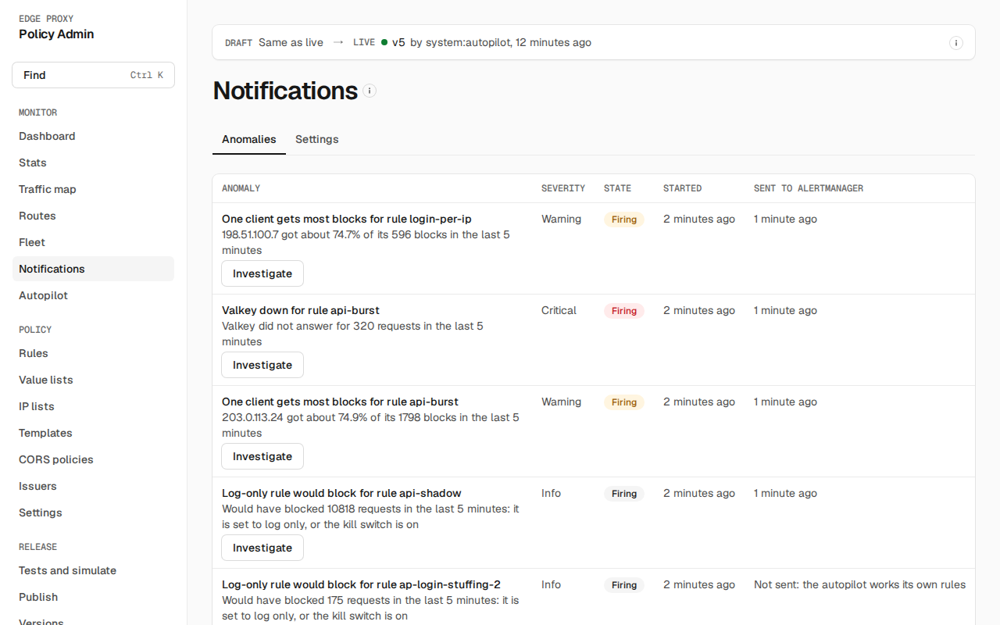

- Firing anomalies are sent to Alertmanager, which routes them.
- A signal trips only with enough requests to judge, and notifies after several checks in a row.

More: [Notifications](../operate/notifications.md).

## Autopilot

Short-lived rate limit rules against an attack while it runs. A language model investigates and proposes; admin checks every proposal and your budgets before a rule reaches an edge.

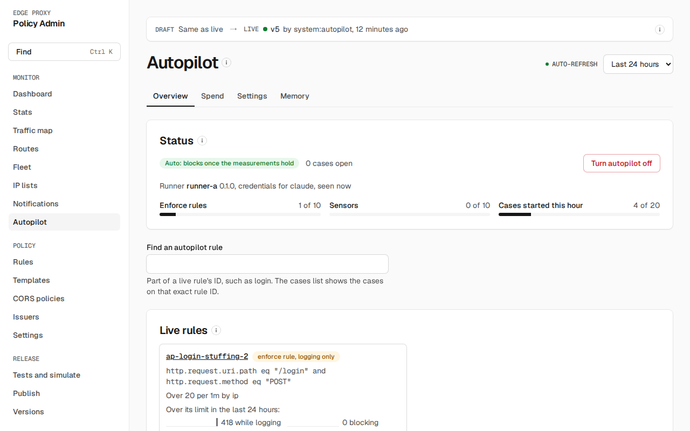

- Cases, the live autopilot rules, settings, spend and the off switch.
- Every autopilot rule expires.
- It needs the autopilot runner: `make demo-autopilot` adds it to the demo.

Open a case to see what started it, the model's evidence and admin's checks on what it proposed:

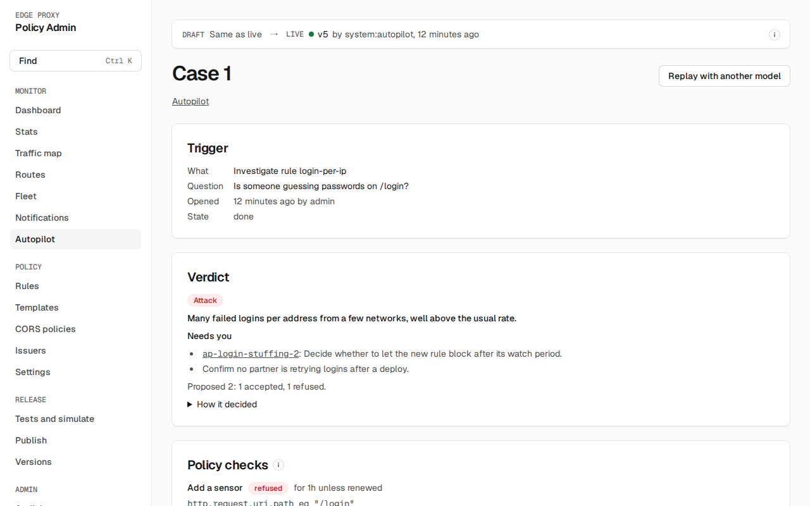

More: [Autopilot](../use/autopilot.md).

## Autopilot memory

What the autopilot's runs learned and recorded, newest first. **Memory** is a tab of the Autopilot page.

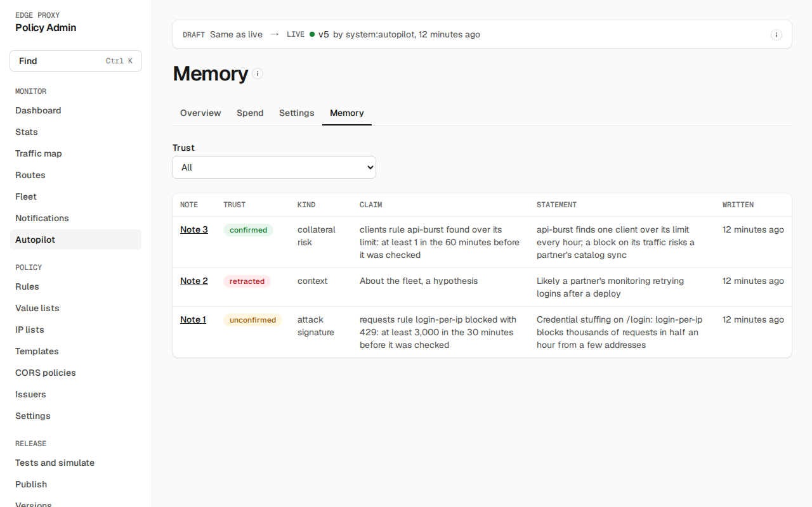

- Admin checks each claim against its own stats before a note is kept, and serves a note to later runs only while it holds.
- No person writes notes; they come only from runs.

A note's page shows its claim, the statistics admin found, links, evidence, uses and history:

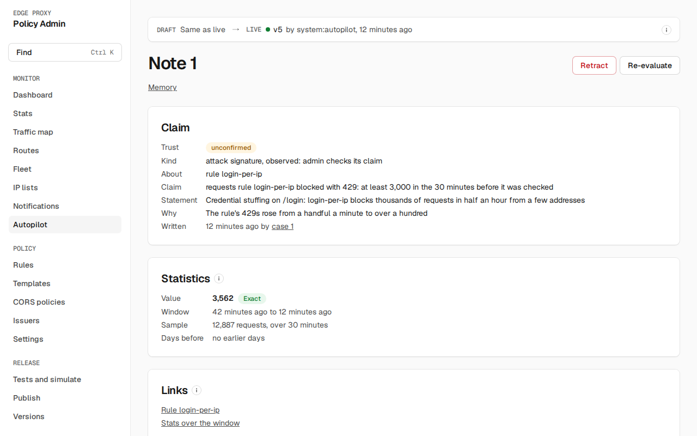

More: [Autopilot](../use/autopilot.md).
