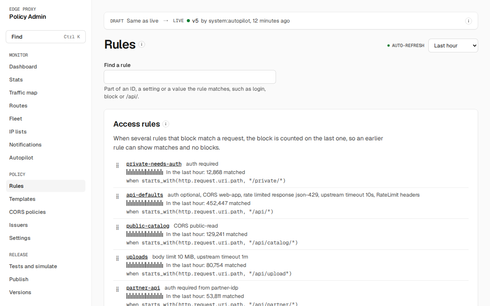
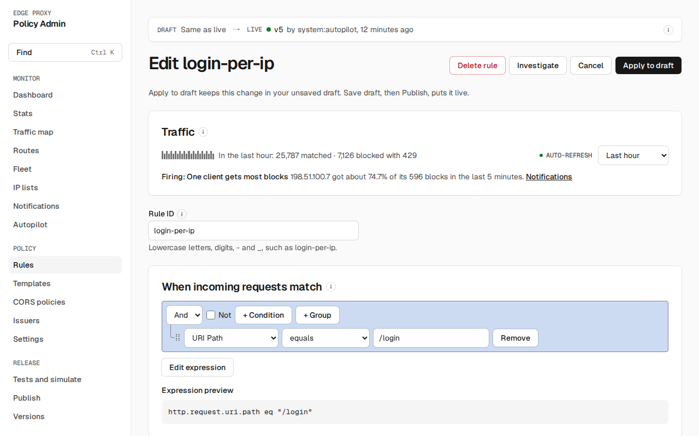
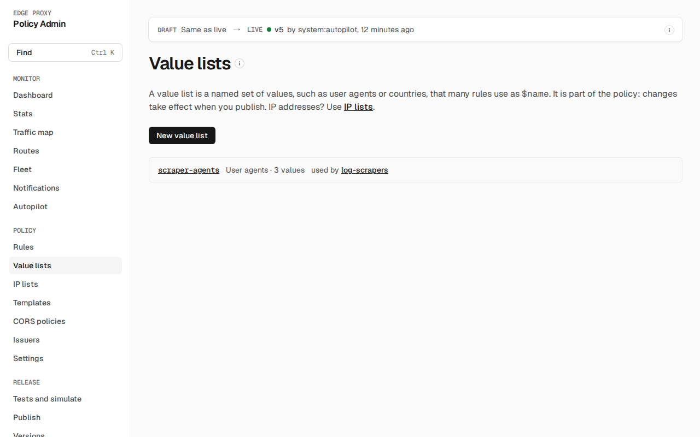
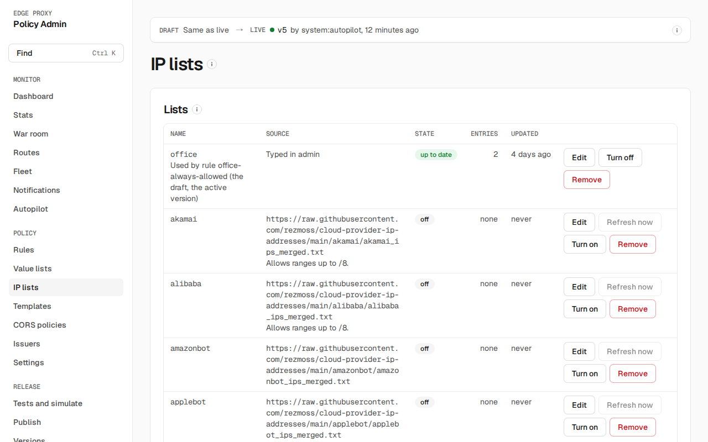
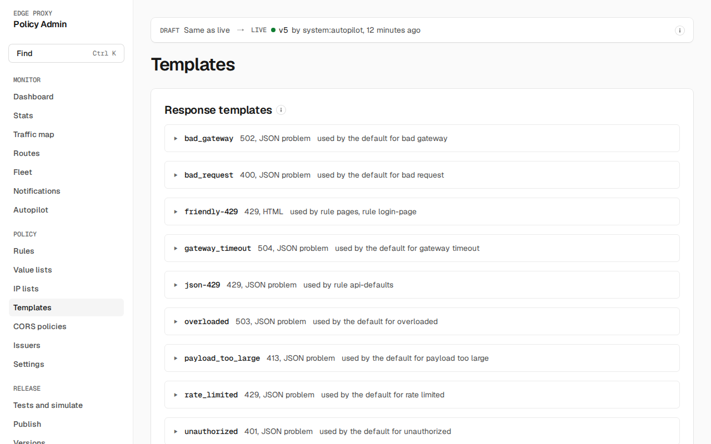
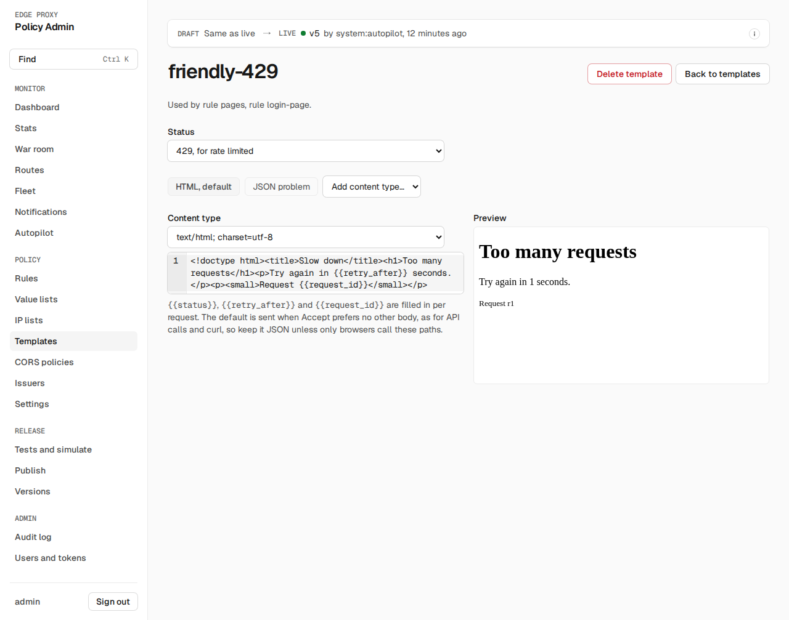
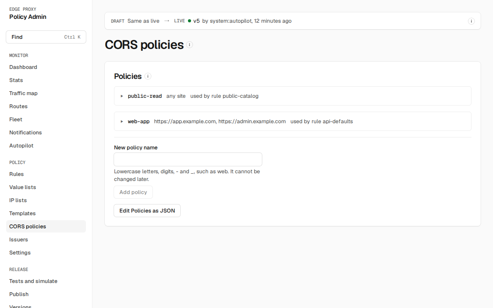
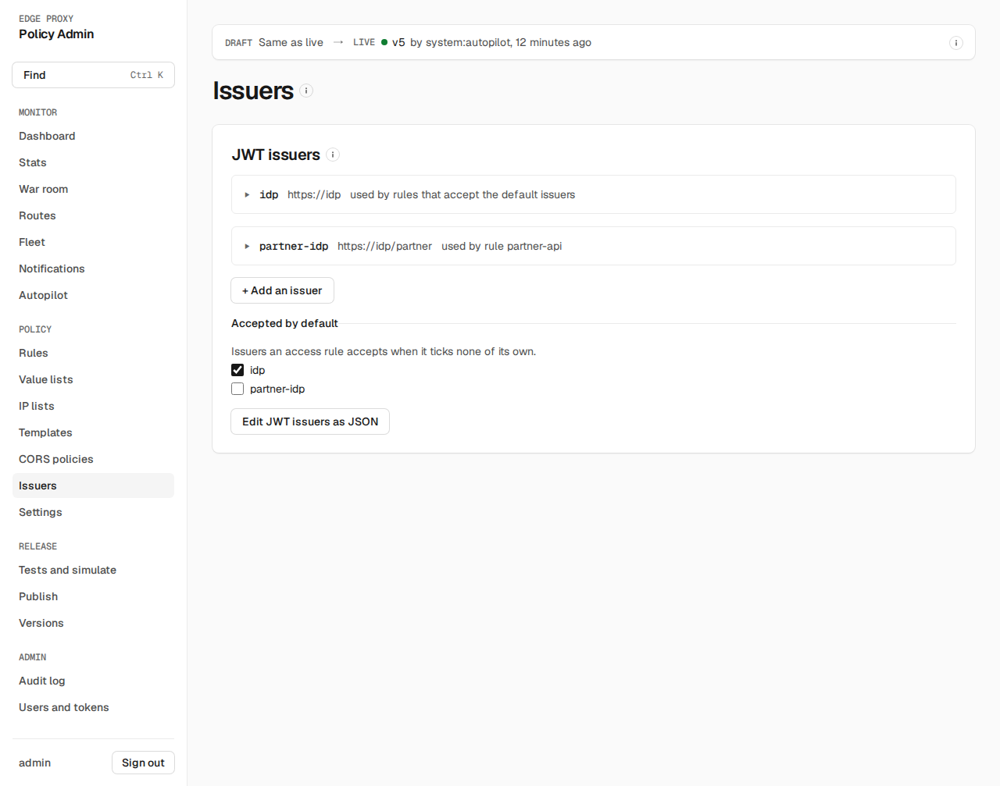
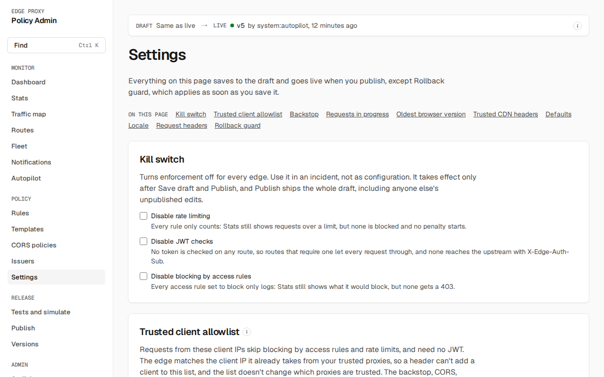

# Policy

The pages under **Policy** in the menu: the rules and the shared parts they use. Every change here goes to the draft and reaches the edges when you publish, except IP lists and, on **Settings**, **Rollback guard** and **Where the edges are**, which apply when saved.

## Rules

**Rules** shows the three phases and their rules, in order (**Access rules**, **Rate limit rules** and **Request header rules**), each with what it does and the condition it matches.

- **Access rules** decide who gets in and how each request is handled: blocking, token checks, Cross-Origin Resource Sharing (CORS) and timeouts.
- Drag a rule to reorder it.
- Add a rule to a phase with its button, such as **Add access rule** or **Add rate limit rule**, or open one to edit it.
- **Find a rule** shows only the rules whose ID, summary or condition contains what you type, such as `login`, `block` or `/api/`, with how many of each phase's rules are shown.
- A rule with `expires_at`, yours included, shows when it expires.
- A rate limit rule also shows its penalty and what it does when Valkey is down, unless it lets requests through.
- A rule that only logs (a rate limit rule set to `log`, or an access rule whose `block` is `log`) is marked **log only**.
- An [always-allow](../use/policy.md#always-allow) access rule is marked **always allow**.
- For roles that can read stats, each rule has a line of what it did over the [time range](index.md#time-range), such as `1,204 matched · 38 blocked with 429`, with a small chart of its matches. These counts are exact: every request is counted, for the version that served it.
- When several access rules that block match a request, the block is counted on the last one, so an earlier rule can show matches and no blocks.

### Autopilot rules on the rules page

When the live version has [autopilot rules](../use/publishing.md#autopilot-rules), the rate limit card lists them under **Autopilot rules**.

- They are read-only and not in the draft, each marked **autopilot** with when it expires.
- An ID opens the [Autopilot page](../use/autopilot.md#the-autopilot-page) with **Find an autopilot rule** set to it.
- With `config.write`, **Adopt** copies one into the draft as your own rule, without its `ap-` prefix and expiry. Save or discard unsaved changes first.
- An adopted rule reads **adopted, leaves autopilot on next publish** until then.

### Rule editor

A rule's editor has a **Traffic** card: the same counts over the time range as on **Rules**, and any anomaly firing or pending on the rule, with a link to **Notifications**.

- A rule not yet published shows `0 matched`.
- With `autopilot.manage`, **Investigate** asks the [autopilot](../use/autopilot.md#reading-a-case) about the rule, with an optional question, and opens the case.
- A rule's ID must be unique across all phases. **Apply to draft** stays disabled while another rule has it.
- **When incoming requests match** is the rule builder. **Edit expression** switches to text.
- The preview shows the expression as admin renders it, for the builder and for text as you type. Its problems are listed with the rest of the rule's above it.
- A header condition's key suggests the names in [`CDN_HEADERS`](../deploy/edge.md#cdn-headers) that rules can read. Any header name can still be typed.
- Where a condition's field and operator can take a [value list](../use/value-lists.md), **Type values** and **Use a list** switch between values written in the rule and a value list of that field's kind.
- A value list shows what it matches and, with a pattern operator, how many of the rule's 32 conditions it uses.
- **Save as list** turns the values you typed into a new value list and uses it.

The **IP lists** field:

- Roles that can read IP lists pick the names from the existing lists, with a **Find a list** search box. Other roles type the names.
- Operators that take several names use checkboxes, the others radio buttons.
- Each option shows whether the list is on, off or on but not downloaded yet.
- A name in the rule that is not a list is shown as no such list.

### Then form

**Then** is a form for what the rule does.

- An access rule's **Action** is **No action**, **Block**, **Log only** or **Always allow**.
- An always-allow rule that does not yet require the client IP, an IP list or a verified crawler offers **Add condition: client is on IP list**, which adds that condition for the list you pick.
- Every fixed value, and every name of something else (a CORS policy, issuer or template), is picked from a list.
- Numbers and durations are a number and a unit.
- A field that does not apply, such as burst for a window algorithm, is not shown.
- A response template is offered only for the kinds of error whose status it uses.
- A new rate limit rule starts as log only.
- **Edit as JSON** shows the same settings as JSON, with **Fields and an example**.
- As you edit, admin checks the draft with the rule in it, exactly as a save would. Each problem appears under its field and in a list at the top, and **Apply to draft** stays disabled until there are none.

### Saving

- **Apply to draft** keeps the change in the browser.
- **Save draft**, in the bar at the top of the screen once you have unsaved edits or the starter draft has never been saved, validates and saves it for everyone.
- If someone else saves the draft first, the bar says who and when. Discard and redo your changes on their version.
- When a save fails on a rule, the error links to that rule.

## Value lists

Named lists of values that rules share, such as user agents or countries.

- Each list with what it holds (such as **User agents** or **Countries**), how many values and the rules that use it.
- **New value list** opens an empty list. Opening one edits its name, what it holds (only while no rule uses it) and its values, one per line.
- Renaming updates `$name` in every rule that uses it.
- **Apply to draft** stays off while the change has a problem, including one that would break a rule.
- A change takes effect when you publish.

More: [Value lists](../use/value-lists.md).

## IP lists

Named lists of addresses: your own, typed on the page, and downloaded lists of abusers, cloud providers, crawlers, monitors and CDNs.

- A list allows or blocks nothing by itself; the rule that names it decides.
- Changes reach the edges within about a minute, with no publish.
- **Edit** a list, see the rules that use each one, and check an address with **Is this IP listed?**.
- **Banned IPs** lists current bans, with **Lift ban**.

More: [IP lists](../use/ip-lists.md).

## Templates

The answers the edge sends itself: bad requests, missing tokens, rate limits, timeouts.

- Each template with its status, content types and what uses it, and the template each kind of edge response uses by default.
- **Add default HTML and text pages** adds those bodies to templates that lack them.

- Opening a template shows its status and one tab per body, default first, with a preview filled with sample values.
- **Add content type** adds a body; **Make default** moves a body to the front.

More: [Response templates](../use/templates.md).

## CORS policies

Which other sites may call your API from their pages.

- Each policy's allowed sites, methods, the headers the page may send and read, whether browsers may send cookies, and how long browsers may reuse a preflight answer.
- An access rule picks a policy for its routes; a policy no rule picks has no effect.

More: [CORS](../use/cors.md).

## Issuers

The identity providers whose tokens the edge accepts.

- Each JSON Web Token (JWT) issuer's ID, `iss` value, audiences, keys URL and signing algorithm.
- **Accepted by default** sets the issuers a rule accepts when it names none.

More: [Issuers and tokens](../use/tokens.md).

## Editing templates, CORS policies and issuers

Templates, CORS policies and issuers are each a form that edits the draft directly.

- Each one is a line that says what uses it, such as `used by rule api-defaults`, or `not used`. One with a problem opens by itself.
- A template or policy is added by name and removed with its button. Its name cannot be changed.
- Every edit is checked by admin as a save would check it, and **Save draft** stays disabled until there are no problems.
- Each form has **Edit … as JSON**, which shows the same section as JSON.
- Saving warns about a CORS policy no access rule selects, an issuer no rule accepts, and a template nothing sends.

## Settings

Policy-wide values, one card each: **Kill switch**, **Trusted client allowlist**, **Backstop**, **Requests in progress**, **Oldest browser version**, **Trusted CDN headers**, **Defaults**, **Locale**, **Request headers**, **Rollback guard** and **Where the edges are**.

- Every card saves to the draft and goes live when you publish, except **Rollback guard** and **Where the edges are**, which apply when saved.
- **Publish** ships the whole draft, including anyone else's unpublished edits.

More: [Settings](../use/settings.md).
