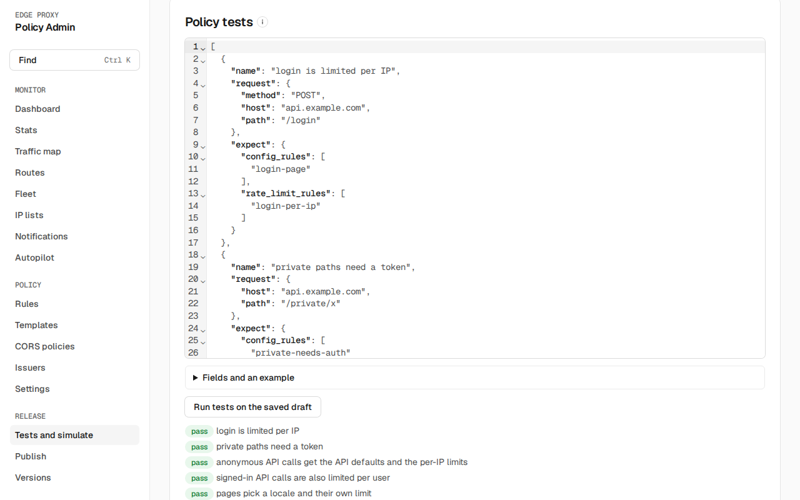
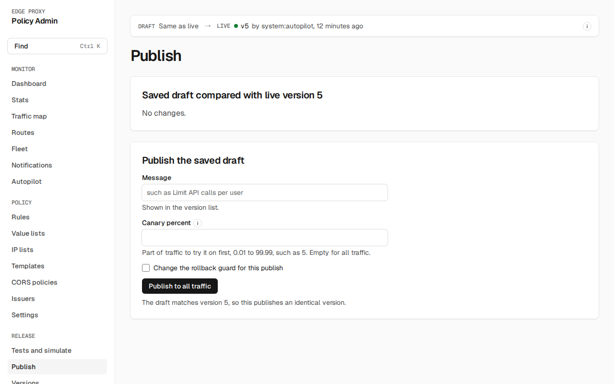
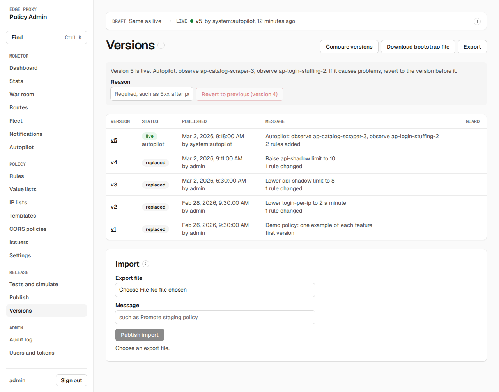

# Release

The pages under **Release** in the menu: check the draft, publish it and roll it back.

## Tests and simulate

This page has two parts: **Simulate a request** comes first, then **Policy tests**.

- **Simulate a request** runs one request against the saved draft or any published version and shows the outcome, which rules match, what settings apply and which headers the upstream would receive.
- **Policy tests** are the draft's tests, edited as JSON, with **Run tests on the saved draft**.
- Failing tests block publish.
- Simulate and the tests use the saved draft, so unsaved rule and setting changes are not in their results. The page says so while you have some.
- After simulating against the saved draft with no unsaved rule changes, **Add as a test** appends that request to **Policy tests** as a test expecting the same outcome and rules.

### The request form

The request is a form:

- Method from a list, host, path, client IP, country, AS number and HTTPS.
- The IP lists it is on.
- Headers.
- The claims of a verified token, if it has one.
- **Edit the request as JSON** shows it as JSON.
- A request the simulator cannot run, such as one with a mistyped IP, shows the problem under its field.

??? note "Details"
    - A request from a client on the trusted client allowlist shows the entry it matched, and one an always-allow rule matches shows the rule.
    - For both, the Rate limit rows read "Skipped, trusted client", and the Auth row notes that a trusted client needs no token.
    - **On IP lists** offers the lists rules name, for roles that can read IP lists, because the simulator does not look the client IP up in them.

## Publish

**Publish** compares the saved draft with the live version, rule by rule. Unsaved changes are not shown or published.

- Enter a message and press **Publish to all traffic**, or **Publish to N% of traffic** with a canary percent.

Optional:

- **Canary percent:** send only part of the traffic to the new version, then step, promote or abort it here.
    - The canary says when the guard allows the next step and how many requests the step has seen, or that it is ready.
    - **Step up** and **Promote to all traffic** stay disabled until then.
    - **Abort** works at any time once you enter an abort reason.
    - If the guard raised an alert on the canary, the card and the promote dialog say which signals tripped.
    - The percent may end in `%`. Anything that is not 0.01 to 99.99 blocks the publish.
- **Override reason:** shown once a publish is refused because an issuer's keys were never fetched; give a reason to publish anyway.
- **Change the rollback guard for this publish:** the same form as in **Settings**, with a required reason.

## Versions

**Versions** lists every published version with its author, message, change summary and guard outcome.

- A version autopilot published is marked **autopilot**.
- An aborted canary shows its abort reason.
- Open one to see what it changed from the previous version and which guard signals tripped.
- **Revert** to a version (a rolled back version warns that the guard never rolls back a revert) or **Copy to draft**.
- **Compare versions** diffs any two.
- A rule's published history is in its rule editor.
- Once there is a previous version, the banner at the top reverts to it in one step, with a reason: the emergency undo.

Moving config between admins:

- **Download bootstrap file** saves the live version as the file an edge starts from when admin is unreachable.
- **Export** saves it with its tests.
- **Import** on another admin (production, say, from staging) publishes that file through every publish check, to all traffic.

When a guard rollback, an aborted canary or a revert replaces the version a draft started from, **Publish** offers to rebase the draft. If the draft has no edits of its own, it offers instead to keep the replaced version's changes in the draft to fix and publish again.
