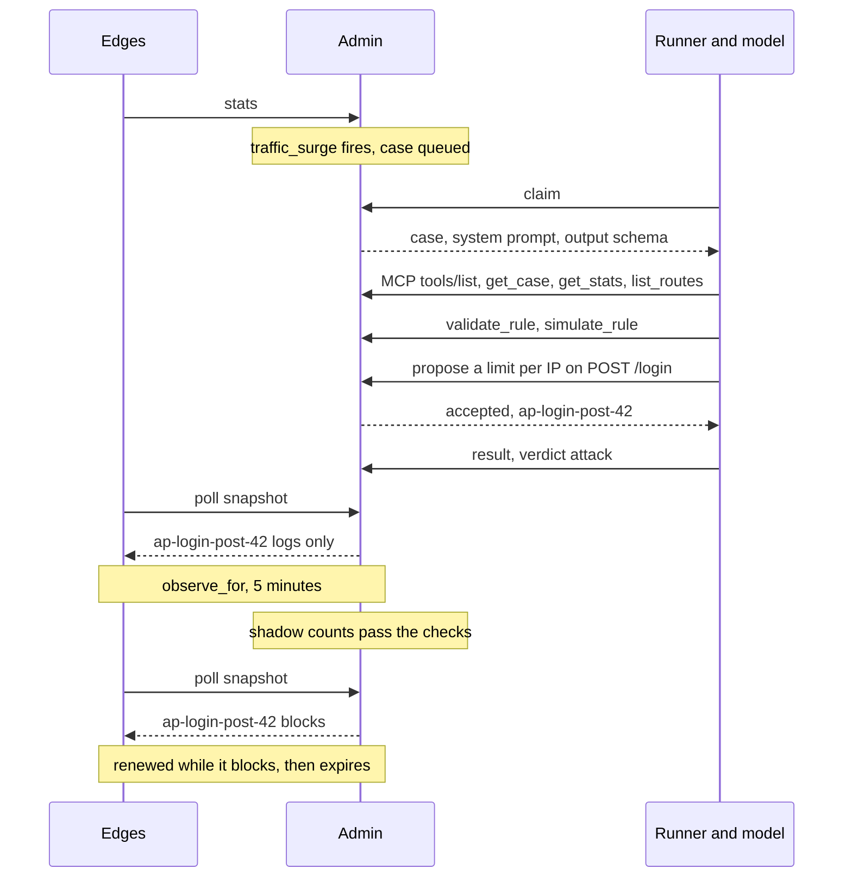
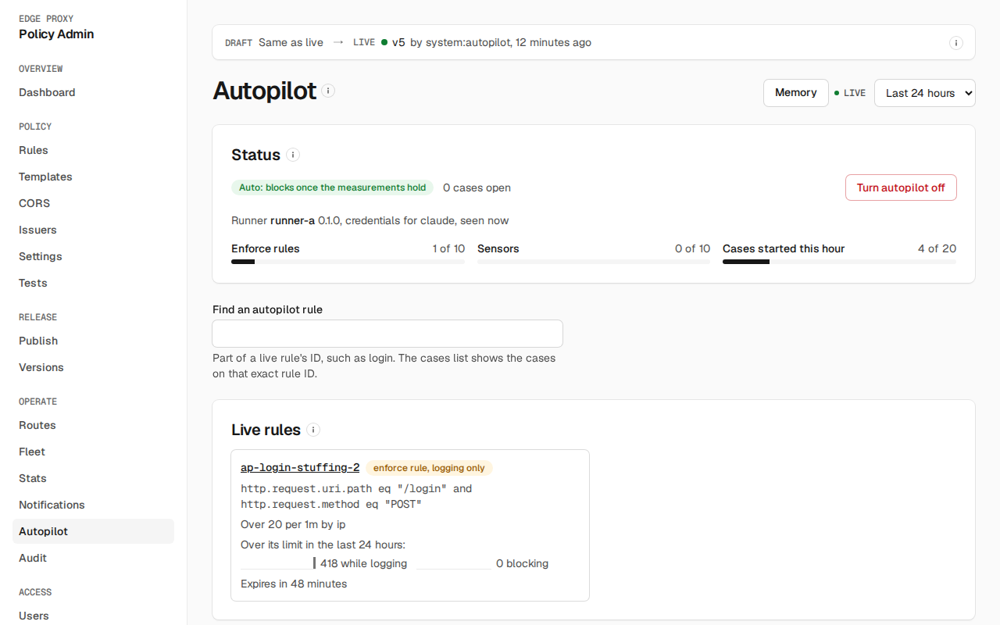
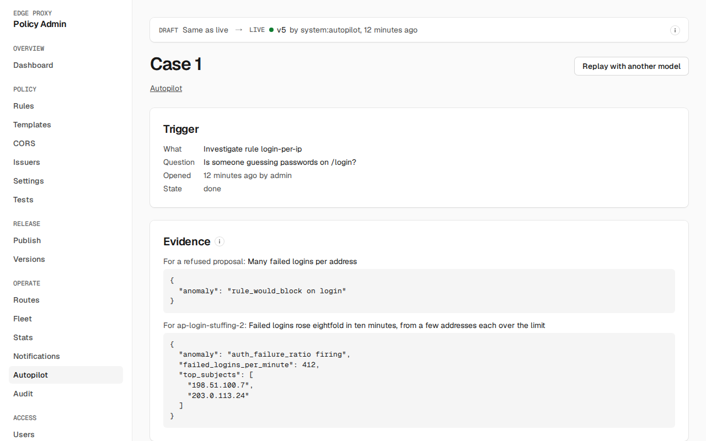
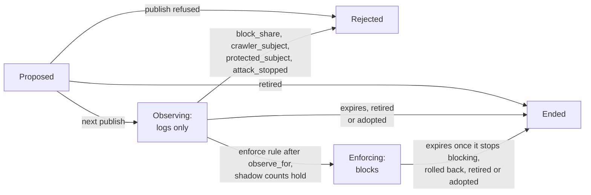
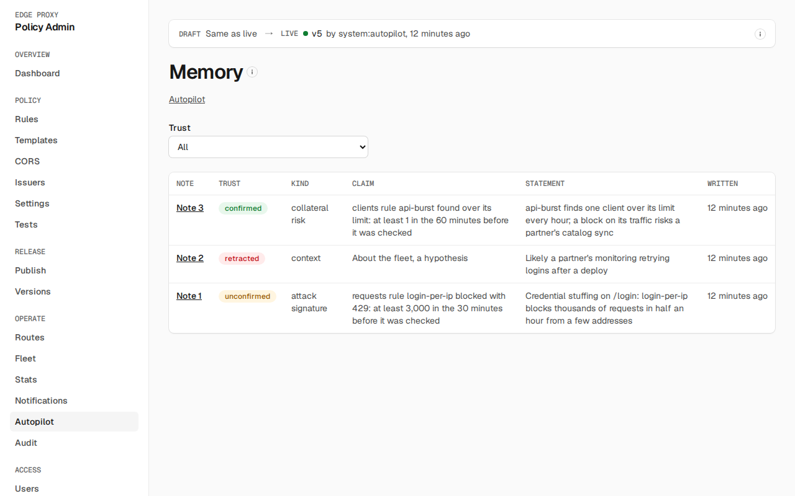
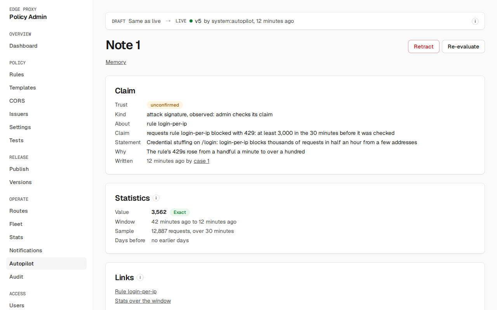

# Autopilot

Autopilot adds a short-lived rate limit during an attack. A language model investigates and proposes a rule through admin's [MCP tools](../reference/api.md#mcp-tools). Admin decides: it checks the proposal against fixed checks and your budgets, runs the rule log-only first, and lets it block only when it would block few other clients. Each autopilot rule expires at most 24 hours ahead and is renewed only while it is still needed, up to `max_lifetime` (7 days by default). Autopilot rules run after yours, as an [overlay](publishing.md#autopilot-rules).

## How it works

An example with the default settings (`mode: auto`):

1. Requests rise over 5 times their baseline (at least 1,000), [`traffic_surge`](../operate/notifications.md#signals) fires, and admin opens a case.
2. The runner claims the case and runs the model. The model reads the stats, routes and rules and finds the surge on `POST /login`. It tests a rule with `validate_rule` and `simulate_rule`, then proposes it ([example](#example-a-proposal)).
3. Admin runs its [checks](#proposals-and-the-checks). A refused proposal goes back to the model with the reasons.
4. The next publish puts the rule on the edges, logging only. After 5 minutes (`observe_for`), admin looks at what it would have blocked. The rule starts blocking when it would still block someone, the blocks besides its heaviest clients are at most 2% of the fleet's requests (`max_block_share`), and none of the clients it would block most is a verified crawler or a protected subject. Otherwise it is rejected.
5. While it blocks, its own [rule guard](#the-rule-guard) can roll it back. Its TTL counts again from when it started blocking, and near its expiry it is renewed by `default_ttl` (1h) only if it blocked someone in the last 10 minutes, up to `max_lifetime`. Once it blocks no one, it runs out at its current expiry. It renews on any client it blocks, so a rule that keeps blocking legitimate clients, such as many users behind one address, keeps running: **Mark false positive** on its case.

In `observe` mode, step 4 also waits for a person to click **Approve blocking** on the case. A rule nobody approves runs out at its expiry. Every step shows on the [Autopilot page](#the-autopilot-page) and on the [case's page](#reading-a-case).



## Example: a proposal

The model calls `propose` with the rule it wants. It names the rule and sets a TTL; admin sets the id, the expiry and whether it logs or blocks:

```json
{
  "action": "enforce",
  "name": "login-post",
  "ttl": "1h",
  "rationale": "Failed logins from many addresses, each over 20 a minute",
  "rule": {
    "expression": "http.request.uri.path eq \"/login\" and http.request.method eq \"POST\"",
    "algorithm": "sliding_window",
    "limit": 20,
    "period": "1m",
    "key": ["ip"],
    "on_missing_key": "fallback_ip",
    "fail_mode": "open"
  }
}
```

Admin accepts it and answers with the new rule's id, `ap-<name>-<proposal id>`. `checks` lists every check with its result; one is shown here:

```json
{"proposal_id": 42, "accepted": true, "rule_id": "ap-login-post-42", "reasons": [],
 "checks": [{"name": "site_wide", "ok": true, "detail": "an autopilot rule never matches every request"}]}
```

On the edges the rule runs as:

```text
id:       ap-login-post-42
match:    http.request.uri.path eq "/login" and http.request.method eq "POST"
          and not client.verified_bot          (while VERIFIED_BOT_SOURCES is set)
          and not ip.src in {...}              (while protected_subjects is set)
          and not the active exclusions          (when there are any)
limit:    20 per 1m, keyed on ip, sliding window, fail open
action:   log, then block after the checks in step 4
expires:  1h after it goes live, counted again from when it starts blocking,
          renewed by default_ttl near expiry while it still blocks
```

The same rule with `and ip.src in {"203.0.113.0/24"}` added is refused. Autopilot limits whoever crosses a rate; it never lists clients:

```json
{"proposal_id": 43, "accepted": false, "reasons": ["named_subjects"],
 "checks": [{"name": "named_subjects", "ok": false, "detail": "the rule names no IP, AS number, X-Forwarded-For or JWT claim value"}]}
```

## What runs where

- **Admin** holds the cases, the rules, the checks and the publish. The leader runs autopilot every 30 seconds and publishes at most once a run.
- **A runner** is a separate process holding the model provider credentials. It long-polls admin for a case (`POST /v1/autopilot/claim` with the `AUTOPILOT_TOKEN_FILE` token, see [admin settings](../deploy/admin.md)), runs the model with the system prompt and tools admin sends, and reports the verdict, token use and its transcript. [Autopilot runner](../deploy/autopilot.md) covers its image and settings. Credentials never reach admin, Postgres or the UI: the runner only names the providers it holds one for (`claude`, `openai`).
- **Without a runner,** nothing new is investigated. Rules already live keep their expiry and run out on the edges, and rules already observing still enforce or are rejected on their measurements.

## The Autopilot page

**Autopilot**, under **Operate**, needs `autopilot.read`. It refreshes every 30 seconds. **Memory** opens the autopilot's [notes](#the-memory-pages), and, with `stats.read`, the range picker sets the range of the live rules' counts.



- **Status:** the mode, how many cases are open, each runner seen in the last day with its version, the providers it holds a credential for and when it was last seen, and any warning, such as a model whose provider no connected runner holds. When no runner was seen in the last 2 minutes it says so: nothing new is investigated, and live rules run until they expire. Three budgets show what is in use: **Enforce rules** (`max_enforcing`), **Sensors** (`max_sensors`) and **Cases started this hour** (`cases_per_hour`). With `settings.manage`, **Turn autopilot off** is the [kill switch](#turning-it-off).
- **Find an autopilot rule** narrows **Live rules** to the rules whose ID contains what you type, and **Cases** to the cases opened on exactly that rule ID. An autopilot rule's ID on **Rules** links here with it filled in.
- **Live rules:** each proposed, observing or enforcing rule, as a sensor or an enforce rule, with its condition as admin renders it, its limit and key, and when it expires. Once an enforce rule has been measured, it shows the share of the requests it checked that were over its limit while it only logged; the edges count every request, so the share is exact. With `stats.read`, each rule also shows how many requests it found over its limit in the picked range while logging and while blocking, with a sparkline of each; the counts are exact. A rule's ID opens the case that made it.
- **Exclusions:** the [exclusions](#exclusions) active now and those that ended in the last 30 days, with **Revoke** for an active one with `autopilot.manage`.
- **Cases:** the latest 20 cases, newest first, with what started each, its state and its verdict.
- **Settings:** every [setting](#settings), saved on its own outside the draft, with the server's reason for a refused value shown by its field. The mode here offers **Observe** and **Auto**, or **Off** while it is off; turning it off goes through **Turn autopilot off**.
- **Model prices:** the [price table](#cases), and, with `settings.manage`, **Add a price**. A price is never changed: a new row takes over from its time.

### Spend

What finished runs cost, for the last 24 hours and the last 7 days, counted back from now by when each run started. A run still going is not counted. **At your prices** is each run's token counts, as the runner reported them, times the price in effect when it started: exact for your price table. A run whose model had no price is left out of it and counted as having no price. **The provider's estimate** is the runner's report of what the provider itself estimated, for the runs that reported one.

**By day and model** splits the finished runs started in the last 14 UTC days, today included, by UTC day and model, newest day first: runs, cases, the cost at your prices, the cost per case and the provider's estimate. A case whose run failed and was queued again counts once in **Cases**. **Per case** is the cost at your prices divided by cases, or `n/a` with the number of unpriced runs when any run that day had no price.

### Precision

How the enforce rules that ended in the last 7 days turned out, one row per model and prompt, the prompt named by the first 12 characters of its SHA-256. **Right** counts the rules that ran out after blocking and the rules a person adopted. **Wrong** counts the rules their [guard](#the-rule-guard) rolled back and the rules a person marked a false positive. Rules retired for another reason, rejected before they blocked, or sensors are not counted. The counts are exact.

## Reading a case

A case's page reads top to bottom as the case happened. It refreshes every 2 seconds while the case is open or one of its rules waits to publish.



- **Trigger:** what opened it, its question, who opened it and when, and its state.
- **Evidence:** for each proposal, the model's rationale and the evidence it cited, as it wrote them.
- **Tool calls:** every MCP call the case's runs made, in order, as admin recorded it. Each is closed until opened, and shows the arguments and admin's answer or refusal, and how long it took. Admin's answer needs both `stats.read` and `config.read`, and is hidden without either one, with the permissions it needs. A [connector](#external-metrics-and-logs) call's answer also needs `autopilot.manage`; hidden, it shows neither its arguments nor its refusal, since its query and error text are part of what it read. A call over 64 KiB is kept only as its size and SHA-256, and shows just those.
- **Verdict:** `attack`, `benign` or `unsure`, with the model's summary.
- **Policy checks:** each proposal, accepted or refused, with every [check](#proposals-and-the-checks) it passed or failed.
- **Actions:** each rule the case made, with its state, how it ended and every change of state. With `autopilot.manage`: **Approve blocking**, in `observe` mode, for an observing enforce rule, refused until it has observed for `observe_for`; **Retire** and **Mark false positive**, each asking for a reason that the rule's history and the audit log keep; and, for a sensor, **Exclude a client** (see [Exclusions](#exclusions)). With `config.write`, **Adopt** copies a live rule into the draft, as on [Rules](dashboard.md#rules).
- **Cost:** each run's model, prompt and tool list hashes (the first 12 characters of each SHA-256), result, token counts, cost at your prices and the provider's estimate.

**Replay with another model** shows the command that [replays](#replay-and-evaluation) the case's run against a provider and model you pick. Admin calls no model for it.

**Investigate**, with `autopilot.manage`, opens a case and this page: on a rule's editor, on a route's page, and on an open anomaly on **Notifications**. It takes an optional question.

[Find](dashboard.md#find) opens one of the latest 100 cases by `Case N`, and one of the newest 500 notes by `Note N` or words from the first 80 characters of its statement.

## Settings

`GET` and `PUT /api/settings/autopilot` (`settings.manage` to change). `PUT` replaces every setting: send the whole object from `GET`, since a setting left out is saved as zero or empty where its range allows it, such as `max_enforcing: 0`. Every change is audited (`settings.autopilot`) and takes effect on the next run.

A rule is renewed only in the last quarter of its TTL, on a 30 second run that publishes at most once every `min_publish_interval`, so `default_ttl` and `max_ttl` must be at least 4 times (30s plus `min_publish_interval`): 6m at the default `min_publish_interval` of 1m. A `PUT` below that is refused with `422`. Stored settings below it are raised to it when read, as is `max_lifetime`. An enforce rule logs only for `observe_for` first, so `default_ttl`, and an enforce proposal's own `ttl`, must also be over `observe_for` plus `min_publish_interval` and 30s (6m30s at the defaults); a shorter one would expire before it blocks.

| Setting | Default | Range | What it does |
|---|---|---|---|
| `mode` | `auto` | `off`, `observe`, `auto` | `observe` adds sensors and measures enforce rules; a person approves each before it blocks. `auto` enforces once the measurements hold. `off` is the [kill switch](#turning-it-off) |
| `max_enforcing` | 10 | 0 to 50 | Enforce rules proposed, observing or enforcing at once |
| `max_sensors` | 10 | 0 to 50 | Sensors proposed or observing at once |
| `observe_for` | 5m | 1m to 1h | How long an enforce rule logs before it may block |
| `default_ttl` | 1h | 4 × (30s + `min_publish_interval`) to `max_ttl`, and over `observe_for` + `min_publish_interval` + 30s | A rule's TTL when the proposal sets none, and an enforcing rule's renewal |
| `max_ttl` | 24h | 4 × (30s + `min_publish_interval`) to 24h | The longest TTL; a sensor is renewed by this much |
| `max_lifetime` | 168h | `max_ttl` to 720h | How long a rule, and the sensor it cites, may keep being renewed; also how long a rolled back or false positive rule is not proposed again |
| `max_block_share` | 0.02 | 0.001 to 0.2 | The most of the fleet's requests one autopilot rule may block besides its heavy subjects, each at least 5% of a minute's blocks: the collateral. See [Rule states](#rule-states) |
| `cases_per_hour` | 20 | 1 to 200 | Runs started in the last hour |
| `min_publish_interval` | 1m | 30s to 15m | Least time from the last autopilot publish of any kind to one that adds or renews rules. Removals don't wait |
| `model`, `sweep_model` | `claude-opus-5-5` | a model id | The model for cases, and for sweeps and reviews. A model id containing `claude` runs on a runner's `claude` credential; any other on `openai` |
| `protected_subjects` | none | up to 200 IPs, CIDRs or AS numbers | Subjects no autopilot rule may block. Each autopilot rule leaves the networks out of its expression on the edges; your own rules still apply to them. Together with the active exclusions, as `not ip.src in {...}`, they must fit in half of an expression (2,000 characters). An AS number is accepted but not yet matched: the stats name subjects by address. Subjects are checked only for a rule whose key includes `ip`, which admin puts first in the key; a rule keyed on a JWT claim alone is not checked |

## Cases

A case is one question for the model. Admin opens one:

- **On an anomaly:** `traffic_surge`, `auth_failure_ratio`, `rule_auth_failure_ratio` or `rule_match_surge` firing, and `rule_would_block` or `rule_subject_dominates` on an autopilot rule. Those two open no case on an autopilot rule while a case on the same rule and signal closed `benign` within `max_ttl`, one renewal of the sensor.
- **Sweep,** hourly: find observed routes no rule watches and propose sensors for them. It waits while `max_sensors` is used up, since it only proposes sensors.
- **Review,** daily: retire sensors that never fire or whose cases keep closing benign, and summarize the day.
- **Investigate** (`POST /api/autopilot/cases`, `autopilot.manage`): a person asks about a rule, route or anomaly, with an optional question, or asks a question alone. Admin also opens one on each rule still enforcing on a note that was [retracted](#re-checks).
- **Ablation:** a re-run of a case with a confirmed [note](#memory) withheld.

Admin opens cases only while a runner was seen in the last 2 minutes, at most one per target at a time and 100 open at most. A case still queued an hour after it was opened, or after it was last queued again, is cancelled at the next run. A runner takes the oldest queued case whose model's provider it holds a credential for. It holds a case on a 10 minute lease it renews by heartbeat. When the lease lapses, or the run reports `error` or `timeout`, the case is queued again once, then fails. A case that fails or ends `unsure` raises [`autopilot_needs_person`](../operate/notifications.md#signals), and so does one that ends `attack` with no enforce rule accepted, or with one accepted in `observe` mode that no person has approved yet, unless the case's rule is an autopilot rule that already enforces.

Every run is kept: its model and provider, the prompt and tool list hashes, the runner's events (at most 1,000 and 4 MiB a run), every tool call admin answered, its token use and its cost. Cost is from the model prices admin holds (`POST /api/autopilot/prices`), at the price in effect when the run started, and from what the runner reports. Cost is recorded and reported only; a model with no price still runs.

## Proposals and the checks

The model proposes `add_sensor`, `enforce` or `retire` (of a sensor). Admin checks a rule before it is accepted, and answers every check with its reason. A refused proposal is not saved as a rule.

| Check | Refuses |
|---|---|
| `not_overlay_shape` | A malformed proposal: a name outside 1 to 40 of `a-z`, `0-9` and `-`, or starting `ap-`, which admin adds, a TTL under 4 × (30s + `min_publish_interval`), the shortest a rule can be renewed within, or `cites` not naming an observing sensor |
| `site_wide` | An expression of `true` |
| `fail_mode` | `fail_mode: closed`. A Valkey outage never blocks traffic for an autopilot rule |
| `key_needs_ip_or_jwt` | A key without `ip` or a `jwt_claim:`, so a client can't choose its own bucket |
| `constant_or_host_key` | A `constant` key, or a key of `host` only |
| `missing_key_rejects` | `on_missing_key: reject` |
| `ttl_over_max`, `lifetime_over_max` | A TTL past `max_ttl`, or a rule that would outlast the cited sensor's `max_lifetime` |
| `penalty_past_expiry` | A penalty longer than the TTL |
| `named_subjects` | An expression comparing `ip.src`, `ip.src.asnum`, `http.x_forwarded_for`, a JWT claim or a client IP header (`X-Forwarded-For`, `Forwarded`, `X-Real-IP`, `True-Client-IP`, `CF-Connecting-IP`, `CF-Connecting-IPv6`, `CloudFront-Viewer-Address`, `X-GCLB-Client-IP`), with any operator, negated or not, or any condition whose value is an IP address or a prefix. Autopilot limits whoever crosses a rate; it never lists clients. A client IP header under another name, or an address written another way, is not caught |
| `duplicate` | The same expression and key as a live rule, yours or autopilot's |
| `suppressed` | A rule with exactly the same expression and key as one rolled back or marked a false positive within `max_lifetime`. It is best effort: any change to the expression or key is a new rule |
| `compile` | Anything [validation](policy.md) refuses, with your rules and every live and pending autopilot rule |
| `budget_sensors`, `budget_enforcing` | A proposal past `max_sensors` or `max_enforcing` |
| `note_key`, `note_jwt_key` | A key a confirmed [note](#citing-a-note) the proposal cites rules out |

Each accepted rule gets the id `ap-<name>-<n>` and starts with `action: log`. Admin adds to its expression what no autopilot rule may limit, so the edges leave it out on every request: `and not client.verified_bot` while `VERIFIED_BOT_SOURCES` is set, `and not ip.src in {...}` with the protected networks, and the active [exclusions](#exclusions). The rule's content is fixed when it is proposed, so a later change to `protected_subjects` applies to new rules only. The check of its top subjects before it enforces still refuses it early.

## Rule states



- **Proposed** until the next publish that may add rules: no canary is running and `min_publish_interval` has passed since the last. When a live edge's deployment settings or schema refuse the publish that would add it, it is **rejected** with that reason (`deployment` or `schema`), so it never holds back later ticks; expiries and rollbacks still go out.
- **Observing:** live on the edges, logging only. A sensor stays here, renewed by `max_ttl` while it is due within a quarter of its TTL, up to `max_lifetime`. An enforce rule is not renewed while it observes, so in `observe` mode one nobody approves expires.
- **Enforcing:** an enforce rule blocks once it has observed for `observe_for` (and, in `observe` mode, a person approved it with `POST /api/autopilot/rules/{id}/enforce`). Before it does, admin measures its shadow counts since it went live. It is **rejected** instead when, besides its heavy subjects, it would block over `max_block_share` of the fleet's requests (`block_share`), when a subject it would block, an IPv4 address or an IPv6 /64 as the edge shows it, overlaps a verified crawler range (`crawler_subject`) or a protected subject (`protected_subject`), or when it would have blocked nothing over the last `observe_for` (`attack_stopped`). Its heavy subjects are found minute by minute, each holding at least 5% of the rule's would-limit requests in that minute. Their estimates are summed over the window and left out once, less an allowance of 3 × √(16 × H) for sampling error, where H is that sum and 16 is the edges' sampling rate: an edge adds one limited request in 16 to a subject's estimate. An attack spread so thin that no subject reaches 5% of a minute counts as collateral, and is refused. A confirmed [note](#citing-a-note) the rule cites can lower that share, halve `observe_for`, or hold it back (`note_expected_pattern`). When it starts blocking, its TTL counts again from then, so time spent observing and waiting for a publish doesn't leave it too little to be renewed; it never runs past `max_lifetime` after it, or the sensor it cites, went live. An enforcing rule is renewed by `default_ttl` only if it blocked within the last 10 minutes, so it runs out once the attack moves on.
- **Ended:** expired, retired by a person (`POST /api/autopilot/rules/{id}/retire`, with `false_positive` to stop it being proposed again), retired by the model (sensors only: an enforcing rule ends at its expiry or by a person), adopted into your draft, or rolled back by its guard. When a new rule no longer compiles with the rules you published since, admin can't tell which one broke the publish, so every proposed rule is **rejected** (`compile`).

Every change of state is an `autopilot_transitions` row and an audit event naming the rule, with the numbers that decided it.

## Exclusions

An exclusion is a client a person found legitimate on a host, and optionally a path prefix, such as a CI job polling an API that a sensor keeps flagging. Every autopilot rule proposed while it is active leaves that traffic out on the edges, as it leaves out the protected networks, so a sensor stops counting the client and no enforce rule can block it there. Your own rules still apply to it. Only a person makes or ends one; no model tool can.

**Exclude a client**, on a sensor's case with `autopilot.manage`, lists, with `stats.read` and only for a sensor keyed on `ip`, the clients the sensor found over its limit most in the last 24 hours, a sampled estimate, and takes the client, the host and path prefix (filled from the sensor's own conditions), a reason, and an expiry: 30 days, 7 days, 90 days or never. The sensor is retired with it, in the same transaction, so the next sweep can watch the route again without the client. **Exclusions**, on the Autopilot page, lists the active ones and those that ended in the last 30 days; **Revoke** asks for a reason.

The client is an IP, or a CIDR of at least /24 for IPv4 or /48 for IPv6; a wider network belongs in `protected_subjects`. The exclusions and the protected networks share half of an expression (2,000 characters), which every autopilot rule carries.

A rule's content never changes under its id, so an exclusion that is revoked or expires stops applying to new rules, and on its next run admin retires each observing sensor that still carries it. An enforce rule that carries it keeps blocking until it ends: it is renewed only while it blocks, and never past `max_lifetime`.

Exclusions are kept in `autopilot_exclusions`, never deleted, and `get_autopilot_state` lists the active ones to the model: client, host, path prefix and expiry, not who made one or why. The audit actions are `autopilot.exclusion_add` and `autopilot.exclusion_revoke`.

## The rule guard

The [rollback guard](publishing.md#rollback-guard) leaves autopilot rules out of its rule signals and judges the version a person published, so an autopilot rule blocking an attack never rolls back your publish. Each enforcing autopilot rule has its own guard instead, for the guard's `window` after it started blocking, using the `changed_rule_limited_ratio` signal's `mode` and `max_vs_shadow`, and the guard's `min_requests`. It trips when the rule limits more than `max_vs_shadow` times its shadow ratio, or, when its shadow ratio is 0 (every shadow limit went to heavy subjects), more than the signal's `max_ratio`; or when it limits more than `max_block_share` of the fleet's requests. The shadow ratio leaves heavy subjects out, as the guard's counts do: both find them minute by minute and leave their summed estimates out once over the window, less the same sampling allowance. An attack spread so thin that no subject reaches 5% of a minute counts against the rule, and can roll it back. In `rollback` mode the rule is rolled back (`autopilot.rollback`), [`autopilot_rolled_back`](../operate/notifications.md#signals) fires, and the rule leaves the edges in that run's publish. During a canary no publish goes out, so it stays on the edges until the canary ends, and its transition records `published: false` and `waits_for_canary` with the canary's version. In `alert` mode it is audited once (`guard.alert`). With the guard turned off (`enabled: false`), or the `changed_rule_limited_ratio` signal's `mode` set to `off`, autopilot rules are not judged either.

## Memory

A case run can record what it learned as a **note** with `record_learning`, and later runs read notes with `search_notes`. A note goes live without a person. The gate below, its trust level and the limits keep it honest, and a person can [retract](#retracting-a-note) one at any time. No note can stop sensors, anomalies or notifications, or change budgets, protected subjects or [exclusions](#exclusions).

| Kind | What it says | Effect once confirmed |
|---|---|---|
| `context` | Background that needs judgment | None |
| `expected_pattern` | Traffic that is normal for a scope | Raises the evidence an enforce rule needs |
| `attack_signature` | How an attack looks | Shortens `observe_for` |
| `collateral_risk` | What blocking a scope would hurt | Lowers the share a rule may block, or requires a `jwt_claim` key |
| `key_preference` | A key that separates attackers from users | Requires key parts |

An `observed` note has a **claim** admin recomputes on its own data, and cites **evidence**: the `evidence_id`s of successful calls to `stats.read` tools or [connector](#external-metrics-and-logs) tools in the same run. Admin answers every such call with its `evidence_id`, both as a second text content and in the structured result, unless the call's record was over 64 KiB and was cut. A `hypothesis` is a `context` note with no claim whose statement says it is one, with a word such as likely, might, appears or unconfirmed. It is never confirmed.

A note's **scope** is `{"kind": "global"}`, an observed host (`{"kind": "host", "host": ...}`), an observed route (`{"kind": "route", "host": ..., "method": ..., "template": ...}`) or a live rate-limit rule (`{"kind": "rule", "rule": ...}`).

A **claim** is `{metric, window, op, value}`, with `subject` for `subject_limited`. The window is `{"last_minutes": N}` or `{"daily_utc": [from, to]}`, whole UTC hours with `0 <= from < to <= 24` whose latest occurrence ended by now; either is at most 360 minutes. An `expected_pattern` takes `daily_utc` only. `op` is `>=` or `<=`, and a `>=` value is above 0. The days before are the same window 24, 48 and so on hours earlier.

| Metric | Scope | Counts |
|---|---|---|
| `requests`, `auth_failures`, `upstream_5xx` | global | Fleet totals |
| `rule_evaluated`, `rule_limited`, `rule_would_limit` | rule | The rule's counts |
| `rule_subjects` | rule | Subjects in the rule's most-limited list. A sampled lower bound: `>=` only, windows of at most 60 minutes |
| `subject_limited` | rule | Limited requests of those subjects inside `subject`, an IP or CIDR. A sampled lower bound: `>=` only, windows of at most 60 minutes |
| `route_requests`, `route_4xx`, `route_5xx` | route, host | Observed requests, and 4xx and 5xx answers. Windows of whole hours |

### The gate

`record_learning` refuses, in this order, with the reason the model sees, counted in `admin_autopilot_note_refusals_total{reason}`:

| Reason | Refuses |
|---|---|
| `credential` | What looks like a credential anywhere in the arguments, keys included, even ones that don't decode: a bearer token, a JWT, an AWS, OpenAI, GitHub or Slack key, a private key, or `api_key`, `secret`, `password` or `token` set to a value. The refusal never repeats it, and the run's record keeps the call's arguments as `{"redacted": "credential"}` |
| `off` | Any note while autopilot is off |
| `ablation` | Any note from an [ablation](#re-checks) run |
| `invalid` | Malformed arguments, an empty statement or one over 500 characters, a rationale over 1,000, over 20 evidence ids or over 5 merges |
| `scope` | A scope over 700 characters, checked here, before the limits |
| `run_limit`, `day_limit`, `scope_limit`, `total_limit` | Past 3 notes a run, 20 in 24 hours, 5 kept in a scope or 200 kept in all; the last two leave out the notes it merges. Kept is unconfirmed, confirmed or dormant |
| `hypothesis` | A hypothesis that does not say it is one, has a claim or is not `context`, and an observed note without a claim |
| `scope` | A scope admin has not seen |
| `claim` | A claim or effect outside the rules above and below. A `key_preference`'s `key` is 1 to 5 parts, each `ip` or `jwt_claim:<name>` |
| `evidence` | An observed note citing nothing, or an id that is not a successful `stats.read` or connector call of this run kept whole |
| `false_claim` | A claim false on admin's data now, with the value admin found, or one with no data in its window |
| `anchor` | An `expected_pattern` or `collateral_risk` without an [anchor](#the-anchor) |
| `merges` | Merges outside the daily review case, of a note of another kind or scope, or a hypothesis merging an observed note |

A note admin keeps carries what admin computed itself, never what the model wrote: the claim's value with its `precision` (`exact`, or `estimate` for sampled metrics and routes counted from sampled lines) and `sample` (requests, subjects and minutes), and its **baseline** over the 14 days before: the days present, median, p95 (nearest rank), median absolute deviation, the ratio of the value to the median (to 1 when the median is under 1), the robust z, `(value - median) / (1.4826 * MAD)`, and `held_days`, the days the claim held. With a MAD of 0, z is `(value - median) / (1.2533 * mean absolute deviation)`; with that 0 too, z is 0 at the median and empty elsewhere. It also keeps the inputs for links to the route, rule or stats page, and each cited read as its run, `seq`, tool and SHA-256.

### The anchor

A note that makes the autopilot less likely to act needs evidence an attacker can't create: its `subject` inside a protected subject or a verified crawler range, a rule scope whose key has a `jwt_claim` while issuers are configured, or a claim that held on 7 of the 14 days before. A subject or history anchors only a **tight** claim, one that says something about what admin found: a `>=` value of at least half the value admin found, or a `<=` value of at most twice it (or 2 when it found under 1). A history claim must be within a factor of 2 of both today's value and the median of the days before, so a ceiling twice a one-day spike, which holds on every normal day, anchors nothing. A looser claim holds whatever the traffic does. A pattern an attacker keeps up for 7 of 14 days passes the history anchor; contradiction and ablation, below, guard against it.

### Trust

| Level | Reached | Served |
|---|---|---|
| `unconfirmed` | Written; or contested by an ablation, after which it is never confirmed again | Yes, labelled, its effect ignored |
| `confirmed` | One case, within 30 days of writing: at least 1,000 requests or 30 subjects in the claim's window, and for `attack_signature` a z of at least 4 or a ratio of at least 3. For `attack_signature` and `key_preference`, an enforce rule of the same case enforced for the whole guard `window`, with the guard and its `changed_rule_limited_ratio` signal on, and had no alert, rollback or false positive mark; the guard judges a window only once it holds `min_requests`, so a quieter one passes. For the other kinds, an anchor and a finished case. Hypotheses never | Yes, with its effect |
| `dormant` | Its claim failed on 3 uses in a row | No |
| `retracted` | A person, or a contradiction | No |
| `retired` | Dormant for 30 days, merged into another, or no run served it for 30 days | No |

### Citing a note

`search_notes` checks the 20 newest unconfirmed and confirmed notes, by `scope` and `kind` when given, and serves a run the ones whose claim matches its data now, and hypotheses, with what the model wrote inside `untrusted` fields. Every note it checks is a recorded use. An answer holds at most 56 KiB of notes; notes past that are neither served nor recorded, and a narrower `scope` or `kind` reaches them. `propose` and `validate_rule` take `notes`, up to 5 ids search served to this run; any other is refused. A confirmed note acts only on a proposal that cites it:

- `key_preference`: the proposal is refused `note_key` unless its key has every part of the note's `key`.
- `collateral_risk` with `require_jwt_claim`: refused `note_jwt_key` unless its key has a `jwt_claim`.
- `collateral_risk` with `max_block_share`: the rule's share of the fleet, at enforce and in its guard, is the lower of that and the setting.
- `expected_pattern`: while now is in its daily window, the rule enforces only when the claim's metric from the window's start to now (to the last whole hour for route metrics) is at least twice the note's baseline median scaled to that part of the window; it is rejected `note_expected_pattern` otherwise. The scaling assumes the pattern's traffic spreads evenly over its window.
- `attack_signature`: the rule observes half of `observe_for`, at least a minute, before it enforces or a person can approve it.

### Re-checks

- **Daily.** Once a day the leader re-checks every unconfirmed and confirmed note's claim. Its third failed use in a row, by a search or a re-check, makes it dormant. The daily review case also asks the model to re-check notes and merge ones on the same topic with `merges`.
- **Contradiction.** When the guard rolls back a rule, or a person marks it a false positive, the confirmed attack signatures and key preferences its proposal cited or its own case wrote are retracted with the reason, in the same transaction. A `collateral_risk` or `expected_pattern` the rule cited held it back, so it stays. While autopilot is on and a runner is connected, every other rule still enforcing because it cites a retracted note gets an investigate case in that transaction; otherwise none opens.
- **Ablation.** When 3 cases served a confirmed note closed as benign within 24 hours, or a served `expected_pattern`, `collateral_risk` or `context` note's scope got busier every hour for the last 4 hours, to at least twice the first and 1,000 (requests; for a rule, limited and would-limit requests), admin opens an `ablation` case at most once a day per note. Only anomaly and investigate cases count, and it re-runs the latest such case, with the same brief, with the note withheld from search. The ablation run can't `propose` or `record_learning`, and its `list_cases` leaves out every ablation case and the cases the note was served to. A different verdict, `unsure` included, makes the note `unconfirmed` for good and raises [`autopilot_note_contested`](../operate/notifications.md#signals) for an hour.

### Retracting a note

`POST /api/autopilot/notes/{id}/retract` with a `reason` (`autopilot.manage`) adds a `retracted` revision; nothing is deleted, and no case opens. `GET /api/autopilot/notes/{id}` lists the note's revisions, its last 200 uses, its cited reads and its blast radius: the cases served it, the proposals that cited it and the rules still enforcing because of them. `POST /api/autopilot/notes/{id}/reevaluate` opens an investigate case on each of those rules. Like a case a person opens, it is refused while autopilot is off or no runner was seen in the last 2 minutes.

Notes are kept in `autopilot_notes`, with every change in `autopilot_note_revisions` and every use in `autopilot_note_uses`, both append-only. The audit actions are `autopilot.note_write`, `autopilot.note_trust`, `autopilot.note_dormant` and `autopilot.note_retract`.

### The Memory pages

**Memory**, from the Autopilot page, lists the newest 500 notes, newest first, with their trust, kind, claim in words, statement and when they were written. **Trust** narrows it to one level. A hypothesis has no claim and reads as one about its scope. No person writes notes: they come only from runs, through the gate.



A note's page has:

- **Claim:** its trust, kind and basis (`observed`, whose claim admin checks, or `hypothesis`), its scope, the claim in words, its effect and anchor, the statement and rationale the model wrote, and the case that wrote it.
- **Statistics:** what admin found when it was written: the value, marked **Exact** or **Estimate** (for metrics counted from samples, such as client counts, to which the edges add one limited request in 16), the window, the sample, and the days before: median, p95, the days present of the 14, the ratio to the median, the robust z and the days the claim held, or that there were no earlier days.
- **Links:** to the route (its page when it was seen in the last 25 hours, or **Routes** on its host), the rule, **Stats** over the smallest range that reaches back to the window's start, and, with `LOG_SEARCH_URL`, the log lines in the window. A status class such as `4xx` is left out of the log link, since the search takes a code.
- **Evidence:** each cited read as admin answered it. Without `stats.read` and `config.read`, or for a connector read also `autopilot.manage`, it is hidden and names what it needs.
- **Uses:** the latest 200 times a run or admin's checks read it, whether its claim matched and the value found.
- **Blast radius:** the cases served it, the proposals that cited it and the rules still enforcing because of them.
- **History:** every revision, with who made it and why.



With `autopilot.manage`, **Retract** asks for a reason of up to 500 characters and is offered while the note is unconfirmed, confirmed or dormant. **Re-evaluate** opens an investigate case on each rule still enforcing because of it, and shows admin's reason when it can't, such as no rule citing it.

## External metrics and logs

Where the deployment sets them, the autopilot reads its own Prometheus, Grafana and Datadog through six connector tools: `prom_query` and `prom_query_range`, `grafana_annotations` and `grafana_dashboards`, `dd_query_metrics` and `dd_search_logs` ([MCP tools](../reference/api.md#mcp-tools)). A connector that isn't set has no tools listed, so a run's tool list hash changes with the connectors set. [Admin settings](../deploy/admin.md#connectors) covers the variables and the credentials to give them.

- **Runner only.** Only the runner's token calls the connector tools: a connector reaches whatever its credentials do, which is more than `stats.read` grants. A person's token never lists them.
- **Untrusted.** Labels, scopes, titles, annotations and log lines reach the model inside `untrusted` fields, like client-written values, and anything that looks like a credential is redacted from the whole answer before the model or the run's record sees it.
- **Evidence, never a claim.** A successful connector read kept whole answers an `evidence_id` a note can cite, but a note's claim is always on admin's own stats, which admin can size and recheck.
- **Who sees the answers.** A connector read can hold other services' logs and metrics, so on a case's page and a note's page its answer needs `stats.read`, `config.read` and `autopilot.manage`. Without them the answer, and on a case's page the call's arguments and refusal, are hidden, and `hidden_reason` names what is needed.
- **Failures.** A connector that fails, times out after 10 seconds or answers over 256 KiB gives the model a tool error, and the case goes on. [`admin_connector_requests_total`](../operate/monitoring.md#admin-metrics) counts every result; see [A connector fails](../operate/runbooks.md#a-connector-fails).

## Replay and evaluation

**Replay** runs a recorded case against another model or prompt without admin opening a run. It reads the case and `GET /api/autopilot/contract` from admin, or a bundle of both saved earlier, then serves the run's recorded tool calls to the model from a local MCP server: a call the run made gets admin's recorded answer, and any other call gets an error saying it was not recorded. A replay never reaches admin's MCP server, so it never proposes or records anything. **Replay with another model** on a case's page shows its command; [Development](../build/development.md#replay-and-golden-cases) covers the flags and the golden cases.

It prints a report: the recorded run's provider, model, verdict, tokens and costs, the replay's verdict, turns, tool calls, tokens, the provider's cost estimate and seconds, and the differences: whether the verdict changed, whether the prompt or tool list differs from the recorded run's, the calls the model made that the run didn't, and the recorded calls it didn't make. The prompt text is not recorded, so a replay uses the current prompt, or one given with `--prompt`, and says when its hash differs. The replay's own cost is only the provider's estimate: your prices apply to recorded runs.

## Turning it off

On the Autopilot page, **Turn autopilot off** asks for a reason, at most 500 characters, which the audit row of the change keeps as `reason`; the settings don't store it. The API takes the same optional `reason` on `PUT /api/settings/autopilot`. Setting `mode` to `off` retires every autopilot rule, cancels open cases and publishes the active version without autopilot rules, in one transaction. Like every autopilot publish that only takes rules out, it skips the deployment and schema checks, so an edge that is old or runs other deployment settings never holds it back. It is refused (`409`) while a canary runs: promote or abort it first. For the same reason a [rule guard](#the-rule-guard) rollback during a canary keeps the rule on the edges until the canary ends, recorded as `published: false` with `waits_for_canary`. Off, autopilot opens no cases and publishes nothing.

## From Claude Code

The same MCP tools answer a person's API token, limited to its scopes. The runner's own tools (`get_case`, `validate_rule`, `simulate_rule`, `propose`, `record_learning` and the [connector](#external-metrics-and-logs) tools) need `autopilot.agent`, which no person's token has:

```bash
claude mcp add --transport http edge-admin https://admin.internal/v1/mcp \
  --header "Authorization: Bearer $EDGE_ADMIN_TOKEN"
```

A token with `autopilot.read`, `config.read` and `stats.read` reads cases, rules, stats, anomalies, routes and versions. See [Claude Code MCP](https://code.claude.com/docs/en/mcp) for the command.

## Permissions

| Permission | Roles | Allows |
|---|---|---|
| `autopilot.read` | viewer, editor, publisher, admin | Autopilot state, settings, cases, prices, notes and `search_notes` |
| `autopilot.manage` | publisher, admin | Investigate, approve an enforce rule, retire a rule, add or revoke an exclusion, retract a note, re-evaluate a note's rules, and, with `stats.read` and `config.read`, read connector answers |
| `settings.manage` | admin | Change settings and prices |
| `autopilot.agent` | the `AUTOPILOT_TOKEN_FILE` token only | Claim cases, report runs, and the runner's MCP tools |
