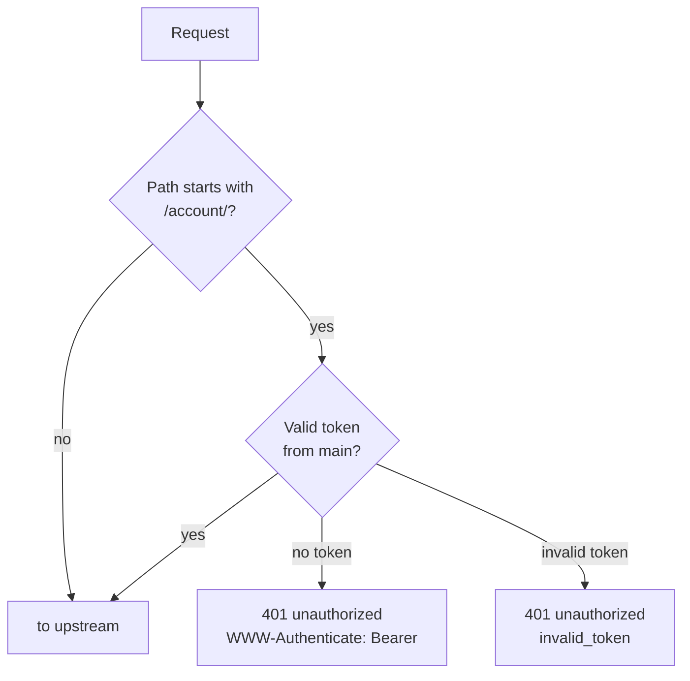
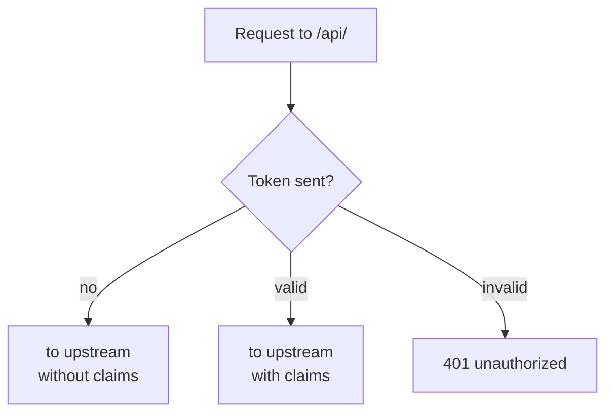
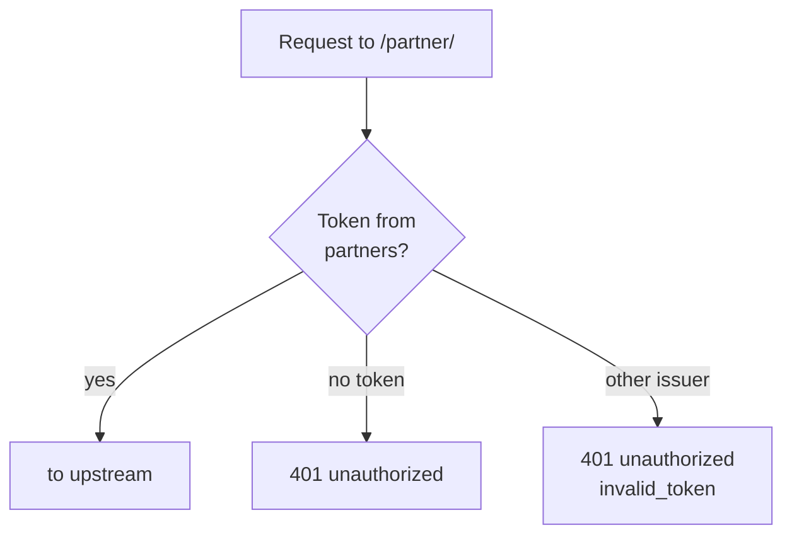
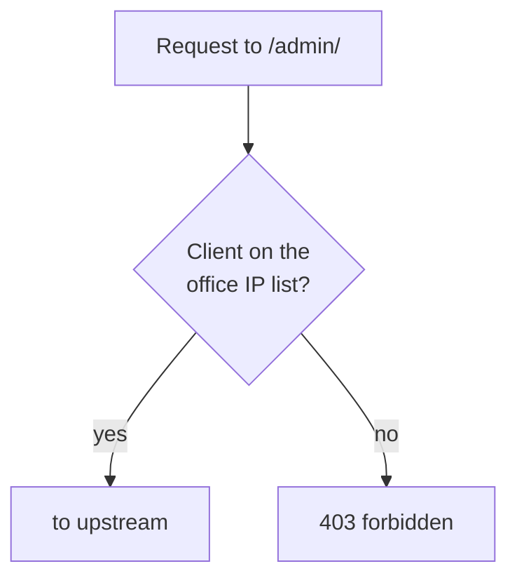
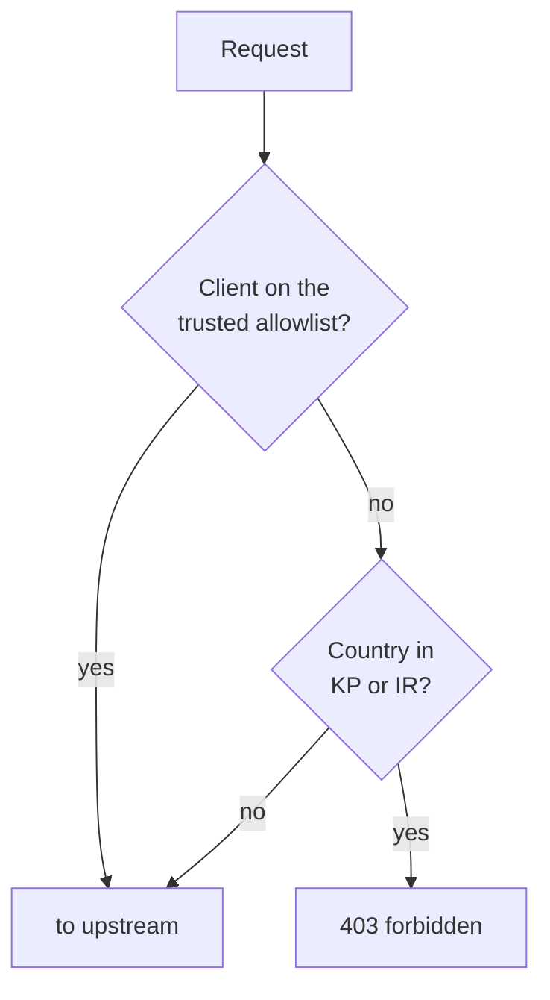
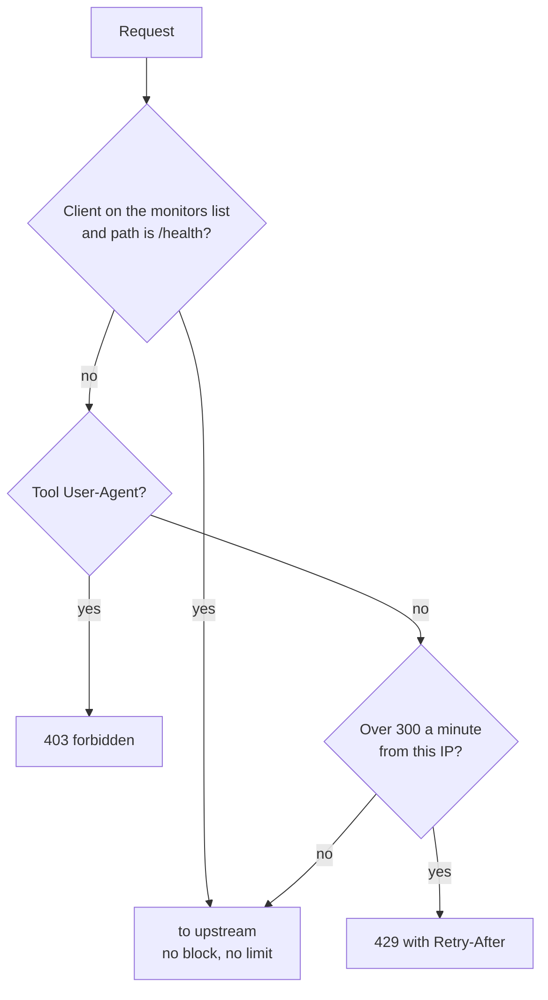
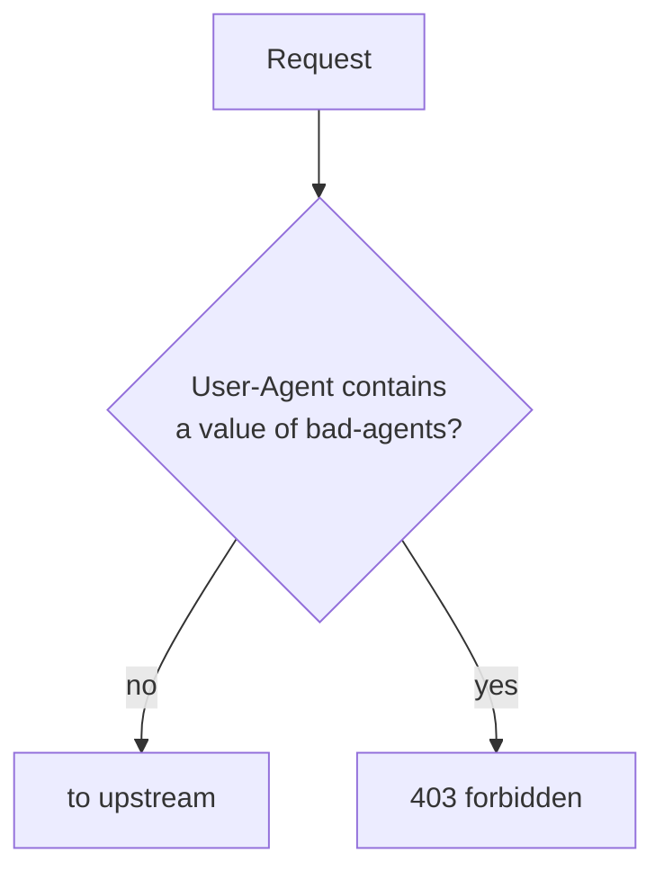
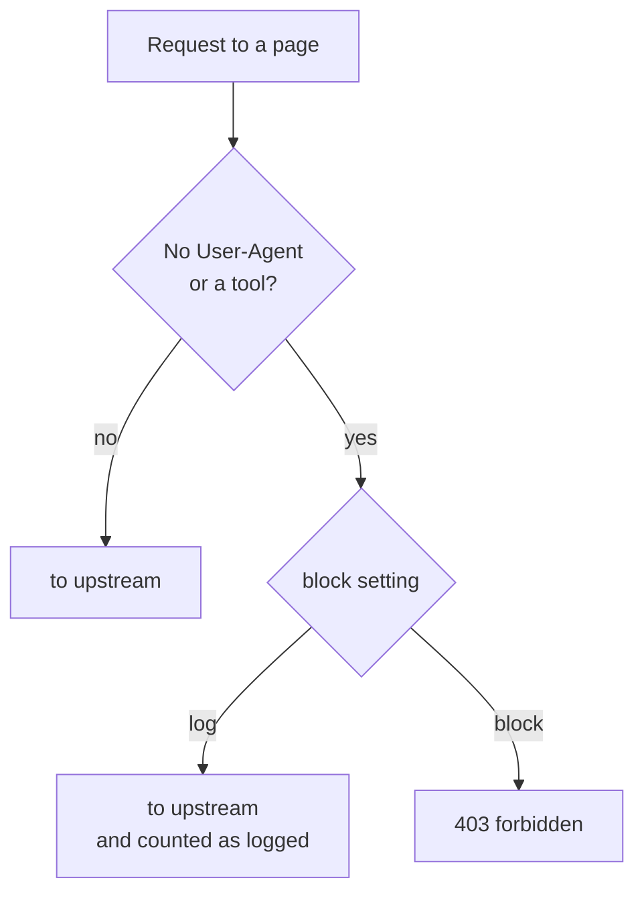
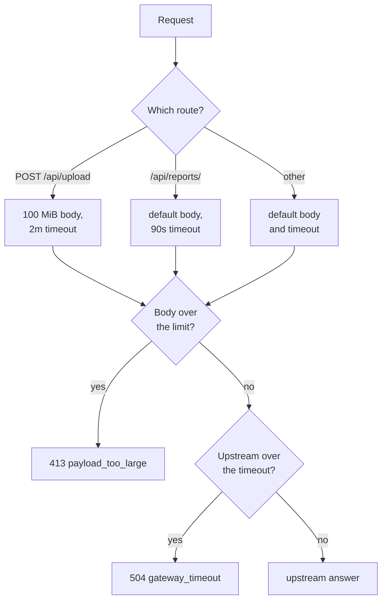

# Access: sign-in, blocking and per-route settings

Rules in the **Access rules** phase, which the config calls `config_rules`. Each case is one goal, with the rule to enter and a test that proves it.

Add each rule as described in [How to use a case](index.md#how-to-use-a-case).

## Require sign-in on account pages

Pages under `/account/` need a valid token. Everything else stays open.



**Rule** · Access rule, ID `account-needs-sign-in`

When:

```text
starts_with(http.request.uri.path, "/account/")
```

Then:

```json
{"settings": {"auth": {"mode": "required"}}}
```

**Also set** on **Issuers**, the identity provider whose tokens the rule checks (`auth`):

```json
{
  "issuers": [
    {
      "id": "main",
      "issuer": "https://login.example.com",
      "audiences": ["api"],
      "jwks_url": "https://login.example.com/.well-known/jwks.json",
      "algorithm": "RS256"
    }
  ],
  "default_accepted": ["main"]
}
```

The `main` issuer is also the one rules accept by default (`default_accepted`). Tick it on the same page.

**Prove it** with this policy test:

```json
[
  {
    "name": "no token is refused",
    "request": {"host": "www.example.com", "path": "/account/orders"},
    "expect": {"rejected": "auth", "config_rules": ["account-needs-sign-in"]}
  },
  {
    "name": "a verified token gets in",
    "request": {
      "host": "www.example.com",
      "path": "/account/orders",
      "jwt_claims": {"sub": "user-42"}
    },
    "expect": {
      "rejected": "",
      "settings": {"auth_mode": "required", "accepted": ["main"]}
    }
  },
  {
    "name": "other paths need no token",
    "request": {"host": "www.example.com", "path": "/"},
    "expect": {"rejected": "", "settings": {"auth_mode": "none"}}
  }
]
```

**Watch out**

- A token must use the issuer's configured algorithm, carry its `iss`, have an `aud` matching one of its `audiences`, and carry `exp`, with 60 seconds of clock leeway.
- `required` with no token, or `optional` or `required` with an invalid token or one from an issuer the rule doesn't accept, gives 401. `none` never checks a token. The challenge is `WWW-Authenticate: Bearer`, or `Bearer error="invalid_token"` when a token was sent.
- The access phase runs before JSON Web Token (JWT) validation, so access rules can't match on claims. Use a rate limit or request header rule when you need a claim.
- A client on the trusted allowlist, or one matched by an always-allow rule, is treated as `optional` on a required route, so it needs no token.
- A token naming an accepted issuer whose keys the edge has never fetched passes with no claims, even on a `required` route, so the upstream must still refuse a request without a verified identity. See [When the token is missing or bad](../tokens.md#when-the-token-is-missing-or-bad).

## Accept a token when one is sent, but don't require it

Public API routes where a signed-in caller gets claims and an anonymous one still gets through.



**Rule** · Access rule, ID `api-sign-in-optional`

When:

```text
starts_with(http.request.uri.path, "/api/")
```

Then:

```json
{"settings": {"auth": {"mode": "optional"}}}
```

**Also set** on **Issuers**, the identity provider whose tokens the rule checks (`auth`):

```json
{
  "issuers": [
    {
      "id": "main",
      "issuer": "https://login.example.com",
      "audiences": ["api"],
      "jwks_url": "https://login.example.com/.well-known/jwks.json",
      "algorithm": "RS256"
    }
  ],
  "default_accepted": ["main"]
}
```

The `main` issuer is also the one rules accept by default (`default_accepted`). Tick it on the same page.

**Prove it** with this policy test:

```json
[
  {
    "name": "anonymous still gets through",
    "request": {"host": "www.example.com", "path": "/api/products"},
    "expect": {"rejected": "", "settings": {"auth_mode": "optional"}}
  }
]
```

**Watch out**

- `optional` with no token continues without claims.
- An invalid token, or one from an issuer the rule doesn't accept, still gives 401, as it does under `required`. Only `none` ignores tokens.
- `X-Edge-Auth-Issuer` and `X-Edge-Auth-Sub` are set for the upstream only after a token verifies.
- If the edge has never obtained an issuer's keys, a token from that issuer passes without claims, so an identity provider outage at setup can't take the site down. Upstreams should still validate.

## Accept only the partner issuer on partner routes

Most routes accept the `main` issuer. Under `/partner/` only tokens from `partners` are accepted, and tokens from `main` are refused.



**Rule** · Access rule, ID `partner-api`

When:

```text
starts_with(http.request.uri.path, "/partner/")
```

Then:

```json
{"settings": {"auth": {"mode": "required", "accepted": ["partners"]}}}
```

**Also set** on **Issuers**, two issuers with `main` as the default (`auth`):

```json
{
  "issuers": [
    {
      "id": "main",
      "issuer": "https://login.example.com",
      "audiences": ["api"],
      "jwks_url": "https://login.example.com/.well-known/jwks.json",
      "algorithm": "RS256"
    },
    {
      "id": "partners",
      "issuer": "https://partners.example.com",
      "audiences": ["partner-api"],
      "jwks_url": "https://partners.example.com/jwks.json",
      "algorithm": "ES256"
    }
  ],
  "default_accepted": ["main"]
}
```

**Prove it** with this policy test:

```json
[
  {
    "name": "partner paths accept only the partner issuer",
    "request": {
      "host": "api.example.com",
      "path": "/partner/orders",
      "jwt_claims": {"sub": "acme"}
    },
    "expect": {"rejected": "", "settings": {"accepted": ["partners"]}}
  }
]
```

**Watch out**

- `accepted` lists issuer IDs. A rule that leaves it out gets `auth.default_accepted`, and having neither is a validation error.
- The audience is checked per issuer: the token's `aud` must match one of that issuer's `audiences`.
- A token from an issuer the rule doesn't accept gives 401, as does an invalid token.
- A token naming an accepted issuer whose keys the edge has never fetched passes with no claims, even on a `required` route, so the upstream must still refuse a request without a verified identity. See [When the token is missing or bad](../tokens.md#when-the-token-is-missing-or-bad).

## Allow admin pages only from the office

Block `/admin/` for every client that is not on the `office` IP list.



**Rule** · Access rule, ID `admin-office-only`

When:

```text
starts_with(http.request.uri.path, "/admin/") and not client.ip_lists in {"office"}
```

Then:

```json
{"settings": {"block": "block"}}
```

**Prove it** with this policy test:

```json
[
  {
    "name": "admin from outside the office is blocked",
    "request": {"host": "www.example.com", "path": "/admin/users"},
    "expect": {"rejected": "blocked"}
  },
  {
    "name": "admin from the office passes",
    "request": {
      "host": "www.example.com",
      "path": "/admin/users",
      "ip": "198.51.100.7",
      "ip_lists": ["office"]
    },
    "expect": {"rejected": ""}
  }
]
```

**Watch out**

- The `office` list is typed on the **IP lists** page and reaches edges within about a minute, with no publish.
- Until an edge's first poll after it starts, `client.ip_lists` is empty, so `not client.ip_lists in {"office"}` matches the office too for that moment.
- A client on the trusted allowlist skips every block rule, so a listed client reaches `/admin/` from anywhere.

## Block countries but let a partner network through

Refuse traffic from two countries, except for one partner range that the trusted allowlist exempts.



**Rule** · Access rule, ID `block-countries`

When:

```text
ip.src.country in {"KP" "IR"}
```

Then:

```json
{"settings": {"block": "block"}}
```

**Also set** on **Settings**, the trusted client allowlist (`global.client_allowlist`):

```json
["198.51.100.0/24"]
```

**Prove it** with this policy test:

```json
[
  {
    "name": "a listed country is blocked",
    "request": {"host": "www.example.com", "path": "/", "country": "KP"},
    "expect": {"rejected": "blocked"}
  },
  {
    "name": "the partner network passes from a listed country",
    "request": {
      "host": "www.example.com",
      "path": "/",
      "country": "KP",
      "ip": "198.51.100.20"
    },
    "expect": {"rejected": ""}
  },
  {
    "name": "other countries pass",
    "request": {"host": "www.example.com", "path": "/", "country": "AU"},
    "expect": {"rejected": ""}
  }
]
```

**Watch out**

- Country matching needs a trusted country viewer header in the deployment (`VIEWER_HEADERS` or a CDN preset).
- The allowlist holds up to 100 entries, each no wider than /24 for IPv4 or /48 for IPv6.
- A listed client skips every block, ban and rate-limit rule, but still goes through the backstop, Cross-Origin Resource Sharing (CORS) and header rules.
- On a route that requires a JSON Web Token (JWT), a listed client needs no token. See [Trusted clients](../policy.md#trusted-clients).

## Never block or limit your uptime monitor

Your monitoring service's addresses are always let through on the health check path, even when it sends a tool-like `User-Agent` such as `curl`. Everyone else, and the monitor on any other path, is blocked for tools and limited per IP.



**Also set** on **IP lists**, a list named `monitors` that you type yourself, holding the addresses your monitoring vendor publishes. See [Add a list](../ip-lists.md#add-a-list).

**Rule** · Access rule, ID `monitors-always-allowed`

When:

```text
client.ip_lists in {"monitors"} and http.request.uri.path eq "/health"
```

Then:

```json
{"settings": {"allow": true}}
```

**Rule** · Access rule, ID `block-tools`

When:

```text
client.signals in {"ua_tool"}
```

Then:

```json
{"settings": {"block": "block"}}
```

**Rule** · Rate limit rule, ID `per-ip`

When:

```text
true
```

Then:

```json
{
  "algorithm": "sliding_window",
  "limit": 300,
  "period": "1m",
  "key": ["ip"],
  "on_missing_key": "fallback_ip",
  "action": "block",
  "fail_mode": "open"
}
```

**Prove it** with this policy test:

```json
[
  {
    "name": "a monitor using curl is not blocked or rate limited",
    "request": {
      "host": "www.example.com",
      "path": "/health",
      "headers": {"User-Agent": "curl/8.5.0"},
      "ip_lists": ["monitors"]
    },
    "expect": {"rejected": "", "rate_limit_rules": []}
  },
  {
    "name": "a monitor using curl on another path is blocked",
    "request": {
      "host": "www.example.com",
      "path": "/login",
      "headers": {"User-Agent": "curl/8.5.0"},
      "ip_lists": ["monitors"]
    },
    "expect": {"rejected": "blocked"}
  },
  {
    "name": "anyone else using curl is blocked",
    "request": {
      "host": "www.example.com",
      "path": "/health",
      "headers": {"User-Agent": "curl/8.5.0"}
    },
    "expect": {"rejected": "blocked"}
  }
]
```

**Watch out**

- An always-allow rule needs a condition the client can't forge, joined by `and` at the top level: the client IP, an IP list or a verified crawler.
- Type the addresses in your own list rather than naming a downloaded list such as `uptimerobot`. The editor warns when an always-allow rule names a downloaded list: whoever publishes it decides who skips blocks, bans and rate limits.
- Keep the rule on the health path. A shared monitoring service's addresses also carry every other customer's checks, and always-allow skips every block, ban and rate-limit rule, and on a route that requires a JSON Web Token (JWT) the client needs no token. See [Always allow](../policy.md#always-allow).
- When the vendor changes its addresses, edit the list. A saved list reaches every edge within about a minute, with no publish.
- The allow rule wins whatever the rule order.

## Block a shared list of bad user agents

Keep the scanner names in one value list and let any rule use it. Editing the list on **Value lists** changes every rule that names it at the next publish.



**Rule** · Access rule, ID `block-bad-agents`

When:

```text
http.user_agent contains $bad-agents
```

Then:

```json
{"settings": {"block": "block"}}
```

**Also set** on **Value lists**, a list of user agents (`global.lists`):

```json
{
  "bad-agents": {
    "field": "http.user_agent",
    "values": ["sqlmap", "nikto", "masscan"]
  }
}
```

**Prove it** with this policy test:

```json
[
  {
    "name": "a scanner is blocked",
    "request": {
      "host": "www.example.com",
      "path": "/",
      "headers": {"User-Agent": "sqlmap/1.8"}
    },
    "expect": {"rejected": "blocked", "config_rules": ["block-bad-agents"]}
  },
  {
    "name": "a browser passes",
    "request": {
      "host": "www.example.com",
      "path": "/",
      "headers": {"User-Agent": "Mozilla/5.0 Firefox/133.0"}
    },
    "expect": {"rejected": ""}
  }
]
```

**Watch out**

- A value list belongs to one field, here `http.user_agent`, and is used only with that field. See [Value lists](../value-lists.md).
- With a pattern operator such as `contains`, the rule matches when any value matches, and each value counts as one of the expression's 32 conditions.
- A value list is part of the policy, so a change takes effect when you publish. Addresses belong in an [IP list](../ip-lists.md), which changes without a publish.
- Start with `"block": "log"`, as in [Log first, block later](#log-first-block-later).

## Log first, block later

Count the tools that hit your pages before you refuse them. Change `log` to `block` when **Stats** shows only the traffic you meant to catch.



**Rule** · Access rule, ID `no-tools-on-pages`

When:

```text
client.signals in {"ua_missing" "ua_tool"} and not starts_with(http.request.uri.path, "/api/")
```

Then:

```json
{"settings": {"block": "log"}}
```

**Prove it** with this policy test:

```json
[
  {
    "name": "a tool on a page is only logged",
    "request": {
      "host": "www.example.com",
      "path": "/pricing",
      "headers": {"User-Agent": "python-requests/2.32"}
    },
    "expect": {"rejected": "", "settings": {"block": "log"}}
  }
]
```

**Watch out**

- A rule whose `block` is `log` is marked **log only** on **Rules** and blocks nothing.
- Publish the change to `block` through a [canary](../publishing.md#canary) so only part of the traffic sees it first.
- The path condition leaves `/api/` alone, because API clients are tools by design.

## Give uploads and slow reports their own limits

The default body limit and timeout are right for most routes. Uploads need a larger body and a longer wait, and one report path needs a longer wait only.



**Rule** · Access rule, ID `uploads`

When:

```text
http.request.method eq "POST" and starts_with(http.request.uri.path, "/api/upload")
```

Then:

```json
{"settings": {"body_limit": 104857600, "upstream_timeout": "2m"}}
```

**Rule** · Access rule, ID `reports`

When:

```text
starts_with(http.request.uri.path, "/api/reports/")
```

Then:

```json
{"settings": {"upstream_timeout": "90s"}}
```

**Prove it** with this policy test:

```json
[
  {
    "name": "uploads take 100 MiB and 2 minutes",
    "request": {
      "method": "POST",
      "host": "api.example.com",
      "path": "/api/upload"
    },
    "expect": {
      "settings": {"body_limit": 104857600, "upstream_timeout": "2m0s"}
    }
  },
  {
    "name": "reports wait 90 seconds",
    "request": {"host": "api.example.com", "path": "/api/reports/monthly"},
    "expect": {
      "settings": {"body_limit": 10485760, "upstream_timeout": "1m30s"}
    }
  }
]
```

**Watch out**

- Over `body_limit` the edge answers 413 with the `payload_too_large` template. An upstream that runs past `upstream_timeout` gives 504 `gateway_timeout`.
- Later matching access rules override earlier ones, setting by setting, so a narrow rule goes below a broad one.
- The `reports` rule sets only `upstream_timeout`, so the body limit stays at the default.
