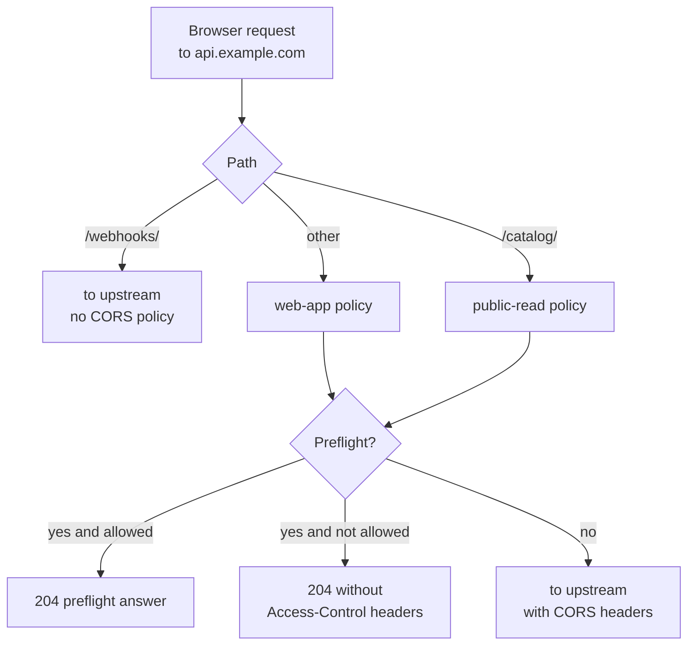
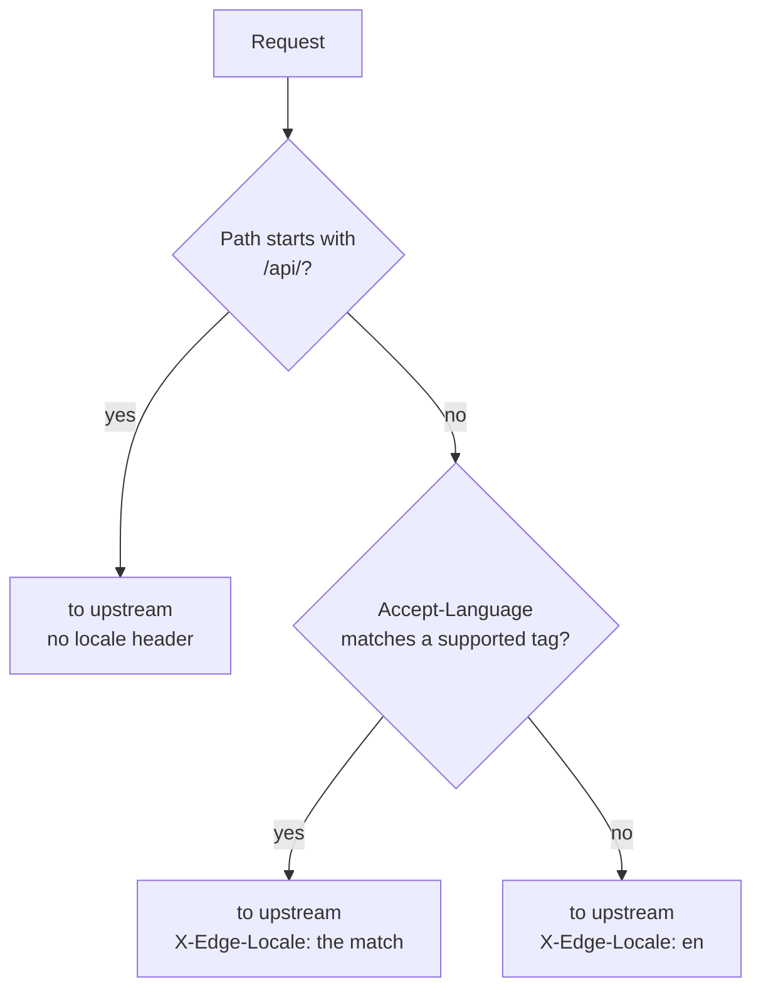
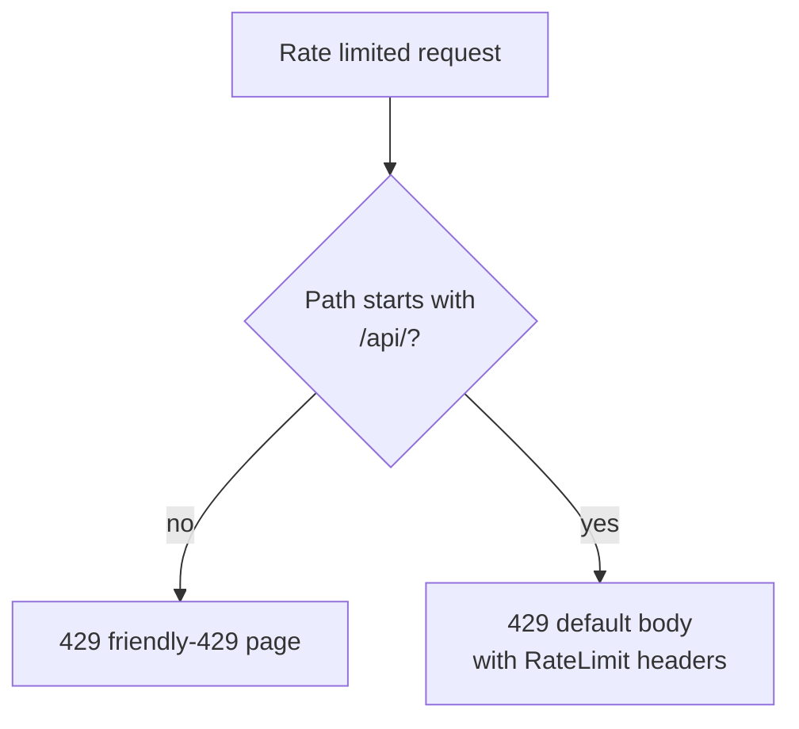
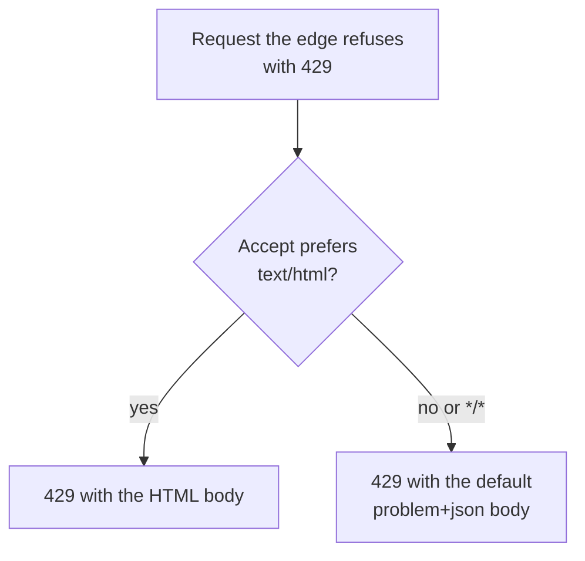

# Browsers: CORS, locale and error pages

Settings that browsers see: Cross-Origin Resource Sharing (CORS), the page language and the pages the edge sends for its own errors.

Add each rule as described in [How to use a case](index.md#how-to-use-a-case).

## Let a web app and a public catalog call the API from browsers

The web app at `app.example.com` can call the API with cookies. The catalog is readable from any site. On webhooks the edge applies no Cross-Origin Resource Sharing (CORS) policy: it adds no CORS headers and passes on any the upstream sends.



**Rule** · Access rule, ID `api-cors`

When:

```text
http.host eq "api.example.com"
```

Then:

```json
{"settings": {"cors_policy": "web-app"}}
```

**Rule** · Access rule, ID `catalog-cors`

When:

```text
http.host eq "api.example.com" and starts_with(http.request.uri.path, "/catalog/")
```

Then:

```json
{"settings": {"cors_policy": "public-read"}}
```

**Rule** · Access rule, ID `webhooks-no-cors`

When:

```text
http.host eq "api.example.com" and starts_with(http.request.uri.path, "/webhooks/")
```

Then:

```json
{"settings": {"cors_policy": ""}}
```

**Also set** on **CORS policies**, two policies (`global.cors_policies`):

```json
{
  "web-app": {
    "origins": ["https://app.example.com"],
    "methods": ["PUT", "PATCH", "DELETE"],
    "request_headers": ["Authorization", "Content-Type"],
    "exposed_headers": ["X-Request-Id"],
    "credentials": true,
    "max_age": "10m"
  },
  "public-read": {
    "origins": ["*"],
    "methods": [],
    "request_headers": [],
    "exposed_headers": [],
    "credentials": false,
    "max_age": "1h"
  }
}
```

**Prove it** with this policy test:

```json
[
  {
    "name": "the app's preflight is answered by the edge",
    "request": {
      "method": "OPTIONS",
      "host": "api.example.com",
      "path": "/orders/1",
      "headers": {
        "Origin": "https://app.example.com",
        "Access-Control-Request-Method": "DELETE"
      }
    },
    "expect": {"preflight": true, "settings": {"cors_policy": "web-app"}}
  },
  {
    "name": "the catalog is readable from any site",
    "request": {"host": "api.example.com", "path": "/catalog/shoes"},
    "expect": {"settings": {"cors_policy": "public-read"}}
  },
  {
    "name": "webhooks have no CORS",
    "request": {
      "method": "OPTIONS",
      "host": "api.example.com",
      "path": "/webhooks/stripe",
      "headers": {
        "Origin": "https://evil.example",
        "Access-Control-Request-Method": "POST"
      }
    },
    "expect": {"preflight": false, "settings": {"cors_policy": ""}}
  }
]
```

**Watch out**

- `credentials` can't be combined with `*`, which is why `web-app` lists its one origin.
- A list of origins echoes the request's `Origin` when it is listed and sends `Vary: Origin`.
- A preflight on a route with a policy is answered by the edge with 204, before JSON Web Token (JWT) checks and rate limits. A disallowed one gets no `Access-Control-*` headers.
- `cors_policy: ""` turns CORS off, so preflights go to the upstream. The rule order matters: later matching rules override earlier ones, so the narrow rules sit below `api-cors`.

## Pick the page language from Accept-Language

Pages get an `X-Edge-Locale` header with `en`, `ko` or `zh-Hant`. The API gets none.



**Rule** · Access rule, ID `pages-locale`

When:

```text
not starts_with(http.request.uri.path, "/api/")
```

Then:

```json
{"settings": {"locale": true}}
```

**Also set** on **Settings**, the locale (`global.locale`):

```json
{
  "supported": ["en", "ko", "zh-Hant"],
  "default": "en",
  "output_header": "X-Edge-Locale"
}
```

**Prove it** with this policy test:

```json
[
  {
    "name": "a Korean browser gets ko",
    "request": {
      "host": "www.example.com",
      "path": "/",
      "headers": {"Accept-Language": "ko-KR,ko;q=0.9,en;q=0.5"}
    },
    "expect": {
      "settings": {"locale": true},
      "upstream_headers": {"X-Edge-Locale": "ko"}
    }
  },
  {
    "name": "an unsupported language gets the default",
    "request": {
      "host": "www.example.com",
      "path": "/",
      "headers": {"Accept-Language": "fr-FR"}
    },
    "expect": {"upstream_headers": {"X-Edge-Locale": "en"}}
  },
  {
    "name": "the API gets no locale header",
    "request": {
      "host": "www.example.com",
      "path": "/api/x",
      "headers": {"Accept-Language": "ko"}
    },
    "expect": {
      "settings": {"locale": false},
      "upstream_headers": {"X-Edge-Locale": ""}
    }
  }
]
```

**Watch out**

- The edge picks from `supported` by `Accept-Language` and sends it in the output header, replacing a client copy. Its value is `edge.locale` in later phases.
- The output header must start with `X-Edge-`, so clients can't send it.
- With locale off for a route, the header is not set.

## Show a friendly 429 page on pages and headers on the API

Pages answer a rate-limited request with a custom HTML page. The API keeps the default 429 and adds `RateLimit` headers so clients can back off.



**Rule** · Access rule, ID `pages-friendly-429`

When:

```text
not starts_with(http.request.uri.path, "/api/")
```

Then:

```json
{"settings": {"responses": {"rate_limited": "friendly-429"}}}
```

**Rule** · Access rule, ID `api-ratelimit-headers`

When:

```text
starts_with(http.request.uri.path, "/api/")
```

Then:

```json
{"settings": {"ratelimit_headers": true}}
```

**Also set** on **Templates**, one template (`global.responses`):

```json
{
  "friendly-429": {
    "status": 429,
    "content_type": "text/html; charset=utf-8",
    "body": "<h1>Slow down</h1><p>Try again in {{retry_after}} seconds."
  }
}
```

**Prove it** with this policy test:

```json
[
  {
    "name": "pages answer 429 with the friendly page",
    "request": {"host": "www.example.com", "path": "/login"},
    "expect": {
      "config_rules": ["pages-friendly-429"],
      "settings": {
        "responses": {"rate_limited": "friendly-429"},
        "ratelimit_headers": false
      }
    }
  },
  {
    "name": "the API keeps the default 429 and gets RateLimit headers",
    "request": {"host": "www.example.com", "path": "/api/orders"},
    "expect": {
      "config_rules": ["api-ratelimit-headers"],
      "settings": {"ratelimit_headers": true}
    }
  }
]
```

**Watch out**

- A template map sets which template answers each kind. A template is offered only for kinds with its status, here 429 for `rate_limited`.
- `{{retry_after}}` is filled in with the seconds to wait.
- `ratelimit_headers: true` adds `RateLimit-Policy` and `RateLimit` for blocking rules only.
- See [Policy tests](../policy.md#policy-tests) for how `responses` is checked.

## Answer errors as JSON for apps and as a page for browsers

One template with two bodies. The edge sends the body that the request's `Accept` header prefers, so a browser opening a page gets HTML and an app gets JSON.



**Rule** · Access rule, ID `brand-errors`

When:

```text
true
```

Then:

```json
{"settings": {"responses": {"rate_limited": "brand-429"}}}
```

**Also set** on **Templates**, one template with a second body (`global.responses`):

```json
{
  "brand-429": {
    "status": 429,
    "content_type": "application/problem+json",
    "body": "{\"title\":\"Too Many Requests\",\"retry_after\":{{retry_after}}}",
    "variants": [
      {
        "content_type": "text/html; charset=utf-8",
        "body": "<p>Try again in {{retry_after}}s. Request ID: {{request_id}}"
      }
    ]
  }
}
```

**Prove it** with this policy test:

```json
[
  {
    "name": "every route uses the brand template",
    "request": {"host": "www.example.com", "path": "/pricing"},
    "expect": {
      "config_rules": ["brand-errors"],
      "settings": {"responses": {"rate_limited": "brand-429"}}
    }
  }
]
```

**Watch out**

- A policy test checks which rules and settings apply, not the body sent. Check the body with curl: `-H 'Accept: text/html'` gets the page, and no `Accept` or `*/*` gets the default.
- A template has a default body and up to three more, one per content type. With more than one body it sends `Vary: Accept`.
- An `Accept` header over 256 bytes is ignored, so the default is sent. The edge never answers 406.
- The starter templates already have problem+json, HTML and text bodies. See [Response templates](../templates.md).
