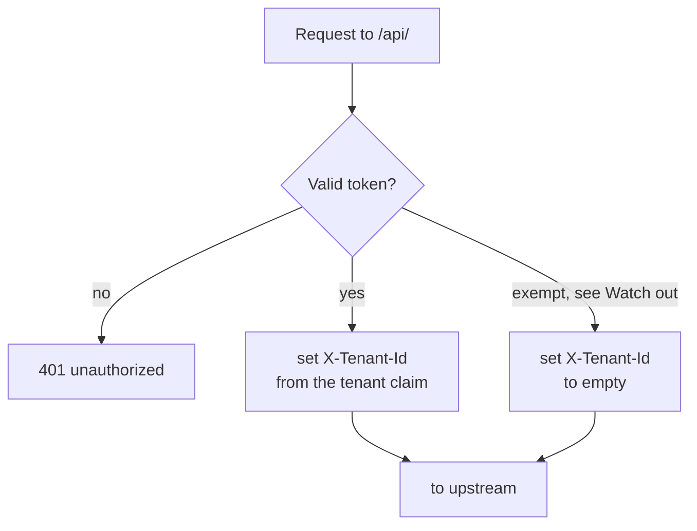
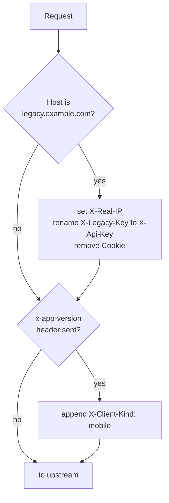
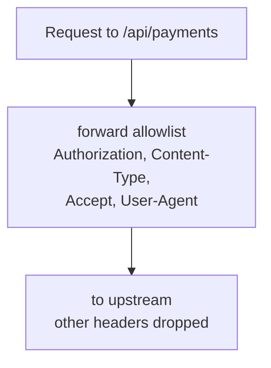
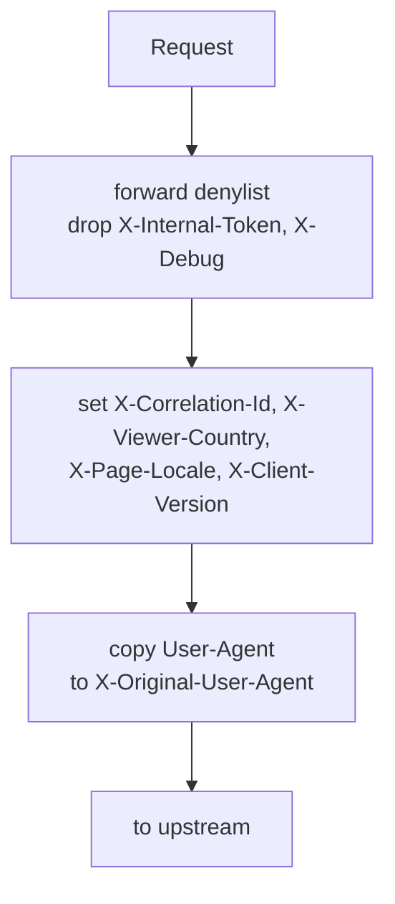

# Headers your upstream receives

Rules in the **Request header rules** phase. They change what the upstream receives and never what the client sees.

Add each rule as described in [How to use a case](index.md#how-to-use-a-case).

## Send the tenant from the token to the upstream

Services read `X-Tenant-Id` instead of parsing the token. The edge sets it from the verified `tenant` claim and replaces any copy the client sent.



**Rule** · Access rule, ID `api-needs-sign-in`

When:

```text
starts_with(http.request.uri.path, "/api/")
```

Then:

```json
{"settings": {"auth": {"mode": "required"}}}
```

**Rule** · Request header rule, ID `tenant-to-upstream`

When:

```text
starts_with(http.request.uri.path, "/api/")
```

Then:

```json
{"ops": [{"op": "set", "name": "X-Tenant-Id", "value": "{{jwt_claim:tenant}}"}]}
```

**Also set** on **Issuers**, the identity provider whose tokens the rule checks (`auth`):

```json
{
  "issuers": [
    {
      "id": "main",
      "issuer": "https://login.example.com",
      "audiences": ["api"],
      "jwks_url": "https://login.example.com/.well-known/jwks.json",
      "algorithm": "RS256"
    }
  ],
  "default_accepted": ["main"]
}
```

The `main` issuer is also the one rules accept by default (`default_accepted`). Tick it on the same page.

**Prove it** with this policy test:

```json
[
  {
    "name": "the tenant claim reaches the upstream",
    "request": {
      "host": "api.example.com",
      "path": "/api/orders",
      "jwt_claims": {"sub": "user-42", "tenant": "acme"}
    },
    "expect": {"upstream_headers": {"X-Tenant-Id": "acme"}}
  },
  {
    "name": "a client's own X-Tenant-Id is replaced",
    "request": {
      "host": "api.example.com",
      "path": "/api/orders",
      "headers": {"X-Tenant-Id": "other"},
      "jwt_claims": {"sub": "user-42", "tenant": "acme"}
    },
    "expect": {"upstream_headers": {"X-Tenant-Id": "acme"}}
  }
]
```

**Watch out**

- `set` replaces any client copy.
- `{{jwt_claim:<name>}}` is empty without a verified token. The edge still sets the header, so the client's copy never reaches the upstream.
- Even on this `required` route, a request can reach the upstream with `X-Tenant-Id` empty: a [trusted](../policy.md#trusted-clients) or [always-allowed](../policy.md#always-allow) client, a token from an issuer whose [keys were never fetched](../tokens.md#when-the-token-is-missing-or-bad), or the [JSON Web Token (JWT) kill switch](../tokens.md#exemptions-and-the-kill-switch). The upstream must refuse an empty value and validate the token itself. `Authorization` is forwarded unless a forward allowlist leaves it out.
- `X-Edge-Auth-Issuer` and `X-Edge-Auth-Sub` are also set for the upstream after a token verifies.

## Give a legacy host the headers it expects

An old service wants `X-Real-IP`, a renamed API key header and no cookies. A second rule tags requests from the mobile app.



**Rule** · Request header rule, ID `legacy-real-ip`

When:

```text
http.host eq "legacy.example.com"
```

Then:

```json
{
  "ops": [
    {"op": "set", "name": "X-Real-IP", "value": "{{client_ip}}"},
    {"op": "rename", "from": "X-Legacy-Key", "to": "X-Api-Key"},
    {"op": "remove", "name": "Cookie"}
  ]
}
```

**Rule** · Request header rule, ID `tag-mobile`

When:

```text
http.request.headers["x-app-version"] wildcard "*"
```

Then:

```json
{"ops": [{"op": "append", "name": "X-Client-Kind", "value": "mobile"}]}
```

**Prove it** with this policy test:

```json
[
  {
    "name": "the legacy app gets the client IP and the renamed key, no cookies",
    "request": {
      "host": "legacy.example.com",
      "path": "/",
      "ip": "203.0.113.7",
      "headers": {"X-Legacy-Key": "abc", "Cookie": "s=1"}
    },
    "expect": {
      "upstream_headers": {
        "X-Real-IP": "203.0.113.7",
        "X-Api-Key": "abc",
        "X-Legacy-Key": "",
        "Cookie": ""
      }
    }
  },
  {
    "name": "a client can't set X-Api-Key by leaving out X-Legacy-Key",
    "request": {
      "host": "legacy.example.com",
      "path": "/",
      "headers": {"X-Api-Key": "forged"}
    },
    "expect": {"upstream_headers": {"X-Api-Key": ""}}
  }
]
```

**Watch out**

- `rename` or `copy` with a missing source removes the target, so a client can't supply the target itself. The second test checks this for `X-Api-Key`.
- `{{client_ip}}` is the trusted client IP, never a client-supplied value.
- Edge-managed headers (`X-Forwarded-*`, `X-Edge-*`, `X-Request-Id`) can't be written by rules and are always set by the edge.
- Ops of every matching rule are applied in rule order.

## Send a payment service only the headers it needs

Only four headers reach the payment service. Everything else the client sent is dropped.



**Rule** · Request header rule, ID `payments-minimal-headers`

When:

```text
starts_with(http.request.uri.path, "/api/payments")
```

Then:

```json
{
  "ops": [
    {
      "op": "forward",
      "mode": "allowlist",
      "names": ["Authorization", "Content-Type", "Accept", "User-Agent"]
    }
  ]
}
```

**Prove it** with this policy test:

```json
[
  {
    "name": "only listed headers reach the payment service",
    "request": {
      "host": "api.example.com",
      "path": "/api/payments",
      "headers": {
        "Authorization": "Bearer x",
        "X-Debug": "1",
        "Content-Type": "application/json"
      }
    },
    "expect": {
      "upstream_headers": {
        "Authorization": "Bearer x",
        "Content-Type": "application/json",
        "X-Debug": ""
      }
    }
  }
]
```

**Watch out**

- A forward `allowlist` that leaves out `Authorization`, `Cookie` or `Content-Type` gets a validation warning. This case drops `Cookie` on purpose, so expect the warning on **Save draft**.
- The edge-managed headers are set after the filter, so they still reach the upstream.
- An allowlist never drops the connection headers the edge needs, such as `Host`, `Connection` and `Upgrade`, so it can't break WebSockets or trailers. See [Header rules](../policy.md#header-rules).

## Give every service the same request context

Every upstream gets the request ID, the viewer's country, the page language and the app version in headers of your choosing, and headers clients must never send are dropped.



**Rule** · Access rule, ID `locale-everywhere`

When:

```text
true
```

Then:

```json
{"settings": {"locale": true}}
```

**Rule** · Request header rule, ID `request-context`

When:

```text
true
```

Then:

```json
{
  "ops": [
    {
      "op": "forward",
      "mode": "denylist",
      "names": ["X-Internal-Token", "X-Debug"]
    },
    {"op": "set", "name": "X-Correlation-Id", "value": "{{request_id}}"},
    {"op": "set", "name": "X-Viewer-Country", "value": "{{country}}"},
    {"op": "set", "name": "X-Page-Locale", "value": "{{locale}}"},
    {
      "op": "set",
      "name": "X-Client-Version",
      "value": "app/{{header:x-app-version}}"
    },
    {"op": "copy", "from": "User-Agent", "to": "X-Original-User-Agent"}
  ]
}
```

**Also set** on **Settings**, the locale (`global.locale`):

```json
{
  "supported": ["en", "ko"],
  "default": "en",
  "output_header": "X-Edge-Locale"
}
```

**Prove it** with this policy test:

```json
[
  {
    "name": "the upstream gets the context and no internal headers",
    "request": {
      "host": "www.example.com",
      "path": "/",
      "country": "AU",
      "headers": {
        "Accept-Language": "ko",
        "User-Agent": "ExampleApp/4.2",
        "X-App-Version": "4.2",
        "X-Internal-Token": "forged",
        "X-Debug": "1"
      }
    },
    "expect": {
      "upstream_headers": {
        "X-Viewer-Country": "AU",
        "X-Page-Locale": "ko",
        "X-Client-Version": "app/4.2",
        "X-Original-User-Agent": "ExampleApp/4.2",
        "X-Internal-Token": "",
        "X-Debug": ""
      }
    }
  }
]
```

**Watch out**

- `{{country}}` is accepted only when the deployment has a trusted country source, and `{{locale}}` only when supported locales are set; it is empty on a route with locale off. The edge also sends `X-Edge-Geo-Country` and `X-Edge-Locale` itself.
- `{{header:<name>}}` is the first value as the client sent it, so treat it as untrusted.
- `copy` keeps the source and, like `rename`, removes the target when the source is missing.
- A rule's `forward` op replaces the global filter from **Settings** for the requests it matches, and the last matching rule with one wins.
