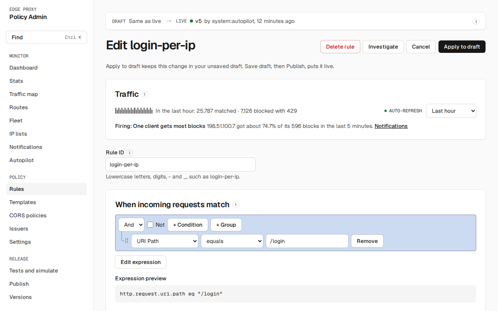
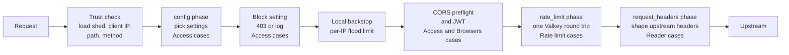

# Use cases

Every case is a goal, a flow diagram, the rule as you enter it in the admin UI, and a policy test that proves it. Copy the rule, run the test, and change the values to fit your site.

## How to use a case

1. On **Rules**, add the rule to its phase and set the **ID**.
2. Under **When incoming requests match**, choose **Edit expression** and paste the When text.
3. Under **Then**, choose **Edit as JSON** and paste the Then JSON.
4. **Apply to draft**, **Save draft**. On **Tests and simulate**, add the test to **Policy tests** and press **Run tests on the saved draft**.

Then publish ([Publish and roll back](../publishing.md)). Policy settings such as issuers, Cross-Origin Resource Sharing (CORS) policies, templates, locale and the allowlist are on their own pages (**Issuers**, **CORS policies**, **Templates**, **Settings**).

Every new rate-limit rule should start with `"action": "log"` (shadow mode, see [Before you block](../rate-limiting.md#before-you-block-shadow-mode)). A few cases show `block` so you can see the final shape.

## Where each case sits

The pages: [Access](access.md), [Rate limits](rate-limits.md), [Browsers](browsers.md) and [Headers](headers.md).

## I want to

### Access: sign-in, blocking and per-route settings

| I want to | Case |
|---|---|
| Require a valid token on some pages | [Require sign-in on account pages](access.md#require-sign-in-on-account-pages) |
| Read a token when sent, but let anonymous visitors in | [Accept a token when one is sent, but don't require it](access.md#accept-a-token-when-one-is-sent-but-dont-require-it) |
| Accept only one identity provider on a route | [Accept only the partner issuer on partner routes](access.md#accept-only-the-partner-issuer-on-partner-routes) |
| Allow a path only from my office | [Allow admin pages only from the office](access.md#allow-admin-pages-only-from-the-office) |
| Block countries but exempt a partner network | [Block countries but let a partner network through](access.md#block-countries-but-let-a-partner-network-through) |
| Never block or limit my uptime monitor | [Never block or limit your uptime monitor](access.md#never-block-or-limit-your-uptime-monitor) |
| Watch a block rule before it refuses anyone | [Log first, block later](access.md#log-first-block-later) |
| Block many user agents from one shared list | [Block a shared list of bad user agents](access.md#block-a-shared-list-of-bad-user-agents) |
| Allow big uploads or a long wait on some routes | [Give uploads and slow reports their own limits](access.md#give-uploads-and-slow-reports-their-own-limits) |
| Refuse tools on pages | [Refuse tools on pages](../bots.md#refuse-tools-on-pages) |
| Ban scanners that hit trap paths | [Trap paths](../bots.md#trap-paths) |
| Limit cloud providers | [IP lists](../ip-lists.md) |
| Refuse stale browsers | [Stale browsers](../bots.md#stale-browsers) |
| Answer API paths with JSON errors | [JSON answers on API paths](../bots.md#json-answers-on-api-paths) |
| Turn enforcement off now | [Stop rate limiting, blocking or JWT checks now](../../operate/runbooks.md#stop-rate-limiting-blocking-or-jwt-checks-now) |

### Rate limits

| I want to | Case |
|---|---|
| Slow down password guessing on a login form | [Slow down login guessing](rate-limits.md#slow-down-login-guessing) |
| Give each signed-in user a quota | [Limit each signed-in user, and anonymous callers by IP](rate-limits.md#limit-each-signed-in-user-and-anonymous-callers-by-ip) |
| Cap each tenant per day | [Cap each tenant per day](rate-limits.md#cap-each-tenant-per-day) |
| Limit each partner API key | [Limit each partner API key](rate-limits.md#limit-each-partner-api-key) |
| Limit each browser session by its cookie | [Limit each browser session, with a per-IP partner](rate-limits.md#limit-each-browser-session-with-a-per-ip-partner) |
| Set one ceiling per IP for the whole site | [Set a site-wide ceiling per IP](rate-limits.md#set-a-site-wide-ceiling-per-ip) |
| Protect one fragile backend with a shared limit | [Protect a fragile search backend with one shared limit](rate-limits.md#protect-a-fragile-search-backend-with-one-shared-limit) |
| Refuse a route when Valkey can't answer | [Refuse payments when limits can't be checked](rate-limits.md#refuse-payments-when-limits-cant-be-checked) |
| Limit a route only for a sale | [Limit checkout only for the length of a sale](rate-limits.md#limit-checkout-only-for-the-length-of-a-sale) |
| Spot someone guessing coupon codes | [Watch for coupon guessing](rate-limits.md#watch-for-coupon-guessing) |
| Add a limit without blocking anyone yet | [Start every new limit in shadow mode](rate-limits.md#start-every-new-limit-in-shadow-mode) |
| Limit by Transport Layer Security (TLS) fingerprint and network | [Limit by TLS fingerprint and network](../bots.md#limit-by-tls-fingerprint-and-network) |
| Limit a fleet on one browser fingerprint | [A fleet on one browser fingerprint](../bots.md#a-fleet-on-one-browser-fingerprint) |
| Limit 404 sweeps | [404 sweeps](../bots.md#404-sweeps) |
| Limit failed logins | [Failed logins](../bots.md#failed-logins) |
| Limit how many different paths a client crawls | [Crawl breadth](../bots.md#crawl-breadth) |
| Limit one account used from many IPs | [An account used from many IPs](../bots.md#an-account-used-from-many-ips) |
| Let autopilot add limits during an attack | [Autopilot](../autopilot.md) |
| Roll a change out to a share of traffic | [Canary](../publishing.md#canary) |
| Respond to a flood | [A flood](../../operate/runbooks.md#a-flood) |

### Browsers: CORS, locale and error pages

| I want to | Case |
|---|---|
| Let a web app call my API from a browser with Cross-Origin Resource Sharing (CORS) | [Let a web app and a public catalog call the API from browsers](browsers.md#let-a-web-app-and-a-public-catalog-call-the-api-from-browsers) |
| Send the page language to my upstream | [Pick the page language from Accept-Language](browsers.md#pick-the-page-language-from-accept-language) |
| Show my own 429 page on pages and RateLimit headers on the API | [Show a friendly 429 page on pages and headers on the API](browsers.md#show-a-friendly-429-page-on-pages-and-headers-on-the-api) |
| Answer edge errors as JSON for apps and HTML for browsers | [Answer errors as JSON for apps and as a page for browsers](browsers.md#answer-errors-as-json-for-apps-and-as-a-page-for-browsers) |

### Headers your upstream receives

| I want to | Case |
|---|---|
| Pass a token claim to my upstream as a header | [Send the tenant from the token to the upstream](headers.md#send-the-tenant-from-the-token-to-the-upstream) |
| Rename, add or remove headers for an old service | [Give a legacy host the headers it expects](headers.md#give-a-legacy-host-the-headers-it-expects) |
| Send a service only the headers it needs | [Send a payment service only the headers it needs](headers.md#send-a-payment-service-only-the-headers-it-needs) |
| Add the request ID, country, language or app version to every request, and drop headers clients must never send | [Give every service the same request context](headers.md#give-every-service-the-same-request-context) |

## Not shown as a case

These work the same way as the cases above; their reference pages have the details.

- **Key parts** `query:<name>`, `host`, `method`, `country`, `asnum`, `ja4` and `locale`, and `distinct_of` set to `path`, `ip`, `asnum` or `ja4`: [Rate limiting](../rate-limiting.md#a-rule). `host`, `method`, `query` and `ja4` need an `ip` or JSON Web Token (JWT) claim partner, as `cookie` does in [Limit each browser session](rate-limits.md#limit-each-browser-session-with-a-per-ip-partner).
- **The other algorithms' behaviour over time**, with tables: [The algorithms](../rate-limiting.md#the-algorithms).
- **The local backstop**, each edge's own per-IP flood limit under **Settings → Backstop**: [Local backstop](../rate-limiting.md#local-backstop).
- **Bans after a trap path**: [Trap paths](../bots.md#trap-paths) and [Banning a client](../policy.md#banning-a-client).
- **Kill switches**: [Emergency switch](../rate-limiting.md#emergency-switch).
- **Regex matching** (`matches`), which is off unless the deployment sets `ALLOW_REGEX=true`: [Operators](../../reference/expressions.md#operators).
