# Rate limits

Rules in the **Rate limit rules** phase. Each rule shown here uses `"action": "log"` where the case is about shadow mode and `block` where you can see the final shape. Start your own copy with `log`.

Add each rule as described in [How to use a case](index.md#how-to-use-a-case).

## Slow down login guessing

Five login posts a minute per client IP. The sixth gets 429, and the IP stays blocked for 15 minutes.

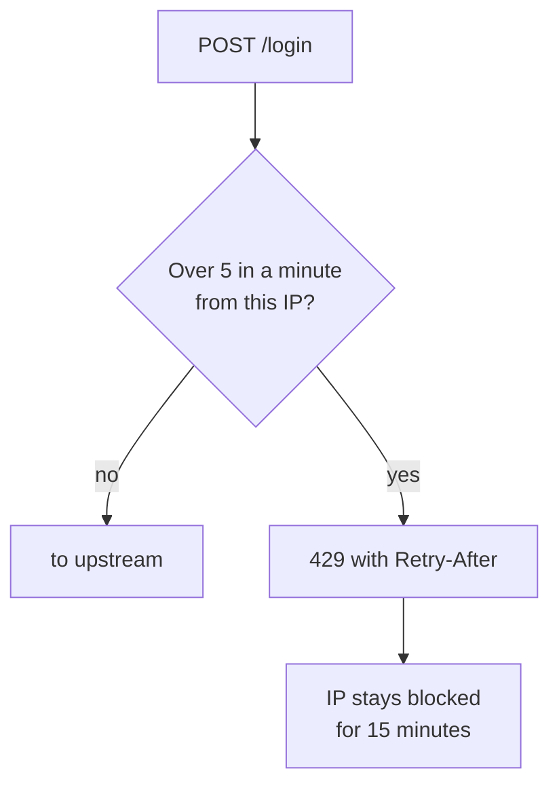

**Rule** · Rate limit rule, ID `login-per-ip`

When:

```text
http.request.method eq "POST" and http.request.uri.path eq "/login"
```

Then:

```json
{
  "algorithm": "sliding_window",
  "limit": 5,
  "period": "1m",
  "key": ["ip"],
  "on_missing_key": "fallback_ip",
  "action": "block",
  "penalty": "15m",
  "fail_mode": "open"
}
```

**Prove it** with this policy test:

```json
[
  {
    "name": "a login post is counted",
    "request": {"method": "POST", "host": "www.example.com", "path": "/login"},
    "expect": {"rate_limit_rules": ["login-per-ip"]}
  },
  {
    "name": "loading the login page is not",
    "request": {"host": "www.example.com", "path": "/login"},
    "expect": {"rate_limit_rules": []}
  }
]
```

**Watch out**

- `penalty` keeps a key blocked for that long after its first 429, and edges answer repeats from a local cache.
- Every counter is shared by all edges through Valkey, so the limit is exact across the fleet.
- Start with `"action": "log"` and switch to `block` once **Stats** looks right. See [Before you block](../rate-limiting.md#before-you-block-shadow-mode).
- For failed logins only, see [Failed logins](../bots.md#failed-logins).

## Limit each signed-in user, and anonymous callers by IP

API calls are counted per user from the token's `sub` claim. A caller with no token is counted under its client IP.

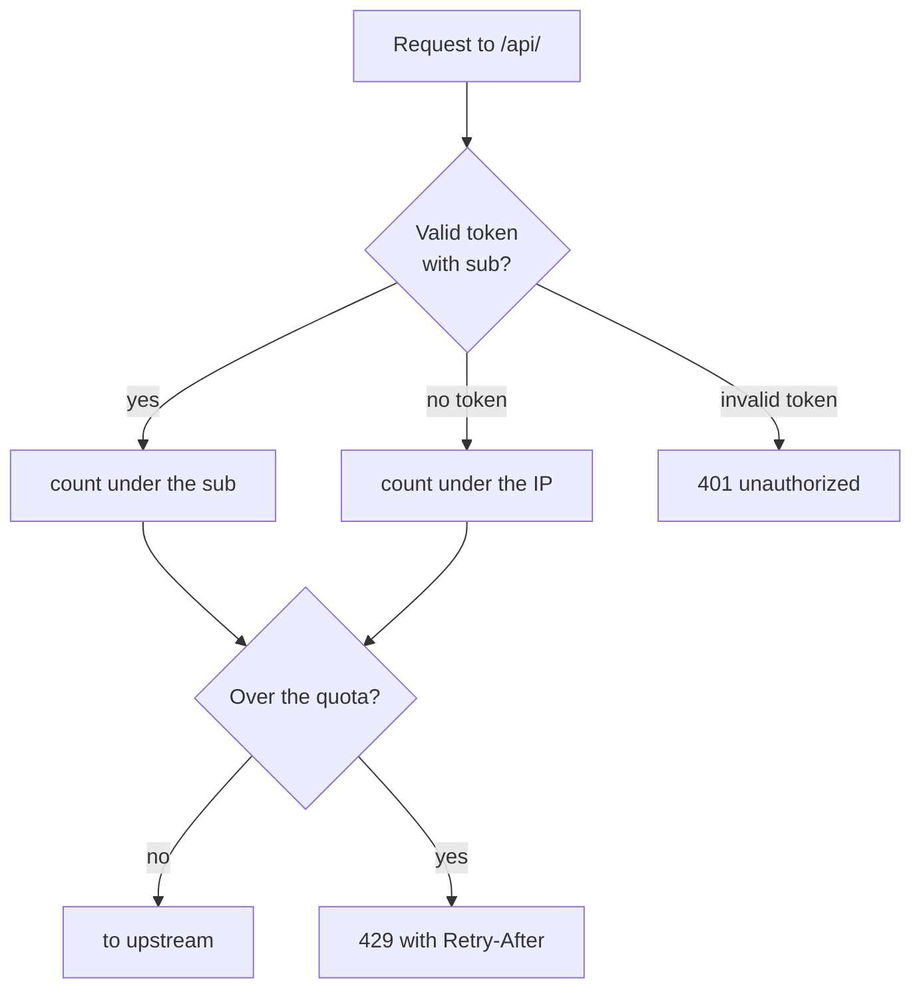

**Rule** · Access rule, ID `api-sign-in-optional`

When:

```text
starts_with(http.request.uri.path, "/api/")
```

Then:

```json
{"settings": {"auth": {"mode": "optional"}}}
```

**Rule** · Rate limit rule, ID `api-per-user`

When:

```text
starts_with(http.request.uri.path, "/api/")
```

Then:

```json
{
  "algorithm": "token_bucket",
  "limit": 600,
  "period": "1m",
  "burst": 100,
  "key": ["jwt_claim:sub"],
  "on_missing_key": "fallback_ip",
  "action": "block",
  "fail_mode": "open"
}
```

**Also set** on **Issuers**, the identity provider whose tokens the rule checks (`auth`):

```json
{
  "issuers": [
    {
      "id": "main",
      "issuer": "https://login.example.com",
      "audiences": ["api"],
      "jwks_url": "https://login.example.com/.well-known/jwks.json",
      "algorithm": "RS256"
    }
  ],
  "default_accepted": ["main"]
}
```

The `main` issuer is also the one rules accept by default (`default_accepted`). Tick it on the same page.

**Prove it** with this policy test:

```json
[
  {
    "name": "a signed-in user is counted",
    "request": {
      "host": "api.example.com",
      "path": "/api/orders",
      "jwt_claims": {"sub": "user-42"}
    },
    "expect": {"rejected": "", "rate_limit_rules": ["api-per-user"]}
  },
  {
    "name": "an anonymous caller is counted by IP",
    "request": {"host": "api.example.com", "path": "/api/orders"},
    "expect": {"rejected": "", "rate_limit_rules": ["api-per-user"]}
  }
]
```

**Watch out**

- Rate limit rules can match on claims because they run after JSON Web Token (JWT) validation. Access rules can't.
- `fallback_ip` counts a request with no key part under its client IP. `skip` would ignore the rule, and `reject` would answer 400 `bad_request`.
- `optional` lets anonymous callers through to be counted by IP. Use `required` if they must sign in.
- With `token_bucket`, a client can send up to `burst` (100) at once after a quiet spell, then averages `limit` (600) a minute. See [Token bucket](../rate-limiting.md#token-bucket).

## Cap each tenant per day

Each tenant gets 100,000 API calls per Coordinated Universal Time (UTC) day. A token with no `tenant` claim is refused.

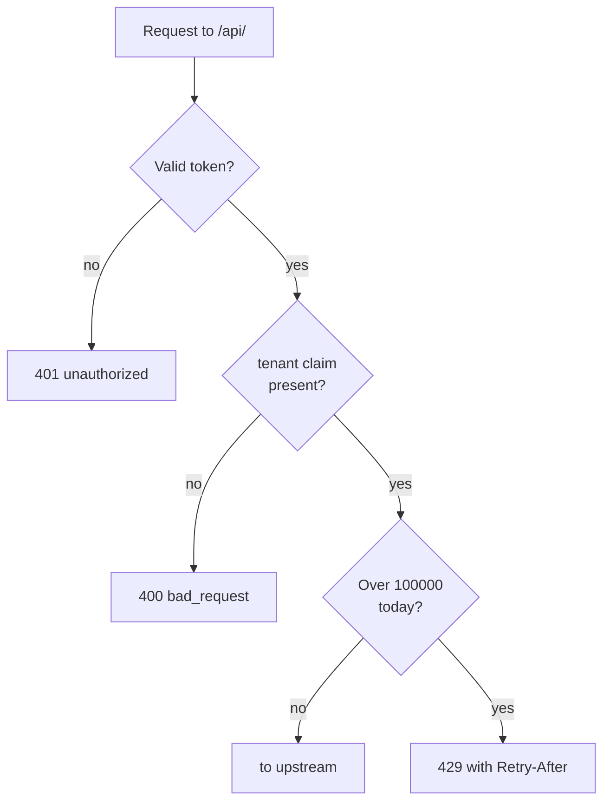

**Rule** · Access rule, ID `api-needs-sign-in`

When:

```text
starts_with(http.request.uri.path, "/api/")
```

Then:

```json
{"settings": {"auth": {"mode": "required"}, "ratelimit_headers": true}}
```

**Rule** · Rate limit rule, ID `tenant-daily`

When:

```text
starts_with(http.request.uri.path, "/api/")
```

Then:

```json
{
  "algorithm": "fixed_window",
  "limit": 100000,
  "period": "24h",
  "key": ["jwt_claim:tenant"],
  "on_missing_key": "reject",
  "action": "block",
  "fail_mode": "open"
}
```

**Also set** on **Issuers**, the identity provider whose tokens the rule checks (`auth`):

```json
{
  "issuers": [
    {
      "id": "main",
      "issuer": "https://login.example.com",
      "audiences": ["api"],
      "jwks_url": "https://login.example.com/.well-known/jwks.json",
      "algorithm": "RS256"
    }
  ],
  "default_accepted": ["main"]
}
```

The `main` issuer is also the one rules accept by default (`default_accepted`). Tick it on the same page.

**Prove it** with this policy test:

```json
[
  {
    "name": "a token with a tenant is counted",
    "request": {
      "host": "api.example.com",
      "path": "/api/orders",
      "jwt_claims": {"sub": "user-42", "tenant": "acme"}
    },
    "expect": {"rejected": "", "rate_limit_rules": ["tenant-daily"]}
  },
  {
    "name": "a token without a tenant is refused",
    "request": {
      "host": "api.example.com",
      "path": "/api/orders",
      "jwt_claims": {"sub": "user-42"}
    },
    "expect": {"rejected": "rate_limit_key"}
  }
]
```

**Watch out**

- `fixed_window` with a 24h period resets at 00:00 UTC, because windows start at multiples of the period since the Unix epoch.
- `ratelimit_headers: true` adds `RateLimit-Policy` and `RateLimit` to responses, for blocking rules only.
- `on_missing_key: reject` answers 400 `bad_request`. A token that passes without claims, because the edge never obtained the issuer's keys, has no tenant and gets the same answer.
- Over the limit, every request from the tenant is refused until the period ends.

## Limit each partner API key

Partners send an `X-Api-Key` header. Each key, from each client IP, gets 100 requests a minute, and a request with no key is refused.

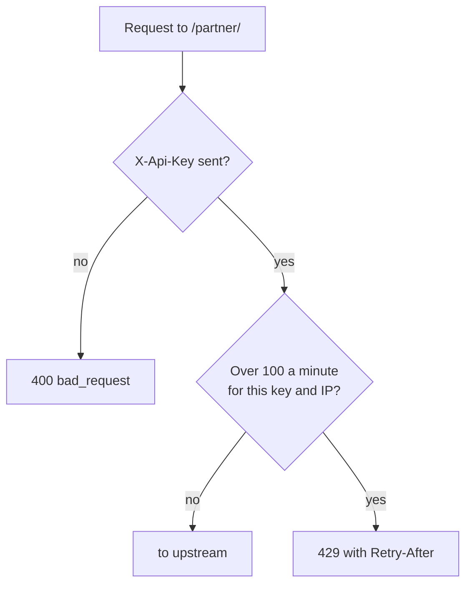

**Rule** · Rate limit rule, ID `partner-per-key`

When:

```text
starts_with(http.request.uri.path, "/partner/")
```

Then:

```json
{
  "algorithm": "sliding_window",
  "limit": 100,
  "period": "1m",
  "key": ["header:x-api-key", "ip"],
  "on_missing_key": "reject",
  "action": "block",
  "fail_mode": "open"
}
```

**Prove it** with this policy test:

```json
[
  {
    "name": "a request with a key is counted",
    "request": {
      "host": "api.example.com",
      "path": "/partner/orders",
      "headers": {"X-Api-Key": "k-123"}
    },
    "expect": {"rejected": "", "rate_limit_rules": ["partner-per-key"]}
  },
  {
    "name": "a request without a key is refused",
    "request": {"host": "api.example.com", "path": "/partner/orders"},
    "expect": {"rejected": "rate_limit_key"}
  }
]
```

**Watch out**

- A key that includes `header`, `cookie`, `query`, `host`, `method` or `ja4` needs `ip` or a `jwt_claim` in the key, or a site-wide rule keyed on `ip`. That is why the key is `["header:x-api-key", "ip"]`. The `ip` part keeps clients apart but doesn't cap one IP: each new key value from it gets its own counter. Add a per-IP rule, such as [Set a site-wide ceiling per IP](#set-a-site-wide-ceiling-per-ip), for a ceiling across keys.
- A header value is chosen by the client, so on its own it would let one client use endless fresh keys.
- `reject` answers 400 `bad_request`. Use `fallback_ip` to count a keyless request under its IP instead.

## Limit each browser session, with a per-IP partner

Count requests per `session` cookie and client IP. A request without the cookie skips this rule, and the site-wide `per-ip` rule still counts it.

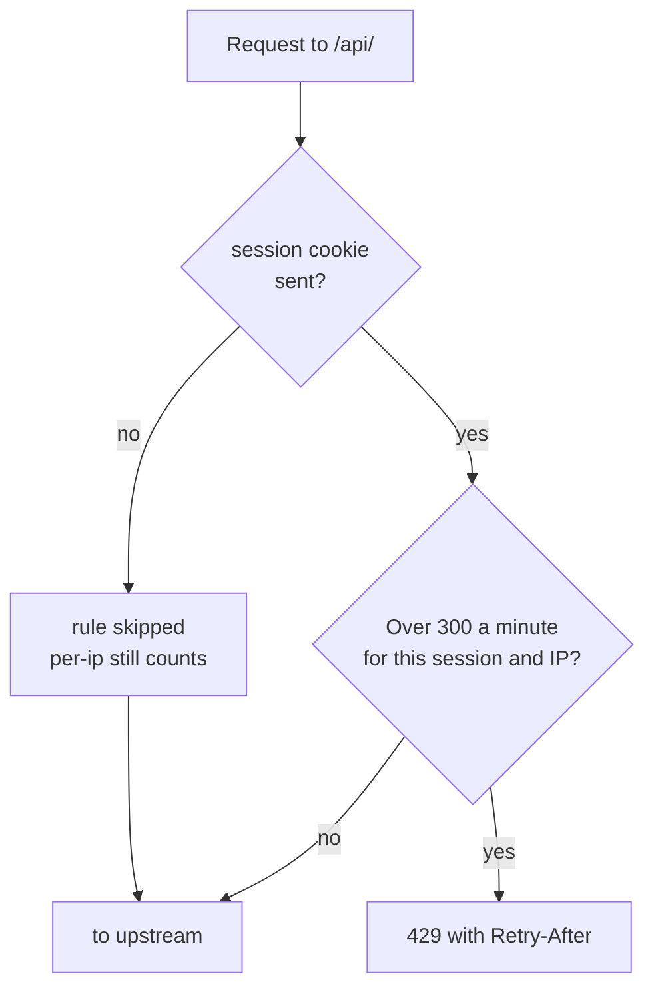

**Rule** · Rate limit rule, ID `per-ip`

When:

```text
true
```

Then:

```json
{
  "algorithm": "sliding_window",
  "limit": 600,
  "period": "1m",
  "key": ["ip"],
  "on_missing_key": "fallback_ip",
  "action": "block",
  "fail_mode": "open"
}
```

**Rule** · Rate limit rule, ID `per-session`

When:

```text
starts_with(http.request.uri.path, "/api/")
```

Then:

```json
{
  "algorithm": "sliding_window",
  "limit": 300,
  "period": "1m",
  "key": ["cookie:session", "ip"],
  "on_missing_key": "skip",
  "action": "block",
  "fail_mode": "open"
}
```

**Prove it** with this policy test:

```json
[
  {
    "name": "a request with a session is counted by both rules",
    "request": {
      "host": "api.example.com",
      "path": "/api/cart",
      "headers": {"Cookie": "session=abc123"}
    },
    "expect": {"rate_limit_rules": ["per-ip", "per-session"]}
  },
  {
    "name": "a request without a session is counted per IP only",
    "request": {"host": "api.example.com", "path": "/api/cart"},
    "expect": {"rate_limit_rules": ["per-ip"]}
  }
]
```

**Watch out**

- `skip` lets a client bypass the rule by leaving the cookie out. Use it only when another rule, here `per-ip`, covers those requests.
- A cookie value is chosen by the client, so the key also has `ip`, which keeps clients apart. It doesn't stop a client getting a fresh counter with every fresh cookie; `per-ip` is what caps one IP's total.
- A skipped rule takes no slot in the cap of 5 matching rules per request.

## Set a site-wide ceiling per IP

One rule for every request that reaches rate limiting: no client IP gets more than 600 requests a minute, whatever the path. Clients on the trusted allowlist or matched by an always-allow rule skip rate-limit rules, and a CORS preflight the edge answers itself is never counted.

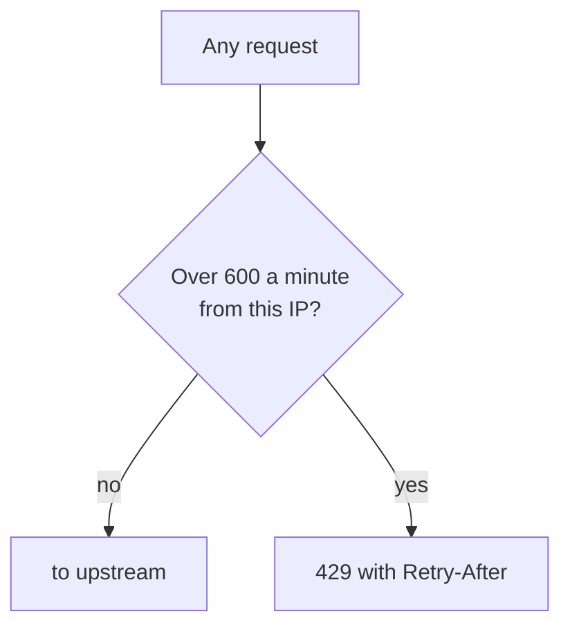

**Rule** · Rate limit rule, ID `per-ip`

When:

```text
true
```

Then:

```json
{
  "algorithm": "sliding_window",
  "limit": 600,
  "period": "1m",
  "key": ["ip"],
  "on_missing_key": "fallback_ip",
  "action": "block",
  "fail_mode": "open"
}
```

**Prove it** with this policy test:

```json
[
  {
    "name": "every request is counted",
    "request": {"host": "any.example.com", "path": "/anything"},
    "expect": {"rate_limit_rules": ["per-ip"]}
  }
]
```

**Watch out**

- At most 2 site-wide rules (expression `true`) are allowed.
- A site-wide rule keyed on `ip` also satisfies the key check for other rules that key on a header, cookie or query value.
- Start with `"action": "log"` on a site-wide rule, because it touches every request.

## Protect a fragile search backend with one shared limit

Search can take 50 requests a second in total, with a burst of 100, however many clients send them.

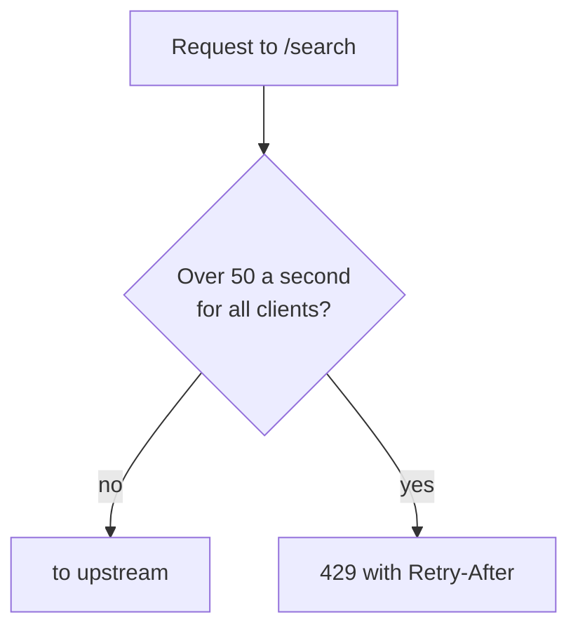

**Rule** · Rate limit rule, ID `search-total`

When:

```text
starts_with(http.request.uri.path, "/search")
```

Then:

```json
{
  "algorithm": "leaky_bucket",
  "limit": 50,
  "period": "1s",
  "burst": 100,
  "key": ["constant"],
  "on_missing_key": "fallback_ip",
  "action": "block",
  "fail_mode": "local"
}
```

**Prove it** with this policy test:

```json
[
  {
    "name": "search is counted in one shared bucket",
    "request": {"host": "www.example.com", "path": "/search?q=shoes"},
    "expect": {"rate_limit_rules": ["search-total"]}
  }
]
```

**Watch out**

- `key: ["constant"]` is one counter for every matching request, so one noisy client can use up the share of everyone else.
- `fail_mode: local` means that when Valkey can't answer, each edge counts at limit ÷ fleet size instead of letting everything through.
- Pair it with a per-IP rule so one client can't take the whole budget.

## Refuse payments when limits can't be checked

Payment posts are limited to 10 per 10 minutes per IP. If Valkey can't answer, the edge refuses the request instead of letting it through.

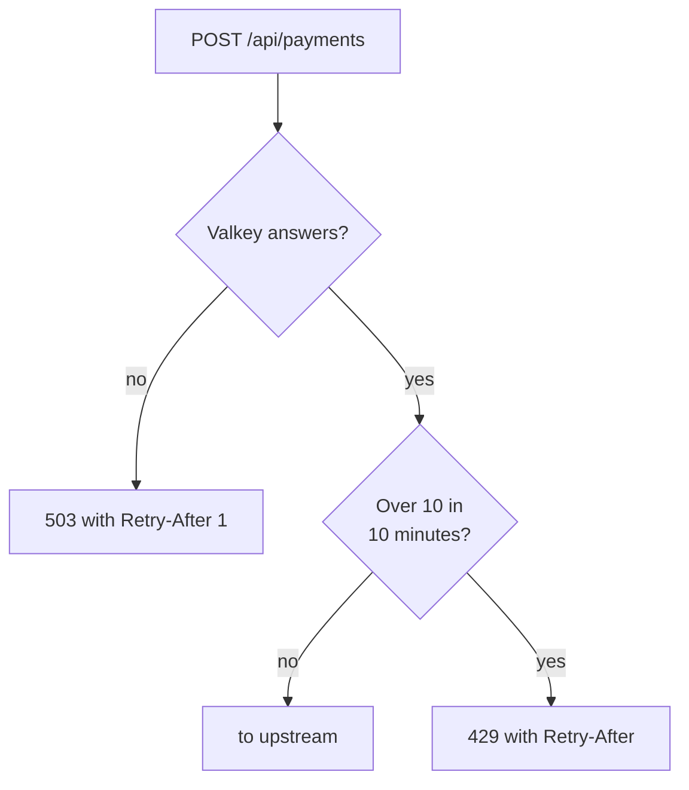

**Rule** · Rate limit rule, ID `payments-per-ip`

When:

```text
http.request.method eq "POST" and starts_with(http.request.uri.path, "/api/payments")
```

Then:

```json
{
  "algorithm": "sliding_window",
  "limit": 10,
  "period": "10m",
  "key": ["ip"],
  "on_missing_key": "fallback_ip",
  "action": "block",
  "fail_mode": "closed"
}
```

**Prove it** with this policy test:

```json
[
  {
    "name": "payment posts are counted",
    "request": {
      "method": "POST",
      "host": "api.example.com",
      "path": "/api/payments"
    },
    "expect": {"rate_limit_rules": ["payments-per-ip"]}
  }
]
```

**Watch out**

- `fail_mode` is `open`, `closed` or `local`. `closed` answers 503 with `Retry-After: 1` when Valkey can't answer.
- Fail-closed is a deliberate choice for one rule. The default stays `open`, so a Valkey outage doesn't stop the site.
- Rate-limit calls are never retried, so a request can't consume quota twice.

## Limit checkout only for the length of a sale

A checkout limit that switches itself off at a set time, with no second publish.

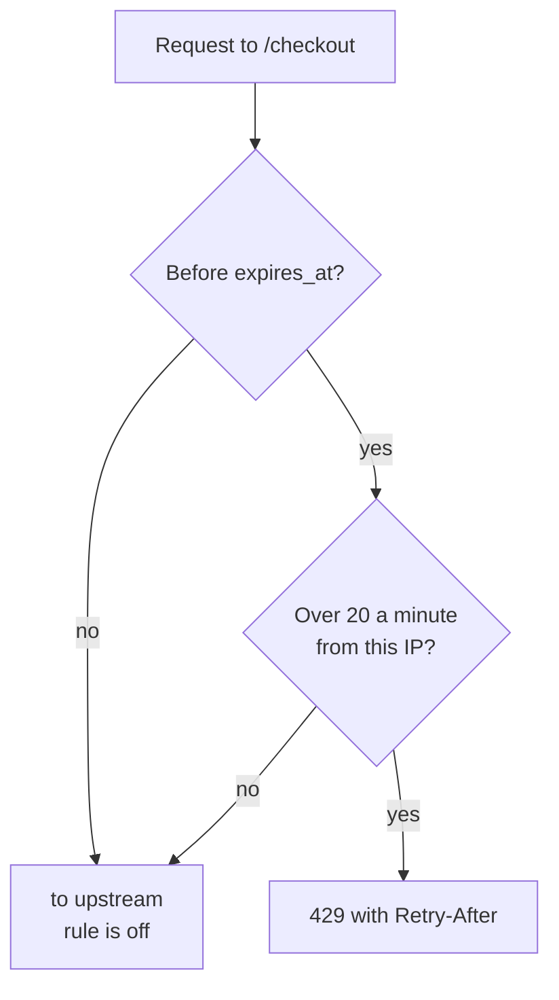

**Rule** · Rate limit rule, ID `sale-checkout`

When:

```text
http.request.uri.path eq "/checkout"
```

Then:

```json
{
  "algorithm": "sliding_window",
  "limit": 20,
  "period": "1m",
  "key": ["ip"],
  "on_missing_key": "fallback_ip",
  "action": "block",
  "fail_mode": "open",
  "expires_at": "2099-12-01T00:00:00Z"
}
```

**Prove it** with this policy test:

```json
[
  {
    "name": "checkout is limited while the sale runs",
    "request": {"host": "www.example.com", "path": "/checkout"},
    "expect": {"rate_limit_rules": ["sale-checkout"]}
  }
]
```

**Watch out**

- `expires_at` is an RFC 3339 time. The form has no field for it, so set it in **Edit as JSON**.
- Each edge uses its own clock, so edges stop the rule within their clock differences.
- The rule shows when it expires on **Rules**.

## Watch for coupon guessing

Count how many different coupon codes one IP tries in an hour. The rule only logs, so you can see the real numbers first.

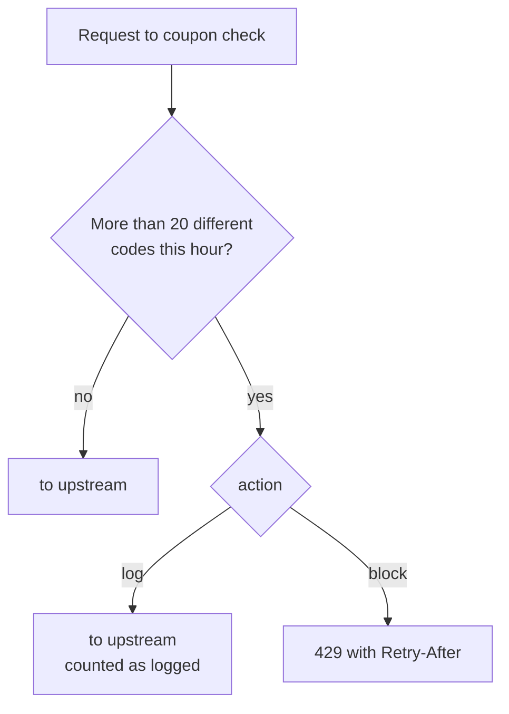

**Rule** · Rate limit rule, ID `coupon-guessing`

When:

```text
http.request.uri.path eq "/api/coupons/check"
```

Then:

```json
{
  "algorithm": "distinct",
  "distinct_of": "query:code",
  "limit": 20,
  "period": "1h",
  "key": ["ip"],
  "on_missing_key": "fallback_ip",
  "action": "log",
  "fail_mode": "open"
}
```

**Prove it** with this policy test:

```json
[
  {
    "name": "coupon checks are counted",
    "request": {
      "host": "www.example.com",
      "path": "/api/coupons/check?code=SAVE10"
    },
    "expect": {"rate_limit_rules": ["coupon-guessing"]}
  }
]
```

**Watch out**

- `distinct` with `distinct_of: "query:code"` counts different values per period, estimated within about 10%, and can't use `fail_mode: local`.
- Repeating one code doesn't raise the count. Only new values do.
- `log` shows what would have been limited as **Logged instead of limited** on **Stats** and blocks nothing.

## Start every new limit in shadow mode

Add the rule with `"action": "log"`, watch **Stats**, then change it to `block`.

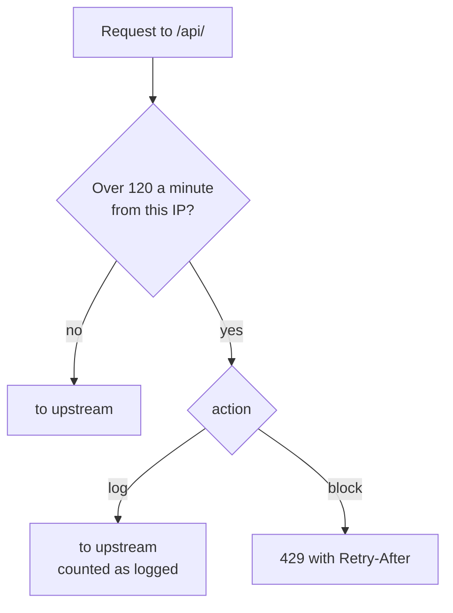

**Rule** · Rate limit rule, ID `api-per-ip`

When:

```text
starts_with(http.request.uri.path, "/api/")
```

Then:

```json
{
  "algorithm": "sliding_window",
  "limit": 120,
  "period": "1m",
  "key": ["ip"],
  "on_missing_key": "fallback_ip",
  "action": "log",
  "fail_mode": "open"
}
```

**Prove it** with this policy test:

```json
[
  {
    "name": "API calls are counted",
    "request": {"host": "api.example.com", "path": "/api/x"},
    "expect": {"rate_limit_rules": ["api-per-ip"]}
  }
]
```

**Watch out**

- `log` counts what would have been limited, shows it as **Logged instead of limited** on **Stats**, and blocks nothing.
- A rule added in the UI starts as log only.
- Publish the switch to `block` through a [canary](../publishing.md#canary). The rollback guard compares a changed rule with what it found while it only logged.
- See [Before you block](../rate-limiting.md#before-you-block-shadow-mode).
