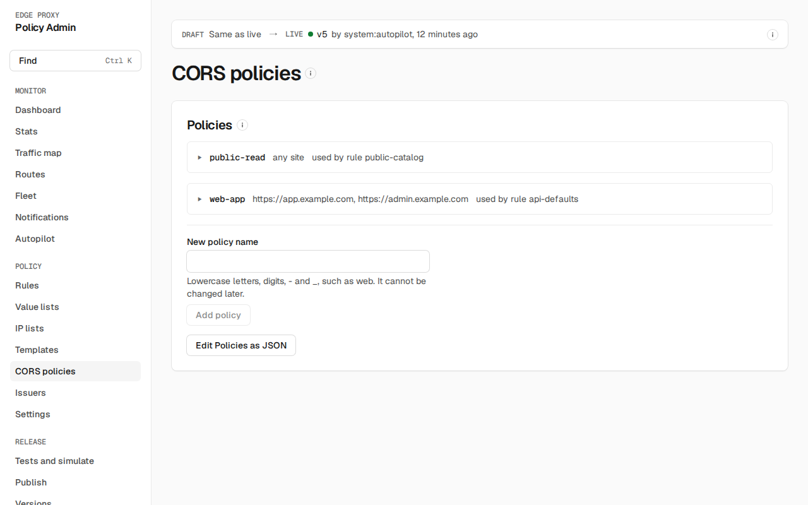

# CORS

Use a Cross-Origin Resource Sharing (CORS) policy to let pages on other sites call your API from a browser. The edge answers the browser's preflight check itself and puts the CORS headers on every response, so your upstream doesn't have to.



You define named policies under `global.cors_policies`, then an access rule picks one for the requests it matches. A policy that no rule picks has no effect.

## Choose a policy for a route

An access rule's `settings.cors_policy` names the policy for the requests the rule matches:

```json
{"settings": {"cors_policy": "web-app"}}
```

- `""` turns Cross-Origin Resource Sharing (CORS) off for the matching requests. Their preflights go to the upstream, and the edge adds no CORS headers.
- Rules apply top to bottom and the last matching rule that sets `cors_policy` wins, so put narrow rules, such as one that turns CORS off for `/webhooks/`, below the broad one.
- A route that no rule gives a policy has none. The edge then neither answers preflights nor touches the upstream's own CORS headers.
- A rule that names a policy that doesn't exist is refused at save, and saving warns about a policy no rule selects.

## Policy fields

| Field | Holds |
|---|---|
| `origins` | Required, 1 to 100 entries. `*` for any site, or exact origins such as `https://app.example.com` or `http://localhost:3000` |
| `methods` | Up to 100 methods the browser may use besides `GET`, `HEAD` and `POST`, which are always allowed. Uppercase, such as `PUT` |
| `request_headers` | Up to 100 headers the page may send, or `*`. Names are compared without regard to case |
| `exposed_headers` | Up to 100 response headers page scripts may read, or `*` |
| `credentials` | `true` sends `Access-Control-Allow-Credentials: true`, so the browser may send cookies and `Authorization`. Default `false` |
| `max_age` | How long the browser may reuse a preflight answer: whole seconds from `1s` to `24h`, such as `"10m"`. Omitted or `"0s"` sends no `Access-Control-Max-Age`, and each browser decides |

Rules for the values:

- **Origins are exact.** Each is `http` or `https`, a host and an optional port, in lowercase, with no path, query, fragment or user name. The edge compares the request's `Origin` to the list as a whole string, so there are no subdomain patterns: `https://*.example.com` matches no request. List each origin, or use `*`. Write the origin as a browser sends it: no default port (`https://app.example.com`, not `https://app.example.com:443`) and an international host name in its punycode form (`xn--`). Saving an origin with a `*` in the host, the scheme's default port, a port that is not a plain number up to 65535, or a non-ASCII host lists a warning under the save message.
- **`*` can't be combined with `credentials`.** This holds for `origins`, `request_headers` and `exposed_headers`, as the Fetch standard requires. Save refuses it.
- **No duplicates.** A repeated origin, method or header is refused.
- Policy names are 1 to 64 characters of `a-z 0-9 - _`, starting with a letter or digit, and there are at most 100 policies.

## What the edge sends

On a route with a policy, the edge answers a browser's cross-origin preflight check itself and sets the Cross-Origin Resource Sharing (CORS) headers on every other response.

### The allowed origin

| `origins` | `Access-Control-Allow-Origin` | `Vary: Origin` |
|---|---|---|
| `["*"]` (or a list holding `*`) | `*` | No |
| One origin | That origin, whatever the request's `Origin` is | No |
| Several origins | The request's `Origin` when it is listed, nothing when it is not | Yes |

Only the list form depends on the request, so only it sends `Vary: Origin`, which tells caches in front to key on `Origin`. A policy with one origin doesn't check the request's `Origin`: the edge always sends that origin and the browser refuses a page from another site. Use two or more origins when you want the edge to leave the header out for a stranger.

### Preflight

A preflight is an `OPTIONS` request with an `Origin` header and an `Access-Control-Request-Method` header. On a route with a policy the edge answers it itself, so it never reaches the upstream.

The edge answers it after the load shed and client checks, any block or ban, and the per-IP backstop, and before the token check and rate limits. A preflight is not counted against a rate limit, and a blocked or banned client gets its 403 as for any request. On a route without a policy, a preflight goes to the upstream like any request.

The answer is always `204` with `Cache-Control: no-store` and the request's `X-Request-Id`, plus `Vary: Origin` for a list of origins. It is allowed when the origin, the requested method and every requested header are allowed:

- The origin is allowed when the policy sends an `Access-Control-Allow-Origin` for it (always, for `*` or one origin).
- The method is allowed when it is `GET`, `HEAD` or `POST`, or is listed in `methods`.
- Every name in `Access-Control-Request-Headers` is listed in `request_headers`, or the policy lists `*`.

| Outcome | Headers added |
|---|---|
| Allowed | `Access-Control-Allow-Origin`, `Access-Control-Allow-Credentials: true` when `credentials` is set, `Access-Control-Allow-Methods` and `Access-Control-Allow-Headers` echoing what the browser asked for, and `Access-Control-Max-Age` when `max_age` is set |
| Not allowed | No `Access-Control-*` header, which the browser treats as a failed check |

Exposed headers are not part of a preflight answer. The edge counts answers in `edge_cors_preflight_total{result}`, see [Edge metrics](../operate/monitoring.md#edge-metrics).

### Every other response

On a route with a policy, the edge removes every `Access-Control-*` header the upstream sent and sets its own, so the policy is the only source:

- `Access-Control-Allow-Origin` as in the table above, and nothing else when it is empty.
- `Access-Control-Allow-Credentials: true` when `credentials` is set.
- `Access-Control-Expose-Headers` with the `exposed_headers`, joined by commas.
- `Vary: Origin` for a list of origins, added to the upstream's own `Vary`.

The edge's own answers get the same headers once the access rules have run: a 401 for a missing token, a 429 for a rate limit, a 403 for a block. Answers sent before that, such as a 400 for a bad path, have none. Every answer the edge writes itself sends `Cache-Control: no-store`.

### A disallowed origin

CORS tells the browser what a page may read. It is not access control, and the edge does not refuse a request for its `Origin`:

- A request from an origin not in a list is still forwarded to the upstream and answered. The response has no `Access-Control-Allow-Origin`, so the browser won't hand it to the page.
- A disallowed preflight gets the `204` with no `Access-Control-*` headers, and the browser doesn't send the real request.
- Requests from `curl`, servers and other non-browser clients are unaffected. Use [rules and tokens](tokens.md), not CORS, to keep callers out.

## Edit policies in the UI

On **CORS policies** (under **Policy**):

1. Give a name under **New policy name** and press **Add policy**. The name can't be changed later.
2. Each policy is one line with its sites (`any site` for `*`) and what uses it, such as `used by rule api-cors`, or `not used`. Open it to edit.
3. **Allowed sites** has one field per origin. **Methods** is a row of checkboxes, one per method. Tick the ones beyond the always-allowed `GET`, `HEAD` and `POST`. **Headers the page may send** and **Headers the page may read** have one field per header.
4. **Let browsers send cookies and Authorization** sets `credentials`.
5. **Browsers may reuse the answer for** sets `max_age`, a number and a unit.
6. **Remove policy** followed by the name deletes it from the draft.
7. In an access rule's **Then** form, **CORS policy** picks a policy, or **Off for these requests** for `""`.
8. **Save draft**, run **Tests and simulate**, then publish.

**Edit Policies as JSON** shows the section as the map of names to policies. Admin checks every edit as a save would, and each problem appears under its field.

## Example: one policy for the API, none for webhooks

The web apps at `app.example.com` and `admin.example.com` call `api.example.com` with cookies. Webhook callers are servers, so `/webhooks/` gets no Cross-Origin Resource Sharing (CORS) handling at all.

**Rule** · Access rule, ID `api-cors`

When:

```text
http.host eq "api.example.com"
```

Then:

```json
{"settings": {"cors_policy": "web-app"}}
```

**Rule** · Access rule, ID `webhooks-no-cors`, placed below `api-cors`

When:

```text
starts_with(http.request.uri.path, "/webhooks/")
```

Then:

```json
{"settings": {"cors_policy": ""}}
```

**Also set** on **CORS policies**, one policy (`global.cors_policies`). In **Edit Policies as JSON**, add it beside the policies already there, because the editor replaces the whole section:

```json
{
  "web-app": {
    "origins": ["https://app.example.com", "https://admin.example.com"],
    "methods": ["PUT", "PATCH", "DELETE"],
    "request_headers": ["Authorization", "Content-Type"],
    "exposed_headers": ["X-Request-Id"],
    "credentials": true,
    "max_age": "10m"
  }
}
```

**Prove it** with this policy test, added as described in [Policy tests](policy.md#policy-tests):

```json
[
  {
    "name": "the edge answers the app's preflight",
    "request": {
      "method": "OPTIONS",
      "host": "api.example.com",
      "path": "/orders/1",
      "headers": {
        "Origin": "https://app.example.com",
        "Access-Control-Request-Method": "DELETE"
      }
    },
    "expect": {"preflight": true, "settings": {"cors_policy": "web-app"}}
  },
  {
    "name": "an ordinary API request uses the policy",
    "request": {"host": "api.example.com", "path": "/orders/1"},
    "expect": {"preflight": false, "settings": {"cors_policy": "web-app"}}
  },
  {
    "name": "a webhook preflight goes to the upstream",
    "request": {
      "method": "OPTIONS",
      "host": "api.example.com",
      "path": "/webhooks/stripe",
      "headers": {
        "Origin": "https://evil.example",
        "Access-Control-Request-Method": "POST"
      }
    },
    "expect": {
      "config_rules": ["api-cors", "webhooks-no-cors"],
      "preflight": false,
      "settings": {"cors_policy": ""}
    }
  }
]
```

**Watch out**

- A policy test shows whether the edge answers a request as a preflight and which policy applies. It does not show whether the preflight is allowed or which headers are sent, so `preflight: true` also holds for an origin the policy refuses.
- Check the headers with curl against a published policy: `curl -si -X OPTIONS https://api.example.com/orders/1 -H 'Origin: https://app.example.com' -H 'Access-Control-Request-Method: PUT' -H 'Access-Control-Request-Headers: content-type'`. For this policy the code answers `204` with `Access-Control-Allow-Origin: https://app.example.com`, `Access-Control-Allow-Credentials: true`, `Access-Control-Allow-Methods: PUT`, `Access-Control-Allow-Headers: content-type`, `Access-Control-Max-Age: 600`, `Vary: Origin` and `Cache-Control: no-store`. With `Origin: https://evil.example` it answers `204` with `Vary: Origin` and no `Access-Control-*` header.
- `credentials` can't be combined with `*`, which is why the policy lists its origins.

More examples: [Browsers cases](cases/browsers.md#let-a-web-app-and-a-public-catalog-call-the-api-from-browsers).
