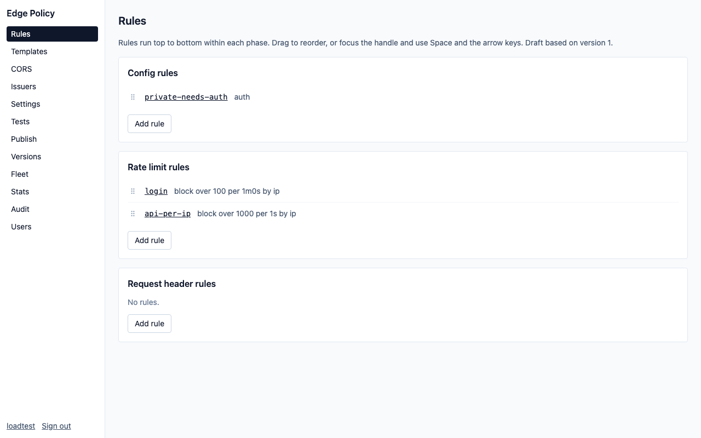
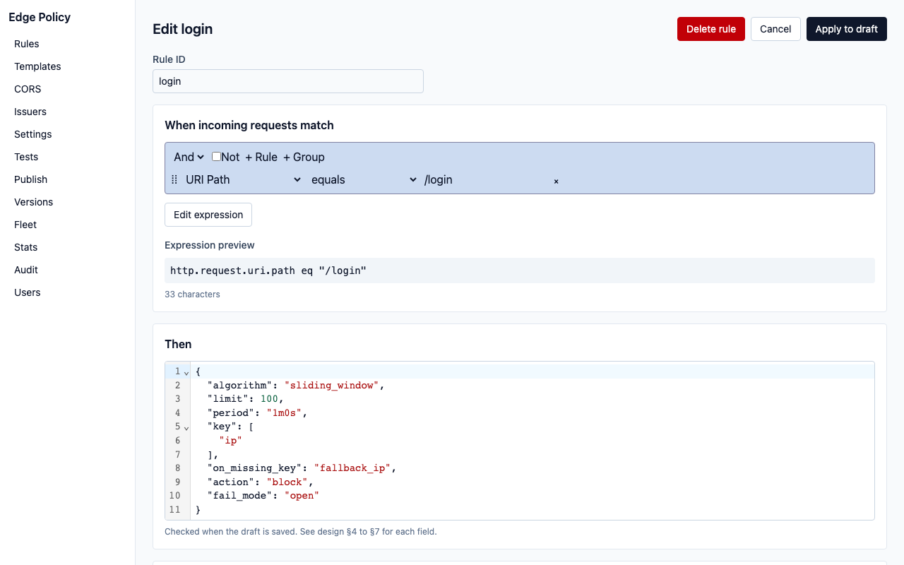
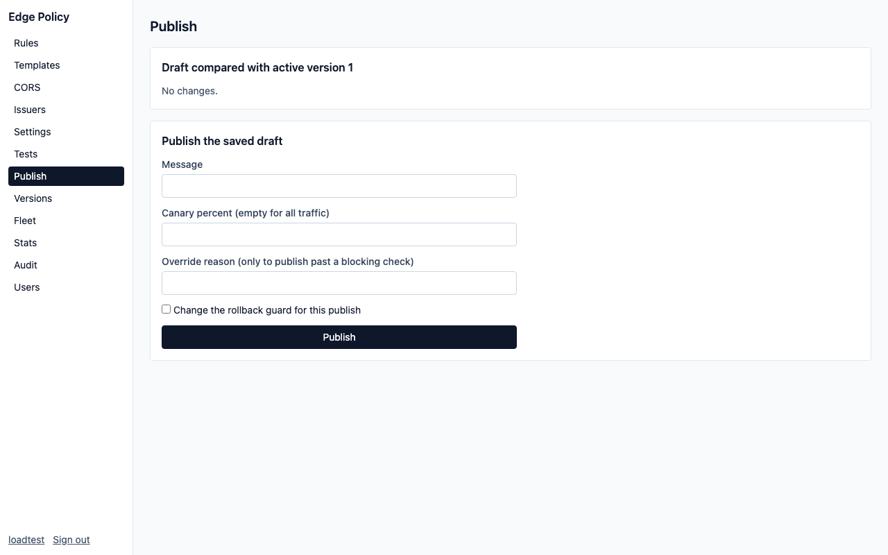
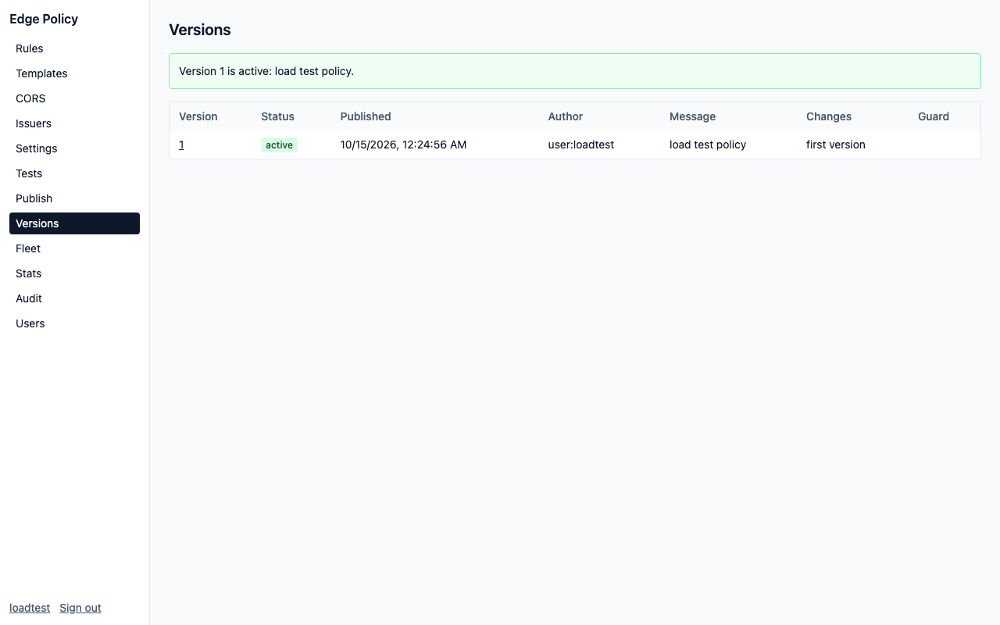
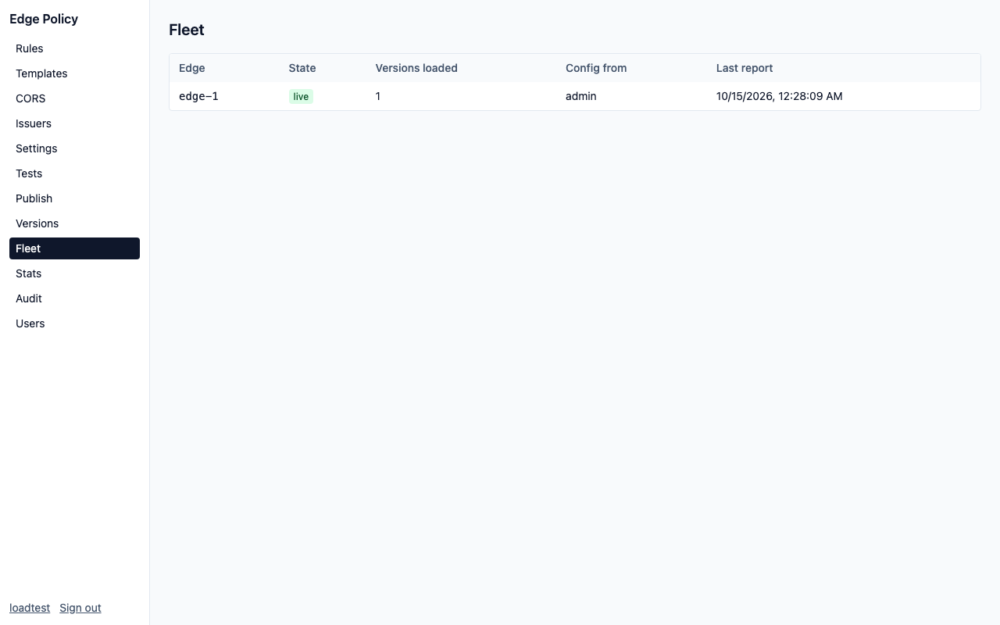
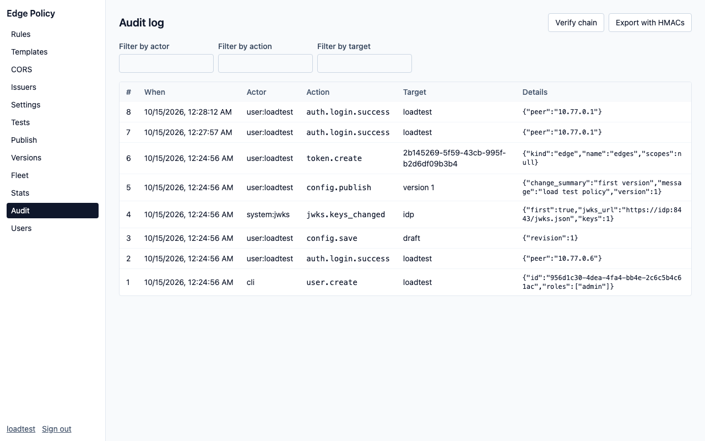

# Dashboard

The admin UI is served by the admin service. Sign in with a username and password. Menu items you lack the permission for are hidden.

## Roles

| Role | Can |
|---|---|
| viewer | Read config, stats and the audit log |
| editor | Viewer, plus edit the draft and run tests |
| publisher | Editor, plus publish, revert and run canaries |
| admin | Publisher, plus manage users, tokens and settings |

## Rules

The three phases and their rules, in order. Drag a rule to reorder it. **Add rule** or open one to edit it.

**When incoming requests match** is the rule builder; **Edit expression** switches to text. The preview shows the expression as admin renders it. **Then** is the action. **Apply to draft** keeps the change in the browser; **Save draft**, in the bar at the top of the screen once you have unsaved edits, validates and saves it for everyone.

## Templates, CORS, Issuers, Settings

The shared parts of the policy: response templates, CORS policies, JWT issuers, and global settings (kill switches, backstop, defaults, locale, header forwarding). **Settings** also holds the rollback guard, which only an admin can save.

## Tests

Run the draft's config tests, or simulate one request and see which rules match, what settings apply and which headers the upstream would receive. Failing tests block publish.

## Publish

The draft compared with the active version, rule by rule. Enter a message and press **Publish**. Optional:

- **Canary percent:** send only part of the traffic to the new version, then step, promote or abort it here.
- **Override reason:** publish although an issuer's keys were never fetched.
- **Change the rollback guard for this publish:** with a required reason.

## Versions

Every published version with its author, message, change summary and guard outcome. Open one to compare it with the previous version, **Revert** to it or **Copy to draft**; **Compare** diffs any two. A rule's published history is in its rule editor. The banner at the top reverts to the previous version in one step, with a reason: the emergency undo.

## Fleet and Stats

**Fleet** lists every edge: its state, the versions it has loaded, where its config came from (admin, cache file or bootstrap) and its last report. **Stats** shows requests, 5xx and auth failures per version, per-rule counts (`limited`, `would_limit` for log-only rules, `failed` when Valkey couldn't answer), plus the most-limited clients.

## Audit

Every change, sign-in and automatic action, with a diff for config changes. Filter, export, and check the integrity badge: it shows whether the last recorded verification of the HMAC chain (daily, manual, or a detected break) passed.

## Users

Add users, set their roles and disable them. Create **tokens** here too:

- **edge tokens**, which edges use to fetch config and send stats;
- **user tokens** with scoped permissions, for automation.

A token is shown once, when it is created.

## Account

Change your own password. Passwords are hashed with Argon2id and checked against the optional blocklist (`PASSWORD_BLOCKLIST_PATH`); sign-in attempts are throttled.
