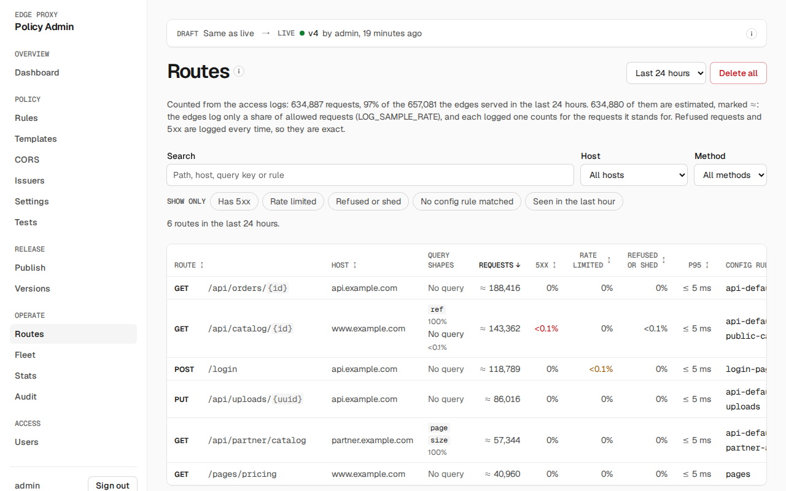
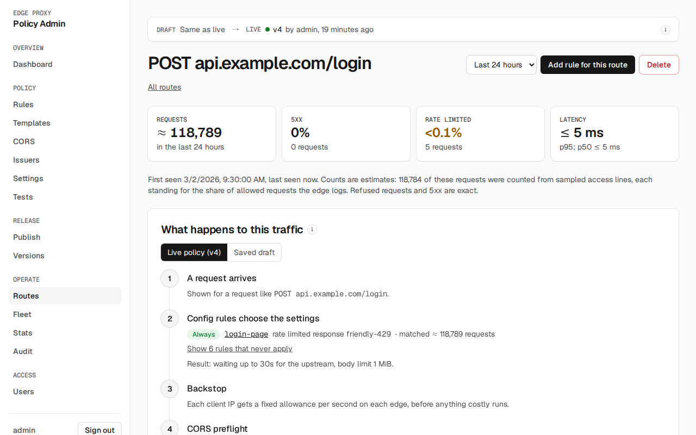

# Dashboard

The admin UI is served by the admin service. Sign in with a username and password. Menu items you lack the permission for are hidden, and opening such a page by its address says your role cannot open it. On a narrow screen the menu opens from **Menu** at the top.

The bar at the top of every screen shows where policy stands, in the order a change travels: the shared draft (such as **Unsaved edits**, **Same as live**, or what is **Not published**, such as `1 rule changed`; while a canary runs it is compared with the canary), a canary if one runs, and the live version.

## Roles

| Role | Can |
|---|---|
| viewer | Read config, stats and the audit log |
| editor | Viewer, plus edit the draft and run tests |
| publisher | Editor, plus publish, revert and run canaries, and delete or group routes |
| admin | Publisher, plus manage users, tokens and settings |

## Overview

The first screen after sign-in. **Time range** picks the window for the traffic figures, from the last hour to the last week; **Live** beside it means the figures refresh every 10 seconds, and it reads **Not updating** when they can't. Each panel is shown only to roles that can read its page, and links to it.

- **Needs attention** lists states to act on. Each is a fact read from admin, never a guess from a threshold:
    - **A kill switch is on** (rate limiting or JWT checks): enforcement is off everywhere. Turn it off in **Settings** once the emergency is over.
    - **A canary was aborted**, with its reason, or **the guard rolled back a version**: a canary, or a full publish it replaced with a copy of the version before. The line names the version edges now serve and, for a rollback, the signals that tripped and the version they were compared with. Fix the change in the draft and publish again; **Publish** shows how.
    - **The guard raised an alert** on the live or canary version: the signals that tripped, the version they were compared with, and why the version stayed. Open the version and decide whether to keep or revert it.
    - **A canary is running**, with its percent and start time. Promote or abort it in **Publish**.
    - **Live edges serve a cache or bootstrap snapshot** because they can't get config from admin, or **live edges have not loaded the live version**. They keep serving an older policy; check them in **Fleet**.
    - **Valkey did not answer rate limit checks**, split by what each rule's **When Valkey cannot answer** setting then did: let the request through uncounted, answered `503` (a rule that fails closed, unless another rule answered `429`), or counted on the edge alone. Check Valkey; **Stats** has the counts per rule.
    - **Log only rules had requests over their limit**, up to three, with how many requests a block would have stopped. Review the rule before switching it to block.
    - **The audit log failed its tamper check**, with the event where the chain broke. Open **Audit**.

    The rate limit counts include every request, not a sample, though a report an edge could not deliver is missing; each is read against the version that served it, so a rule changed during the range is counted by its settings at the time. A line goes away when its state does: there is nothing to dismiss, and the **Audit** log and **Stats** keep the history. With nothing to list, the panel says what it checked.
- **Traffic** shows requests, and the share rate limited, edge 5xx, upstream 5xx and auth failures, over a chart of requests split into served, rate limited and 5xx. Each bar is a minute, or a few minutes for long ranges; the bar for the minute in progress is paler. Hover a bar for its numbers. Drag across bars to zoom in to them, and the traffic and rate limiting figures follow, while **Needs attention** keeps the whole range; **Reset zoom** goes back. From the keyboard, focus the chart, move with the arrow keys, hold Shift to select, then press Enter to zoom or Escape to cancel.
- **Rate limiting** lists the rules that blocked the most requests, or for log only rules found the most over their limit, and the most limited clients. A rule that limited requests but has no client in the ranking is named below it: each edge reports only its 20 most limited clients across all rules, counted from 1 in 16 limited requests.
- **Live policy** shows the live version and how many rules each phase has.
- **Fleet** shows live and gone edges, the versions they have loaded and where their config came from.
- **Recent changes** lists changes to policy, releases, settings, users, tokens and routes (deleted or grouped), without sign-ins, with the latest audit chain check.

Counts of a million or more are shortened, such as 12.35M; hover over the request count for the exact number. The figures update every 10 seconds while the page is open, and include the minute in progress: edges report every 10 seconds and admin writes what it has every 10 seconds, so a request shows within about 20 seconds.

## Rules

The three phases and their rules, in order, each with what it does and the condition it matches. A rate limit rule also shows its penalty and what it does when Valkey is down, unless it lets requests through. Drag a rule to reorder it. Add a rule to a phase with its button, such as **Add rate limit rule**, or open one to edit it. **Find a rule** shows only the rules whose ID, summary or condition contains what you type, such as `login`, `block` or `/api/`, with how many of each phase's rules are shown.

A rule's ID must be unique across all phases; **Apply to draft** stays disabled while another rule has it. **When incoming requests match** is the rule builder; **Edit expression** switches to text. The preview shows the expression as admin renders it, with any errors, for the builder and for text as you type.

**Then** is a form: every fixed value, and every name of something else (a CORS policy, issuer or template), is picked from a list, numbers and durations are a number and a unit, and a field that does not apply, such as burst for a window algorithm, is not shown. A response template is offered only for the kinds of error whose status it uses. As you edit, admin checks the draft with the rule in it, exactly as a save would: each problem appears under its field and in a list at the top, and **Apply to draft** stays disabled until there are none. A new rate limit rule starts as log only. **Edit as JSON** shows the same settings as JSON, with **Fields and an example**.

**Apply to draft** keeps the change in the browser; **Save draft**, in the bar at the top of the screen once you have unsaved edits or the starter draft has never been saved, validates and saves it for everyone. If someone else saves the draft first, the bar says who and when; discard and redo your changes on their version. When a save fails on a rule, the error links to that rule.

## Templates, CORS, Issuers, Settings

The shared parts of the policy, each a form that edits the draft directly:

- **Templates:** each response template's status, content type and body, and the template each kind of edge response uses by default, with when the edge sends that kind. Status and content type are picked from lists; a kind is offered only the templates with its status.
- **CORS:** each policy's allowed sites, methods (ticked from a list), the headers the page may send and read, whether browsers may send cookies, and how long browsers may reuse the answer.
- **Issuers:** each JWT issuer's ID, `iss` value, audiences, keys URL and signing algorithm (picked from a list), and the issuers rules accept by default (ticked).
- **Settings:** the kill switches, the backstop, the defaults (body limit, timeouts, locale detection), locale and header forwarding.

Each template, policy and issuer is one line that says what it is and what uses it, such as `used by rule api-defaults`, or `not used`; open it to edit. One with a problem opens by itself. A template or policy is added by name and removed with its button; its name cannot be changed. Lists such as allowed sites have one field per item. Every edit is checked by admin as a save would check it: each problem appears under its field and in the bar at the top, with a link to its page (in a rule editor the bar leaves out that rule's own problems), and **Save draft** stays disabled until there are none. Each form has **Edit … as JSON**, which shows the same section as JSON. Saving warns about a CORS policy no config rule selects, an issuer no rule accepts, and a template nothing sends: each saves but has no effect.

**Settings** also holds the rollback guard: a form with the watch time, the request and step minimums, and each check with whether it rolls back, alerts or is off, its thresholds and a sentence of when it trips. **Edit as JSON** shows the same settings as JSON. It applies at once rather than with the draft, and only an admin can save it.

## Tests

Run the draft's config tests, edited as JSON, or simulate one request against the saved draft or any published version and see the outcome, which rules match, what settings apply and which headers the upstream would receive. Simulate and the tests use the saved draft, so unsaved rule and setting changes are not in their results; the page says so while you have some. After simulating against the saved draft with no unsaved rule changes, **Add as a test** appends that request as a test expecting the same outcome and rules. The request is a form: method from a list, host, path, client IP, country, AS number, HTTPS, headers, and the claims of a verified token if it has one; **Edit the request as JSON** shows it as JSON. A request the simulator cannot run, such as one with a mistyped IP, shows the problem under its field. Failing tests block publish.

## Publish

The saved draft compared with the live version, rule by rule; unsaved changes are not shown or published. Enter a message and press **Publish to all traffic**, or **Publish to N% of traffic** with a canary percent. Optional:

- **Canary percent:** send only part of the traffic to the new version, then step, promote or abort it here. The canary says when the guard allows the next step and how many requests the step has seen, or that it is ready; **Step up** and **Promote to all traffic** stay disabled until then. **Abort** works at any time once you enter an abort reason. If the guard raised an alert on the canary, the card and the promote dialog say which signals tripped. The percent may end in `%`; anything that is not 0.01 to 99.99 blocks the publish.
- **Override reason:** shown once a publish is refused because an issuer's keys were never fetched; give a reason to publish anyway.
- **Change the rollback guard for this publish:** the same form as in **Settings**, with a required reason.

## Versions

Every published version with its author, message, change summary and guard outcome. An aborted canary shows its abort reason. Open one to see what it changed from the previous version and which guard signals tripped, **Revert** to it (a rolled back version warns that the guard never rolls back a revert) or **Copy to draft**; **Compare versions** diffs any two. A rule's published history is in its rule editor. Once there is a previous version, the banner at the top reverts to it in one step, with a reason: the emergency undo.

**Download bootstrap file** saves the live version as the file an edge starts from when admin is unreachable. **Export** saves it with its tests; **Import** on another admin (production, say, from staging) publishes that file through every publish check, to all traffic.

When a guard rollback, an aborted canary or a revert replaces the version a draft started from, **Publish** offers to rebase the draft, or, if the draft has no edits of its own, to keep the replaced version's changes in the draft to fix and publish again.

## Routes

Every route the edges served, built from their access logs: a log shipper posts the logs to admin, so the edge does no extra work for this page. Without a shipper the page says no access logs have arrived; the Helm chart runs one by default, and [admin's settings](../deploy/admin.md) name its token.

A route is a host, a method and a path template. Path segments that are IDs, UUIDs, long hex strings or tokens become `{id}`, `{uuid}`, `{hex}` and `{token}`, and so do the hash and number pieces of file names such as `app.3f9a1c2b7d.js`. A route that has only ever been answered with errors, such as a login whose every request is rate limited, is marked **only errors so far** and kept under its own limit of 500, so scans for missing pages cannot push other routes out; its first 1xx to 3xx answer removes the mark and moves it under the main 5,000 limit. If that limit is full, the route keeps the mark, and its traffic that includes a 1xx to 3xx answer is counted as not grouped until there is room. Admin keeps up to 5,000 routes and 30 days of hourly counts; requests it could not group are counted on the page.

- **The list** shows each route's query shapes (the sets of query argument names seen, never their values), requests, the shares answered 5xx, rate limited, and refused or shed, p95 latency, the config rules that matched and when it was last seen. **Search** matches a path, host, query argument name or rule ID; **Host**, **Method** and the **Show only** buttons narrow the list, and the column headers sort it. **Time range** picks the last 24 hours, 7 days or 30 days, on the list and on a route. The address keeps the time range, search, filters and sort, so a view can be bookmarked or shared.
- **How complete the counts are:** the line above the list compares the requests logged with those the edges counted. When the edges log only a sample of allowed requests (`LOG_SAMPLE_RATE` below 1), each logged one counts for the requests it stands for, so shares match the traffic; those counts are estimates, marked ≈, while refused requests and 5xx are logged every time and stay exact.
- **Similar routes** appears when 20 or more paths under one parent differ only in their last segment, such as blog posts. **Group as one route** adds a grouping, such as `/blog/*`, that merges them and their history into `/blog/{*}`, and new paths like them join it. Under **Groupings** you can add one yourself, for one host or every host, where each `*` stands for one segment, or delete one; a more specific grouping wins over a broader one.
- **Delete all** deletes every route and its history. Routes that still get traffic come back within a minute.

Open a route for its figures, requests per hour, query shapes and outcomes, and **What happens to this traffic**: a request like the route's, with each placeholder filled in, walked through the edge's steps in the order the edge runs them, using the same simulation as **Tests**. Each rule in a step is marked **Always**, **Never** (hidden until you ask), or **Depends on** what decides it, such as `Header x-beta` or the client's country; lines starting **Logged:** say what the logs show happened. Above it, pick the policy to walk: **Live policy**, **Canary** (only while a canary runs), or **Saved draft**, which shows what a change will do to this route before you publish it.

**Add rule for this route** opens a new config, rate limit or header rule whose condition matches the route's host, method and path. A path with a placeholder becomes a `wildcard` condition, and its `*` also matches deeper paths, so narrow it if the rule should match this route only. **Delete** deletes one route and its history. Deleting and grouping routes need the publisher or admin role, and each is recorded in the audit log.

## Fleet and Stats

**Fleet** lists every edge: its state, the versions it has loaded, its upstream (the `UPSTREAM_URL` it forwards to, read-only because only the deployment sets it), where its config came from (admin, cache file or bootstrap) and its last report. **Stats** shows requests, 5xx and auth failures per version, per-rule counts of every request (**Checked**, **Blocked**, **Over limit, log only**, and **Valkey down** for checks Valkey didn't answer), plus the most-limited clients, for all rules or for the one picked in **Rule**. The chart zooms as on the dashboard. Each client shows its sampled estimate of requests blocked and, for log-only rules, requests over the limit, so you can see who a log-only rule would hit before switching it to `block`.

## Audit

Every change, sign-in and automatic action in words, with its action name for the filter, a diff for config changes, the changed fields for a settings change, and the tripped signals of a guard event. Filter by actor, action or target, which match exactly, or by **Mentions**, which finds any part of the target or details: a rule ID such as `login` finds the saves that changed it, and a username finds what happened to that user. **Export with HMACs**, and check the integrity badge: it shows whether the last recorded verification of the HMAC chain (daily, manual, or a detected break) passed.

## Users

Add users, set their roles and disable them; your own roles and account are changed by another admin. A change that would leave no enabled user who can manage users is refused. Create **tokens** here too:

- **edge tokens**, which edges use to fetch config and send stats;
- **user tokens** with scopes picked from the permissions you hold, for automation.

A token is shown once, when it is created.

## Account

Change your own password. Passwords are hashed with Argon2id and checked against the optional blocklist (`PASSWORD_BLOCKLIST_PATH`); sign-in attempts are throttled.
