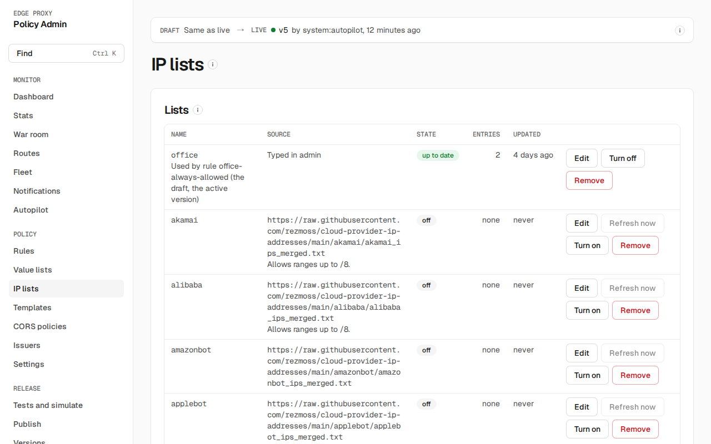

# IP lists



The **IP lists** page (Policy, IP lists) holds named lists of addresses: your own, typed on the page, such as an office or partner network, and downloaded lists of known abusers and the address ranges of cloud providers, crawlers, monitors and Content Delivery Networks (CDNs). A list says nothing about allowing or blocking: the rule that names it does, whether it blocks, logs, rate limits or [always allows](policy.md#always-allow). `client.ip_lists` holds the names of the lists that hold the request's client IP, so a rule says which ones it means:

```text
client.ip_lists in {"aws" "azure"}
```

Use an IP list for addresses and ranges. For user agents, paths, countries and other values, use a [value list](value-lists.md). An IP list is saved on its own and reaches every edge within about a minute, with no publish; a value list changes with the policy.

The migration adds [73 lists](#default-ip-lists), all off. A list that is off is not downloaded and matches no one. Turn on the ones your rules name, or add your own.

## Add a list

Under **Add a list**, give a **Name**: 1 to 63 lowercase letters, digits and hyphens, not starting with a hyphen. A name or a URL another list already has is refused. Then choose where the addresses come from:

- **I'll type them:** one address or CIDR range per line, at most 10,000. Every line must be valid or nothing is saved, and each problem names its line: not an address, host bits set (`198.51.100.7/24` suggests `198.51.100.0/24`), a zone, IPv4 written as IPv6, wider than /16 for IPv4 or /32 for IPv6 (or /8 and /16 with **Allows ranges up to /8**), or a repeat. A saved change reaches every edge within about a minute, with no publish.
- **Download from a URL:** an https address with no query, credentials or fragment, serving plain text or JSON, and for a cloud provider's list, **Allows ranges up to /8**.

**Add list** saves it, on and with no publish. A new downloaded list shows `not fetched yet` until admin's next check downloads it, within about a minute.

## Edit, refresh and remove

Each row shows the list's name, its source, its state (`off`, `not fetched yet`, `up to date`, `failing, using the last good list` or `failing, no list yet`), its entries and when it was last updated. The buttons need the `ip_lists.manage` permission.

**Edit** changes a list's name, its addresses or URL, and its width. A list keeps its kind, so to switch between typed and downloaded, remove it and add it again.

- Changing a downloaded list's URL, or narrowing its width, stops serving its old entries without waiting for a download, so edges drop them within about a minute. Admin fetches the list again on the leader's next check, every minute, after any download in progress. Widening keeps the old entries.
- A typed list's audit row records every address added and removed.
- **Used by**, under a list's name, names the rules in the draft, the active version or a canary candidate that name a list.
- A list cannot be renamed while any of those rules names it, because the rule would then match no one: change those rules first.
- **Turn on** and **Turn off** switch a list without removing it. Turning a list off or removing it reaches every edge within about a minute, with no publish.
- **Remove** names the rules that will stop matching. A rule that requires the list matches no one, and an exclusion that names it excludes no one.
- **Refresh now** (downloaded lists that are on) makes the list due, and admin downloads it on the leader's next check, every minute, after any download in progress. A list typed in admin has nothing to download.

## Check an address

**Is this IP listed?** takes an IPv4 or IPv6 address and answers with each list that holds it and the range that matched, such as `aws (203.0.113.0/24)`, or that it is on none of the lists that are on. Anyone who can read stats can use it.

It reads every list that is on and has entries (typed, or downloaded at least once), without the 500,000-entry cut, so a hit on a list left out at the cut is not in the edges' `client.ip_lists`.

## Downloads

Admin downloads each list that is on about once an hour through the same guard as [JWKS](../deploy/admin.md#variables), keeps the last good copy, and serves the lists to the edges by name. A failed download changes nothing on the edges, and the row shows `failing, using the last good list`, the last error and the number of lines skipped.

When a change reaches the edges:

- Turning a list off or removing it reaches every edge within about a minute, with no publish.
- A downloaded list added or turned on does so once admin has downloaded it, so check its first success on the page before relying on it.
- A typed list is served from the edges' next poll.

File formats:

- A list is plain text, one address or range per line, where text after a space, tab, comma, `;` or `#` is ignored.
- A list is JSON when the file starts with `{` or `[`: every string value in it that is an address or range counts, at any depth; object keys are not read and other values are ignored.
- A JSON file is read whole, so a file that holds several kinds of ranges, such as GitHub's meta file, becomes one list.
- JSON that is broken or cut off counts as failed.
- A download with no usable line, such as an HTML page, counts as failed and the last good list stays.
- Ranges wider than a /16 for IPv4 or a /32 for IPv6 are skipped and counted on the page, or wider than a /8 and a /16 on a list that allows wide ranges.
- A download is at most 32 MiB and has one minute to finish.

## Limits

- There are at most 128 lists, the defaults included.
- A typed list holds at most 10,000 entries.
- The edges take at most 500,000 entries in all: typed lists come first, then downloaded lists in the order they were added.
- A list that would pass that limit is left out whole, so a name never means part of a list; a later, smaller list that still fits is served.

An address on several lists carries every name, because one provider's ranges can overlap another's (GitHub Actions runners are in both `github` and `azure`). Until an edge's first poll after it starts, `client.ip_lists` is empty, as `client.verified_bot` is: a rule that names a list does not match, and an exclusion does not exempt.

## Use lists in rules

`client.ip_lists` is a list field that takes only `eq`, `ne`, `in` and `not_in`, with list names as values ([Expressions](../reference/expressions.md#fields)). A config that reads it needs schema 11 edges, and admin waits for them. Saving checks only the form of a name, since which lists exist is admin state, not config.

With any list on, every [access log](../operate/monitoring.md#logs) line for a listed address carries `client.ip_lists`. Group by it and `server.address` in your log store to see which provider sends what to which host before a rule blocks anything.

In a [policy test](policy.md#policy-tests), `ip_lists` in the request puts the test IP on the named lists, whether or not they are on, so the test does not depend on admin's lists. This rule blocks known abusers, as an access rule's AST:

```json
{
  "id": "block-abusers",
  "expression": {
    "combinator": "and",
    "rules": [
      {
        "field": "client.ip_lists",
        "operator": "in",
        "value": ["firehol-abusers", "spamhaus-drop"]
      }
    ]
  },
  "settings": {"block": "block"}
}
```

With this test:

```json
[
  {
    "name": "an address on an abuse list is blocked",
    "request": {
      "host": "www.example.com",
      "path": "/",
      "ip": "198.51.100.7",
      "ip_lists": ["firehol-abusers"]
    },
    "expect": {"rejected": "blocked", "config_rules": ["block-abusers"]}
  },
  {
    "name": "an unlisted address passes",
    "request": {"host": "www.example.com", "path": "/", "ip": "198.51.100.8"},
    "expect": {"rejected": ""}
  }
]
```

### Using it

Find the source first: turn on the lists you care about and read the log. Then limit by name. Roll out each rule as `log` first, because the ranges come from third-party repositories:

```json
{ "settings": { "block": "log" } }
```

Known abusers, anywhere:

```text
client.ip_lists in {"firehol-abusers" "spamhaus-drop"} and not client.verified_bot
```

A lower per-IP rate limit for hosted clients, as a `rate_limit` rule with key `ip`, keeping your own monitor's health checks out with a list you typed, `monitors`:

```text
client.ip_lists in {"aws" "azure" "googlecloud" "digitalocean" "hetzner" "vultr"} and not (client.ip_lists in {"monitors"} and http.request.uri.path eq "/health")
```

To rate limit a whole provider at once, catching a scraper that rotates addresses inside one cloud, scope the same kind of expression to that provider and use the key `constant`: one counter is shared by every matching address.

Match services, not whole providers, where a provider list mixes both: `aws` holds CloudFront and Route 53 health checks as well as EC2 compute, and `github` holds webhooks as well as the CI runners anyone can rent. Use `aws-ec2` and `github-actions` for compute, and `aws-route53-healthchecks` and `github-hooks` to match what you want. Exclude only addresses you typed, and only on the paths they need: a downloaded list's publisher decides who escapes the rule, and a shared service's addresses, typed or downloaded, carry its other customers' requests too. Other services of a provider are added by their address from the same repository.

The editor warns about each name in a rule that matches no one:

- a list that does not exist,
- a list that is off or has no entries yet (typed, or downloaded at least once), which matters most for exclusions, because every default is off,
- a list that is on but left out because the lists that are on pass 500,000 entries.

A rule that reads `client.denylisted` is always warned about, since it matches every list that is on, monitors and crawlers included.

Many hosted clients are your own monitors and webhooks, such as Datadog, StatusCake, UptimeRobot checks and GitHub webhooks, which is why a rule names lists instead of matching "any list". Lists catch known abusers and hosted clients, not a scan from rotating residential addresses, which public lists rarely carry: use them beside a [trap rule](bots.md#trap-paths), not instead of one.

## Banned IPs

The same page lists **Banned IPs**: addresses a [trap rule](bots.md#trap-paths) banned, as the edges reported them, that have not ended or been lifted. Each row shows the rule, the host and path that tripped it, and the edge. See [Banning a client](policy.md#banning-a-client) for what ends a ban early.

- Each edge reports a ban within about a minute of recording it.
- An edge restart ends a ban, and removing its rule suspends it, without admin knowing. It applies again if a rule with that ID that sets `ban` returns before the ban ends.
- **Lift ban** ends the ban on every edge within about a minute; the address is banned again if it trips the trap again.
- For an IPv6 address the ban covers its whole /64.
- A lift ends only the ban: it does not change any rule, and it is not the allowlist, which skips blocking, bans and rate-limit rules and needs a [publish](policy.md#trusted-clients).

## Permissions and a warning

- Changing lists and lifting bans needs the `ip_lists.manage` permission, which publishers and admins have, because editing a list that an always-allow or blocking rule names changes whom that rule matches without a publish. Every role that reads stats can read the page.
- An [always-allow](policy.md#always-allow) rule that requires a downloaded list (names it in a positive `eq` or `in` condition the rule needs) is warned about in the editor, because whoever publishes that address then decides who skips blocks, bans and rate limits: type the addresses in a list instead.

## Default IP lists

Each row is a list the migration adds, off.

- An abuse list is [FireHOL `firehol_abusers_30d`](https://iplists.firehol.org/) or [Spamhaus DROP](https://www.spamhaus.org/drop/).
- The others are files of [rezmoss/cloud-provider-ip-addresses](https://github.com/rezmoss/cloud-provider-ip-addresses), updated daily, with each provider's IPv4 and IPv6 ranges merged.
- The terms of each source differ, so check them before use.
- **Wide** lists keep ranges up to /8 for IPv4 and /16 for IPv6. A list without Wide skips ranges wider than /16 for IPv4 and /32 for IPv6, whatever its category, and Wide is set only where the provider's own data has wider ranges.
- The repository also has per-region lists, split and re-formatted copies of these ranges and more per-service lists; add one by its address from the page. A default you remove stays removed.
- `spamhaus-drop` does not allow wide ranges, so its /12 to /15 entries are skipped and counted on the page; to keep them, remove it and add it again by its address with **Allows ranges up to /8**.

| Name | Holds | Address | Wide |
| --- | --- | --- | --- |
| `firehol-abusers` | abuse list | `https://raw.githubusercontent.com/firehol/blocklist-ipsets/master/firehol_abusers_30d.netset` | no |
| `spamhaus-drop` | abuse list | `https://www.spamhaus.org/drop/drop.txt` | no |
| `akamai` | CDN | `https://raw.githubusercontent.com/rezmoss/cloud-provider-ip-addresses/main/akamai/akamai_ips_merged.txt` | yes |
| `alibaba` | cloud provider | `https://raw.githubusercontent.com/rezmoss/cloud-provider-ip-addresses/main/alibaba/alibaba_ips_merged.txt` | yes |
| `amazonbot` | crawler | `https://raw.githubusercontent.com/rezmoss/cloud-provider-ip-addresses/main/amazonbot/amazonbot_ips_merged.txt` | no |
| `apple-private-relay` | VPN or anonymiser | `https://raw.githubusercontent.com/rezmoss/cloud-provider-ip-addresses/main/apple_private_relay/apple_private_relay_ips_merged.txt` | no |
| `applebot` | crawler | `https://raw.githubusercontent.com/rezmoss/cloud-provider-ip-addresses/main/applebot/applebot_ips_merged.txt` | no |
| `atlassian` | service | `https://raw.githubusercontent.com/rezmoss/cloud-provider-ip-addresses/main/atlassian/atlassian_ips_merged.txt` | no |
| `aws` | cloud provider | `https://raw.githubusercontent.com/rezmoss/cloud-provider-ip-addresses/main/aws/aws_ips_merged.txt` | yes |
| `azure` | cloud provider | `https://raw.githubusercontent.com/rezmoss/cloud-provider-ip-addresses/main/azure/azure_ips_merged.txt` | yes |
| `backblaze` | cloud provider | `https://raw.githubusercontent.com/rezmoss/cloud-provider-ip-addresses/main/backblaze/backblaze_ips_merged.txt` | no |
| `baidu` | crawler | `https://raw.githubusercontent.com/rezmoss/cloud-provider-ip-addresses/main/baidu/baidu_ips_merged.txt` | yes |
| `bingbot` | crawler | `https://raw.githubusercontent.com/rezmoss/cloud-provider-ip-addresses/main/bingbot/bingbot_ips_merged.txt` | no |
| `bunny` | CDN | `https://raw.githubusercontent.com/rezmoss/cloud-provider-ip-addresses/main/bunny/bunny_ips_merged.txt` | no |
| `cachefly` | CDN | `https://raw.githubusercontent.com/rezmoss/cloud-provider-ip-addresses/main/cachefly/cachefly_ips_merged.txt` | no |
| `circleci` | service | `https://raw.githubusercontent.com/rezmoss/cloud-provider-ip-addresses/main/circleci/circleci_ips_merged.txt` | no |
| `claudebot` | crawler | `https://raw.githubusercontent.com/rezmoss/cloud-provider-ip-addresses/main/claudebot/claudebot_ips_merged.txt` | no |
| `cloudflare` | CDN | `https://raw.githubusercontent.com/rezmoss/cloud-provider-ip-addresses/main/cloudflare/cloudflare_ips_merged.txt` | yes |
| `commoncrawl` | crawler | `https://raw.githubusercontent.com/rezmoss/cloud-provider-ip-addresses/main/commoncrawl/commoncrawl_ips_merged.txt` | no |
| `contabo` | cloud provider | `https://raw.githubusercontent.com/rezmoss/cloud-provider-ip-addresses/main/contabo/contabo_ips_merged.txt` | yes |
| `datadog` | uptime monitor | `https://raw.githubusercontent.com/rezmoss/cloud-provider-ip-addresses/main/datadog/datadog_ips_merged.txt` | no |
| `digitalocean` | cloud provider | `https://raw.githubusercontent.com/rezmoss/cloud-provider-ip-addresses/main/digitalocean/digitalocean_ips_merged.txt` | no |
| `discord` | service | `https://raw.githubusercontent.com/rezmoss/cloud-provider-ip-addresses/main/discord/discord_ips_merged.txt` | no |
| `duckduckbot` | crawler | `https://raw.githubusercontent.com/rezmoss/cloud-provider-ip-addresses/main/duckduckbot/duckduckbot_ips_merged.txt` | no |
| `fastly` | CDN | `https://raw.githubusercontent.com/rezmoss/cloud-provider-ip-addresses/main/fastly/fastly_ips_merged.txt` | yes |
| `gabia` | cloud provider | `https://raw.githubusercontent.com/rezmoss/cloud-provider-ip-addresses/main/gabia/gabia_ips_merged.txt` | no |
| `gcore` | cloud provider | `https://raw.githubusercontent.com/rezmoss/cloud-provider-ip-addresses/main/gcore/gcore_ips_merged.txt` | no |
| `github` | service | `https://raw.githubusercontent.com/rezmoss/cloud-provider-ip-addresses/main/github/github_ips_merged.txt` | yes |
| `gocache` | CDN | `https://raw.githubusercontent.com/rezmoss/cloud-provider-ip-addresses/main/gocache/gocache_ips_merged.txt` | no |
| `googlebot` | crawler | `https://raw.githubusercontent.com/rezmoss/cloud-provider-ip-addresses/main/googlebot/googlebot_ips_merged.txt` | no |
| `googlecloud` | cloud provider | `https://raw.githubusercontent.com/rezmoss/cloud-provider-ip-addresses/main/googlecloud/googlecloud_ips_merged.txt` | yes |
| `googleservices` | service | `https://raw.githubusercontent.com/rezmoss/cloud-provider-ip-addresses/main/googleservices/googleservices_ips_merged.txt` | yes |
| `gptbot` | crawler | `https://raw.githubusercontent.com/rezmoss/cloud-provider-ip-addresses/main/gptbot/gptbot_ips_merged.txt` | no |
| `hetzner` | cloud provider | `https://raw.githubusercontent.com/rezmoss/cloud-provider-ip-addresses/main/hetzner/hetzner_ips_merged.txt` | yes |
| `hostway` | cloud provider | `https://raw.githubusercontent.com/rezmoss/cloud-provider-ip-addresses/main/hostway/hostway_ips_merged.txt` | no |
| `huawei` | cloud provider | `https://raw.githubusercontent.com/rezmoss/cloud-provider-ip-addresses/main/huawei/huawei_ips_merged.txt` | yes |
| `ibmcloud` | cloud provider | `https://raw.githubusercontent.com/rezmoss/cloud-provider-ip-addresses/main/ibmcloud/ibmcloud_ips_merged.txt` | yes |
| `imperva` | CDN | `https://raw.githubusercontent.com/rezmoss/cloud-provider-ip-addresses/main/imperva/imperva_ips_merged.txt` | yes |
| `internetarchive` | crawler | `https://raw.githubusercontent.com/rezmoss/cloud-provider-ip-addresses/main/internetarchive/internetarchive_ips_merged.txt` | no |
| `leaseweb` | cloud provider | `https://raw.githubusercontent.com/rezmoss/cloud-provider-ip-addresses/main/leaseweb/leaseweb_ips_merged.txt` | yes |
| `linode` | cloud provider | `https://raw.githubusercontent.com/rezmoss/cloud-provider-ip-addresses/main/linode/linode_ips_merged.txt` | yes |
| `meta` | service | `https://raw.githubusercontent.com/rezmoss/cloud-provider-ip-addresses/main/meta/meta_ips_merged.txt` | yes |
| `microsoft365` | service | `https://raw.githubusercontent.com/rezmoss/cloud-provider-ip-addresses/main/microsoft365/microsoft365_ips_merged.txt` | yes |
| `mullvad` | VPN or anonymiser | `https://raw.githubusercontent.com/rezmoss/cloud-provider-ip-addresses/main/mullvad/mullvad_ips_merged.txt` | no |
| `nhncloud` | cloud provider | `https://raw.githubusercontent.com/rezmoss/cloud-provider-ip-addresses/main/nhncloud/nhncloud_ips_merged.txt` | no |
| `oracle` | cloud provider | `https://raw.githubusercontent.com/rezmoss/cloud-provider-ip-addresses/main/oracle/oracle_ips_merged.txt` | yes |
| `ovhcloud` | cloud provider | `https://raw.githubusercontent.com/rezmoss/cloud-provider-ip-addresses/main/ovhcloud/ovhcloud_ips_merged.txt` | yes |
| `perplexitybot` | crawler | `https://raw.githubusercontent.com/rezmoss/cloud-provider-ip-addresses/main/perplexitybot/perplexitybot_ips_merged.txt` | no |
| `pingdom` | uptime monitor | `https://raw.githubusercontent.com/rezmoss/cloud-provider-ip-addresses/main/pingdom/pingdom_ips_merged.txt` | no |
| `play2go` | service | `https://raw.githubusercontent.com/rezmoss/cloud-provider-ip-addresses/main/play2go/play2go_ips_merged.txt` | no |
| `quiccloud` | CDN | `https://raw.githubusercontent.com/rezmoss/cloud-provider-ip-addresses/main/quiccloud/quiccloud_ips_merged.txt` | no |
| `rackspace` | cloud provider | `https://raw.githubusercontent.com/rezmoss/cloud-provider-ip-addresses/main/rackspace/rackspace_ips_merged.txt` | yes |
| `salesforce` | service | `https://raw.githubusercontent.com/rezmoss/cloud-provider-ip-addresses/main/salesforce/salesforce_ips_merged.txt` | yes |
| `scaleway` | cloud provider | `https://raw.githubusercontent.com/rezmoss/cloud-provider-ip-addresses/main/scaleway/scaleway_ips_merged.txt` | yes |
| `statuscake` | uptime monitor | `https://raw.githubusercontent.com/rezmoss/cloud-provider-ip-addresses/main/statuscake/statuscake_ips_merged.txt` | no |
| `stormwall` | CDN | `https://raw.githubusercontent.com/rezmoss/cloud-provider-ip-addresses/main/stormwall/stormwall_ips_merged.txt` | no |
| `sucuri` | CDN | `https://raw.githubusercontent.com/rezmoss/cloud-provider-ip-addresses/main/sucuri/sucuri_ips_merged.txt` | no |
| `teamcity` | service | `https://raw.githubusercontent.com/rezmoss/cloud-provider-ip-addresses/main/teamcity/teamcity_ips_merged.txt` | no |
| `telegram` | service | `https://raw.githubusercontent.com/rezmoss/cloud-provider-ip-addresses/main/telegram/telegram_ips_merged.txt` | no |
| `tencent` | cloud provider | `https://raw.githubusercontent.com/rezmoss/cloud-provider-ip-addresses/main/tencent/tencent_ips_merged.txt` | yes |
| `tor` | VPN or anonymiser | `https://raw.githubusercontent.com/rezmoss/cloud-provider-ip-addresses/main/tor/tor_ips_merged.txt` | no |
| `upcloud` | cloud provider | `https://raw.githubusercontent.com/rezmoss/cloud-provider-ip-addresses/main/upcloud/upcloud_ips_merged.txt` | yes |
| `uptimerobot` | uptime monitor | `https://raw.githubusercontent.com/rezmoss/cloud-provider-ip-addresses/main/uptimerobot/uptimerobot_ips_merged.txt` | no |
| `vultr` | cloud provider | `https://raw.githubusercontent.com/rezmoss/cloud-provider-ip-addresses/main/vultr/vultr_ips_merged.txt` | yes |
| `wasabi` | cloud provider | `https://raw.githubusercontent.com/rezmoss/cloud-provider-ip-addresses/main/wasabi/wasabi_ips_merged.txt` | no |
| `yandex` | service | `https://raw.githubusercontent.com/rezmoss/cloud-provider-ip-addresses/main/yandex/yandex_ips_merged.txt` | yes |
| `zoho` | service | `https://raw.githubusercontent.com/rezmoss/cloud-provider-ip-addresses/main/zoho/zoho_ips_merged.txt` | no |
| `zoom` | service | `https://raw.githubusercontent.com/rezmoss/cloud-provider-ip-addresses/main/zoom/zoom_ips_merged.txt` | no |
| `zscaler` | service | `https://raw.githubusercontent.com/rezmoss/cloud-provider-ip-addresses/main/zscaler/zscaler_ips_merged.txt` | yes |
| `aws-ec2` | service | `https://raw.githubusercontent.com/rezmoss/cloud-provider-ip-addresses/main/aws/services/ec2/aws_ec2_ips_merged.txt` | yes |
| `aws-route53-healthchecks` | service | `https://raw.githubusercontent.com/rezmoss/cloud-provider-ip-addresses/main/aws/services/route53_healthchecks/aws_route53_healthchecks_ips_merged.txt` | no |
| `github-hooks` | service | `https://raw.githubusercontent.com/rezmoss/cloud-provider-ip-addresses/main/github/services/hooks/github_hooks_ips_merged.txt` | yes |
| `github-actions` | service | `https://raw.githubusercontent.com/rezmoss/cloud-provider-ip-addresses/main/github/services/actions/github_actions_ips_merged.txt` | yes |
