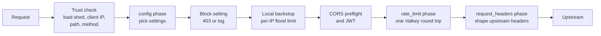
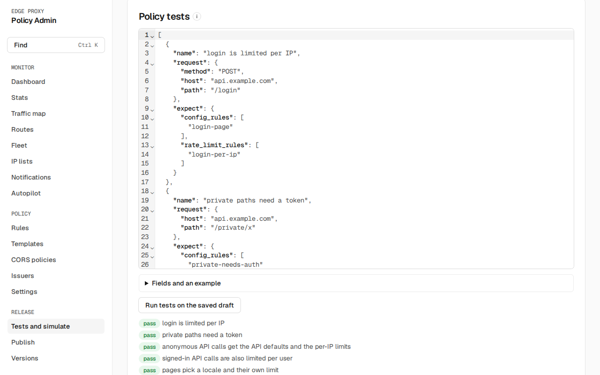

# Rules

A policy is a set of **rules grouped in phases**, plus shared **settings**. Each rule is an *expression* (which requests it matches) and an *action* (what happens to them). You edit a draft in the admin UI, and edges run the published version.

This page covers rules. What rules use has its own page: [Value lists](value-lists.md), [IP lists](ip-lists.md), [Response templates](templates.md), [CORS](cors.md), [Issuers and tokens](tokens.md) and [Settings](settings.md). Every field of a policy is in [Policy fields](../reference/policy-fields.md).

## How a request is handled



Any step can answer the request itself (400, 401, 403, 429 and so on) using a response template. Within a phase, rules are matched top to bottom; in `config` every matching rule applies, and `rate_limit` evaluates site-wide rules (expression `true`, so they match every request) and blocking rules first ([Rate limiting](rate-limiting.md)).

## Phases

The admin UI calls the `config` phase **Access rules**, and it stores them as `config_rules`. The phase key stays `config` in config JSON, the API, tests and expressions, so those docs use the keys.

| Phase | Use it to | Action |
|---|---|---|
| `config` | Choose per-route settings | `settings`: any of `auth` (`none`, `optional`, `required`, plus accepted issuers), `cors_policy`, `locale`, `upstream_timeout`, `body_limit`, `responses`, `ratelimit_headers`, `block`, `ban`, `allow`. Later matching rules override earlier ones, setting by setting; [`allow`](#always-allow) wins whatever the order |
| `rate_limit` | Limit request rates | Algorithm, limit, period and key. See [Rate limiting](rate-limiting.md) |
| `request_headers` | Shape what the upstream receives | Ops: `set`, `append`, `remove`, `copy`, `rename`, `forward` (all, allowlist or denylist) |

The `config` phase runs before JWT validation and before the locale is resolved, so it can't match on JWT claims or `edge.locale`. The later phases can.

Turn on `auth` and `locale` with a `config` rule that matches a few paths first, then widen its expression.

[Use cases](cases/index.md) has a ready rule, flow diagram and policy test for each common job.

### Requiring a token

An access rule's `auth` setting decides whether the matching requests need a JWT (JSON Web Token) in `Authorization: Bearer`:

```json
{ "settings": { "auth": { "mode": "required", "accepted": ["partners"] } } }
```

| `mode` | No token | Valid token | Invalid token |
|---|---|---|---|
| `none` | Passes | Passes, not checked | Passes, not checked |
| `optional` | Passes without claims | Passes with claims | 401 |
| `required` | 401 | Passes with claims | 401 |

`accepted` lists the IDs of the issuers whose tokens the rule accepts, or none for the issuers accepted by default. What is verified, what a 401 carries, what happens before an issuer's keys are fetched, and how claims reach rate limits and headers are in [Issuers and tokens](tokens.md).

### Blocking requests

An access rule with `"block": "block"` answers the requests it matches with 403 and the `forbidden` template, right after the config phase, so a blocked request costs no backstop slot, token check or Valkey call. `"block": "log"` lets them through and counts them as logged. As with every setting, the last matching rule that sets `block` wins, so a later matching rule with `"block": "log"` turns an earlier rule's block into log for the requests both match, and the later rule is the one counted.

Start with `log`, watch **Blocking access rules** on **Stats** and the lines whose `edge.logged_rules` contains the rule in the [access log](../operate/monitoring.md#logs), then switch to `block`. `kill_switch.block`, under **Settings**, turns every `block` into `log` in an incident. [Bot detection](bots.md) has recipes.

The starter's `forbidden` template has three bodies: problem+json, which API clients, `fetch` and curl get because they send `Accept: */*` or none; a small HTML page, which a browser opening a page gets; and plain text, for clients that ask for `text/plain`. A policy published before keeps its own `forbidden` body. To answer some paths with another template, map it in the blocking rule, or in a rule matching those paths:

```json
{"settings": {"block": "block", "responses": {"forbidden": "my-forbidden"}}}
```

### Banning a client

A rule with `"block": "block"` may also set `"ban": "24h"`, a whole number of seconds from `1s` to `24h`. `ban` without `"block": "block"` in the same rule is refused at save. When that rule is the winning block rule for a request, the edge answers 403 as usual and remembers the client IP for that long. Later requests from that IP get 403 with the `forbidden` template and the action `banned`, on every host and path, before the backstop, token check or any rate limit. An IPv6 client is remembered by its /64.

```json
{ "settings": { "block": "block", "ban": "24h" } }
```

- **A ban lives on one edge.** Each edge keeps its own table in memory, so a client trips the rule once per edge, and a restart or rollout clears every ban. Enforcement reads only that memory; admin keeps the reported bans in Postgres for the [IP lists](ip-lists.md) page.
- **A ban follows its rule.** It applies only while the client's version still has a rule with that ID that sets `ban`. Removing the rule or its `ban`, a revert, or a [canary](publishing.md#canary) the client is not in sets the ban aside at once; if a rule with that ID that sets `ban` returns before the ban ends, it applies again. **Lift ban** on the [IP lists](ip-lists.md) page ends it.
- **Trusted clients and the kill switch.** A client on the [allowlist](#trusted-clients) is never banned or refused as banned, and `kill_switch.block` stops refusals as banned.
- **A late request never replaces a newer ban.** A request that arrived before the edge recorded the current ban does not replace it, so a slow request cannot shorten or swap a ban.
- **`log` never bans.** Start with `"block": "log"` to see who the rule matches, then switch to `block` and add `ban`.
- **Later rules win.** If a later matching rule sets `block` without `ban`, it overrides the trap for that request and no ban is recorded. A banned client whose request also matches a blocking rule is refused as `blocked`, and the ban is renewed when that rule sets `ban`. A renewal is reported to admin at most once a minute.
- **About 100,000 bans per edge.** The table is 64 shards of 1,563 bans each, and a new ban is refused when its own shard is full even if others have room, so drops can start well below 100,000. When a shard is full a new ban is not stored and the client is not banned (fail open); each drop counts in `edge_ban_dropped_total`.

[Bot detection](bots.md#trap-paths) has an example.

### Trusted clients

**Settings → Trusted client allowlist** (`global.client_allowlist`) lists client IPs and ranges that are exempt from enforcement, so you don't repeat an exception in every rule. The edge matches the client IP it already derived from your trusted proxies, so a header can't add a client to the list, and the list doesn't change which proxies are trusted. It is part of the policy: it takes effect when you save and publish, and a canary applies the list of the version each request is pinned to. An empty list changes nothing.

A matched request skips:

- every access rule's `block` setting, whether `block` or `log`, so it is not counted as blocked or logged (the rule whose setting it lifted counts it under **Lifted by an allow** on **Stats**), and any ban
- every rate-limit rule, including [autopilot rules](publishing.md#autopilot-rules), count rules, penalties already running and `on_missing_key: reject`. No Valkey call is made and no counter or quota changes

On a route that requires a JWT, a trusted client is treated as `optional`: it needs no token, but a token it sends is still verified. A bad one is refused with 401, and a valid one gives claims and `X-Edge-Auth-*` headers as usual. Claims and those headers come only from a verified token. The kill switch still turns JWT checks off entirely. `ratelimit_headers` is reported false for a trusted client, since no rate-limit rule runs.

It still goes through the load shed, client IP and path checks, the local backstop, CORS, locale, header rules and the edge-managed headers, and the body limit and timeouts. A retained check can still refuse it, and the access log then shows both the match and the refusal.

!!! warning "JWT consequence"
    A route that requires a JWT lets trusted clients in without one. An upstream that needs to know the caller gets its identity only when the trusted client sends a valid token; without one the request is anonymous.

The list holds up to 100 entries, and it needs schema 6 edges: admin refuses the publish while a live edge reads an older schema, naming that edge.

- Each entry is an IPv4 or IPv6 address or a CIDR range written from its first address, such as `198.51.100.0/24`.
- A range with host bits set, such as `198.51.100.7/24`, is refused, and the message names both readings: `198.51.100.0/24` for the whole range or `198.51.100.7` for the one address.
- A range can be no wider than `/24` for IPv4 or `/48` for IPv6, because one entry is meant to be one site.
- Entries must not overlap, and an address is a range of one, so `203.0.113.7` can't sit beside `203.0.113.0/24`.
- An IPv4-mapped IPv6 entry such as `::ffff:203.0.113.7` is read as the IPv4 address and matches the IPv4 client.
- Zones such as `fe80::1%eth0` are refused.

To block Australia and Singapore but let two partner networks through, add an access rule with the expression below and the setting `"block": "block"`:

```text
ip.src.country in {"AU" "SG"}
```

with `198.51.100.0/24` and `2001:db8:f00::/48` on the allowlist. Clients in those networks reach the upstream even when the viewer country is `AU` or `SG`.

To test it, set `ip` in a [policy test](#policy-tests) and assert `rejected` is `""` and, on a route that requires a JWT, `settings.auth_mode` is `optional`: a trusted client's simulated request skips the block and needs no token. The [Tests and simulate page](../tour/release.md#tests-and-simulate) shows a **Trusted client** row with the entry it matched.

### Always allow

An access rule with `"allow": true` lets the requests it matches through every other access rule's `block` (or `log`), any ban, every rate-limit rule and a required JWT, whatever the rule order: it does for one rule what the [allowlist](#trusted-clients) does for the whole policy, with the same exemptions and the same checks kept. The admin UI calls it **Always allow**. Its other settings, and the CORS policy, locale, limits and templates other matching rules set, still apply.

An access rule `cfg-office` with the expression:

```text
client.ip_lists in {"office"}
```

and **Then**:

```json
{ "settings": { "allow": true } }
```

Because anyone can send a header, cookie, path or user agent, an allow rule must require something the client can't forge, as a condition of its own joined with `and` at the top level. It needs schema 12 edges. The conditions that count are:

- the client IP (`ip.src eq` or `in`), counted only when every range is no wider than /24 for IPv4 or /48 for IPv6, as the allowlist does; wider networks go in an IP list,
- an [IP list](ip-lists.md) (`client.ip_lists eq` or `in`),
- a verified crawler (`client.verified_bot`).

Which conditions count:

- A condition in parentheses or in an `and` subgroup counts, but one inside an `or` or a negated group does not.
- Other conditions may narrow it further, such as a host or path.
- A rule that matches on anything else alone, or that joins the client IP with another condition by `or`, is refused at save, and so is `allow` with `block` in the same rule.
- A typed IP list such as `office` changes within about a minute with no publish, while the rule itself is published.

Each allowed request's [access log](../operate/monitoring.md#logs) line names the rule in `edge.decided_by` and lists it in `edge.matched_rules` as `allowed`; a block it lifted is listed as `overridden`. **Simulate** (`POST /api/simulate`) reports it as `allow_rule`, and a [policy test](#policy-tests) checks its effect with `rejected` and `config_rules`.

## Expressions

Expressions are built in the UI with a rule builder, or typed as text:

```text
starts_with(http.request.uri.path, "/api/") and not ip.src in {"10.0.0.0/8"}
http.request.jwt.claims["tenant"] eq "acme" and http.request.method in {"POST" "PUT"}
```

`true` matches every request. A [value list](value-lists.md), written `$name`, holds a list of values many rules share, such as user agents or countries. Fields, operators and syntax are in [Expressions](../reference/expressions.md). Admin parses and validates expressions; the UI never does.

## Settings

Rules pick from parts of the policy defined once: [response templates](templates.md), [CORS policies](cors.md) and [issuers](tokens.md). Policy-wide values, such as the kill switch, the local backstop and default timeouts, are on [Settings](settings.md).

## Headers your upstream can trust

The edge always removes client-sent copies of the headers it manages, then sets them from trusted values. Header rules can't override them.

| Header | Value |
|---|---|
| `X-Forwarded-For` | The client IP only |
| `X-Forwarded-Proto` | From the trusted viewer `ssl` header; `http` when none is configured |
| `X-Forwarded-Host` | The request's `Host` |
| `X-Request-Id` | Reused only from a trusted proxy, otherwise generated |
| `X-Edge-Client-IP`, `X-Edge-Geo-Country`, `X-Edge-Geo-Continent`, `X-Edge-Geo-Asn` | From the trusted client-IP and viewer headers |
| `X-Edge-Auth-Issuer`, `X-Edge-Auth-Sub` | Only after a token verified |
| `X-Edge-TLS-JA4` | The client's JA4 fingerprint, when the deployment has a trusted JA4 source and the CDN sent a well-formed one |
| Locale header (named in settings, `X-Edge-...`) | When locale is on for the route |

`Authorization` is forwarded unless a forward allowlist leaves it out (validation warns), so upstreams can validate tokens too.

`traceparent` and `tracestate` are not in this list: the client chooses their trace ID and sampled flag, so they are for correlating logs and traces, never for authorization. No forward filter drops them. With [tracing](../operate/monitoring.md#traces) on, the upstream gets the edge's span, in the caller's trace when the request carried a valid one. With tracing off, it gets them as the client sent them.

## Header rules

A `request_headers` rule changes the headers the upstream receives when its expression matches. A rule has 1 to 100 ops. The edge applies them in this order:

1. The forward filter: the global one from **Settings**, or the `forward` op of the last matching rule that has one.
2. The other ops of every matching rule, in rule order.
3. The [headers the edge manages](#headers-your-upstream-can-trust), which no rule can override.

| Op | Fields | Effect |
|---|---|---|
| `set` | `name`, `value` | Replaces the header with `value` |
| `append` | `name`, `value` | Adds `value` as another value of the header |
| `remove` | `name` | Removes the header |
| `copy` | `from`, `to` | Sets `to` to the values of `from`, which stays |
| `rename` | `from`, `to` | Like `copy`, then removes `from` |
| `forward` | `mode`, `names` | Replaces the forward filter: `all`, `allowlist` (only `names` pass) or `denylist` (`names` are dropped) |

`copy` and `rename` read the headers as forwarded, after the filter and earlier ops. **When the source header is missing, the target is removed**, so a client can't supply its own value for the target by leaving the source out. Validation warns when a forward filter can drop the source.

A `value` is at most 4096 bytes with no control characters, and can hold placeholders:

| Placeholder | Value |
|---|---|
| `{{header:<name>}}` | The first value of a header as the client sent it |
| `{{client_ip}}` | The client IP |
| `{{jwt_claim:<name>}}` | The first value of a claim from the verified token; empty without one |
| `{{country}}` | The viewer country. Accepted only when the deployment has a trusted country source |
| `{{locale}}` | The [locale](#locale); empty when locale is off for the route. Accepted only when supported locales are set |
| `{{request_id}}` | The request's `X-Request-Id` |

Control characters are removed from header and claim values.

**Reserved headers** can be neither written nor read by any rule: not by an op, a `{{header:<name>}}` placeholder, a `header:<name>` rate-limit key or `http.request.headers["<name>"]` in an expression. Validation rejects them. They are:

- `Host`, `Content-Length`, `Transfer-Encoding`, `Connection`, `Keep-Alive`, `Proxy-Connection`, `Proxy-Authenticate`, `Proxy-Authorization`, `Te`, `Trailer`, `Upgrade`, `Forwarded` and `X-Request-Id`,
- every `X-Edge-*` and `X-Forwarded-*` header,
- the deployment's client-IP, viewer and ingress-secret source headers.

Why and how:

- A [CDN header](../deploy/edge.md#cdn-headers) that is also a source header, such as `CF-IPCountry` on the `cloudflare` preset, is reserved too: read it through its typed field, such as `ip.src.country`.
- A client can forge an `X-Edge-*` header before the edge replaces it, and a source header can carry the ingress secret.
- An allowlist never drops the named ones, from `Host` to `X-Request-Id`, so it can't break WebSockets or trailers.

??? note "Details: tracing headers"
    A rule can name `traceparent` or `tracestate`, with a warning: a forward filter, denylist included, still keeps them, and with tracing on the edge replaces whatever a rule writes. With tracing off, a `remove` op is the way to drop them.

## CORS

A `config` rule picks a CORS policy with `cors_policy`, and `""` turns CORS off for the matching requests. Policies, preflights and the headers the edge sends are in [CORS](cors.md).

## Locale

Locale is off unless **Settings** turns it on by default or a `config` rule sets `locale: true` (`false` turns it off). **Settings** holds:

- `supported`: BCP 47 tags in canonical form, such as `en`, `ko` or `zh-Hant`.
- `default`: one of `supported`.
- `output_header`: the header the upstream receives, `X-Edge-Locale` unless set. It must start with `X-Edge-`, so clients can't send it.

On a route with locale on, the edge picks one of `supported` from `Accept-Language`, using the [`golang.org/x/text/language`](https://pkg.go.dev/golang.org/x/text/language) matcher, which weighs q-values, regions and scripts:

| `Accept-Language` | With `supported: [en, ko, zh-Hant]`, `default: en` |
|---|---|
| `ko-KR,ko;q=0.9,en;q=0.5` | `ko` |
| `en;q=0.2, ko;q=0.8` | `ko` |
| `zh-TW` | `zh-Hant` |
| `fr-FR`, a language not supported | `en` |
| Missing, malformed or over 256 bytes | `en` |

The result is sent in the output header, replacing any client copy, and is the value of `edge.locale` in expressions, the `locale` rate-limit key part and `{{locale}}`. On a route with locale off, no header is set and the value is empty, so a `locale` key part is missing and `on_missing_key` applies.

## Policy tests



A test is a synthetic request and the outcome you expect. Tests run through the edge's own code, so they check what will really happen:

```json
{
  "name": "private pages need a token",
  "request": {"method": "GET", "host": "api.example.com", "path": "/private/x"},
  "expect": {
    "config_rules": ["private-needs-auth"],
    "settings": {"auth_mode": "required"}
  }
}
```

A test states the trusted values directly, because trust depends on the deployment. `request` takes:

| Field | Holds |
|---|---|
| `method` | `GET` unless set |
| `host` | The `Host` |
| `path` | The path as sent, query included |
| `ip` | The client IP, `192.0.2.1` unless set |
| `headers` | Header name to one value |
| `country`, `asn` | The viewer country code and AS number |
| `ssl` | `true` for HTTPS |
| `http_version` | The viewer HTTP version, such as `2.0` or `HTTP/2` |
| `ja4`, `ja3` | The viewer TLS fingerprints. As on the edge, a malformed one is absent, and with an `ssl` source a fingerprint applies only when `ssl` is `true` |
| `verified_bot` | `true` to put `ip` in the verified crawler ranges |
| `jwt_claims` | Claim name to one value, standing in for a verified token |
| `ip_lists` | Names of the [IP lists](ip-lists.md) that hold `ip`, standing in for the lists edges get from admin |

`expect` checks only what it lists:

| Field | Passes when |
|---|---|
| `rejected` | The check that stops the request matches: `method`, `path`, `blocked`, `auth` or `rate_limit_key`, or `""` for none |
| `preflight` | Whether the edge answers the request as a CORS preflight matches |
| `config_rules` | The IDs of the matching access rules equal this list, in order |
| `rate_limit_rules` | The IDs of people's rate-limit rules the request is checked against equal this list, in order. [Autopilot rules](publishing.md#autopilot-rules) are left out |
| `settings` | Each listed setting matches: `auth_mode`, `accepted`, `cors_policy`, `locale`, `responses`, `body_limit`, `upstream_timeout`, `ratelimit_headers`, `block`, `ban` (the winning rule's duration, absent when none, such as `1h0m0s`). `responses` checks only the kinds it lists, such as `{"rate_limited": "friendly-429"}`, and must list at least one. It must be an object whose keys are response kinds and whose values are template names (strings), or the save is refused; a template name that does not exist fails when the test runs |
| `upstream_headers` | Each listed header's first value matches; `""` means the header is absent |

**A failing test blocks publish.** The backstop and rate-limit counters depend on the running edges and aren't simulated.

A test stops where the edge would stop the request: an access rule set to block (`rejected: blocked`), a CORS preflight the edge answers (`preflight: true`), required auth with no `jwt_claims` (`rejected: auth`), or a missing rate-limit key under `on_missing_key: reject` (`rejected: rate_limit_key`). Later results are then empty. `upstream_headers` never include client copies of `X-Edge-*` or the deployment's source headers, which the edge strips.

## Validation

Every save runs the same validator the edges run before activating a version, so nothing invalid is saved or published. It also rejects values that could never match, such as a locale not in the supported list. Warnings, such as a rule that can never match, don't block.

Expressions have their own [limits](../reference/expressions.md#limits). The rest of the config:

| Limit | Value |
|---|---|
| Rules per phase | 200, counting the [autopilot rules](publishing.md#autopilot-rules) the draft is published with |
| Config size | 8 MiB |
| Policy tests | 500 |
| Names (rule IDs, templates, CORS policies, issuer IDs) | 1 to 64 of `a-z 0-9 - _`, starting with a letter or digit |

Regex matching (`matches`) is off unless the deployment sets `ALLOW_REGEX=true`.
