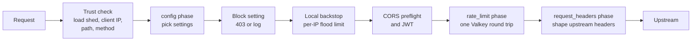

# Policy

A policy is a set of **rules grouped in phases**, plus shared **settings**. Each rule is an *expression* (which requests it matches) and an *action* (what happens to them). You edit a draft in the admin UI, and edges run the published version.

## How a request is handled



Any step can answer the request itself (400, 401, 403, 429 and so on) using a response template. Within a phase, rules are matched top to bottom; in `config` every matching rule applies, and `rate_limit` evaluates site-wide rules (expression `true`, so they match every request) and blocking rules first ([Rate limiting](rate-limiting.md)).

## Phases

| Phase | Use it to | Action |
|---|---|---|
| `config` | Choose per-route settings | `settings`: any of `auth` (`none`, `optional`, `required`, plus accepted issuers), `cors_policy`, `locale`, `upstream_timeout`, `body_limit`, `responses`, `ratelimit_headers`, `block`. Later matching rules override earlier ones, setting by setting |
| `rate_limit` | Limit request rates | Algorithm, limit, period and key. See [Rate limiting](rate-limiting.md) |
| `request_headers` | Shape what the upstream receives | Ops: `set`, `append`, `remove`, `copy`, `rename`, `forward` (all, allowlist or denylist) |

The `config` phase runs before JWT validation and before the locale is resolved, so it can't match on JWT claims or `edge.locale`. The later phases can.

Turn on `auth` and `locale` with a `config` rule that matches a few paths first, then widen its expression.

### Blocking requests

A config rule with `"block": "block"` answers the requests it matches with 403 and the `forbidden` template, right after the config phase, so a blocked request costs no backstop slot, token check or Valkey call. `"block": "log"` lets them through and counts them as would block. As with every setting, the last matching rule that sets `block` wins, so a later matching rule with `"block": "log"` turns an earlier rule's block into log for the requests both match, and the later rule is the one counted.

Start with `log`, watch **Blocking config rules** on **Stats** and the `would_block` decision in the [access log](../operate/monitoring.md#logs), then switch to `block`. `kill_switch.block`, under **Settings**, turns every `block` into `log` in an incident. [Bot detection](bots.md) has recipes.

The default `forbidden` template is an HTML page, since a block usually refuses a page request. For API paths, add a JSON template with status 403 and map it in the blocking rule, or in a rule matching the API paths:

```json
{ "settings": { "block": "block", "responses": { "forbidden": "forbidden-json" } } }
```

## Expressions

Expressions are built in the UI with a rule builder, or typed as text:

```text
starts_with(http.request.uri.path, "/api/") and not ip.src in {"10.0.0.0/8"}
http.request.jwt.claims["tenant"] eq "acme" and http.request.method in {"POST" "PUT"}
```

`true` matches every request. Fields, operators and syntax are in [Expressions](../reference/expressions.md). Admin parses and validates expressions; the UI never does.

## Settings

| Section | Holds |
|---|---|
| Templates | Response bodies for each kind of edge response: `bad_request`, `unauthorized`, `forbidden`, `payload_too_large`, `rate_limited`, `bad_gateway`, `unavailable`, `overloaded`, `gateway_timeout`. JSON, problem+json, HTML or text, with `{{retry_after}}`, `{{request_id}}` and `{{status}}` placeholders |
| CORS | Named policies: origins, methods, headers, credentials, max age |
| Issuers | JWT issuers: ID, issuer (the token's `iss`), audiences, JWKS URL (https), algorithm (RS, PS, ES or EdDSA; never HMAC). Config rules say which are accepted |
| Settings | Kill switch (rate limiting, JWT checks, blocking), local backstop, defaults (body limit and timeouts), locale (supported languages and output header), header forwarding, and the rollback guard |

## Headers your upstream can trust

The edge always removes client-sent copies of the headers it manages, then sets them from trusted values. Header rules can't override them.

| Header | Value |
|---|---|
| `X-Forwarded-For` | The client IP only |
| `X-Forwarded-Proto` | From the trusted viewer `ssl` header; `http` when none is configured |
| `X-Forwarded-Host` | The request's `Host` |
| `X-Request-Id` | Reused only from a trusted proxy, otherwise generated |
| `X-Edge-Client-IP`, `X-Edge-Geo-Country`, `X-Edge-Geo-Continent`, `X-Edge-Geo-Asn` | From the trusted client-IP and viewer headers |
| `X-Edge-Auth-Issuer`, `X-Edge-Auth-Sub` | Only after a token verified |
| `X-Edge-TLS-JA4` | The client's JA4 fingerprint, when the deployment has a trusted JA4 source and the CDN sent a well-formed one |
| Locale header (named in settings, `X-Edge-...`) | When locale is on for the route |

`Authorization` is forwarded unless a forward allowlist leaves it out (validation warns), so upstreams can validate tokens too.

`traceparent` and `tracestate` are not in this list: the client chooses their trace ID and sampled flag, so they are for correlating logs and traces, never for authorization. No forward filter drops them. With [tracing](../operate/monitoring.md#traces) on, the upstream gets the edge's span, in the caller's trace when the request carried a valid one. With tracing off, it gets them as the client sent them.

## Header rules

A `request_headers` rule changes the headers the upstream receives when its expression matches. A rule has 1 to 100 ops. The edge applies them in this order:

1. The forward filter: the global one from **Settings**, or the `forward` op of the last matching rule that has one.
2. The other ops of every matching rule, in rule order.
3. The [headers the edge manages](#headers-your-upstream-can-trust), which no rule can override.

| Op | Fields | Effect |
|---|---|---|
| `set` | `name`, `value` | Replaces the header with `value` |
| `append` | `name`, `value` | Adds `value` as another value of the header |
| `remove` | `name` | Removes the header |
| `copy` | `from`, `to` | Sets `to` to the values of `from`, which stays |
| `rename` | `from`, `to` | Like `copy`, then removes `from` |
| `forward` | `mode`, `names` | Replaces the forward filter: `all`, `allowlist` (only `names` pass) or `denylist` (`names` are dropped) |

`copy` and `rename` read the headers as forwarded, after the filter and earlier ops. **When the source header is missing, the target is removed**, so a client can't supply its own value for the target by leaving the source out. Validation warns when a forward filter can drop the source.

A `value` is at most 4096 bytes with no control characters, and can hold placeholders:

| Placeholder | Value |
|---|---|
| `{{header:<name>}}` | The first value of a header as the client sent it |
| `{{client_ip}}` | The client IP |
| `{{jwt_claim:<name>}}` | The first value of a claim from the verified token; empty without one |
| `{{country}}` | The viewer country. Accepted only when the deployment has a trusted country source |
| `{{locale}}` | The [locale](#locale); empty when locale is off for the route. Accepted only when supported locales are set |
| `{{request_id}}` | The request's `X-Request-Id` |

Control characters are removed from header and claim values.

**Reserved headers** can be neither written nor read by any rule: not by an op, a `{{header:<name>}}` placeholder, a `header:<name>` rate-limit key or `http.request.headers["<name>"]` in an expression. Validation rejects them. They are `Host`, `Content-Length`, `Transfer-Encoding`, `Connection`, `Keep-Alive`, `Proxy-Connection`, `Proxy-Authenticate`, `Proxy-Authorization`, `Te`, `Trailer`, `Upgrade`, `Forwarded`, `X-Request-Id`, every `X-Edge-*` and `X-Forwarded-*` header, and the deployment's client-IP, viewer and ingress-secret source headers. A client can forge an `X-Edge-*` header before the edge replaces it, and a source header can carry the ingress secret. An allowlist never drops the named ones, from `Host` to `X-Request-Id`, so it can't break WebSockets or trailers. A rule can name `traceparent` or `tracestate`, with a warning: a forward filter, denylist included, still keeps them, and with tracing on the edge replaces whatever a rule writes. With tracing off, a `remove` op is the way to drop them.

## CORS

A CORS policy is defined by name under **CORS**, and a `config` rule picks one with `cors_policy`; `""` turns CORS off for the matching requests.

| Field | Holds |
|---|---|
| `origins` | `*`, or one or more origins such as `https://app.example.com`: lowercase, no path |
| `methods` | Methods allowed besides `GET`, `HEAD` and `POST`, which are always allowed. Uppercase |
| `request_headers` | Headers the page may send, or `*` |
| `exposed_headers` | Response headers the page may read, or `*` |
| `credentials` | Sends `Access-Control-Allow-Credentials: true`. Can't be combined with `*` |
| `max_age` | How long the browser may reuse a preflight answer, 1s to 24h |

**Allowed origin.** `*` sends `*`. A single listed origin is always sent as is. A list of origins echoes the request's `Origin` when it is listed, and sends no `Access-Control-Allow-Origin` otherwise. Only the list form depends on the request, so only it sends `Vary: Origin`.

**Preflight.** On a route with a policy, the edge answers a preflight (`OPTIONS` with `Origin` and `Access-Control-Request-Method`) itself, after the local backstop and before JWT and rate limits. The answer is always `204` with `Cache-Control: no-store`. When the origin, the requested method and every requested header are allowed, it echoes the requested method and headers in `Access-Control-Allow-Methods` and `Access-Control-Allow-Headers`, and adds `Access-Control-Max-Age` when set. Otherwise it has no `Access-Control-*` headers, which the browser treats as a failed check. On a route without a policy, a preflight goes to the upstream like any request.

**Other responses.** On a route with a policy, the edge removes the upstream's `Access-Control-*` headers and sets its own: the allowed origin, credentials and exposed headers. Edge responses such as a 401 or 429 get them too; edge responses sent before the `config` phase, such as a 400 for a bad path, have none. Every edge response sends `Cache-Control: no-store`.

## Locale

Locale is off unless **Settings** turns it on by default or a `config` rule sets `locale: true` (`false` turns it off). **Settings** holds:

- `supported`: BCP 47 tags in canonical form, such as `en`, `ko` or `zh-Hant`.
- `default`: one of `supported`.
- `output_header`: the header the upstream receives, `X-Edge-Locale` unless set. It must start with `X-Edge-`, so clients can't send it.

On a route with locale on, the edge picks one of `supported` from `Accept-Language`, using the [`golang.org/x/text/language`](https://pkg.go.dev/golang.org/x/text/language) matcher, which weighs q-values, regions and scripts:

| `Accept-Language` | With `supported: [en, ko, zh-Hant]`, `default: en` |
|---|---|
| `ko-KR,ko;q=0.9,en;q=0.5` | `ko` |
| `en;q=0.2, ko;q=0.8` | `ko` |
| `zh-TW` | `zh-Hant` |
| `fr-FR`, a language not supported | `en` |
| Missing, malformed or over 256 bytes | `en` |

The result is sent in the output header, replacing any client copy, and is the value of `edge.locale` in expressions, the `locale` rate-limit key part and `{{locale}}`. On a route with locale off, no header is set and the value is empty, so a `locale` key part is missing and `on_missing_key` applies.

## Config tests

A test is a synthetic request and the outcome you expect. Tests run through the edge's own code, so they check what will really happen:

```json
{
  "name": "private pages need a token",
  "request": { "method": "GET", "host": "api.example.com", "path": "/private/x" },
  "expect": { "config_rules": ["private-needs-auth"], "settings": { "auth_mode": "required" } }
}
```

A test states the trusted values directly, because trust depends on the deployment. `request` takes:

| Field | Holds |
|---|---|
| `method` | `GET` unless set |
| `host` | The `Host` |
| `path` | The path as sent, query included |
| `ip` | The client IP, `192.0.2.1` unless set |
| `headers` | Header name to one value |
| `country`, `asn` | The viewer country code and AS number |
| `ssl` | `true` for HTTPS |
| `http_version` | The viewer HTTP version, such as `2.0` or `HTTP/2` |
| `ja4`, `ja3` | The viewer TLS fingerprints. As on the edge, a malformed one is absent, and with an `ssl` source a fingerprint applies only when `ssl` is `true` |
| `verified_bot` | `true` to put `ip` in the verified crawler ranges |
| `jwt_claims` | Claim name to one value, standing in for a verified token |

`expect` checks only what it lists:

| Field | Passes when |
|---|---|
| `rejected` | The check that stops the request matches: `method`, `path`, `blocked`, `auth` or `rate_limit_key`, or `""` for none |
| `preflight` | Whether the edge answers the request as a CORS preflight matches |
| `config_rules` | The IDs of the matching config rules equal this list, in order |
| `rate_limit_rules` | The IDs of people's rate-limit rules the request is checked against equal this list, in order. [Autopilot rules](publishing.md#autopilot-rules) are left out |
| `settings` | Each listed setting matches: `auth_mode`, `accepted`, `cors_policy`, `locale`, `responses`, `body_limit`, `upstream_timeout`, `ratelimit_headers`, `block` |
| `upstream_headers` | Each listed header's first value matches; `""` means the header is absent |

**A failing test blocks publish.** The backstop and rate-limit counters depend on the running edges and aren't simulated.

A test stops where the edge would stop the request: a config rule set to block (`rejected: blocked`), a CORS preflight the edge answers (`preflight: true`), required auth with no `jwt_claims` (`rejected: auth`), or a missing rate-limit key under `on_missing_key: reject` (`rejected: rate_limit_key`). Later results are then empty. `upstream_headers` never include client copies of `X-Edge-*` or the deployment's source headers, which the edge strips.

## Validation

Every save runs the same validator the edges run before activating a version, so nothing invalid is saved or published. It also rejects values that could never match, such as a locale not in the supported list. Warnings, such as a rule that can never match, don't block.

Expressions have their own [limits](../reference/expressions.md#limits). The rest of the config:

| Limit | Value |
|---|---|
| Rules per phase | 200, counting the [autopilot rules](publishing.md#autopilot-rules) the draft is published with |
| Config size | 8 MiB |
| Config tests | 500 |
| Names (rule IDs, templates, CORS policies, issuer IDs) | 1 to 64 of `a-z 0-9 - _`, starting with a letter or digit |

Regex matching (`matches`) is off unless the deployment sets `ALLOW_REGEX=true`.
