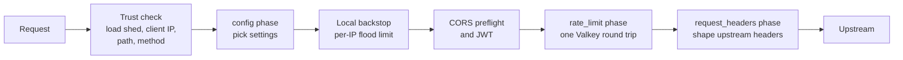

# Policy

A policy is a set of **rules grouped in phases**, plus shared **settings**. Each rule is an *expression* (which requests it matches) and an *action* (what happens to them). You edit a draft in the admin UI, and edges run the published version.

## How a request is handled



Any step can answer the request itself (400, 401, 429 and so on) using a response template. Within a phase, rules are matched top to bottom; in `config` every matching rule applies, and `rate_limit` evaluates site-wide and blocking rules first ([Rate limiting](rate-limiting.md)).

## Phases

| Phase | Use it to | Action |
|---|---|---|
| `config` | Choose per-route settings | `settings`: any of `auth` (`none`, `optional`, `required`, plus accepted issuers), `cors_policy`, `locale`, `upstream`, `upstream_timeout`, `body_limit`, `responses`, `ratelimit_headers`. Later matching rules override earlier ones, setting by setting |
| `rate_limit` | Limit request rates | Algorithm, limit, period and key. See [Rate limiting](rate-limiting.md) |
| `request_headers` | Shape what the upstream receives | Ops: `set`, `append`, `remove`, `copy`, `rename`, `forward` (all, allowlist or denylist) |

The `config` phase runs before JWT validation and before the locale is resolved, so it can't match on JWT claims or `edge.locale`. The later phases can.

## Expressions

Expressions are built in the UI with a rule builder, or typed as text:

```text
starts_with(http.request.uri.path, "/api/") and not ip.src in {"10.0.0.0/8"}
http.request.jwt.claims["tenant"] eq "acme" and http.request.method in {"POST" "PUT"}
```

`true` matches every request. Fields, operators and syntax are in [Expressions](../reference/expressions.md). Admin parses and validates expressions; the UI never does.

## Settings

| Section | Holds |
|---|---|
| Templates | Response bodies for each kind of edge response: `bad_request`, `unauthorized`, `misdirected`, `payload_too_large`, `rate_limited`, `bad_gateway`, `unavailable`, `overloaded`, `gateway_timeout`. JSON, problem+json, HTML or text, with `{{retry_after}}`, `{{request_id}}` and `{{status}}` placeholders |
| CORS | Named policies: origins, methods, headers, credentials, max age |
| Issuers | JWT issuers: ID, issuer (the token's `iss`), audiences, JWKS URL (https), algorithm (RS, PS, ES or EdDSA; never HMAC). Config rules say which are accepted |
| Settings | Local backstop, defaults (body limit and timeouts), locale (supported languages and output header), header forwarding, and the rollback guard |

## Headers your upstream can trust

The edge always removes client-sent copies of the headers it manages, then sets them from trusted values. Header rules can't override them.

| Header | Value |
|---|---|
| `X-Forwarded-For` | The client IP only |
| `X-Forwarded-Proto` | From the trusted viewer `ssl` header; `http` when none is configured |
| `X-Forwarded-Host` | The request's `Host` |
| `X-Request-Id` | Reused only from a trusted proxy, otherwise generated |
| `X-Edge-Client-IP`, `X-Edge-Geo-Country`, `X-Edge-Geo-Continent`, `X-Edge-Geo-Asn` | From the trusted client-IP and viewer headers |
| `X-Edge-Auth-Issuer`, `X-Edge-Auth-Sub` | Only after a token verified |
| Locale header (named in settings, `X-Edge-...`) | When locale is on for the route |

`Authorization` is forwarded unless a forward allowlist leaves it out (validation warns), so upstreams can validate tokens too.

## Config tests

A test is a synthetic request and the outcome you expect. Tests run through the edge's own code, so they check what will really happen:

```json
{
  "name": "private pages need a token",
  "request": { "method": "GET", "host": "api.example.com", "path": "/private/x" },
  "expect": { "config_rules": ["private-needs-auth"], "settings": { "auth_mode": "required" } }
}
```

`expect` checks only what it lists: `rejected`, `preflight`, `config_rules`, `rate_limit_rules`, `settings` and `upstream_headers`. **A failing test blocks publish.**

A test stops where the edge would stop the request: a CORS preflight the edge answers (`preflight: true`), required auth with no `jwt_claims` (`rejected: auth`), or a missing rate-limit key under `on_missing_key: reject` (`rejected: rate_limit_key`). Later results are then empty. `upstream_headers` never include client copies of `X-Edge-*` or the deployment's source headers, which the edge strips.

## Validation

Every save runs the same validator the edges run before activating a version, so nothing invalid is saved or published. It also rejects values that could never match, such as a locale not in the supported list. Warnings, such as a rule that can never match, don't block.

| Limit | Value |
|---|---|
| Rules per phase | 200 |
| Conditions per expression / nesting depth | 32 / 8 |
| Expression text | 4000 bytes |
| Config size | 8 MiB |
| Config tests | 500 |
| Names (rule IDs, templates, CORS policies, issuer IDs) | 1 to 64 of `a-z 0-9 - _`, starting with a letter or digit |

Regex matching (`matches`) is off unless the deployment sets `ALLOW_REGEX=true`.
