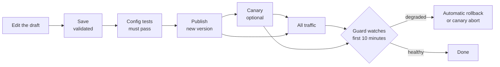

# Publish and roll back

Changes go live in small, checked steps. Nothing invalid is ever saved, and every publish can be undone.

## Draft

There is one shared draft. Saving it validates the whole config; an invalid draft is refused with the exact field and reason. Saves are guarded by revision, so two editors can't overwrite each other: if the active version moved on, **Rebase** the draft onto it.

## Publish

**Publish** turns the saved draft into a new, numbered, immutable version with a message. Publish is refused when:

- the message is empty;
- a config test fails;
- a canary is in progress (promote or abort it first);
- the active version changed since the draft started (**Rebase** first);
- a live edge can't read the config's schema version (upgrade edges first);
- a live edge runs with different deployment settings than admin (`CLIENT_IP_SOURCE`, `VIEWER_HEADERS`, `INGRESS_SECRET_HEADER` or `ALLOW_REGEX`), because that edge would reject the config and keep its old one. Admin answers 409 naming the edge; make the [settings](../deploy/admin.md#variables) match. Reverts and guard rollbacks skip this check;
- a rule requires auth from an issuer whose keys (JWKS) admin has never fetched. A publisher can override this one with a reason, for example "IdP is down, publishing anyway".

Edges poll admin every 5 seconds and switch to the new version atomically. **Fleet** shows which edges run which version.

## Canary

Enter a **canary percent** when publishing to send only part of the traffic to the new version. Clients are chosen by a hash of their IP, so each client consistently sees one version (IPv6 per /64).

| Action | Effect |
|---|---|
| **Step up** | Raise the percentage, for example 1 → 10 → 50. Each step must run at least 5 minutes and see 1000 requests |
| **Promote to all traffic** | Send all traffic to the new version |
| **Abort** | Send all traffic back, with a reason |

If admin goes away during a canary, edges drop the canary on their own within 10 minutes.

## Rollback guard

For the first 10 minutes after a publish, or during a canary, the guard compares the new version with the old one. A canary is compared with the active version over the same minutes; a full publish is compared with the 10 minutes before it. Both sides need 1000 requests before it decides anything.

| Signal | Default | Trips when |
|---|---|---|
| `fleet_adoption` | rollback | Under 90% of edges run the version after 2 minutes |
| `edge_5xx_ratio` | rollback | Over 2× the baseline and over 1% |
| `upstream_5xx_ratio` | rollback | Over 2× the baseline and over 2% |
| `changed_rule_limited_ratio` | rollback | A changed rule limits over 5% of what it evaluates, or over 3× the rate it would have limited while it was log-only |
| `unchanged_rule_limited_ratio` | alert | Over 3× the baseline |
| `p99_latency` | alert | Over 1.5× the baseline and over 50 ms |
| `auth_failure_ratio` | alert | Over 2× the baseline and over 2% |

Rollback signals are ones only a config change causes. Signals an attack can also cause only alert. Clients hammering one rule (each holding at least 5% of its limited requests) are left out of the counts, so a single attacker can't trip it.

A rollback publishes the previous version again as a new version. By default it happens at most once per publish (`max_auto_rollbacks_per_publish`), and never for a revert or a rollback, which only alert. Every decision is stored on the version; alerts, rollbacks and canary aborts are also written to the audit log, and admin logs `guard tripped`.

**Settings → Rollback guard** changes the defaults. Every signal must be present with its thresholds; set a signal's mode to `off` to disable it. A publisher can change the guard for one publish, with a required reason, for example "this rule limits on purpose".

!!! note "Publishing a rule that targets an ongoing attack"
    Attackers spread over many IPs can push `changed_rule_limited_ratio` over its limit and get the rule rolled back. Publish such a rule with a guard override and a reason.

## Revert

**Versions → Revert** publishes an old version's config as a new version (optionally through a canary). History is never rewritten. **Copy to draft** starts a new draft from any version instead.

## Audit

Every change is in **Audit**: who, what, when and a diff. The log is append-only, HMAC-chained with a key kept outside Postgres, and checked every 5 minutes and in full daily. The page shows the result of the last recorded verification and has a **Verify chain** button.
