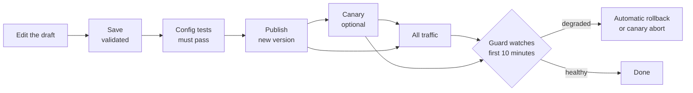

# Publish and roll back

Changes go live in small, checked steps. Nothing invalid is ever saved, and every publish can be undone.

## Draft

There is one shared draft. Saving it validates the whole config; an invalid draft is refused with the exact field and reason. Saves are guarded by revision, so two editors can't overwrite each other: if the active version moved on, **Rebase** the draft onto it.

## Publish

**Publish** turns the saved draft into a new, numbered, immutable version with a message. Publish is refused when:

- the message is empty;
- a config test fails;
- a canary is in progress (promote or abort it first);
- the active version changed since the draft started (**Rebase** first);
- a live edge can't read the config's schema version (upgrade edges first);
- a live edge runs with different deployment settings than admin (`CLIENT_IP_SOURCE`, `VIEWER_HEADERS`, `INGRESS_SECRET_HEADER` or `ALLOW_REGEX`), because that edge would reject the config and keep its old one. Admin answers 409 naming the edge; make the [settings](../deploy/admin.md#variables) match. Reverts and guard rollbacks skip this check;
- a rule requires auth from an issuer whose keys (JWKS) admin has never fetched. A publisher can override this one with a reason, for example "IdP is down, publishing anyway".

Edges poll admin every 5 seconds and switch to the new version atomically. **Fleet** shows which edges run which version.

## Canary

Enter a **canary percent** when publishing to send only part of the traffic to the new version. Clients are chosen by a hash of their IP, so each client consistently sees one version (IPv6 per /64).

| Action | Effect |
|---|---|
| **Step up** | Raise the percentage, for example 1 → 10 → 50. Each step must run at least 5 minutes and see 1000 requests |
| **Promote to all traffic** | Send all traffic to the new version |
| **Abort** | Send all traffic back, with a reason |

If admin goes away during a canary, edges drop the canary on their own within 10 minutes.

## Rollback guard

For the first 10 minutes after a publish, or during a canary, the guard compares the new version with the old one. A canary is compared with the active version over the same minutes; a full publish is compared with the 10 minutes before it. Both sides need 1000 requests before it decides anything.

| Signal | Default | Trips when |
|---|---|---|
| `fleet_adoption` | rollback | Under 90% of edges run the version after 2 minutes |
| `edge_5xx_ratio` | rollback | Over 2× the baseline and over 1% |
| `upstream_5xx_ratio` | rollback | Over 2× the baseline and over 2% |
| `changed_rule_limited_ratio` | rollback | A changed rate limit limits over 5% of what it evaluates, or over 3× the rate it would have limited while it was log-only. A changed config rule blocks over 3× the larger of the share it logged and the share it blocked in the active version, or over 5% if it did neither |
| `unchanged_rule_limited_ratio` | alert | Over 3× the baseline |
| `p99_latency` | alert | Over 1.5× the baseline and over 50 ms |
| `auth_failure_ratio` | alert | Over 2× the baseline and over 2% |

The two rule signals cover rate limits and config rules with a [`block` setting](policy.md#blocking-requests); a config rule evaluates every request, so its share is of all requests the version served. A config rule whose `block` was `log` in the active version is judged only against its logged share × `max_vs_shadow`, so a rule that blocks what it logged doesn't roll back however large that share is. An edited block rule is judged against the larger of its logged share and its blocked share in the active version, times `max_vs_shadow`. With neither a log run nor blocks in the active version, `max_ratio` (5%) applies, which is why the [bot recipes](bots.md) log first. Rollback signals are ones only a config change causes. Signals an attack can also cause only alert. For rate limits, clients hammering one rule (each holding at least 5% of its limited requests) are left out of the counts, so a single attacker can't trip it. Config rules count every block, since stats keep no per-client config counts, so log a new block rule first.

A rollback publishes the previous version again as a new version. By default it happens at most once per publish (`max_auto_rollbacks_per_publish`), and never for a revert or a rollback, which only alert. Every decision is stored on the version; alerts, rollbacks and canary aborts are also written to the audit log, and admin logs `guard tripped`.

**Settings → Rollback guard** changes the defaults. Every signal must be present with its thresholds; set a signal's mode to `off` to disable it. A publisher can change the guard for one publish, with a required reason, for example "this rule limits on purpose".

!!! note "Publishing a rule that targets an ongoing attack"
    Attackers spread over many IPs can push `changed_rule_limited_ratio` over its limit and get the rule rolled back. Publish such a rule with a guard override and a reason.

## Revert

**Versions → Revert** publishes an old version's own rules as a new version (optionally through a canary), with the current autopilot rules, or without them when together they are refused ([Autopilot rules](#autopilot-rules)). History is never rewritten. **Copy to draft** starts a new draft from any version instead, without its autopilot rules.

## Autopilot rules

Autopilot rules are rate-limit rules whose ids start `ap-`. They run after your rules, each until its `expires_at` ([Rules that expire](rate-limiting.md#rules-that-expire)). Admin refuses (`422`) an autopilot rule whose id lacks the `ap-` prefix, that has no `expires_at`, or whose `expires_at` is more than 24 hours ahead, and leaves out one whose `expires_at` has already passed. A rule's content is fixed per id: republishing a live `ap-` id with anything changed but its `action` and `expires_at` is refused (`422`), so a changed rule needs a new id. Republishing it with `action: block` makes it enforce, and with a later `expires_at` renews it. An `ap-` id adopted into your draft and no longer live is refused too (`422`): a new autopilot rule needs a new id. They are published as their own versions, with source `autopilot` in **Versions** and `config.overlay_publish` in **Audit**, through every publish check, except that one which only takes autopilot rules out skips the deployment and schema checks, like a revert. They wait for a canary like any publish.

- **The draft holds your rules only.** **Rules** lists the autopilot rules apart, read-only, with their expiry. A save counts them, so a draft that would take the version past 200 rate-limit rules is refused at save.
- **They don't make you rebase.** An autopilot publish keeps your draft as it is and moves it onto the new version. It publishes over issuers whose keys admin never fetched, as the live version did, and records its own fixed reason in `override_reason`.
- **Config tests ignore them in `rate_limit_rules`.** A test's list is compared with your rules only.
- **Every publish keeps them while they run:** yours, an import and a revert. Every publish, revert, rollback and import drops the ones already expired. An import ignores the `ap-` rate-limit rules in its file and is refused when a config rule or request header rule there has an `ap-` id; an export includes them, so an edge started from the bootstrap file keeps them until they expire.
- **Reverts and rollbacks keep today's autopilot rules.** An `ap-` rule of the restored version comes back too while it has not expired, if you adopted it after that version: restoring removes your copy. The guard judges the version a person published, not an autopilot publish, and leaves autopilot rules out of its rule signals: each autopilot rule has [its own guard](autopilot.md#the-rule-guard). If a revert or a guard rollback is refused with the autopilot rules (validation, the schema the edges can load, or the config tests) but the restored rules alone pass validation and the config tests, admin publishes them without any autopilot rules (an edge too old to read them keeps its policy), so autopilot rules never block either, and the version's audit event has `overlay_dropped: true`.
- **Adopt** copies an autopilot rule into the draft as your own rule, without the `ap-` prefix and without an expiry. It needs `config.write` and a draft with no unsaved changes, and is refused when the draft already has a rule with that id in any phase, since rule ids are unique across phases. The rule shows as adopted until your next publish, which removes the autopilot copy.
- **`ap-` is reserved.** A rule of yours with such an id, in any phase, is refused at save. Admin won't upgrade while the active version, a canary or the draft has one: `admin migrate` fails naming the rule. Rename it with the previous release, then run `admin migrate` again before rolling admin. An older version with such a rule, in any phase, loses it when restored.

## Audit

Every change is in **Audit**: who, what, when and a diff. The log is append-only, HMAC-chained with a key kept outside Postgres, and checked every 5 minutes and in full daily. The page shows the result of the last recorded verification and has a **Verify chain** button.
