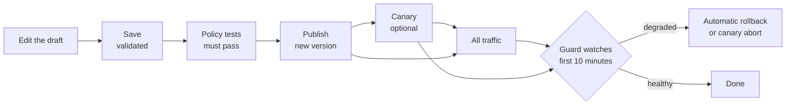
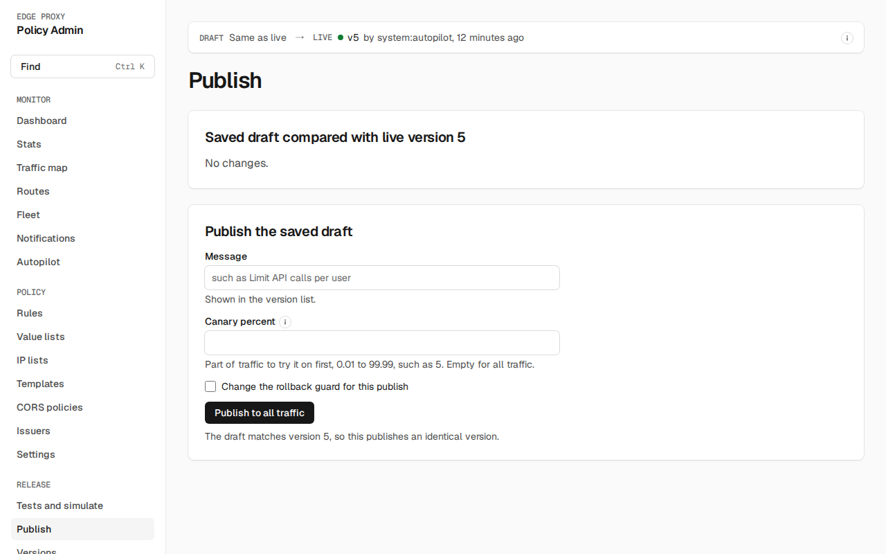
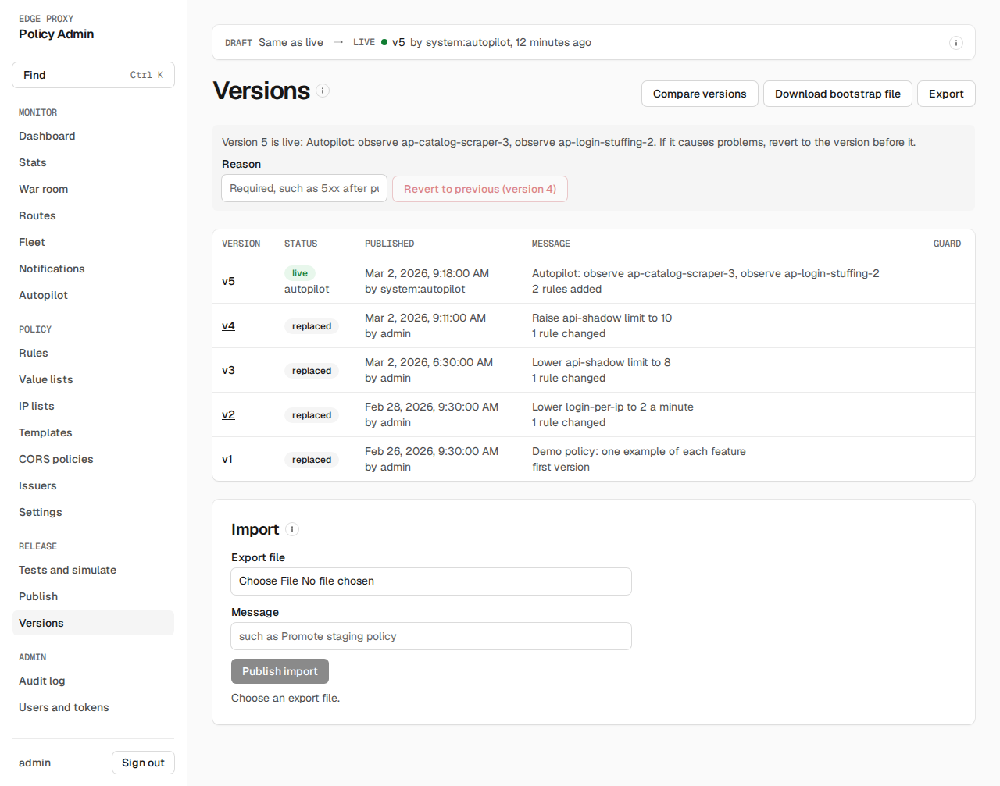

# Publish and roll back

Changes go live in small, checked steps. Nothing invalid is ever saved, and every publish can be undone.

## Draft

There is one shared draft. Saving it validates the whole config; an invalid draft is refused with the exact field and reason. Saves are guarded by revision, so two editors can't overwrite each other: if the active version moved on, **Rebase** the draft onto it.

Rules, templates, CORS policies, issuers and **Settings** (including the kill switches) change the draft and go live only when you **Save draft** and **Publish**. **Publish** ships the whole saved draft, including other people's saved edits, so read the comparison on **Publish** first. Five things are saved on their own, outside the draft, and apply when saved: the rollback guard, notification settings, autopilot settings, [IP lists](ip-lists.md) and **Settings → Where the edges are**. Each card carries an **Applies when saved** badge.

## Publish

**Publish** turns the saved draft into a new, numbered, immutable version with a message. Publish is refused when:

- the message is empty;
- a policy test fails;
- a canary is in progress (promote or abort it first);
- the active version changed since the draft started (**Rebase** first);
- a live edge can't read the config's schema version (upgrade edges first);
- a live edge runs with different deployment settings than admin (`CLIENT_IP_SOURCE`, `VIEWER_HEADERS`, `CDN_HEADERS`, `INGRESS_SECRET_HEADER` or `ALLOW_REGEX`), because that edge would reject the config and keep its old one. Admin answers 409 naming the edge; make the [settings](../deploy/admin.md#variables) match. On a `cloudfront` or `cloudflare` deployment, an upgrade from a release without [`CDN_HEADERS`](../deploy/edge.md#cdn-headers) holds publishing until admin and every live edge run the new release. Reverts and guard rollbacks skip this check;
- a rule requires auth from an issuer whose keys (JWKS) admin has never fetched. A publisher can override this one with a reason, for example "IdP is down, publishing anyway".

Edges poll admin every 5 seconds and switch to the new version atomically. **Fleet** shows which edges run which version.

## Canary

A canary sends a new version to part of the traffic first, so you see its effect before everyone does. Clients are chosen by a hash of their IP, so each client consistently sees one version (IPv6 per /64).

### Publish to a canary, step by step

You need the `config.publish` and `canary.manage` permissions. Without `canary.manage` the **Canary percent** field is not shown.

1. Make your edits and press **Save draft**. Policy tests must pass, as for any publish.
2. Open **Publish** and read the comparison of the saved draft with the live version.
3. Enter a **Message**, then a **Canary percent** from 0.01 to 99.99, such as 5. The button reads **Publish to 5% of traffic**; with the field empty it reads **Publish to all traffic**.
4. Press the button and confirm **Publish to 5% of traffic?** with **Publish**. Every edge starts serving the saved draft to that share of clients and the rest keep the live version. A canary card appears on **Publish**: **Canary: version N on 5% of traffic**, with when the step started.
5. Watch it. The card says when the next step is allowed and how many requests the step has seen. **Fleet** shows which edges run which version, and the dashboard marks the canary version. The guard compares the canary with the live version over the same minutes and raises any alert on the card.
6. To widen it, enter a **Next percent** above the current one and at most 99.99, then **Step up** and confirm. The button stays disabled until the step has run for the guard's minimum time (5 minutes by default) and seen its minimum requests (1000 by default).
7. To send it to everyone, press **Promote to all traffic** and confirm. It is disabled until the same minimum time and request count are met.
8. To send everyone back to the live version, enter an **Abort reason** (required), press **Abort** and confirm **Abort the canary?**. The canary version is rolled back and its reason is kept. You can abort at any time.

Check afterwards:

- **Versions** shows the canary version as `active` after a promote, or `rolled_back` with its abort reason after an abort, and **Audit log** has the `canary.step`, `canary.promote` or `canary.abort` event.
- After an abort, **Publish** may ask you to **Rebase** the draft onto the live version.

While the canary runs:

- A new publish or a revert is refused until you promote or abort it.
- The guard compares the canary with the live version. If a rollback signal trips, it aborts the canary itself. It only alerts, and never aborts, when the guard is disabled, no signal is in `rollback` mode, `max_auto_rollbacks_per_publish` is 0, or the canary is a revert. The card says which applies. See [Rollback guard](#rollback-guard).
- A step up and a promote use the guard's minimum time and requests, which **Settings → Rollback guard** changes.

### Canary actions

| Action | Effect |
|---|---|
| **Step up** | Raise the percentage, for example 1 → 10 → 50. Each step must run at least 5 minutes and see 1000 requests |
| **Promote to all traffic** | Send all traffic to the new version |
| **Abort** | Send all traffic back, with a reason |

If admin goes away during a canary, edges drop the canary on their own within 10 minutes.

## Rollback guard

The guard compares a new version with the old one and rolls it back, or raises an alert, when a signal trips. You change its thresholds in **Settings → Rollback guard**.

For the first 10 minutes after a publish, or during a canary, the guard watches. Both sides need 1000 requests before it decides anything.

- A canary is compared with the active version over the same minutes.
- A full publish is compared with the 10 minutes before it.

| Signal | Trips when |
|---|---|
| `fleet_adoption` | Too few edges run the version after the allowed time |
| `edge_5xx_ratio` | The edge's own 5xx share is over a multiple of the baseline and over a floor |
| `upstream_5xx_ratio` | The upstream 5xx share is over a multiple of the baseline and over a floor |
| `changed_rule_limited_ratio` | A changed rate limit or access rule blocks over a cap, or over a multiple of what it found while log only |
| `unchanged_rule_limited_ratio` | An unchanged rule blocks over a multiple of the baseline |
| `p99_latency` | 99th percentile (p99) latency is over a multiple of the baseline and over a floor |
| `auth_failure_ratio` | The token check failure share is over a multiple of the baseline and over a floor |

Default modes and thresholds are in [Settings: Signals](settings.md#signals).

Rollback signals are ones only a config change causes. Signals an attack can also cause only alert.

??? note "Details: how the two rule signals judge a rule"
    The two rule signals cover rate limits and access rules with a [`block` setting](policy.md#blocking-requests). An access rule evaluates every request, so its share is of all requests the version served.

    - **An access rule whose `block` was `log` in the active version** is judged only against its logged share × `max_vs_shadow`, so a rule that blocks what it logged doesn't roll back however large that share is.
    - **An edited block rule** is judged against the larger of its logged share and its blocked share in the active version, times `max_vs_shadow`.
    - **With neither a log run nor blocks in the active version**, `max_ratio` (5%) applies, which is why the [bot recipes](bots.md) log first.
    - **Rate limits:** clients hammering one rule (each holding at least 5% of its limited requests) are left out of the counts, so a single attacker can't trip it.
    - **A rate-limit key with no per-client part** (no `ip`, `jwt_claim`, `header`, `cookie` or `query`, such as `ja4` or `constant`) is judged on its raw limited count, since its one bucket holds many clients.
    - **Access rules** count every block, since stats keep no per-client config counts, so log a new block rule first.

A rollback publishes the previous version again as a new version. By default it happens at most once per publish (`max_auto_rollbacks_per_publish`), and never for a revert or a rollback, which only alert. Every decision is stored on the version; alerts, rollbacks and canary aborts are also written to the audit log, and admin logs `guard tripped`.

**Settings → Rollback guard** changes the defaults. Every signal must be present with its thresholds; set a signal's mode to `off` to disable it. A publisher can change the guard for one publish, with a required reason, for example "this rule limits on purpose".

!!! note "Publishing a rule that targets an ongoing attack"
    Attackers spread over many IPs can push `changed_rule_limited_ratio` over its limit and get the rule rolled back. Publish such a rule with a guard override and a reason.

## Revert

**Versions → Revert** publishes an old version's own rules as a new version (optionally through a canary), with the current autopilot rules, or without them when together they are refused ([Autopilot rules](#autopilot-rules)). History is never rewritten. **Copy to draft** starts a new draft from any version instead, without its autopilot rules.

## Autopilot rules

Autopilot rules are rate-limit rules the [autopilot](autopilot.md) publishes on its own. They are not in your draft, and they expire. Reading this section matters when a publish, revert or import is refused because of one.

- Their ids start `ap-`.
- They run after your rules, each until its `expires_at` ([Rules that expire](rate-limiting.md#rules-that-expire)).
- They are published as their own versions, with source `autopilot` in **Versions** and `config.overlay_publish` in **Audit log**.

??? note "Details: what admin accepts and refuses"
    - Admin refuses (`422`) an autopilot rule whose id lacks the `ap-` prefix, that has no `expires_at`, or whose `expires_at` is more than 24 hours ahead, and leaves out one whose `expires_at` has already passed.
    - A rule's content is fixed per id: republishing a live `ap-` id with anything changed but its `action` and `expires_at` is refused (`422`), so a changed rule needs a new id.
    - Republishing it with `action: block` makes it enforce, and with a later `expires_at` renews it.
    - An `ap-` id adopted into your draft and no longer live is refused too (`422`): a new autopilot rule needs a new id.
    - They go through every publish check, except that one which only takes autopilot rules out skips the deployment and schema checks, like a revert.
    - They wait for a canary like any publish.

- **The draft holds your rules only.** **Rules** lists the autopilot rules apart, read-only, with their expiry. A save counts them, so a draft that would take the version past 200 rate-limit rules is refused at save.
- **They don't make you rebase.** An autopilot publish keeps your draft as it is and moves it onto the new version. It publishes over issuers whose keys admin never fetched, as the live version did, and records its own fixed reason in `override_reason`.
- **Policy tests ignore them in `rate_limit_rules`.** A test's list is compared with your rules only.
- **Every publish keeps them while they run:** yours, an import and a revert. Every publish, revert, rollback and import drops the ones already expired. An import ignores the `ap-` rate-limit rules in its file and is refused when an access rule or request header rule there has an `ap-` id; an export includes them, so an edge started from the bootstrap file keeps them until they expire.
- **Reverts and rollbacks keep today's autopilot rules.** The details are in the note below.
- **Adopt** copies an autopilot rule into the draft as your own rule, without the `ap-` prefix and without an expiry. It needs `config.write` and a draft with no unsaved changes, and is refused when the draft already has a rule with that id in any phase, since rule ids are unique across phases. The rule shows as adopted until your next publish, which removes the autopilot copy.
- **`ap-` is reserved.** A rule of yours with such an id, in any phase, is refused at save. Admin won't upgrade while the active version, a canary or the draft has one: `admin migrate` fails naming the rule. Rename it with the previous release, then run `admin migrate` again before rolling admin. An older version with such a rule, in any phase, loses it when restored.

??? note "Details: reverts and rollbacks keep today's autopilot rules"
    - An `ap-` rule of the restored version comes back too while it has not expired, if you adopted it after that version: restoring removes your copy.
    - The guard judges the version a person published, not an autopilot publish, and leaves autopilot rules out of its rule signals: each autopilot rule has [its own guard](autopilot.md#the-rule-guard).
    - If a revert or a guard rollback is refused with the autopilot rules (validation, the schema the edges can load, or the policy tests) but the restored rules alone pass validation and the policy tests, admin publishes them without any autopilot rules (an edge too old to read them keeps its policy), so autopilot rules never block either, and the version's audit event has `overlay_dropped: true`.

## Audit

Every change is in **Audit log**: who, what, when and a diff. The log is append-only, HMAC-chained with a key kept outside Postgres, and checked every 5 minutes and in full daily. The page shows the result of the last recorded verification and has a **Verify chain** button.
