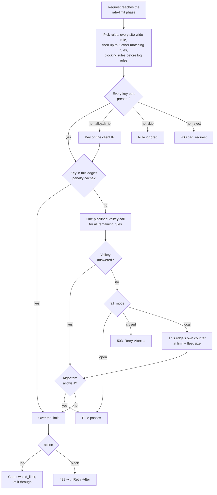
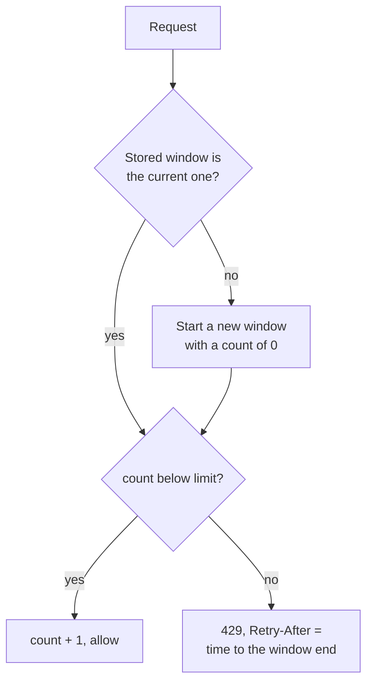
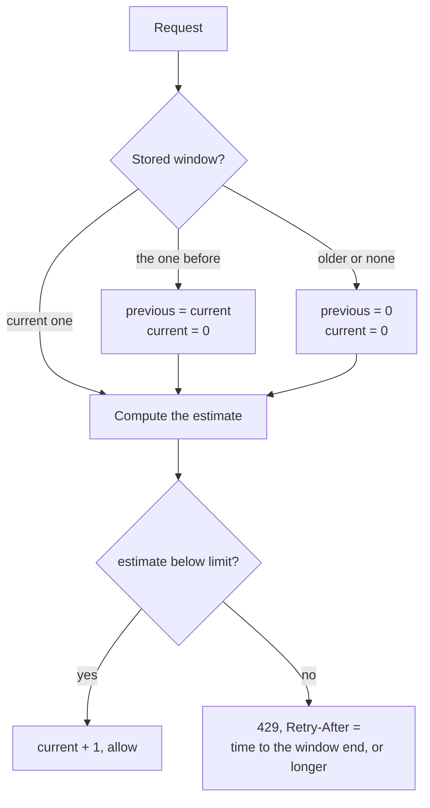
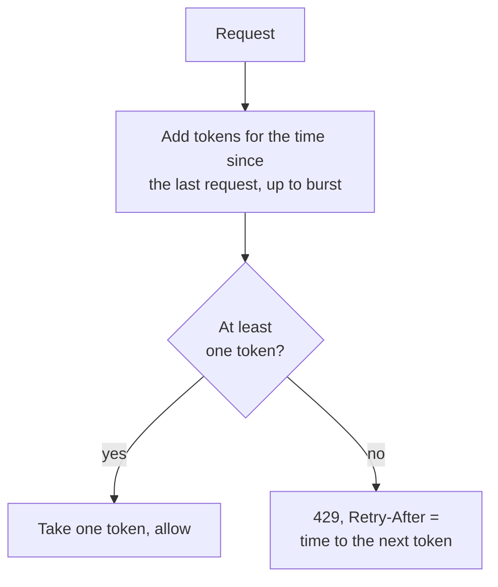
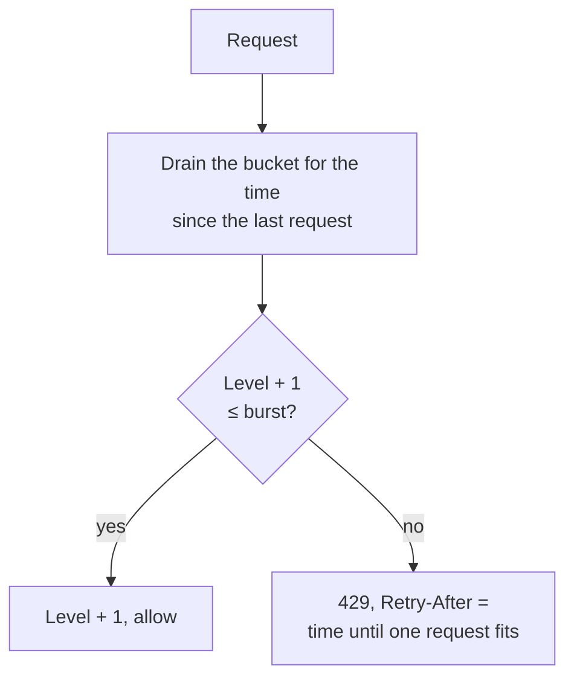
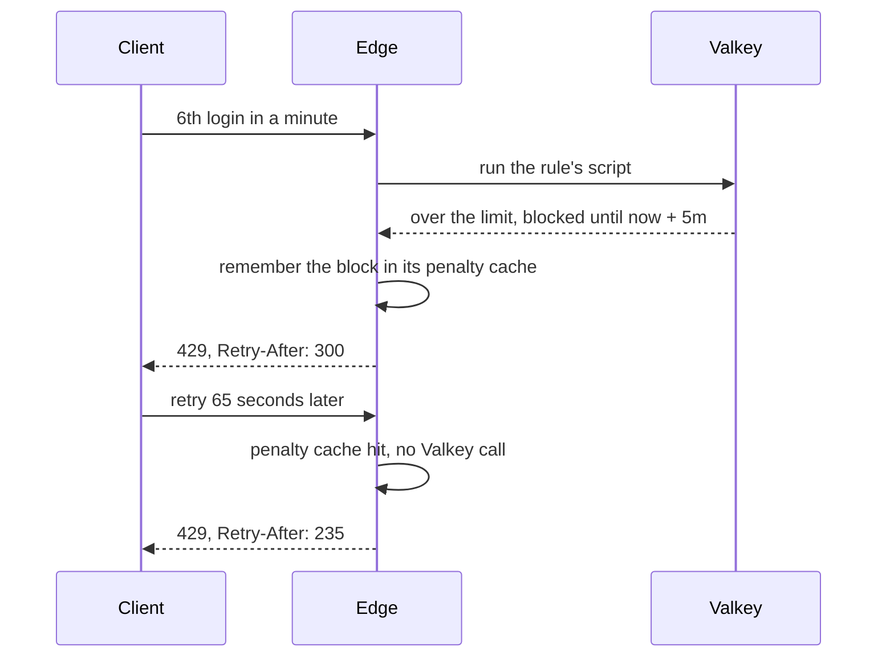

# Rate limiting

Each rule keeps one counter per key in Valkey, shared by every edge, so a limit of 100 means 100 across the fleet. A request makes at most one Valkey round trip, whatever number of rules it matches.

## A rule

```json
{
  "id": "login",
  "algorithm": "sliding_window",
  "limit": 5,
  "period": "1m",
  "key": ["ip"],
  "on_missing_key": "fallback_ip",
  "action": "block",
  "penalty": "5m",
  "fail_mode": "open"
}
```

This is the rule's **Then** block in the UI; its expression (here `http.request.uri.path eq "/login"`) is built above it.

| Field | Values |
|---|---|
| `algorithm` | `fixed_window`, `sliding_window`, `token_bucket`, `leaky_bucket` |
| `limit`, `period` | 1 to 1e9 requests per 1s to 24h (whole seconds) |
| `burst` | `token_bucket` and `leaky_bucket` only, and required for them |
| `key` | 1 to 5 parts: `ip`, `jwt_claim:<name>`, `header:<name>`, `cookie:<name>`, `query:<name>`, `host`, `method`, `country`, `asnum`, `locale`, or `constant` alone (one counter for everyone). IPv6 is keyed per /64 |
| `on_missing_key` | `skip` the rule, `fallback_ip`, or `reject` the request |
| `action` | `block`, or `log` to count what would have been limited without blocking (shadow mode) |
| `penalty` | Optional, 1s to 24h: once over the limit, stay blocked this long |
| `fail_mode` | What to do when Valkey can't answer: `open`, `closed` or `local` |

## How a request is checked

Rate limiting runs after the local backstop, CORS and JWT, and before header rules and the proxy. Each rule below is checked on its own; then the request gets one answer.



How the per-rule results combine:

- **Any blocking rule over its limit:** 429. `Retry-After` is the longest wait among those rules.
- **Otherwise, any `fail_mode: closed` rule that Valkey couldn't answer:** 503. A `log` rule never fails closed.
- **Otherwise** the request continues to the header phase and the upstream.

Rules are independent counters. A request blocked by one rule still used quota in every other rule it matched, because checking all of them first would need a second round trip.

## The algorithms

Every algorithm keeps its state in one Valkey key per subject and reads the time from Valkey, so all edges agree on it. The tables below were produced by running the algorithm code on each timeline. Times are from the start of a window.

### Fixed window

Counts requests per calendar window of `period`. The count resets when the next window starts.



**Scenario:** `limit: 5`, `period: 1m`. A client sends 5 requests late in one window and 5 more right after it ends.

| Time | Result | Why |
|---|---|---|
| 0:59.0 to 0:59.4 | 5 allowed | Count goes 1 to 5 |
| 1:00.0 to 1:00.4 | 5 allowed | A new window started; the count went back to 0 |
| 1:00.5 | 429, `Retry-After: 60` | Count is 5 until 2:00 |

10 requests passed in 1.5 seconds. That edge burst is the price of the cheapest algorithm; use it for coarse quotas where it doesn't matter.

### Sliding window

Smooths the edge burst. It keeps the count of the current window and the previous one, and estimates the last `period` as:

estimate = current count + previous count × the share of the previous window still inside the last `period`, rounded up



**Scenario:** the same client and the same `limit: 5`, `period: 1m`.

| Time | Estimate before the request | Result |
|---|---|---|
| 0:59.0 to 0:59.4 | 0, 1, 2, 3, 4 | 5 allowed |
| 1:00.0 | 0 + 5 × 100% = 5 | 429 |
| 1:30.0 | 0 + 5 × 50% = 2.5, rounded up to 3 | Allowed |
| 1:30.1 | 1 + 3 = 4 | Allowed |
| 1:30.2 | 2 + 3 = 5 | 429 |
| 1:45.0 | 2 + 5 × 25% = 1.25, rounded up to 2, so 4 | Allowed |
| 2:00.0 | 0 + 3 × 100% = 3 | Allowed |

The edge burst is gone: at 1:00 the client gets nothing more until the old requests age out. Rounding up means the estimate never lets one extra request through. Good for login and signup limits.

### Token bucket

A bucket holds up to `burst` tokens and starts full. It refills at `limit` tokens per `period`. Each request takes one token.



**Scenario:** `limit: 10`, `period: 1m`, `burst: 5`. One token every 6 seconds, at most 5 saved up.

| Time | Result | Why |
|---|---|---|
| 0:00, 5 requests | 5 allowed | The bucket starts full |
| 0:00, 6th request | 429, `Retry-After: 6` | Empty; the next token comes in 6s |
| 0:06, 2 requests | 1 allowed, then 429 | One token refilled |
| 0:30, 6 requests | 4 allowed, then 2 × 429 | 24s refilled 4 tokens |

A client can burst up to `burst` after a quiet spell, and averages `limit` per `period` over time. Good for API limits.

### Leaky bucket

A bucket holds up to `burst` requests and starts empty. Each request adds one; the bucket drains at `limit` per `period`. A request that would overflow it is rejected, never queued. This is the meter form of the leaky bucket, the same as GCRA.



**Scenario:** the same `limit: 10`, `period: 1m`, `burst: 5`. The results are the same as the token bucket, request for request: with equal settings the two admit the same traffic. Both are offered because operators think of limits in one model or the other. Choose leaky bucket when "at most one request every 6 seconds, with 5 of slack" is the way you describe protecting a fragile upstream.

### Choosing an algorithm

| Algorithm | Behaviour | Good for |
|---|---|---|
| `fixed_window` | Count per calendar window; allows up to 2 × `limit` across a window edge | Cheap coarse quotas |
| `sliding_window` | Weighted previous window plus the current one | Login and signup limits |
| `token_bucket` | Bursts to `burst`, refills at `limit` per `period` | API rate limits |
| `leaky_bucket` | Same admission as the token bucket, described as a draining bucket | Protecting a fragile upstream |

Changing `limit` or `burst` applies on the next request. Changing `algorithm` or `period` starts every subject from zero, because both are part of the Valkey key.

## Penalty

Without a penalty, a client over the limit gets through again as soon as the algorithm allows. With one, the first rejected request blocks the key for the whole `penalty`.



**Scenario:** the `login` rule above: `sliding_window`, `limit: 5`, `period: 1m`, `penalty: 5m`.

| Time | Result | Why |
|---|---|---|
| 0:00 to 0:04 | 5 allowed | Under the limit |
| 0:05 | 429, `Retry-After: 300` | 6th request: the penalty starts and runs to 5:05 |
| 1:10 | 429, `Retry-After: 235` | Still blocked, although the window has moved on |
| 5:04 | 429, `Retry-After: 1` | Still blocked |
| 5:05 | Allowed | Penalty over; counting starts fresh |

- **Repeat offenders cost almost nothing.** Each edge keeps a local copy of active penalties (up to 100,000 keys) and answers from it without calling Valkey. An edge that hasn't seen the client yet asks Valkey once; Valkey answers "blocked" without counting, and that edge caches it too.
- **Penalties apply only to `action: block` rules.** A `log` rule records that a penalty would have started and never blocks.

## When the key is missing

A key part can be absent: a missing header, cookie or query argument, no verified token for a `jwt_claim`, no country or ASN from the CDN, or no locale. `on_missing_key` decides what happens.

**Scenario:** an API rule keyed on `["jwt_claim:sub"]`, `limit: 1000`, `period: 1h`.

| Request | `fallback_ip` (default) | `skip` | `reject` |
|---|---|---|---|
| Valid token, `sub` = `user-42` | user-42's counter | user-42's counter | user-42's counter |
| No token on a route with `auth: optional` | A counter for the client IP | Rule not applied | 400 `bad_request` |

- **`fallback_ip` is the safe default.** A fallback key can never collide with a value a client chooses, so a header set to someone's IP can't land in that IP's bucket.
- **`skip` lets a client bypass the rule** by leaving the value out. Use it only when another rule covers those requests.
- **A `skip`ped rule takes no slot** in the 5-rule cap.

## Several rules on one request

**Scenario:** a site-wide rule `per-ip` (expression `true`, key `ip`, 300 per minute) and the `login` rule. A client sends its 6th login of the minute.

| Rule | Counter after the request | Result |
|---|---|---|
| `per-ip` | 6 of 300 | Allowed |
| `login` | Over 5 | 429 |

The answer is 429, and `per-ip` still counted the request. Both rules were checked in one Valkey round trip.

Limits per request:

- **Site-wide rules** (expression `true`) always run. At most 2 are allowed.
- **Up to 5 other matching rules** run, blocking rules first, then `log` rules. Requests that matched more are counted in `edge_ratelimit_rules_capped_total`.
- Blocking rules go first because clients choose which rules match through what they send. Otherwise five matching `log` rules could push a login limit out of evaluation.

## When Valkey fails

Each Valkey call has a short deadline. After 5 consecutive failures on one Valkey node, the edge stops calling that node for 1 second, then lets one probe through. Only keys on the failed node are affected. Rate-limit calls are never retried: a call that timed out may already have counted, and a retry could count it twice.

Every rule then follows its `fail_mode`.

**Scenario:** Valkey is unreachable, 4 edges are running, and the `login` rule (`limit: 5`) receives traffic.

| `fail_mode` | Result | Use it when |
|---|---|---|
| `open` (default) | Every request passes this rule | Availability matters more than the limit |
| `closed` | 503 with `Retry-After: 1` | The upstream must never see unlimited traffic |
| `local` | Each edge counts on its own with a limit of 5 ÷ 4, rounded down and at least 1. Across the fleet, about 4 logins per minute pass | You need a rough limit during an outage |

- **The fleet size comes from admin,** which counts the edges that reported stats in the last minute. Until admin has supplied it, `EXPECTED_REPLICAS` from deployment config is used.
- **`local` state is bounded** at 100,000 keys per edge, split evenly between rules, and survives publishes during the outage.
- **Cluster deployments must set `cluster-require-full-coverage no`.** With the default, one failed primary fails every key, not just its own.

## Rules that keep limits honest

- **Attacker-controlled keys need a partner.** A rule whose key includes `header`, `cookie`, `query`, `host` or `method` is rejected unless the key also has `ip` or `jwt_claim`, or a site-wide rule keyed on `ip` exists. Otherwise a client could rotate the value to get a fresh counter.
- **JWT claims count only after the token verified.**
- **Repeated values use the first one,** so a client can't pick a bucket by reordering duplicate headers or arguments.

## Response headers

- **`Retry-After`** is on every 429, in whole seconds, rounded up.
- **`RateLimit-Policy` and `RateLimit`** (IETF draft) are sent when a config rule sets `ratelimit_headers: true`. There is one item per blocking rule, named by its ID, for example `RateLimit-Policy: "login";q=5;w=60` and `RateLimit: "login";r=2;t=41`. `log` rules are left out.

## Before you block: shadow mode

Publish a new rule with `"action": "log"` first. **Stats** shows its `would_limit` count against real traffic. Switch it to `block` once the numbers look right.

## Local backstop

Before any shared limit, each edge applies a per-IP token bucket in memory (**Settings → Backstop**). It absorbs floods without touching Valkey and works even when Valkey is down. It is per edge, so the effective ceiling is about the number of edges × the setting. Set it well above any real client's rate.

When its table is full, new IPs pass the backstop untracked rather than share one bucket; the shared limits still apply to them.

## Emergency switch

**Settings → Kill switch → Disable rate limiting** turns every rule into `log`. Save and publish it to stop all rate-limit blocking at once; the backstop still applies. **Disable JWT checks** turns JWT verification off entirely: every route behaves as `auth: none`, claims are empty and `X-Edge-Auth-*` headers are not set.
