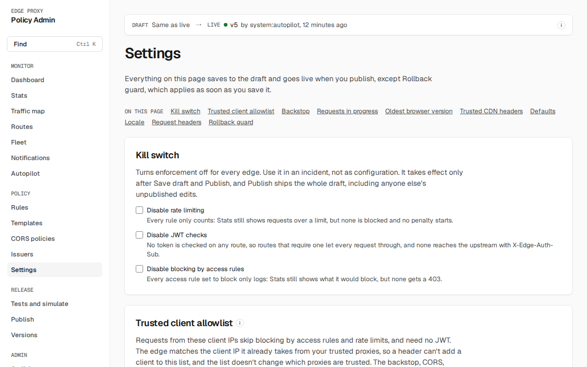

# Settings



**Settings** (under **Policy** in the admin UI) holds the policy settings that apply to every request unless a rule overrides them, and two settings admin stores itself. The cards are listed in the order the page shows them, and the **On this page** links at the top jump to them.

Two kinds of setting live here:

| Kind | Cards | Takes effect |
|---|---|---|
| Policy settings, stored in the draft as `kill_switch` and `global` | **Kill switch**, **Trusted client allowlist**, **Backstop**, **Requests in progress**, **Oldest browser version**, **Trusted CDN headers**, **Defaults**, **Locale**, **Request headers** | When you **Save draft** and **Publish**. A canary applies the settings of the version each request is pinned to. Publish ships the whole draft, including other people's saved edits |
| Admin settings, stored by admin outside the policy | **Rollback guard**, **Where the edges are** | When saved, with an audit row. They are not part of any version and a revert does not change them |

- Reading the page needs `config.read`. Changing the draft needs `config.write`; without it the fields are disabled and a note says so. Saving the rollback guard or **Where the edges are** needs `settings.manage`, and **Where the edges are** is shown only to roles that have it.
- Every policy setting is checked by `snapshot.Compile` on every save, so a value outside its bounds is refused with the field named and nothing is saved. Bounds below are what that check enforces.
- A setting an older edge does not read makes admin refuse the publish while a live edge reads an older schema: `max_inflight` needs schema 3, `client_allowlist` schema 6, `browser_floor` schema 7 and `cdn_trusted_headers` schema 8. The refusal names the edge and the schema it reads.
- The [policy fields reference](../reference/policy-fields.md) lists every field with its type. [Policy](policy.md) covers rules, and the [tour](../tour/policy.md#settings) shows the page.

## Kill switch

Turns enforcement off for every edge, without editing rules. Use it in an incident, not as configuration. It takes effect only after **Save draft** and **Publish**, and Publish ships the whole draft.

| Field | UI label | Starter | Effect when on |
|---|---|---|---|
| `kill_switch.rate_limit` | **Disable rate limiting** | `false` | Every rate-limit rule only counts: stats still show requests over a limit, but none is blocked and no penalty starts. The [local backstop](#backstop) still applies |
| `kill_switch.auth` | **Disable JWT checks** | `false` | Every route behaves as `auth: none`: no token is checked, claims are empty, and no `X-Edge-Auth-*` header reaches the upstream. Routes that require a JSON Web Token (JWT) let every request through |
| `kill_switch.block` | **Disable blocking by access rules** | `false`, left out of the JSON when off | Every access rule `block` setting acts as `log`: stats still count what it logs, but none gets a 403, and a [ban](policy.md#banning-a-client) no longer refuses requests |

- All three are booleans with no other bounds.
- Change them for a live incident: a rule that is blocking real users (`block`), a limit that is wrong and cannot be fixed fast (`rate_limit`), or an identity provider outage that makes valid tokens fail (`auth`). Turn the switch off the same way, with a publish.
- Turning on `auth` removes a security control: any route that only relied on a token is open until you turn it off.
- Each switch has to pass through a publish, so for a bad rule a [revert](publishing.md#revert) is often as fast and keeps enforcement on. See [Runbooks](../operate/runbooks.md) for the incident steps.

## Trusted client allowlist

`global.client_allowlist`: client Internet Protocol (IP) addresses and ranges that skip enforcement. The edge matches the client IP it already derived from your trusted proxies, so a header cannot add a client, and the list does not change which proxies are trusted. Full behavior, the list of what a match skips, and an example are in [Trusted clients](policy.md#trusted-clients).

| Field | UI label | Starter | Allowed |
|---|---|---|---|
| `global.client_allowlist` | **Client IPs and ranges** | Empty, left out of the JSON | Up to 100 entries, no duplicates. Each entry is an IPv4 or IPv6 address or a Classless Inter-Domain Routing (CIDR) range written from its first address. No wider than `/24` for IPv4 or `/48` for IPv6. Entries must not overlap. No zones. An IPv4-mapped IPv6 entry must be `/96` or longer and is read as IPv4 |

- A match skips every access rule `block` setting and ban, and every rate-limit rule, and a route that requires a JWT treats the client as `optional`: no token is needed, but a token it sends is still verified.
- The backstop, CORS, locale, header rules, body limit and timeouts still apply.
- Change it as a stopgap for a known-good office or partner network that a rule wrongly blocks, then fix the rule and remove the entry. Prefer an access rule with [`allow`](policy.md#always-allow) when the exemption belongs to one route.
- Never add a shared monitoring service: its addresses carry every other customer's checks, and an allowlisted address skips every block, ban, rate limit and token requirement on every route. Use [an always-allow rule on the health path](cases/access.md#never-block-or-limit-your-uptime-monitor) instead.
- Every entry is an exemption from rate limits and blocking, so keep ranges as small as the site and remove entries you no longer need.

## Backstop

`global.backstop`: a per-IP token bucket in each edge's memory, checked before CORS preflight, JWT and rate limits. It stops floods even when Valkey is down. It answers `429` with the `rate_limited` template. An IPv6 client is counted per `/64`. Each edge counts on its own, so the fleet-wide ceiling is about the number of edges times the setting. A publish that leaves the backstop unchanged keeps each edge's counters. See [Local backstop](rate-limiting.md#local-backstop).

| Field | UI label | Starter | Allowed |
|---|---|---|---|
| `global.backstop.limit` | **Allow each IP** (`Backstop limit`) ... **requests every** | `100` | 1 to 1,000,000,000 |
| `global.backstop.period` | `Backstop period` | `1s` | Whole seconds, 1 second to 1 hour. The UI offers minutes and seconds |
| `global.backstop.burst` | **Burst** | `200` | 1 to 1,000,000,000 |
| `global.backstop.max_entries` | **IPs tracked per edge** | `100000` | 1 to 10,000,000 |

- `limit` is how many requests the bucket refills each `period`, and `burst` is the bucket size: the requests an IP may send at once after a quiet spell.
- When the table is full, a new IP passes untracked (counted in `edge_backstop_untracked_total`) until tracked IPs expire. The shared rate limits still apply to it.
- The allowlist does not skip the backstop.
- Change it when real clients get `429` with reason `backstop`: the starter 100 per second is low for a busy office or a carrier network behind one address, and [capacity](../deploy/capacity.md) sizes it from your traffic. Set it well above real traffic: it is a floor for floods, not a policy. Raise `max_entries` only if `edge_backstop_untracked_total` grows, since each tracked IP costs memory.

## Requests in progress

`global.max_inflight`: how many ordinary requests each edge works on at once before it answers the rest with `503` and the `overloaded` template.

| Field | UI label | Starter | Allowed |
|---|---|---|---|
| `global.max_inflight` | **Maximum requests in progress per edge** | Unset, left out of the JSON | 1 to 1,000,000, or unset |

- Each edge's own limit is `MAX_INFLIGHT`, sized from its memory ([edge variables](../deploy/edge.md)). The cap an edge applies is the smaller of the two, so a number here can only lower it. A larger number has no effect.
- WebSocket and Server-Sent Events (SSE) streams have their own limit (`MAX_STREAMS`) and do not count.
- Change it to shed load sooner while an upstream struggles, so requests fail fast instead of queueing. Leave it unset otherwise.

## Oldest browser version

`global.browser_floor`: browser versions below these count as outdated, so a rule can match the `browser_outdated` signal. See [Stale browsers](bots.md#stale-browsers).

| Field | UI label | Starter | Allowed |
|---|---|---|---|
| `global.browser_floor.chromium` | **Chrome and other Chromium browsers** | Unset, no floor | 1 to 999, the lowest major version |
| `global.browser_floor.firefox` | **Firefox** | Unset, no floor | 1 to 999 |

- The only keys are `chromium` and `firefox`. Safari has no floor, because its version follows the operating system.
- With no floor set, `browser_outdated` is off, and validation refuses a rule that names it.
- The signal reads the claimed User-Agent, so a client can lie in either direction. Real users on devices that cannot update exist: log first, then block.
- Change it by hand about once a year, to a version old enough that few real users run it.

## Trusted CDN headers

`global.cdn_trusted_headers`: the headers you declare your Content Delivery Network (CDN) sets on every request. The card appears when the deployment's `CDN_HEADERS` is not empty or the policy already sets a list. Trusting a header only silences the client-controlled warning on rules that read it and lets rules use the CDN signals that read it; those signals only narrow a match. The edge does not check that the CDN really sets it: where it does not, a client can send it. Deployment side: [CDN headers](../deploy/edge.md#cdn-headers). Signals: [CDN headers in bot detection](bots.md#cdn-headers).

| Field | UI label | Starter | Allowed |
|---|---|---|---|
| `global.cdn_trusted_headers` | One checkbox per header in `CDN_HEADERS` | Unset: the deployment's default, shown as "Using the default: ..." | Up to 48 header names, no duplicates (case-insensitive), each a valid header name |

- Unset uses the deployment's default list. An empty list trusts none. Any change in the UI writes the whole list, and **Use the default** unsets it again.
- An entry that is a source header (such as the country header on the `cloudflare` preset) is always trusted when listed in `CDN_HEADERS`, so the entry does nothing and validation warns. An entry not in `CDN_HEADERS` is dropped with a warning and shown under the boxes as "Not in CDN_HEADERS, so not trusted". A header the edge manages is refused.
- Change it when you turn on a CDN feature that sets a header on every request, such as Cloudflare Bot Management for the bot score. Never trust a header the CDN sets only on some requests.

## Defaults

`global.defaults`: what applies when no config rule says otherwise. A config rule overrides each of them for the requests it matches, see [Per-rule overrides](#per-rule-overrides).

| Field | UI label | Starter | Allowed |
|---|---|---|---|
| `global.defaults.body_limit` | **Largest request body** | 10 MiB (`10485760` bytes) | At least 1 byte, no upper bound. The UI takes MiB, KiB or bytes |
| `global.defaults.body_read_timeout` | **Time to send the body** | `30s` | 1 second to 1 hour |
| `global.defaults.upstream_timeout` | **Upstream timeout** | `30s` | 1 second to 1 hour |
| `global.defaults.locale` | **Detect the locale on every request** | `false` | Boolean. `true` needs supported locales under [Locale](#locale) |
| `global.defaults.responses` | Edited under **Templates** | Each of the nine kinds names its own template | Every kind needs a template that exists |

- **`body_limit`**: a body larger than this gets `413` with the `payload_too_large` template. A declared `Content-Length` over the limit is refused before anything is sent upstream. A body without one, such as chunked, is refused when it passes the limit. Raise it for upload routes with a [`body_limit` rule override](#per-rule-overrides) rather than for every route.
- **`body_read_timeout`**: how long a client may take to send its request body, counted from when the request arrived. When it runs out, the edge answers `400` with the `bad_request` template and counts it as `body_timeout`. It applies only to requests that have a body, and it is cleared when the body ends, so it never cuts a response stream. No rule overrides it. Lower it to drop slow-body clients sooner, raise it if real clients upload large bodies over slow links.
- **`upstream_timeout`**: how long the upstream has to send its response headers. The body can then stream for as long as it needs (SSE, downloads). When it runs out, the edge answers `504` with the `gateway_timeout` template. Set it just above the slowest legitimate upstream answer, so a hung upstream frees capacity but a slow report does not fail.
- **`locale`**: see [Locale](#locale).
- **`responses`**: which template each kind of edge response uses. See [Response templates](templates.md).

## Locale

`global.locale`: the languages the edge picks from `Accept-Language`, and the header that tells the upstream which one it picked. Locale runs only on routes where it is on, by **Detect the locale on every request** or a rule override. How the match works, with examples, is in [Locale](policy.md#locale).

| Field | UI label | Starter | Allowed |
|---|---|---|---|
| `global.locale.supported` | **Supported locales** | Empty | Up to 100 BCP 47 language tags in canonical form, such as `en-AU`, `fr-FR` or `zh-Hant-TW`, no duplicates |
| `global.locale.default` | **Default locale** | Empty | One of `supported`. Used when the request asks for none of them, or sends no valid `Accept-Language` |
| `global.locale.output_header` | **Header for the upstream** | Empty | Empty for `X-Edge-Locale`, or a header name starting with `X-Edge-`, so clients cannot send it |

- With no supported locales, any default, header or locale-on setting is refused: "needs at least one locale when locale is used".
- With supported locales set and an empty `output_header`, the edge sends `X-Edge-Locale`.
- Change it when the upstream renders content by language. Keep `supported` to the languages the upstream really serves.

## Request headers

`global.request_headers.forward`: which client headers reach the upstream. A header rule can replace the filter for matching requests with a `forward` op, and [Header rules](policy.md#header-rules) cover the other ops.

| Field | UI label | Starter | Allowed |
|---|---|---|---|
| `global.request_headers.forward.mode` | **Forward** | `all` | `all`, `allowlist` or `denylist` |
| `global.request_headers.forward.names` | **Headers** | Empty | Empty with `all`. At least one name otherwise, up to 100, no duplicates (case-insensitive), each a valid header name that the edge does not manage |

- `all` forwards every client header. `allowlist` forwards only the named ones. `denylist` drops the named ones.
- Names the edge manages (`Host`, `X-Edge-*`, `X-Forwarded-*`, `X-Request-Id`, and the deployment's client-IP and viewer headers) are refused. The edge keeps its own hop and framing headers whatever the filter says, and `traceparent` and `tracestate` are always kept, with a warning when listed.
- An allowlist that leaves out `Authorization`, `Cookie` or `Content-Type` validation warns, because the upstream then loses it.
- Change it to keep internal or debugging headers from reaching the upstream. A denylist is the safer edit, because a new header a client sends is still forwarded; an allowlist is the stricter one.

## Rollback guard

Watches a canary, or a version just published, and rolls it back or alerts when a signal trips. It is saved on its own, not with the draft, carries the **Applies when saved** badge, and applies at once to every canary and new publish after you confirm **Save guard settings**. Each save is audited as `settings.guard`, with the values before and after. **Edit as JSON** shows the same settings as JSON, and **Use the form** goes back. The same form appears when a publisher overrides the guard for one publish, see [Rollback guard](publishing.md#rollback-guard).

The guard compares the new version with the old one: during a canary over the same minutes, after a full publish against the minutes before it. **Roll back** stops a canary, or publishes the old version again as a new version. A revert or a rollback is never rolled back: it only alerts.

### Guard settings

| Field | UI label | Default | Allowed |
|---|---|---|---|
| `enabled` | **Watch new versions** | `true` | Boolean. Off: nothing is rolled back or alerted on automatically |
| `window` | **Watch for** | `10m` | At least 1 minute, no upper bound. After a full publish, how long the guard watches; during a canary, how much recent traffic each check looks at |
| `min_requests` | **Minimum requests to judge** | `1000` | At least 1. No decision until the new and the old version each have this many requests |
| `evaluate_every` | **Check every** | `30s` | At least 1 second |
| `step_min_time` | **Minimum time per canary step** | `5m` | Not negative. Each canary step must run this long, and see `min_requests`, before you can step up or promote |
| `max_auto_rollbacks_per_publish` | **Automatic rollbacks per publish** | `1` | Not negative. After this many, a check set to roll back only alerts, and `0` means alert only |
| `signals` | **Checks** | Seven signals, below | Every signal must be present. Set its mode to `off` to disable it |

- A change to `evaluate_every` takes effect when admin leadership next changes, for example on the next admin restart ([Admin variables](../deploy/admin.md)). The others apply on the next check.
- Raise `window` and `min_requests` when traffic is low or noisy and the guard rolls back on thin evidence. Lower them to catch problems sooner on high traffic. A guard that never reaches `min_requests` makes no decision.
- Raise `max_auto_rollbacks_per_publish` only if you want repeated automatic rollbacks of the same publish. Turn `enabled` off only for a planned change you are watching yourself.

### Signals

Each signal has a mode: **Roll back** (`rollback`), **Alert only** (`alert`) or **Off** (`off`), chosen under **When it trips**. The thresholds are shown while the mode is not off, with a sentence of when it trips. A signal in `rollback` mode that trips ends the canary or rolls the publish back, as far as `max_auto_rollbacks_per_publish` allows; in `alert` mode it only records an alert, which is raised when it starts and not on every check. Decisions are stored on the version, and alerts, rollbacks and canary aborts are written to the audit log.

| Signal | UI label | Default mode | Default thresholds | Bounds | Trips when |
|---|---|---|---|---|---|
| `fleet_adoption` | **Edges loading the version** | Roll back | `min_ratio` 0.9, `after` 2m | `min_ratio` above 0 and at most 1 (**Minimum share of edges**); `after` not negative (**Allowed time to load**) | Under `min_ratio` of reporting edges have loaded the version once `after` has passed |
| `edge_5xx_ratio` | **Edge 5xx** | Roll back | `factor` 2, `floor` 0.01 | `factor` at least 1 (**Times the old share**); `floor` 0 to 1 (**Never below**) | The 5xx responses the edge sends itself are over `factor` times their share on the old version and over `floor` of requests |
| `upstream_5xx_ratio` | **Upstream 5xx** | Roll back | `factor` 2, `floor` 0.02 | As `edge_5xx_ratio` | The 5xx responses from upstreams are over `factor` times their old share and over `floor` of requests |
| `changed_rule_limited_ratio` | **A changed rate limit rule blocking** | Roll back | `max_ratio` 0.05, `max_vs_shadow` 3 | `max_ratio` above 0 and at most 1 (**Cap on requests blocked**); `max_vs_shadow` at least 1 (**Times its log only count**) | A rule the version added or changed blocks over `max_ratio` of the requests it checks, or over `max_vs_shadow` times the share it found while set to log only |
| `unchanged_rule_limited_ratio` | **An unchanged rate limit rule blocking** | Alert only | `factor` 3 | `factor` at least 1 (**Times the old share**) | A rule the version did not change blocks over `factor` times the share it blocked on the old version |
| `p99_latency` | **p99 latency** | Alert only | `factor` 1.5, `floor_ms` 50 | `factor` at least 1 (**Times the old p99**); `floor_ms` not negative (**Never below**) | The 99th percentile (p99) latency is over `factor` times the old version's and over `floor_ms` |
| `auth_failure_ratio` | **Auth failures** | Alert only | `factor` 2, `floor` 0.02 | As `edge_5xx_ratio` | Requests failing their token check are over `factor` times their old share and over `floor` of requests |

- The relative signals (`factor`) trip only when the value is over the old version's value times `factor` and over the floor, so a quiet baseline of zero does not make any small number trip. `floor` is a share of requests, 0.01 meaning 1%, and the UI shows it as a percent.
- The defaults roll back on signals only a config change can cause, and only alert on signals an attack can also cause, such as more auth failures or a busier rule.
- `changed_rule_limited_ratio` also covers access rules with a `block` setting. An access rule judged against what it logged or blocked before, and the exceptions for heavy single clients, are in the [rollback guard details](publishing.md#rollback-guard).
- Autopilot rules are not judged by these signals. They have their own guard.
- Change a mode to `rollback` for a signal you trust to mean "this publish broke something", and to `alert` or `off` for one your traffic trips for other reasons. Raise `max_ratio` or publish with a guard override and a reason when a rule is meant to block a lot, such as one that targets an ongoing attack.

## Where the edges are

`traffic_map`, set with `PUT /api/settings/traffic-map`: where the edges run, shown on the [war room](../tour/monitor.md#war-room) map as the diamond the lines flow to. Not part of the policy. It applies at once when you press **Save**, and is audited as `settings.traffic_map` with the values before and after. **Clear** removes it. Only roles with `settings.manage` see the card.

| Field | UI label | Default | Allowed |
|---|---|---|---|
| `edge.lat` | **Latitude** | None | Required with longitude. -90 to 90 degrees, decimal |
| `edge.long` | **Longitude** | None | Required with latitude. -180 to 180 degrees, decimal |
| `edge.name` | **Place name** | Empty | Optional. At most 60 characters, no control characters, leading and trailing space removed |

- With no place stored, the map draws no lines. Set the place of your edges, such as `50.11` and `8.68` for Frankfurt, so the lines show where traffic lands.
- One place for the whole fleet. It labels the map only and changes nothing about how the edges run.

## Notifications and autopilot

Notification settings (the defaults and per-rule settings that decide which anomalies are sent to Alertmanager) are on **Notifications**, under the **Settings** tab, not on this page. They apply when saved. See [Notifications](../operate/notifications.md).

Autopilot settings (the mode, which automatic cases run and the budgets) are on **Autopilot**, under the **Settings** tab, and apply from the next run. Changing them needs `settings.manage`. See [Autopilot](autopilot.md).

## Per-rule overrides

A config rule sets values in its `settings` for the requests it matches. Later matching rules override earlier ones, setting by setting. [Policy](policy.md#phases) covers config rules and [Policy tests](policy.md#policy-tests) check what a request resolves to.

| Rule `settings` | Overrides | Bounds | Notes |
|---|---|---|---|
| `body_limit` | `global.defaults.body_limit` | At least 1 byte | Raise it for upload routes, lower it for routes that take small JSON bodies |
| `upstream_timeout` | `global.defaults.upstream_timeout` | 1 second to 1 hour | Raise it for slow report or export routes |
| `locale` | `global.defaults.locale` | Boolean. `true` needs supported locales in `global.locale` | `false` turns detection off for matching requests, such as an API |
| `ratelimit_headers` | No global. Off unless a matching rule sets it | Boolean | Sends `RateLimit-Policy` and `RateLimit` for blocking rate-limit rules, see [Rate limiting](rate-limiting.md). Not set for a trusted client |

- `body_read_timeout` has no override: one value applies to every request.
- Other rule settings (`auth`, `cors_policy`, `responses`, `block`, `ban`, `allow`) have their own pages: [Policy](policy.md). A rule that sets nothing is refused.

## Starter settings

The starter policy, the first draft when nothing has been published, as `kill_switch` and `global`. `global.responses` is left out here for length: it holds nine templates, one per kind, each with problem+json, HTML and text bodies ([Response templates](templates.md)). Unset lists and maps are `null` in the stored JSON.

```json
{
  "kill_switch": {
    "rate_limit": false,
    "auth": false
  },
  "global": {
    "backstop": {
      "limit": 100,
      "period": "1s",
      "burst": 200,
      "max_entries": 100000
    },
    "defaults": {
      "locale": false,
      "body_limit": 10485760,
      "body_read_timeout": "30s",
      "upstream_timeout": "30s",
      "responses": {
        "bad_gateway": "bad_gateway",
        "bad_request": "bad_request",
        "forbidden": "forbidden",
        "gateway_timeout": "gateway_timeout",
        "overloaded": "overloaded",
        "payload_too_large": "payload_too_large",
        "rate_limited": "rate_limited",
        "unauthorized": "unauthorized",
        "unavailable": "unavailable"
      }
    },
    "cors_policies": null,
    "locale": {
      "supported": null,
      "default": "",
      "output_header": ""
    },
    "request_headers": {
      "forward": {
        "mode": "all"
      }
    }
  }
}
```

With every optional setting used, `global` also holds `max_inflight`, `client_allowlist`, `browser_floor` and `cdn_trusted_headers`, and `kill_switch` holds `block`:

```json
{
  "kill_switch": {
    "rate_limit": false,
    "auth": false,
    "block": false
  },
  "global": {
    "max_inflight": 2000,
    "client_allowlist": ["198.51.100.0/24", "2001:db8:f00::/48"],
    "browser_floor": {"chromium": 130, "firefox": 128},
    "cdn_trusted_headers": ["cf-bot-score", "cf-verified-bot"],
    "locale": {
      "supported": ["en", "ko", "zh-Hant"],
      "default": "en",
      "output_header": "X-Edge-Locale"
    },
    "request_headers": {
      "forward": {
        "mode": "denylist",
        "names": ["x-debug"]
      }
    }
  }
}
```

The second block shows only the fields it adds to the first, with other `global` fields as in the starter.
