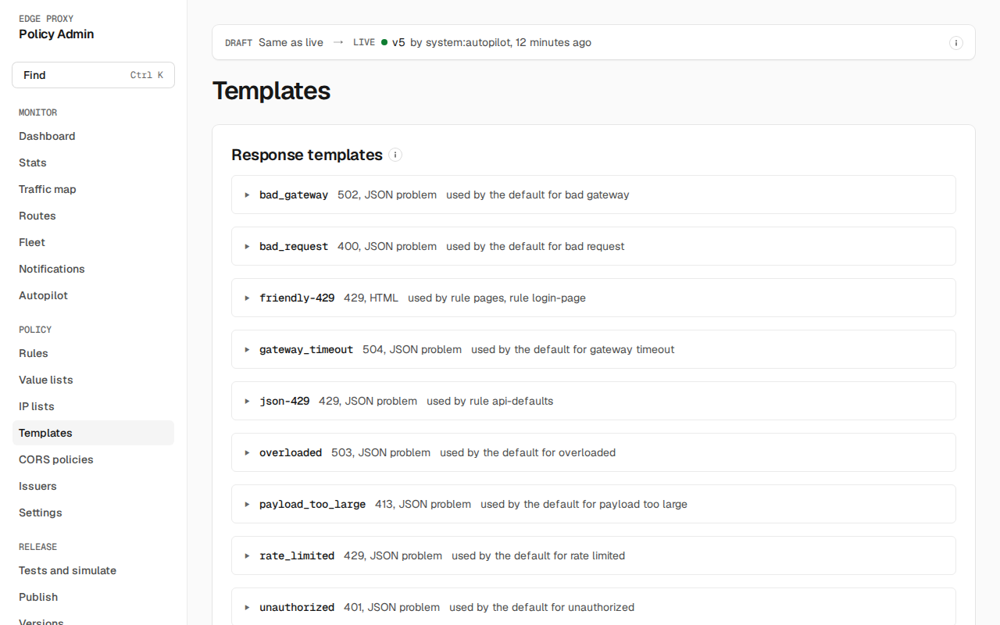

# Response templates

Use response templates to change what a client gets when the edge itself refuses or fails a request: the 429 for a rate limit, the 401 for a missing token, the 502 when the upstream is down. An answer your upstream sends is never replaced by a template.



A template is a status and one to four bodies, one per content type. Every kind of edge answer has a default template, and an access rule can pick another one for the requests it matches.

## What the edge answers itself

Each kind has a fixed status. A template can serve a kind only if it has that status. Kinds are the keys of `global.defaults.responses` and of a rule's `settings.responses`, which map them to template names. `global.responses` itself is keyed by template name.

| Kind | Status | Sent when |
|---|---|---|
| `bad_request` | 400 | The request did not come through a trusted proxy or lacks the ingress secret, the client IP header is missing, repeated or unparseable, the method is not uppercase, the path is ambiguous or not an absolute path, the body was not read within `body_read_timeout`, the body could not be read (broken chunk framing), or a rate limit rule with `on_missing_key: reject` has no value for its key |
| `unauthorized` | 401 | A route requires a token and the request has none, or the token is invalid. See [Issuers and tokens](tokens.md) |
| `forbidden` | 403 | An access rule with `"block": "block"` matched, or the client IP is banned. See [Blocking requests](policy.md#blocking-requests) |
| `payload_too_large` | 413 | The request's `Content-Length` is over `body_limit`, or the body grew past it while being read |
| `rate_limited` | 429 | A blocking rate limit rule found the request over its limit, or the per-IP backstop did. See [Rate limiting](rate-limiting.md) |
| `bad_gateway` | 502 | The upstream could not be reached or the exchange failed before it answered: connection refused or reset, or the load balancer refused the TLS handshake for the `Host` |
| `unavailable` | 503 | A rate limit rule with `fail_mode: closed` could not get an answer from Valkey, no policy is loaded yet, or the edge recovered from an internal error |
| `overloaded` | 503 | The edge already has as many requests, or as many streams in flight as it is set to allow (a stream is a WebSocket or a Server-Sent Events request) |
| `gateway_timeout` | 504 | The upstream did not answer within `upstream_timeout`, or a network timeout hit while reaching it |

Every one of these answers also carries:

- `Cache-Control: no-store` and the request's `X-Request-Id`.
- `Content-Type` and `Content-Length` of the chosen body.
- `Retry-After` (whole seconds, at least 1) on `rate_limited`, `unavailable` and `overloaded`.
- `WWW-Authenticate: Bearer` on `unauthorized`, or `Bearer error="invalid_token"` when a token was sent.
- `Vary: Accept` when the template has more than one body. A `Vary: Origin` that [CORS](cors.md) set stays, and `Accept` is added to it.
- The `RateLimit` and `RateLimit-Policy` headers when a rate limit rule asked for them, and the Cross-Origin Resource Sharing (CORS) headers when the route has a [CORS policy](cors.md). An answer sent before the access rules ran has no CORS headers.

!!! note "No policy loaded"
    An edge that has no policy yet answers 503 in plain text, `Service Unavailable`, with no template. It is not ready in that state (`/readyz` waits for the first policy), so a load balancer does not send it traffic.

## Shape of a template

A template lives under `global.responses`, named by you: 1 to 64 characters of `a-z 0-9 - _`, starting with a letter or digit.

| Field | Holds |
|---|---|
| `status` | 400 to 599. When the template serves a kind, it must equal that kind's status |
| `content_type` | The default body's content type: `application/json`, `application/problem+json`, `text/html; charset=utf-8` or `text/plain; charset=utf-8`, written exactly so |
| `body` | The default body, up to 32 KiB |
| `variants` | Up to three more bodies, each with a `content_type` and a `body`. Each content type can appear once in a template |

A JSON content type needs a body that is valid JSON after the placeholders are filled in. A body holds these placeholders, and nothing else may be written inside `{{ }}`:

| Placeholder | Value |
|---|---|
| `{{status}}` | The template's status |
| `{{retry_after}}` | Seconds to wait, at least 1. `rate_limited` fills in the limiter's wait, and every other kind sends 1 |
| `{{request_id}}` | The request's `X-Request-Id`: letters, digits, `.`, `_` and `-`, so it is safe in JSON and HTML |

Values go in as they are, with no escaping. In a JSON body write a number placeholder bare (`"retry_after":{{retry_after}}`) and wrap `{{request_id}}` in quotes. A `{{` without a well-formed placeholder is refused at save, so a body can't hold a literal `{{`.

## Which body is sent

A template with one body sends it. With more than one, the edge reads the request's first `Accept` header and sends the body it prefers.

- Each body takes the q-value of the most specific `Accept` range that matches its media type: an exact type beats `type/*`, which beats `*/*`. A missing q-value is 1.
- The highest q-value above 0 wins. A tie goes to the earlier body. When no body matches, the default is sent.
- A range with a malformed q-value is dropped.
- A missing `Accept`, `*/*` and an `Accept` header over 256 bytes (not parsed at all) all send the default. The edge never answers 406.
- The response carries `Vary: Accept`, so a cache in front keys on it.

Put the body that API clients should get first: `fetch` and curl send `*/*` or nothing and get the default, while a browser opening a page lists `text/html` first. A template with more than one body needs edges that read schema 14, so admin refuses the publish (409) while a live edge reads an older schema, and names that edge.

## Starter templates

A new draft has one template per kind, named after the kind (`rate_limited`, `forbidden` and so on), and each kind uses its own as its default. Each template has three bodies:

- `application/problem+json` as the default, such as `{"status":429,"title":"Too Many Requests"}`.
- A minimal HTML page, with the status, a heading, a sentence and the request ID.
- A plain text version of the same.

A published policy keeps the bodies it has. On **Templates**, **Add default HTML and text pages** adds the missing HTML and text bodies to the templates that lack them and leaves existing bodies as they are.

## Choose a template for a kind

Two settings pick which template answers a kind:

- `global.defaults.responses` maps every kind to a template name. Every kind needs an entry, and the template must have the kind's status.
- A [config rule](policy.md#phases)'s `settings.responses` maps some kinds to other templates for the requests the rule matches, for example `{"settings": {"responses": {"rate_limited": "api-429"}}}`.

Rules apply top to bottom and the last matching rule that names a kind wins, one kind at a time. Two rules can each set a different kind.

These answers always use the defaults, because they are sent before any rule is evaluated: `overloaded`, and the `bad_request` answers for an untrusted peer, a missing ingress secret, the client IP header, the method and the path. During a canary they come from the active version.

A template that no kind defaults to and no rule names has no effect, and saving warns about it.

## Edit templates in the UI

On **Templates** (under **Policy**):

1. **Response templates** lists each template with its status, its body types and what uses it. Give a name under **New template name** and press **Add template**, or open one.
2. In a template, pick the **Status** (each is labelled with the kinds that use it). Each body is a tab, default first. Pick the **Content type**, edit the body and read the **Preview**, which fills in sample values (`retry_after` as 1, `request_id` as `r1`) and shows HTML in a frame that runs no scripts.
3. **Add content type…** adds a body started from the kind's default. **Make default** moves a tab to the front. **Remove** followed by the body's type, such as **Remove HTML**, deletes a body, and **Delete template** deletes the template.
4. **Default response per kind** picks the template for each kind and says when the edge sends it. Only templates with the kind's status are offered, so add a template with that status first.
5. In an access rule's **Then** form, **Response templates** picks other templates for that rule's requests. Hover a kind to read when the edge sends it.
6. **Save draft**, check **Tests and simulate**, then publish.

**Edit Response templates as JSON** and **Edit Default response per kind as JSON** show the same sections as JSON. Admin checks every edit as a save would, and each problem appears under its field.

## Limits

| Limit | Value |
|---|---|
| Templates | 100 |
| Bodies per template | 4, one per content type |
| Body size | 32 KiB |
| Template name | 1 to 64 of `a-z 0-9 - _`, starting with a letter or digit |
| `Accept` header read | 256 bytes |

## Example: JSON for the API, a page for browsers

API routes answer a rate limit with a small JSON body, and a browser that reaches one gets a short page. Every other route keeps the starter 429.

**Rule** · Access rule, ID `api-json-429`

When:

```text
starts_with(http.request.uri.path, "/api/")
```

Then:

```json
{"settings": {"responses": {"rate_limited": "api-429"}}}
```

**Also set** on **Templates**, one template (`global.responses`). In **Edit Response templates as JSON**, add it beside the templates already there, because the editor replaces the whole section:

```json
{
  "api-429": {
    "status": 429,
    "content_type": "application/json",
    "body": "{\"error\":\"slow_down\",\"retry_after\":{{retry_after}}}",
    "variants": [
      {
        "content_type": "text/html; charset=utf-8",
        "body": "<h1>Slow down</h1><p>Try again in {{retry_after}}s."
      }
    ]
  }
}
```

**Prove it** with this policy test, added as described in [Policy tests](policy.md#policy-tests):

```json
[
  {
    "name": "API paths answer 429 with the JSON template",
    "request": {"host": "api.example.com", "path": "/api/orders"},
    "expect": {
      "config_rules": ["api-json-429"],
      "settings": {"responses": {"rate_limited": "api-429"}}
    }
  },
  {
    "name": "other paths keep the starter 429 template",
    "request": {"host": "api.example.com", "path": "/pricing"},
    "expect": {
      "config_rules": [],
      "settings": {"responses": {"rate_limited": "rate_limited"}}
    }
  }
]
```

**Watch out**

- A policy test checks which template a kind uses. It does not render a body or check a status or header. Trip the limit on a test route and read the answer with curl: `-H 'Accept: text/html'` gets the page, with `Content-Type: text/html; charset=utf-8` and `Vary: Accept`, and no `Accept` gets the JSON.
- See [Policy tests](policy.md#policy-tests) for how `responses` is checked.
- The second test assumes the starter default, a template named `rate_limited`. A policy that names its defaults differently needs that name.
- The rule changes the 429 from a blocking rate limit rule and from the per-IP backstop alike.

More examples: [Browsers cases](cases/browsers.md#answer-errors-as-json-for-apps-and-as-a-page-for-browsers) and [JSON answers on API paths](bots.md#json-answers-on-api-paths).
