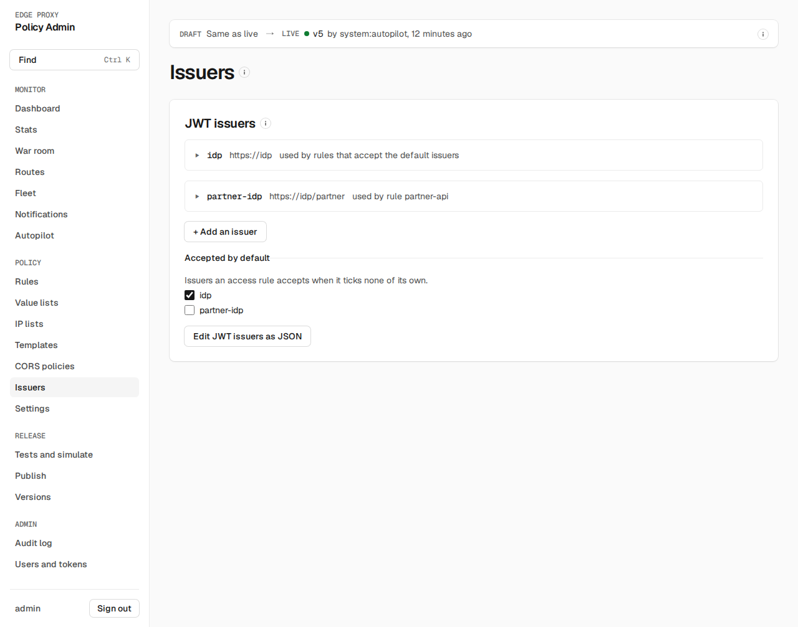

# Issuers and tokens

Use issuers to say whose tokens the edge trusts, and an access rule's `auth` setting to say which routes need one. The edge verifies each JSON Web Token (JWT) against the issuer's public keys and answers 401 to a request whose token fails, before it reaches your upstream. The upstream should still validate tokens itself.



An issuer is an identity provider. You list issuers under `auth.issuers`, and an access rule's `settings.auth` picks a mode and which issuers it accepts.

## Define an issuer

`auth` holds the issuers and the ones accepted by default:

| Field | Holds |
|---|---|
| `issuers[].id` | The name rules use for the issuer: 1 to 64 characters of `a-z 0-9 - _`, starting with a letter or digit. Unique |
| `issuers[].issuer` | The token's `iss` claim, exactly, often with a trailing slash such as `https://example.us.auth0.com/`. 1 to 256 characters. Unique, because the token's `iss` picks the issuer |
| `issuers[].audiences` | 1 to 100 values of the token's `aud` claim to accept, each 1 to 256 characters |
| `issuers[].jwks_url` | The `https` address of the issuer's public keys, usually ending in `/.well-known/jwks.json`. It needs a host, and no user name or fragment |
| `issuers[].algorithm` | The one signing algorithm the issuer uses: `RS256`, `RS384`, `RS512`, `PS256`, `PS384`, `PS512`, `ES256`, `ES384`, `ES512` or `EdDSA` |
| `default_accepted` | IDs of the issuers a rule accepts when it lists none of its own |

There are at most 100 issuers.

The algorithm list never includes the Hash-based Message Authentication Code (HMAC) algorithms (`HS256` and the like): verifying one needs a shared secret, and that would have to sit in the policy every edge reads. The edge accepts only the issuer's configured algorithm, so a token can't pick a weaker one. A key must also fit the algorithm: an RSA key for `RS*` and `PS*`, an elliptic-curve key on the matching curve for `ES*`, an Ed25519 key for `EdDSA`, and a key that names its own `alg` must name the configured one.

## Require or accept a token on a route

An access rule's `settings.auth` sets a mode and, optionally, the issuers it accepts:

```json
{"settings": {"auth": {"mode": "required", "accepted": ["partners"]}}}
```

| `mode` | UI label | Meaning |
|---|---|---|
| `none` | No token needed | The edge doesn't look at any token |
| `optional` | Verify a token if one is sent | No token passes. A token that is sent must verify |
| `required` | Require a valid token | Only a request with a valid token passes |

- `accepted` lists issuer IDs. A rule that lists none accepts `auth.default_accepted`, and a rule with neither is refused at save. `none` with an `accepted` list is refused too.
- A token from an issuer the rule doesn't accept is invalid, as if it had a bad signature.
- Rules apply top to bottom, and the last matching rule that sets `auth` replaces mode and `accepted` together.
- The access phase runs before the token check, so access rules can't match on claims. Rate limit and header rules can.

## What the edge checks

The edge reads the token from `Authorization: Bearer <token>`. The scheme name is not case sensitive. Another scheme counts as no token. An empty token, a token over 4096 bytes, or more than one `Authorization` header is an invalid token.

A token is valid when all of these hold:

1. Its `iss` names an issuer the rule accepts. The edge reads `iss` before verifying the signature, only to pick the issuer.
2. Its signature verifies with a key from that issuer's key set: the key whose `kid` the token names, or the only key when the token has no `kid` and the set has one.
3. It is signed with the issuer's configured `algorithm`.
4. Its `iss` equals the issuer's `issuer`.
5. It has an `aud`, and any one of its audiences is in the issuer's `audiences`.
6. It has an `exp` that has not passed. A token with no `exp` is invalid.
7. Its `nbf`, when present, has passed. `iat` is not checked.

The time checks allow 60 seconds of leeway for clock skew.

A token that verified is remembered for up to 10 minutes, and never past its `exp` plus the 60 seconds, so repeat requests skip the signature check. The rule's `accepted` list is still applied to every request, and a key refresh or a change to the issuer discards what was remembered.

## When the token is missing or bad

| The request has | `none` | `optional` | `required` |
|---|---|---|---|
| No `Authorization` header, or another scheme | Passes | Passes, no claims | 401 |
| A valid token | Passes, not checked | Passes with claims | Passes with claims |
| An invalid token | Passes, not checked | 401 | 401 |
| A token naming an accepted issuer whose keys were never fetched | Passes, not checked | Passes, no claims | Passes, no claims |

A 401 uses the `unauthorized` [template](templates.md) and `Cache-Control: no-store`. Its `WWW-Authenticate` is `Bearer` when no token was sent and `Bearer error="invalid_token"` when one was.

!!! warning "Keys never fetched"
    If the edge has never obtained an issuer's keys, a token that names that issuer passes without claims, even on a `required` route, so an identity provider (IdP) outage when you first add an issuer can't take the site down. The decision is made from the token's unverified `iss`, so the edge verifies nothing about the token. The edge counts it as `edge_auth_total{result="pass_no_keys"}`, which is worth an alert. Keep validating tokens in the upstream: the edge forwards `Authorization` unless a forward allowlist leaves it out.

## How keys are fetched and rotated

The issuer's key set (JSON Web Key Set, JWKS) comes from its `jwks_url`, fetched by both admin and every edge:

- **Admin**, on its leader replica, fetches the keys of every issuer in the draft, the active version and any canary when it starts and every 10 minutes. It stores a key set only when it changed, and audits that as `jwks.keys_changed`. A failed fetch keeps the last good keys. When you save a draft, admin also fetches the keys of any issuer that has none yet, so a mistyped URL shows as a warning at save.
- **Edges** receive admin's keys with the policy, and a changed key set reaches them on their next poll, with no publish. Each edge also fetches the keys itself every 10 minutes.
- **A token with an unknown `kid`** makes the edge fetch again, at most once per 30 seconds per issuer. Only requests that carry that `kid` wait for it, up to 1 second, so a key rotation at the identity provider (IdP) needs no action from you.
- **Keys are only replaced.** The edge keeps whichever copy is newest, a snapshot never overwrites newer keys the edge fetched itself, and a key set with no usable signing key is refused instead of replacing good keys. Keys that can't verify are skipped: other `use` values than `sig`, unsupported key types, and RSA keys under 2048 bits. A key set may be 64 KiB.
- **Keys belong to the issuer ID and URL together.** Changing `jwks_url` starts over with no keys, and the never-fetched behavior above applies until the first fetch. The first token for that issuer starts one.

Publishing is refused with the message `Issuer keys never fetched` when a `required` rule accepts an issuer whose keys admin has never fetched. A publisher can override it with a reason. See [Publish and roll back](publishing.md#publish) and, for an IdP outage, [Identity provider down](../operate/runbooks.md#identity-provider-down).

Every fetch passes the server-side request forgery (SSRF) guard: `https` only, no proxy, redirects only to the same host, and a refusal when the address actually dialed is loopback, private, link-local, shared or otherwise not public. A private host needs listing in `JWKS_ALLOWED_HOSTS`, on admin and on the edge, see [Edge settings](../deploy/edge.md#policy-source).

## Use the claims

After a token verifies, its claims are available in rules that run later:

- `http.request.jwt.claims` in [rate limit and header rule expressions](../reference/expressions.md), and `jwt_claim:<name>` as a rate limit key part, see [Rate limiting](rate-limiting.md). A request with no verified token has no value, and the rule's `on_missing_key` applies.
- `{{jwt_claim:<name>}}` in a header rule's `value`, empty without a verified token.
- The upstream gets `X-Edge-Auth-Issuer`, the issuer's `id` (not its `iss`), and `X-Edge-Auth-Sub`, the `sub` claim when there is one. Both come only from a verified token, and the edge removes any copy the client sent. See [Headers your upstream can trust](policy.md#headers-your-upstream-can-trust).

A claim has one or more string values: strings, numbers and booleans, or lists of them. Objects and nulls have no value. A rate limit key part and a `{{jwt_claim:<name>}}` placeholder use the first value.

## Exemptions and the kill switch

- A [trusted client](policy.md#trusted-clients) or an [always-allow](policy.md#always-allow) rule makes `required` act as `optional`: no token is needed, but one that is sent is still verified, and a bad one gets 401.
- **Settings → Kill switch → Disable JWT checks** (`kill_switch.auth`) sets every route's mode to `none`, so no token is checked, and no claims or `X-Edge-Auth-*` headers exist even for valid tokens. It takes effect after **Save draft** and **Publish**. See [Stop rate limiting, blocking or JWT checks now](../operate/runbooks.md#stop-rate-limiting-blocking-or-jwt-checks-now).

## Edit issuers in the UI

On **Issuers** (under **Policy**):

1. **+ Add an issuer** adds one. Each issuer is one line with its `iss` and what uses it, such as `used by rule orders-need-token`, or `not used`. Open it to edit.
2. Fill in **ID**, **Issuer**, **Audiences** (one field per value), **Keys URL** and **Signing algorithm**. **Remove issuer** followed by its ID deletes it from the draft.
3. Under **Accepted by default**, tick the issuers a rule accepts when it ticks none.
4. In an access rule's **Then** form, **Token check** picks the mode, and **Accept tokens from** ticks issuers. Tick none to use the defaults.
5. **Save draft**. Saving fetches the keys of an issuer that has none, and warns about one no rule accepts and that is not a default. Then check **Tests and simulate** and publish.

**Edit JWT issuers as JSON** shows `auth` as JSON. Admin checks every edit as a save would, and each problem appears under its field.

## Example: tokens on the orders API, with the tenant sent upstream

Requests under `/orders/` need a token from the `main` issuer, and the upstream receives the token's `tenant` claim as a header.

**Rule** · Access rule, ID `orders-need-token`

When:

```text
starts_with(http.request.uri.path, "/orders/")
```

Then:

```json
{"settings": {"auth": {"mode": "required", "accepted": ["main"]}}}
```

**Rule** · Request header rule, ID `orders-tenant`

When:

```text
starts_with(http.request.uri.path, "/orders/")
```

Then:

```json
{"ops": [{"op": "set", "name": "X-Tenant-Id", "value": "{{jwt_claim:tenant}}"}]}
```

**Also set** on **Issuers**, the identity provider and the default (`auth`):

```json
{
  "issuers": [
    {
      "id": "main",
      "issuer": "https://login.example.com/",
      "audiences": ["https://api.example.com"],
      "jwks_url": "https://login.example.com/.well-known/jwks.json",
      "algorithm": "RS256"
    }
  ],
  "default_accepted": ["main"]
}
```

**Prove it** with this policy test, added as described in [Policy tests](policy.md#policy-tests):

```json
[
  {
    "name": "no token is refused",
    "request": {"host": "api.example.com", "path": "/orders/1"},
    "expect": {"rejected": "auth", "config_rules": ["orders-need-token"]}
  },
  {
    "name": "a verified token gets in and its tenant reaches the upstream",
    "request": {
      "host": "api.example.com",
      "path": "/orders/1",
      "jwt_claims": {"sub": "user-42", "tenant": "acme"}
    },
    "expect": {
      "rejected": "",
      "settings": {"auth_mode": "required", "accepted": ["main"]},
      "upstream_headers": {"X-Tenant-Id": "acme"}
    }
  },
  {
    "name": "other paths need no token",
    "request": {"host": "api.example.com", "path": "/products"},
    "expect": {"rejected": "", "settings": {"auth_mode": "none"}}
  }
]
```

**Watch out**

- A policy test stands `jwt_claims` in for a verified token. It can't check a signature, an `iss`, an `aud`, an expiry or an issuer a rule doesn't accept, and it doesn't produce the `X-Edge-Auth-*` headers or the 401 headers. Check those with a real token and curl: `curl -si https://api.example.com/orders/1 -H "Authorization: Bearer $TOKEN"`.
- The claims stand in only where the route's mode isn't `none`, which is why the header rule's test needs the route to require a token.
- Test a bad token on a staging edge: an expired token, one with the wrong `aud`, and one from another issuer each get 401 with `WWW-Authenticate: Bearer error="invalid_token"`.
- Even on this `required` route, a request can reach the upstream with `X-Tenant-Id` empty: a [trusted](policy.md#trusted-clients) or [always-allowed](policy.md#always-allow) client, a token from an issuer whose [keys were never fetched](#when-the-token-is-missing-or-bad), or the [kill switch](#exemptions-and-the-kill-switch). The upstream must refuse an empty value and validate the token itself.

More examples: [Access cases](cases/access.md#require-sign-in-on-account-pages), [accepting only one issuer on a route](cases/access.md#accept-only-the-partner-issuer-on-partner-routes) and [sending the tenant upstream](cases/headers.md#send-the-tenant-from-the-token-to-the-upstream).
