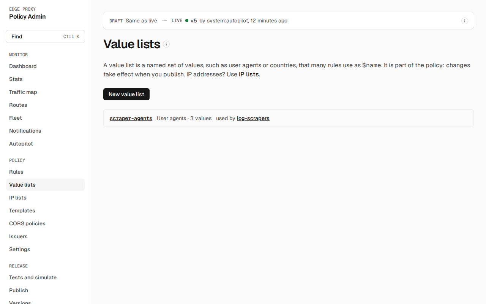

# Value lists



A value list is a named set of values for one request field, such as user agents, URL paths or countries. Many rules name it with `$name`, and you edit the values once. It is kept in the policy at `global.lists` and managed on the **Value lists** page.

## Value list, inline set or IP list

| Use | When |
|---|---|
| `in {...}` or a single value in the rule | One rule needs the values, or there are only a few |
| A value list | Several rules share the values, or the set is long (1 to 10,000 values) and you want to edit it in one place |
| An [IP list](ip-lists.md) | The values are addresses or ranges. A value list is refused on an address field |

A value list is part of the policy: a change takes effect when you publish, with the rest of the draft. An IP list is saved on its own and reaches the edges within about a minute, with no publish.

## Use it in an expression

A condition names a value list with `$name` where a value or a list would go:

```text
http.user_agent contains $bad-agents
ip.src.country in $eu-only
not starts_with(http.request.uri.path, $public-paths)
```

`in $name` matches when the field equals any value of the value list, as `in {...}` does. A value list replaces the whole set, so a bare `$name` inside `{...}` is a syntax error; quote it for a literal.

- A pattern operator (`contains`, `starts_with`, `ends_with`, `wildcard`, `strict_wildcard`, `matches`) matches when any value matches, and its negated form when none does.
- A value list belongs to one field and is used only with that field.
- Its values are checked as that field's when the policy is saved and again where a rule uses it, with that rule's operator: a URL paths value list holding `.php` works with `ends_with` and is refused with `in`, since a path starts with `/`.
- `matches` also needs the deployment to set `ALLOW_REGEX=true`, as it does with a value written in the rule.

## Kinds and operators

| Value list kind | Field | Operators |
|---|---|---|
| User agents | `http.user_agent` | `in` and the pattern operators |
| URL paths | `http.request.uri.path` | `in` and the pattern operators |
| Hostnames | `http.host` | `in` and the pattern operators |
| Referers | `http.referer` | `in` and the pattern operators |
| Header values | `http.request.headers` | `in` and the pattern operators |
| Cookie values | `http.request.cookies` | `in` and the pattern operators |
| Query values | `http.request.uri.args` | `in` and the pattern operators |
| JSON Web Token (JWT) claim values | `http.request.jwt.claims` | `in` and the pattern operators |
| Countries | `ip.src.country` | `in`, `not_in` |
| Continents | `ip.src.continent` | `in`, `not_in` |
| Autonomous System (AS) numbers | `ip.src.asnum` | `in`, `not_in` |
| JA4 fingerprints | `tls.client.ja4` | `in`, `not_in` |
| JA3 fingerprints | `tls.client.ja3` | `in`, `not_in` |

The last five kinds hold exact values, so they take only `in` and `not_in`, and a value is checked as an `in` value. Any other kind is checked as a `contains` value. Keyed fields (headers, cookies, query arguments, claims) still name the key in the condition, such as `http.request.headers["x-api-key"] in $keys`. Any other field, including every address field, takes values written in the condition and is refused with a value list.

## Create and edit

The **Value lists** page (Policy, Value lists) shows each value list with its kind, its number of values and the rules that use it, or `not used`. A list with problems in the draft is marked `has problems`. Everyone who can read the config sees the page. Changing needs write access to the config.

1. **New value list**, then give it a **Name**: 1 to 64 lowercase letters, digits, `-` and `_`, starting with a letter or digit, such as `bad-agents`.
2. Under **Holds**, choose the kind. It decides which field the list serves.
3. Under **Values, one per line**, type the values. The counter shows how many of 10,000 you have used. A blank line in the middle is refused and named by its line, as is a repeat or a value the field can never match.
4. **Apply to draft**. It is off until the name is free, a kind is chosen and the check of the draft finds no problem, and the page says why.
5. **Save draft**, then **Publish**, as for any [policy change](publishing.md).

Two shortcuts reach the same list:

- In a rule, a condition on a field that takes a value list has **Type values** and **Use a list**. **Use a list** shows **Pick a list** with the lists of that field's kind. With no list yet, its link opens **New value list** for that field.
- After you type values in a rule, **Save as list** names them as a value list and puts `$name` in the condition. The name is checked as you type.

A value list's own page also has **Delete value list**. It leaves the draft, and a rule that still uses it shows a problem until you change the rule.

### Rename and change the kind

Renaming a value list changes `$name` in every rule that uses it, in any phase, in the same draft edit, and the page names those rules first. A name another value list has is refused.

The kind cannot change while a rule uses the list, since the rule reads its values as that field. A change to the values that would break a rule, such as a value that its operator refuses, is shown under **This change breaks rules** with a link to each rule, and **Apply to draft** stays off until you fix them.

## Warnings and refusals

- A value list that no rule uses is warned about (`no rule uses it as $name, so it has no effect`). It still saves and publishes.
- A rule that names a value list that does not exist is refused, so deleting one a rule still uses is refused at that rule until you change it.
- A rule that names a value list of another field, or uses an operator the kind does not take, is refused at that rule.
- A value list is refused on an address field: `addresses go in an IP list: match it with client.ip_lists`.
- An autopilot rule may not name a value list: the values are a person's, and naming one would stop the value list being removed.
- A config with any value list needs schema 13 edges, and admin waits for them before it activates the version.

## Limits

| Limit | Value |
|---|---|
| Value lists | 100, each of 1 to 10,000 values |
| A name | 64 bytes |
| Conditions | 32 per rule. With a pattern operator, each value of a value list counts as one; `in $name` counts once |
| Value list values across every use | 200,000, since each use is compiled on its own |

## Example

The value list `bad-agents` holds the scanner names, and the access rule `block-bad-agents` refuses a request whose user agent contains any of them. In `global.lists`:

```json
{
  "lists": {
    "bad-agents": {
      "field": "http.user_agent",
      "values": ["sqlmap", "nikto", "masscan"]
    }
  }
}
```

The rule, in `config_rules`. Its expression is stored as an abstract syntax tree (AST), where the value is `{"list": "bad-agents"}` in place of a string:

```json
{
  "id": "block-bad-agents",
  "expression": {
    "combinator": "and",
    "rules": [
      {
        "field": "http.user_agent",
        "operator": "contains",
        "value": {"list": "bad-agents"}
      }
    ]
  },
  "settings": {"block": "block"}
}
```

In production, start with `"block": "log"` and switch to `block` when **Stats** shows only the traffic you meant to catch ([Log first, block later](cases/access.md#log-first-block-later)). The case [Block a shared list of bad user agents](cases/access.md#block-a-shared-list-of-bad-user-agents) has the text form of the same rule.

With `block` set, this policy test proves it:

```json
[
  {
    "name": "a scanner is blocked",
    "request": {
      "host": "www.example.com",
      "path": "/",
      "headers": {"User-Agent": "sqlmap/1.8"}
    },
    "expect": {"rejected": "blocked", "config_rules": ["block-bad-agents"]}
  },
  {
    "name": "a browser passes",
    "request": {
      "host": "www.example.com",
      "path": "/",
      "headers": {"User-Agent": "Mozilla/5.0 Firefox/133.0"}
    },
    "expect": {"rejected": ""}
  }
]
```

See [Expressions](../reference/expressions.md) for the syntax and every operator.
